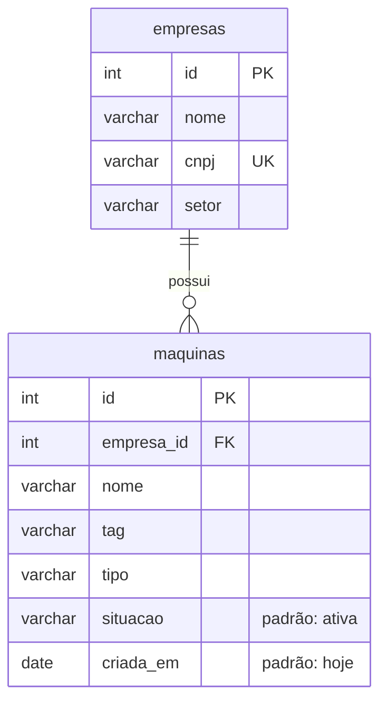

# Parte III: Database First (guia de demonstração)

Este guia explica o que é Database First e traz o roteiro para demonstrar a técnica ao professor. É um projeto à parte, só para a demonstração: ele não faz parte do código do Driftor.

## 1. O que é Database First

Database First é uma forma de trabalhar com banco de dados em que **o banco vem primeiro e o código sai dele**. As tabelas já existem, e uma ferramenta lê a estrutura do banco (tabelas, colunas, tipos, chaves e relacionamentos) e gera automaticamente as classes da aplicação. Se o banco mudar, basta rodar a ferramenta de novo para atualizar as classes.

O caminho oposto é o Code First: o programador escreve as classes e a ferramenta cria as tabelas a partir delas (migrations).

| | Database First | Code First |
|---|---|---|
| O que vem primeiro | O banco | As classes |
| Quem gera o quê | A ferramenta gera as classes a partir das tabelas | A ferramenta gera as tabelas a partir das classes |
| Quando faz sentido | Banco que já existe, banco de outro sistema, banco mantido por um DBA, integração com sistema legado | Sistema novo, em que o time controla o modelo desde o início |

**Relação com reuso:** o esquema do banco é um ativo que já existe e é reaproveitado. Em vez de reescrever à mão as classes que espelham cada tabela, um gerador de código produz essas classes e até as telas de cadastro. É reuso gerativo: o conhecimento está no banco e no gerador, e o código é produzido a partir deles.

## 2. Ferramentas

| Ferramenta | Para que serve |
|---|---|
| .NET 8 SDK | Plataforma onde o projeto roda |
| Entity Framework Core (EF Core) | ORM do .NET: faz a ponte entre as classes C# e as tabelas |
| Npgsql | Provedor do EF Core para PostgreSQL (o banco no Supabase) |
| `dotnet ef dbcontext scaffold` | **O comando Database First.** Lê o banco e gera as classes (entidades) e o `DbContext` |
| `dotnet aspnet-codegenerator controller` | Usa as classes geradas para criar as telas de CRUD em ASP.NET MVC: listar, criar, editar, detalhar e excluir |

## 3. O banco

Um schema próprio, `dbfirst`, no Postgres do Supabase, com duas tabelas e os dados de demonstração das empresas clientes. O script está em [`banco.sql`](banco.sql).



São 4 empresas (Alfa, Beta, Gama e Delta) e 6 máquinas (4 da Alfa e 2 da Gama).

## 4. Preparação (uma vez, antes da aula)

### 4.1 Banco no Supabase

1. No Supabase, abra o **SQL Editor**, cole o conteúdo de `banco.sql` e rode.
2. Ainda no SQL Editor, crie o usuário da demonstração, restrito ao schema `dbfirst`. Troque `SUA_SENHA` por uma senha sua e não a coloque em nenhum arquivo:

   ```sql
   create role dbfirst login password 'SUA_SENHA';
   grant usage on schema dbfirst to dbfirst;
   grant select, insert, update, delete on all tables in schema dbfirst to dbfirst;
   ```

3. No botão **Connect** do projeto, copie o host do **Session pooler** (algo como `aws-0-sa-east-1.pooler.supabase.com`).

### 4.2 Ferramentas no PC (PowerShell)

```powershell
winget install Microsoft.DotNet.SDK.8
dotnet tool install -g dotnet-ef --version 8.0.11
dotnet tool install -g dotnet-aspnet-codegenerator --version 8.0.7
```

Feche e abra o PowerShell para que os comandos `dotnet ef` e `dotnet aspnet-codegenerator` sejam encontrados.

### 4.3 Conexão

A conexão fica numa variável de ambiente, para a senha não ir para o código. Em cada PowerShell novo:

```powershell
$env:ConnectionStrings__Driftor = "Host=HOST_DO_POOLER;Port=5432;Database=postgres;Username=dbfirst.ydjtrcjxhtmygytmebrk;Password=SUA_SENHA;SSL Mode=Require"
```

O `__` no nome da variável é como o .NET lê a chave `ConnectionStrings:Driftor` do `appsettings.json`.

### 4.4 Ensaio

Faça a demonstração inteira uma vez antes da aula, numa pasta de teste. A primeira execução baixa pacotes e demora mais.

## 5. Roteiro da demonstração

A pasta [`DriftorDbFirst/`](DriftorDbFirst/) tem o resultado final, para consulta. Na aula, você gera tudo do zero numa pasta vazia.

### Passo 1: mostrar o banco

Abra o **Table Editor** do Supabase no schema `dbfirst` e mostre as tabelas `empresas` e `maquinas`, com a coluna `empresa_id` ligando uma à outra.

> **Fala:** "Este é o banco do Driftor que vamos usar: duas tabelas, empresas e máquinas, já com dados. Nenhuma linha de código C# existe ainda. No Database First, o código vai sair deste banco."

### Passo 2: criar um projeto MVC vazio

```powershell
dotnet new mvc -n DriftorDbFirst
cd DriftorDbFirst
dotnet add package Npgsql.EntityFrameworkCore.PostgreSQL --version 8.0.11
dotnet add package Microsoft.EntityFrameworkCore.Design --version 8.0.11
dotnet add package Microsoft.EntityFrameworkCore.Tools --version 8.0.11
dotnet add package Microsoft.EntityFrameworkCore.SqlServer --version 8.0.11
dotnet add package Microsoft.VisualStudio.Web.CodeGeneration.Design --version 8.0.7
```

No arquivo `DriftorDbFirst.csproj`, troque `<Nullable>enable</Nullable>` por `<Nullable>disable</Nullable>` (o motivo está na seção 6).

> **Fala:** "Este é um projeto web vazio do ASP.NET MVC. Instalei o Entity Framework Core e o provedor do PostgreSQL. A pasta Models só tem a classe padrão do template."

### Passo 3: gerar as classes a partir do banco (o Database First)

```powershell
dotnet ef dbcontext scaffold $env:ConnectionStrings__Driftor Npgsql.EntityFrameworkCore.PostgreSQL --schema dbfirst --context DriftorContext --output-dir Models --context-dir Data --no-onconfiguring
```

O que cada parte faz:

- `$env:ConnectionStrings__Driftor`: de qual banco ler.
- `Npgsql.EntityFrameworkCore.PostgreSQL`: o provedor, que sabe ler o PostgreSQL.
- `--schema dbfirst`: lê só as tabelas desse schema.
- `--context DriftorContext --context-dir Data`: nome e pasta da classe de contexto.
- `--output-dir Models`: pasta das entidades.
- `--no-onconfiguring`: não grava a conexão no código; ela vem da configuração.

Abra os arquivos gerados:

- `Models/Empresa.cs` e `Models/Maquina.cs`: uma classe por tabela, uma propriedade por coluna. A coluna `empresa_id` virou `EmpresaId`, e a chave estrangeira virou a propriedade `Empresa` em `Maquina` e a lista `Maquinas` em `Empresa`.
- `Data/DriftorContext.cs`: o mapeamento completo. Ele tem nomes das tabelas e colunas, tamanhos (`HasMaxLength(80)`), a chave única do CNPJ, os valores padrão do banco (`'ativa'`, `CURRENT_DATE`) e o relacionamento entre as tabelas.

> **Fala:** "Com um comando, o Entity Framework leu o banco e gerou uma classe para cada tabela. Aqui em Maquina estão as colunas da tabela, e a chave estrangeira empresa_id virou uma referência para a classe Empresa. No DriftorContext estão os tamanhos, o CNPJ único e os valores padrão, todos vindos do banco."

### Passo 4: registrar o contexto na aplicação

Em `Program.cs`, logo depois de `var builder = WebApplication.CreateBuilder(args);`, acrescente:

```csharp
builder.Services.AddDbContext<DriftorDbFirst.Data.DriftorContext>(options =>
    options.UseNpgsql(builder.Configuration.GetConnectionString("Driftor")));
```

E no topo do arquivo:

```csharp
using Microsoft.EntityFrameworkCore;
```

Este é o único trecho escrito à mão. Ele diz à aplicação qual banco usar.

### Passo 5: gerar as telas de CRUD

```powershell
dotnet aspnet-codegenerator controller -name EmpresasController -m Empresa -dc DriftorContext --relativeFolderPath Controllers --useDefaultLayout
dotnet aspnet-codegenerator controller -name MaquinasController -m Maquina -dc DriftorContext --relativeFolderPath Controllers --useDefaultLayout
```

Para cada tabela, o gerador cria um controller com as cinco ações (Index, Details, Create, Edit e Delete) e as cinco telas Razor em `Views/Empresas` e `Views/Maquinas`.

> **Fala:** "Agora o gerador usou as classes que vieram do banco para criar o CRUD completo de cada tabela: um controller com listar, detalhar, criar, editar e excluir, e uma tela para cada ação."

### Passo 6: rodar e usar o CRUD

```powershell
dotnet run
```

Abra no navegador o endereço que aparece no terminal (por exemplo, `http://localhost:5200`), seguido de `/Maquinas`.

1. A lista mostra as 6 máquinas que estão no banco.
2. **Create New**: crie uma máquina (por exemplo, empresa 1, "Fresadora 01", tag `ALF-05`, tipo `fresadora`). Ela aparece na lista.
3. Volte ao Table Editor do Supabase e mostre a linha nova, com `situacao = ativa` e `criada_em` preenchidas pelos valores padrão do banco.
4. **Edit**: troque o nome e salve.
5. **Delete**: exclua a máquina criada.
6. Abra `/Empresas` e mostre o CRUD da outra tabela.

> **Fala:** "A lista vem direto do banco. Vou criar uma máquina pela tela gerada. Ela aparece aqui e também no banco, com a situação e a data preenchidas pelo próprio banco. Edito o nome e, por fim, excluo. Todo esse CRUD foi gerado, e eu não escrevi nenhuma tela."

Para acrescentar os links Empresas e Máquinas no menu, edite `Views/Shared/_Layout.cshtml` (a pasta `DriftorDbFirst/` tem o exemplo). Isso é opcional.

### Passo 7 (opcional, mostra bem a ideia): o banco muda, o código acompanha

1. No SQL Editor do Supabase:

   ```sql
   alter table dbfirst.maquinas add column fabricante varchar(60);
   ```

2. Pare a aplicação (Ctrl+C) e rode o mesmo comando do passo 3 com `--force` no final. A propriedade `Fabricante` aparece em `Models/Maquina.cs`.
3. Rode o comando de `MaquinasController` do passo 5 com `--force` no final. O campo Fabricante aparece nas telas.
4. `dotnet run` e mostre o campo novo no formulário.
5. Ao final, desfaça: `alter table dbfirst.maquinas drop column fabricante;`

> **Fala:** "No Database First, a fonte da verdade é o banco. Acrescentei uma coluna fabricante na tabela, rodei o mesmo comando de novo, e a classe e as telas ganharam o campo, sem que eu editasse o código."

## 6. Problemas comuns

| Sintoma | Causa e solução |
|---|---|
| `dotnet ef` ou `dotnet aspnet-codegenerator` não encontrado | Feche e abra o PowerShell depois de instalar as ferramentas. |
| O gerador de telas pede `Microsoft.EntityFrameworkCore.SqlServer` | É uma exigência do gerador, mesmo usando PostgreSQL. Esse pacote está na lista do passo 2. |
| Ao clicar em Create, a tela volta sem salvar e sem mensagem | O `<Nullable>` ficou `enable`. Com ele ligado, o ASP.NET exige campos que não estão no formulário (a situação, que tem padrão no banco, e a referência à empresa). Troque para `disable` e rode o passo 3 de novo com `--force`. |
| O `dotnet ef` falha com "Build failed" | O projeto precisa compilar antes do scaffold. Se o `Program.cs` já cita `DriftorContext`, que ainda não existe, faça o passo 4 só depois do passo 3. |
| Erro de conexão ou de senha | Confira a variável `$env:ConnectionStrings__Driftor`, o host do Session pooler e o usuário `dbfirst.ydjtrcjxhtmygytmebrk`, que leva o id do projeto depois do ponto. |

## 7. Perguntas que o professor pode fazer

**Qual a diferença para Code First?** No Code First eu escrevo as classes e as migrations criam as tabelas. No Database First o banco já existe e as classes são geradas dele.

**O que foi gerado e o que foi escrito à mão?** Foram gerados as classes `Empresa` e `Maquina`, o `DriftorContext`, os dois controllers e as dez telas. À mão, só o registro do contexto no `Program.cs` e, opcionalmente, os links do menu.

**Se eu editar uma classe gerada e rodar o scaffold de novo?** O `--force` sobrescreve a classe. Por isso as classes são `partial`: regras extras ficam num segundo arquivo da mesma classe, que o gerador não toca.

**Como o gerador sabe o relacionamento?** Pela chave estrangeira `maquinas.empresa_id → empresas.id` definida no banco. Ela vira a navegação `Maquina.Empresa` e `Empresa.Maquinas`.

**Por que um usuário próprio no banco?** O usuário `dbfirst` só enxerga o schema da demonstração. Mesmo que a senha vaze, ele não acessa o banco do produto.
