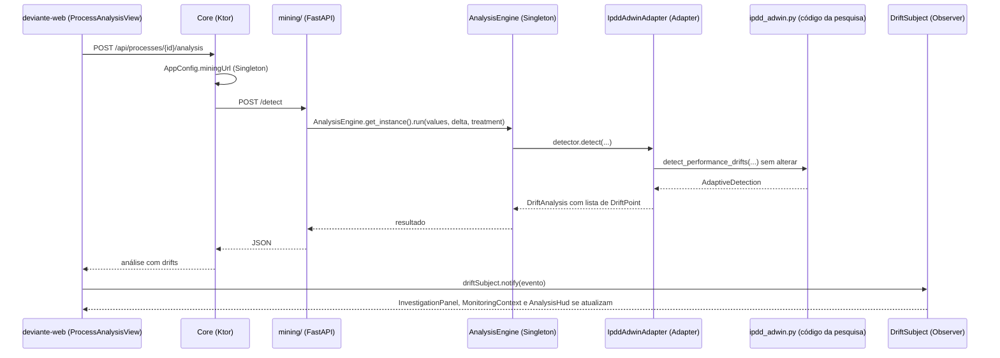

# Defesa Reuso 03: os três padrões de projeto

O enunciado (item 01) pede 3 padrões focados em reuso. Seguimos a **Opção 02**: três padrões, dois exemplos codificados de cada, um padrão de cada família do GoF. As classes estão no banco **Classes** do Notion (coluna Padrão).

| Família | Padrão | Exemplo 1 | Exemplo 2 |
|---|---|---|---|
| Criacional | Singleton | `AppConfig` (Core, Kotlin) | `AnalysisEngine` (análise de drift, Python) |
| Estrutural | Adapter | `IpddAdwinAdapter` → `DriftDetector` | `Pm4pyGraphAdapter` → `GraphMiner` |
| Comportamental | Observer | `DriftSubject` (análise de drift) → `InvestigationPanel`, `MonitoringContext`, `AnalysisHud` | `MaintenanceSubject` (agenda de manutenção) → lista da Agenda, contador do menu |

Strategy foi descartado porque dependia de RUL e probabilidade de falha, fora do escopo da v1 (ADR 06).

**Como ler.** Os trechos com 📍 e link são o código atual, fixado no commit (`deviante-api@c648f62`, `deviante-web@c3fc7a3`). Todo trecho é código que está rodando no sistema, com testes automatizados para cada padrão.

## 0. Onde os padrões rodam

| Padrão | Serviço | Onde roda | Arquivo |
|---|---|---|---|
| Singleton `AppConfig` | Core API | Fly.io, app `deviante-api` | `deviante-api/src/main/kotlin/AppConfig.kt` |
| Singleton `AnalysisEngine` | mining (depois Azure Function) | Fly.io, app `deviante-mining` | `deviante-api/mining/app/analysis_engine.py` |
| Adapter `IpddAdwinAdapter` | mining (depois Azure Function) | Fly.io, app `deviante-mining` | `deviante-api/mining/app/drift_detector.py` |
| Adapter `Pm4pyGraphAdapter` | mining (MS1) | Fly.io, app `deviante-mining` | `deviante-api/mining/app/graph_miner.py` |
| Observer `DriftSubject` | front | Vercel, `deviante.alander.io` | `deviante-web/src/lib/driftSubject.js` |
| Observer `MaintenanceSubject` | front | Vercel, `deviante.alander.io` | `deviante-web/src/lib/maintenanceSubject.js` |

Os CRUDs (Processo, Atividade, Equipamento, Agenda) passam só pelo Core, então o **Singleton `AppConfig`** aparece dentro de qualquer CRUD. O segundo exemplo de **Observer** aparece dentro do CRUD de Agenda. **Adapter** e o primeiro **Observer** vivem no fluxo de análise de drift; eles entram num trecho separado, depois dos CRUDs, rodando uma análise em `https://deviante.alander.io/processes/{id}?view=analysis` num processo que já tem log.

Esse trecho não depende da Azure Function: hoje a análise roda no serviço `mining/` (FastAPI, app `deviante-mining`), chamado pelo Core. O adaptador é o mesmo código nos dois lugares; quando a Function existir, ele só muda de casa.



## 1. Singleton

**Por que serve ao reuso:** um único ponto de acesso a um recurso que precisa ser igual em toda a aplicação ou que é caro de criar. Quem precisa dele reaproveita a mesma instância.

### 1.1 `AppConfig` (Core, Kotlin)

📍 `deviante-api/src/main/kotlin/AppConfig.kt` · linhas 1–43 · [abrir no GitHub](https://github.com/aland3r/deviante-api/blob/c648f62/src/main/kotlin/AppConfig.kt#L1-L43)

```kotlin
package com.deviante

import com.deviante.variability.ClientVariant
import com.deviante.variability.Plan
import com.deviante.variability.ProductLine
import io.ktor.server.config.ApplicationConfig

/**
 * Singleton (Reuso 03): a configuração do Core é lida uma única vez, de
 * application.yaml (que resolve as variáveis de ambiente), e todo módulo que
 * precisa dela reaproveita esta mesma instância. `object` do Kotlin garante uma
 * instância só, criada no primeiro acesso de forma segura entre threads.
 */
object AppConfig {
    lateinit var jdbcUrl: String; private set
    lateinit var dbUser: String; private set
    lateinit var dbPassword: String; private set
    lateinit var supabaseUrl: String; private set
    lateinit var supabaseAnonKey: String; private set
    lateinit var miningUrl: String; private set
    lateinit var productLine: ProductLine; private set

    @Volatile
    private var loaded = false

    /** Idempotente: a primeira chamada carrega; as seguintes não fazem nada. */
    @Synchronized
    fun init(config: ApplicationConfig) {
        if (loaded) return
        jdbcUrl = config.propertyOrNull("database.jdbcUrl")?.getString().orEmpty()
        dbUser = config.propertyOrNull("database.user")?.getString().orEmpty()
        dbPassword = config.propertyOrNull("database.password")?.getString().orEmpty()
        supabaseUrl = config.propertyOrNull("supabase.url")?.getString().orEmpty()
        supabaseAnonKey = config.propertyOrNull("supabase.anonKey")?.getString().orEmpty()
        miningUrl = config.propertyOrNull("mining.url")?.getString()
            ?: System.getenv("MINING_SERVICE_URL")
            ?: "http://localhost:8000"
        // Sem a seção productLine (ex.: testes), todo cliente recebe o plano completo.
        productLine = runCatching { ProductLine.fromConfig(config) }
            .getOrElse { ProductLine(ClientVariant("Cliente padrão", Plan.MANUTENCAO), emptyMap()) }
        loaded = true
    }
}
```

Fala: "`object` em Kotlin é o Singleton da própria linguagem: uma instância só, criada no primeiro acesso de forma segura entre threads. O `init` é idempotente: a primeira chamada lê o `application.yaml` (que resolve as variáveis de ambiente do Fly.io) e as seguintes não fazem nada."

Os três módulos que antes liam a configuração cada um por conta própria agora reaproveitam a mesma instância:

📍 `deviante-api/src/main/kotlin/Database.kt` · linhas 9–13 · [abrir no GitHub](https://github.com/aland3r/deviante-api/blob/c648f62/src/main/kotlin/Database.kt#L9-L13)

```kotlin
fun Application.configureDatabase() {
    AppConfig.init(environment.config)
    val jdbcUrl = AppConfig.jdbcUrl
    val user = AppConfig.dbUser
    val password = AppConfig.dbPassword
```

📍 `deviante-api/src/main/kotlin/SupabaseAuth.kt` · linhas 74–77 · [abrir no GitHub](https://github.com/aland3r/deviante-api/blob/c648f62/src/main/kotlin/SupabaseAuth.kt#L74-L77)

```kotlin
fun Application.configureSupabaseAuthClient(): SupabaseAuthClient {
    AppConfig.init(environment.config)
    return SupabaseAuthClient(AppConfig.supabaseUrl, AppConfig.supabaseAnonKey)
}
```

📍 `deviante-api/src/main/kotlin/MiningClient.kt` · linhas 259–265 · [abrir no GitHub](https://github.com/aland3r/deviante-api/blob/c648f62/src/main/kotlin/MiningClient.kt#L259-L265)

```kotlin
fun Application.configureMiningClient(): MiningClient {
    AppConfig.init(environment.config)
    val baseUrl = AppConfig.miningUrl

    log.info("[MiningClient] process-mining service at $baseUrl")
    return MiningClient(baseUrl)
}
```

📍 `deviante-api/src/test/kotlin/AppConfigTest.kt` · linhas 1–23 · [abrir no GitHub](https://github.com/aland3r/deviante-api/blob/c648f62/src/test/kotlin/AppConfigTest.kt#L1-L23)

```kotlin
package com.deviante

import io.ktor.server.config.MapApplicationConfig
import kotlin.test.Test
import kotlin.test.assertEquals
import kotlin.test.assertSame

class AppConfigTest {
    @Test
    fun `there is a single instance`() {
        assertSame(AppConfig, AppConfig)
    }

    @Test
    fun `configuration is loaded once and reused`() {
        AppConfig.init(MapApplicationConfig("mining.url" to "http://primeira:8000"))
        val loaded = AppConfig.miningUrl

        AppConfig.init(MapApplicationConfig("mining.url" to "http://segunda:8000"))

        assertEquals(loaded, AppConfig.miningUrl)
    }
}
```

**Demonstrar:** em qualquer CRUD, abrir `Database.kt` e `SupabaseAuth.kt` e mostrar que os dois leem o mesmo `AppConfig`. Rodar `./gradlew test --tests com.deviante.AppConfigTest`. Fala: "a configuração é carregada uma vez e todo o Core reaproveita a mesma instância; a segunda chamada de `init` não muda nada, como o teste mostra".

### 1.2 `AnalysisEngine` (análise de drift, Python)

📍 `deviante-api/mining/app/analysis_engine.py` · linhas 1–26 · [abrir no GitHub](https://github.com/aland3r/deviante-api/blob/c648f62/mining/app/analysis_engine.py#L1-L26)

```python
"""Singleton (Reuso 03): uma única instância do motor de análise por processo
Python. Com o serviço "quente" (Fly.io hoje, Azure Function no alvo), o módulo
continua carregado entre requisições e o detector não é recriado a cada uma.
"""

from __future__ import annotations

from .drift_detector import DriftAnalysis, DriftDetector, IpddAdwinAdapter


class AnalysisEngine:
    _instance: AnalysisEngine | None = None

    def __init__(self, detector: DriftDetector) -> None:
        if AnalysisEngine._instance is not None:
            raise RuntimeError("Use AnalysisEngine.get_instance().")
        self.detector = detector

    @classmethod
    def get_instance(cls) -> AnalysisEngine:
        if cls._instance is None:
            cls._instance = cls(IpddAdwinAdapter())
        return cls._instance

    def run(self, values: list[float], *, delta: float, treatment: str) -> DriftAnalysis:
        return self.detector.detect(values, delta=delta, treatment=treatment)
```

Fala: "Aqui o Singleton é escrito à mão, porque Python não tem `object`: o construtor recusa uma segunda instância e `get_instance()` cria na primeira chamada. Com o serviço quente, o motor e o detector não são recriados a cada requisição."

O endpoint `/detect` passa a chamar o motor, e não mais a função da pesquisa direto:

📍 `deviante-api/mining/app/main.py` · linhas 129–157 · [abrir no GitHub](https://github.com/aland3r/deviante-api/blob/c648f62/mining/app/main.py#L129-L157)

```python
@app.post("/detect", response_model=DetectResponse)
def detect(request: DetectRequest) -> DetectResponse:
    """Run Luiz Picolo's IPDD/ADWIN performance-analysis flow.

    ``treatment`` selects which of the two research pipelines to reproduce:
    ``raw`` for the synthetic-corpus baseline (``adwin_dataset.py``) and
    ``treated`` for the shop-floor one (``adwin_real_dataset.py``).
    """
    try:
        # Singleton + Adapter: o endpoint só conhece o motor e a interface
        # DriftDetector; o código da pesquisa fica atrás do IpddAdwinAdapter.
        result = AnalysisEngine.get_instance().run(
            request.values,
            delta=request.delta,
            treatment=request.treatment,
        )
    except ValueError as error:
        raise HTTPException(status_code=422, detail=str(error)) from error

    return DetectResponse(
        method=result.method,
        delta=request.delta,
        treatment=result.treatment,
        observation_count=len(request.values),
        smoothing_window=result.smoothing_window,
        processed_values=result.processed_values,
        outlier_indices=result.outlier_indices,
        drifts=[DriftPoint(**vars(drift)) for drift in result.drifts],
    )
```

📍 `deviante-api/mining/tests/test_analysis_engine.py` · linhas 1–20 · [abrir no GitHub](https://github.com/aland3r/deviante-api/blob/c648f62/mining/tests/test_analysis_engine.py#L1-L20)

```python
import pytest

from app.analysis_engine import AnalysisEngine
from app.drift_detector import DriftDetector, IpddAdwinAdapter


def test_always_the_same_instance() -> None:
    assert AnalysisEngine.get_instance() is AnalysisEngine.get_instance()


def test_direct_construction_is_refused() -> None:
    AnalysisEngine.get_instance()
    with pytest.raises(RuntimeError):
        AnalysisEngine(IpddAdwinAdapter())


def test_engine_talks_to_the_target_interface() -> None:
    detector = AnalysisEngine.get_instance().detector
    assert isinstance(detector, DriftDetector)
    assert isinstance(detector, IpddAdwinAdapter)
```

**Demonstrar:** rodar `pytest mining/tests/test_analysis_engine.py` e depois rodar a análise na tela.

## 2. Adapter

**Por que serve ao reuso:** o código da pesquisa (IPDD/ADWIN) e a biblioteca pm4py têm interfaces próprias. O adaptador traduz essas interfaces para a que o Deviante espera, sem copiar nem alterar o original ("envolver, não fazer fork"). Se o algoritmo ou a biblioteca mudarem, só o adaptador muda.

### 2.1 `IpddAdwinAdapter` → `DriftDetector`

O código da pesquisa (o "adaptado") tem esta interface, que não foi alterada:

📍 `deviante-api/mining/app/ipdd_adwin.py` · linhas 39–54 · [abrir no GitHub](https://github.com/aland3r/deviante-api/blob/c648f62/mining/app/ipdd_adwin.py#L39-L54)

```python
@dataclass(frozen=True)
class AdaptiveDrift:
    detection_index: int
    anomaly_start_index: int
    value: float
    width: float
    estimation: float


@dataclass(frozen=True)
class AdaptiveDetection:
    processed_values: list[float]
    outlier_indices: list[int]
    smoothing_window: int
    treatment: str
    drifts: list[AdaptiveDrift]
```

📍 `deviante-api/mining/app/ipdd_adwin.py` · linhas 155–168 · [abrir no GitHub](https://github.com/aland3r/deviante-api/blob/c648f62/mining/app/ipdd_adwin.py#L155-L168)

```python
def detect_performance_drifts(
    values: list[float],
    *,
    delta: float = 0.002,
    treatment: str = TREATMENT_TREATED,
) -> AdaptiveDetection:
    if len(values) < 2:
        raise ValueError("A análise exige ao menos duas observações.")
    if any(not math.isfinite(value) for value in values):
        raise ValueError("A série contém valores numéricos inválidos.")
    if treatment not in TREATMENTS:
        raise ValueError(
            f"Tratamento desconhecido: {treatment}. Use 'raw' ou 'treated'."
        )
```

A interface alvo e o adaptador:

📍 `deviante-api/mining/app/drift_detector.py` · linhas 1–71 · [abrir no GitHub](https://github.com/aland3r/deviante-api/blob/c648f62/mining/app/drift_detector.py#L1-L71)

```python
"""Adapter (Reuso 03): o código da pesquisa (IPDD/ADWIN, ``ipdd_adwin.py``)
tem interface própria. Este módulo define a interface que o Deviante espera,
``DriftDetector``, e o adaptador que traduz uma para a outra sem alterar
nenhuma linha do código adaptado ("envolver, não fazer fork").
"""

from __future__ import annotations

from abc import ABC, abstractmethod
from dataclasses import dataclass

from .ipdd_adwin import TREATMENT_TREATED, detect_performance_drifts


@dataclass(frozen=True)
class DriftPoint:
    """Formato do Deviante para um ponto de drift."""

    index: int
    anomaly_start_index: int
    value: float
    width: float
    estimation: float


@dataclass(frozen=True)
class DriftAnalysis:
    """Formato do Deviante para o resultado de uma análise de drift."""

    method: str
    treatment: str
    smoothing_window: int
    processed_values: list[float]
    outlier_indices: list[int]
    drifts: list[DriftPoint]


class DriftDetector(ABC):
    """Interface alvo: o resto do sistema só conhece isto."""

    @abstractmethod
    def detect(self, values: list[float], *, delta: float, treatment: str) -> DriftAnalysis: ...


class IpddAdwinAdapter(DriftDetector):
    """Adapter: envolve ``detect_performance_drifts`` (código da pesquisa) e
    converte ``AdaptiveDetection``/``AdaptiveDrift`` para o formato do Deviante."""

    METHOD = "IPDD + ADWIN"

    def detect(
        self, values: list[float], *, delta: float = 0.002, treatment: str = TREATMENT_TREATED
    ) -> DriftAnalysis:
        result = detect_performance_drifts(values, delta=delta, treatment=treatment)
        return DriftAnalysis(
            method=self.METHOD,
            treatment=result.treatment,
            smoothing_window=result.smoothing_window,
            processed_values=result.processed_values,
            outlier_indices=result.outlier_indices,
            drifts=[
                DriftPoint(
                    index=drift.detection_index,
                    anomaly_start_index=drift.anomaly_start_index,
                    value=drift.value,
                    width=drift.width,
                    estimation=drift.estimation,
                )
                for drift in result.drifts
            ],
        )
```

Fala: "`DriftDetector` é a interface que o resto do sistema conhece. `IpddAdwinAdapter` implementa essa interface chamando `detect_performance_drifts` e convertendo `AdaptiveDetection`/`AdaptiveDrift` em `DriftAnalysis`/`DriftPoint`. O endpoint, que antes fazia essa conversão na mão, agora só repassa (`DriftPoint(**vars(drift))`, na linha 156 do `main.py`, acima)."

📍 `deviante-api/mining/tests/test_drift_detector.py` · linhas 1–15 · [abrir no GitHub](https://github.com/aland3r/deviante-api/blob/c648f62/mining/tests/test_drift_detector.py#L1-L15)

```python
from app.drift_detector import DriftAnalysis, DriftPoint, IpddAdwinAdapter
from app.ipdd_adwin import detect_performance_drifts


def test_adapter_translates_research_output_to_deviante_format() -> None:
    values = [10.0] * 100 + [80.0] * 100

    adapted = IpddAdwinAdapter().detect(values, delta=0.002, treatment="treated")
    original = detect_performance_drifts(values, delta=0.002, treatment="treated")

    assert isinstance(adapted, DriftAnalysis)
    assert adapted.method == "IPDD + ADWIN"
    assert adapted.drifts and all(isinstance(d, DriftPoint) for d in adapted.drifts)
    assert [d.index for d in adapted.drifts] == [d.detection_index for d in original.drifts]
    assert adapted.processed_values == original.processed_values
```

O Core chama esse endpoint quando o usuário roda uma análise de processo:

📍 `deviante-api/src/main/kotlin/MiningClient.kt` · linhas 202–211 · [abrir no GitHub](https://github.com/aland3r/deviante-api/blob/c648f62/src/main/kotlin/MiningClient.kt#L202-L211)

```kotlin
    suspend fun detect(
        values: List<Double>,
        delta: Double = 0.002,
        treatment: String = "treated",
    ): DetectSeriesResponse {
        val response = try {
            client.post("$baseUrl/detect") {
                contentType(ContentType.Application.Json)
                setBody(DetectSeriesRequest(values, delta, treatment))
            }
```

**Demonstrar:** abrir `drift_detector.py` e `ipdd_adwin.py` lado a lado e mostrar que `ipdd_adwin.py` não tem nenhuma linha do Deviante. Rodar `pytest mining/tests/test_drift_detector.py mining/tests/test_detector.py`. Fala: "o resto do sistema só conhece `DriftDetector`; trocar o algoritmo é escrever outro adaptador".

### 2.2 `Pm4pyGraphAdapter` → `GraphMiner`

📍 `deviante-api/mining/app/graph_miner.py` · linhas 1–55 · [abrir no GitHub](https://github.com/aland3r/deviante-api/blob/c648f62/mining/app/graph_miner.py#L1-L55)

```python
"""Adapter (Reuso 03): a biblioteca pm4py descobre o grafo de sequência
direta (DFG) com interface própria (dicionários de pares). Este módulo define
a interface que o Deviante espera, ``GraphMiner``, e o adaptador que converte
a saída do pm4py em nós e arestas, o formato que o front desenha.
"""

from __future__ import annotations

from abc import ABC, abstractmethod
from dataclasses import dataclass, field

import pandas as pd


@dataclass
class ProcessGraph:
    """Formato do Deviante: nós e arestas com frequência."""

    nodes: list[dict] = field(default_factory=list)
    edges: list[dict] = field(default_factory=list)


class GraphMiner(ABC):
    """Interface alvo. ``events`` tem as colunas que o parser normaliza:
    ``case_id``, ``raw_label`` e ``occurred_at``."""

    @abstractmethod
    def mine(self, events: pd.DataFrame) -> ProcessGraph: ...


class Pm4pyGraphAdapter(GraphMiner):
    """Adapter: chama ``pm4py.discover_dfg`` e converte para ``ProcessGraph``."""

    def mine(self, events: pd.DataFrame) -> ProcessGraph:
        if events.empty:
            return ProcessGraph()
        import pm4py  # import tardio, como no parser.py: o pm4py é pesado

        dfg, starts, ends = pm4py.discover_dfg(
            events,
            case_id_key="case_id",
            activity_key="raw_label",
            timestamp_key="occurred_at",
        )
        activities = sorted({a for pair in dfg for a in pair} | set(starts) | set(ends))
        return ProcessGraph(
            nodes=[
                {"id": a, "label": a, "start": int(starts.get(a, 0)), "end": int(ends.get(a, 0))}
                for a in activities
            ],
            edges=[
                {"source": s, "target": t, "frequency": int(n)}
                for (s, t), n in sorted(dfg.items(), key=lambda item: (-item[1], item[0]))
            ],
        )
```

Fala: "O pm4py devolve o grafo de sequência direta como dicionários de pares (`dfg`, `starts`, `ends`). O adaptador converte isso em `ProcessGraph`, com nós e arestas com frequência. O import do pm4py é tardio, como no `parser.py`, porque a biblioteca é pesada."

Ele roda a cada log enviado, no endpoint `/parse`, logo depois do parser:

📍 `deviante-api/mining/app/main.py` · linhas 237–238 · [abrir no GitHub](https://github.com/aland3r/deviante-api/blob/c648f62/mining/app/main.py#L237-L238)

```python
    # Adapter: o grafo vem do pm4py, mas o endpoint só conhece GraphMiner.
    graph = Pm4pyGraphAdapter().mine(_event_frame(result.traces))
```

📍 `deviante-api/mining/app/main.py` · linhas 275–275 · [abrir no GitHub](https://github.com/aland3r/deviante-api/blob/c648f62/mining/app/main.py#L275-L275)

```python
            "graph": {"nodes": graph.nodes, "edges": graph.edges},
```

📍 `deviante-api/mining/app/main.py` · linhas 280–295 · [abrir no GitHub](https://github.com/aland3r/deviante-api/blob/c648f62/mining/app/main.py#L280-L295)

```python
def _event_frame(traces) -> pd.DataFrame:
    """Eventos já ordenados pelo parser, nas colunas que o GraphMiner espera.
    Sem timestamp, usa a posição na trace para preservar a ordem."""
    rows = [
        {
            "case_id": trace.case_id,
            "raw_label": event.raw_label,
            "occurred_at": event.occurred_at
            or pd.Timestamp(0, tz="UTC") + pd.Timedelta(seconds=event.sequence_index),
        }
        for trace in traces
        for event in trace.events
    ]
    frame = pd.DataFrame(rows, columns=["case_id", "raw_label", "occurred_at"])
    frame["occurred_at"] = pd.to_datetime(frame["occurred_at"], utc=True)
    return frame
```

📍 `deviante-api/mining/tests/test_graph_miner.py` · linhas 1–47 · [abrir no GitHub](https://github.com/aland3r/deviante-api/blob/c648f62/mining/tests/test_graph_miner.py#L1-L47)

```python
import pandas as pd

from app.graph_miner import GraphMiner, Pm4pyGraphAdapter, ProcessGraph


def _events(rows):
    frame = pd.DataFrame(rows, columns=["case_id", "raw_label", "occurred_at"])
    frame["occurred_at"] = pd.to_datetime(frame["occurred_at"], utc=True)
    return frame


def test_adapter_converts_pm4py_dfg_to_nodes_and_edges() -> None:
    events = _events([
        ("c1", "Corte", "2026-10-01T08:00:00Z"),
        ("c1", "Solda", "2026-10-01T08:10:00Z"),
        ("c1", "Pintura", "2026-10-01T08:30:00Z"),
        ("c2", "Corte", "2026-10-01T09:00:00Z"),
        ("c2", "Solda", "2026-10-01T09:12:00Z"),
    ])

    miner: GraphMiner = Pm4pyGraphAdapter()
    graph = miner.mine(events)

    assert isinstance(graph, ProcessGraph)
    assert {node["id"] for node in graph.nodes} == {"Corte", "Solda", "Pintura"}
    assert {"source": "Corte", "target": "Solda", "frequency": 2} in graph.edges
    assert {"source": "Solda", "target": "Pintura", "frequency": 1} in graph.edges
    corte = next(node for node in graph.nodes if node["id"] == "Corte")
    assert corte["start"] == 2


def test_empty_log_gives_empty_graph() -> None:
    assert Pm4pyGraphAdapter().mine(_events([])) == ProcessGraph()


def test_parse_endpoint_builds_the_graph_from_parsed_traces() -> None:
    from app.main import _event_frame
    from app.parser import parse_log
    from tests.test_parser import CSV_LOG

    result = parse_log(CSV_LOG, "log.csv")
    graph = Pm4pyGraphAdapter().mine(_event_frame(result.traces))

    labels = {event.raw_label for event in result.events}
    assert {node["id"] for node in graph.nodes} == labels
    transitions = sum(max(trace.event_count - 1, 0) for trace in result.traces)
    assert sum(edge["frequency"] for edge in graph.edges) == transitions
```

Fala: "O endpoint só conhece `GraphMiner`. As colunas `case_id`, `raw_label` e `occurred_at` são as que o parser já normaliza. Hoje o Core ainda monta o grafo do canvas a partir das traces que ele mesmo grava; o grafo do adaptador sai na resposta do `/parse`, pronto para substituir essa montagem."

**Demonstrar:** rodar `pytest mining/tests/test_graph_miner.py`; o último teste passa um log CSV pelo parser e confere que o grafo tem todas as atividades e todas as transições.

## 3. Observer

**Por que serve ao reuso:** quando uma análise termina, várias partes da tela precisam reagir. Com o Observer, quem publica o evento não conhece quem escuta; um painel novo só precisa se inscrever, sem mexer no publicador.

São dois sujeitos independentes, que compartilham a mesma base `Subject`. Cada um tem seu publicador e seus observadores, e nenhum sabe do outro.

### 3.1 A base e o sujeito do drift

📍 `deviante-web/src/lib/subject.js` · linhas 1–24 · [abrir no GitHub](https://github.com/aland3r/deviante-web/blob/c3fc7a3/src/lib/subject.js#L1-L24)

```javascript
/**
 * Observer (Reuso 03): base comum dos sujeitos. Guarda os observadores e
 * avisa todos a cada evento; quem publica não sabe quem reage. Um observador
 * é qualquer objeto com `update(event)`.
 */
export class Subject {
  constructor() {
    this.observers = new Set()
  }

  /** Inscreve e devolve a função que cancela a inscrição (cabe no retorno de um useEffect). */
  subscribe(observer) {
    this.observers.add(observer)
    return () => this.unsubscribe(observer)
  }

  unsubscribe(observer) {
    this.observers.delete(observer)
  }

  notify(event) {
    this.observers.forEach((observer) => observer.update(event))
  }
}
```

📍 `deviante-web/src/lib/driftSubject.js` · linhas 1–12 · [abrir no GitHub](https://github.com/aland3r/deviante-web/blob/c3fc7a3/src/lib/driftSubject.js#L1-L12)

```javascript
import { Subject } from './subject'

/**
 * Sujeito 1 do Observer: avisa quando uma análise de drift termina. Quem
 * publica (ProcessAnalysisView) não sabe quantos nem quais painéis reagem.
 *
 * event = { type: 'drift-detected' | 'analysis-completed', processId, analysisId, drifts }.
 */
class DriftSubject extends Subject {}

// Uma instância para o app inteiro.
export const driftSubject = new DriftSubject()
```

Fala: "A base guarda os observadores num `Set`. `subscribe` devolve a função que cancela a inscrição, que é exatamente o que o `useEffect` do React espera como limpeza. `notify` percorre a lista e chama `update` em cada um. O `DriftSubject` só herda da base; o reuso aqui é a própria base, usada pelos dois sujeitos."

### 3.2 O publicador

📍 `deviante-web/src/components/process-analysis/ProcessAnalysisView.jsx` · linhas 471–484 · [abrir no GitHub](https://github.com/aland3r/deviante-web/blob/c3fc7a3/src/components/process-analysis/ProcessAnalysisView.jsx#L471-L484)

```jsx
    try {
      const result = await api.runProcessAnalysis(processId, analysisId, request)
      eventLogIdsRef.current = (result.eventLogs?.length ? result.eventLogs : [result.eventLog]).filter(Boolean).map((log) => log.id)
      setAnalysis(result)
      setSelectedTrace(null)
      // Observer: avisa todos os inscritos (InvestigationPanel, MonitoringContext,
      // AnalysisHud) sem saber quem são.
      driftSubject.notify({
        type: result.drifts.length ? 'drift-detected' : 'analysis-completed',
        processId,
        analysisId,
        drifts: result.drifts,
      })
      setElapsed((performance.now() - started) / 1000)
```

Fala: "Quando a análise volta da API, a tela publica um evento: `drift-detected` se houver drift, `analysis-completed` se não houver. Ela não sabe quem está ouvindo."

### 3.3 Os observadores

Exemplo 1, `InvestigationPanel` (abre a investigação no drift mais recente) e `MonitoringContext` (guarda o estado de drift de cada processo para o app inteiro):

📍 `deviante-web/src/components/process-analysis/InvestigationPanel.jsx` · linhas 1–30 · [abrir no GitHub](https://github.com/aland3r/deviante-web/blob/c3fc7a3/src/components/process-analysis/InvestigationPanel.jsx#L1-L30)

```jsx
import { useEffect, useState } from 'react'
import { X } from 'lucide-react'
import { driftSubject } from '../../lib/driftSubject'

/**
 * Observer: quando um drift é detectado, abre a investigação no drift mais
 * recente (seleciona-o no gráfico) e mostra onde a anomalia começou.
 */
export default function InvestigationPanel({ processId, onInvestigate }) {
  const [drift, setDrift] = useState(null)

  useEffect(() => driftSubject.subscribe({
    update: (event) => {
      if (event.processId !== processId) return
      const latest = event.drifts.at(-1) ?? null
      setDrift(latest)
      if (latest) onInvestigate(latest.index)
    },
  }), [processId, onInvestigate])

  if (!drift) return null
  return (
    <div className="shrink-0 flex items-center gap-3 px-5 py-2 border-b border-border text-[11px]" style={{ background: 'var(--surface-inset)' }}>
      <span className="font-semibold" style={{ color: 'var(--crit-soft)' }}>Investigando drift</span>
      <span className="text-muted-foreground">detectado no traço #{drift.index + 1}, anomalia a partir do traço #{(drift.anomalyStartIndex ?? drift.index) + 1}</span>
      <div className="flex-1" />
      <button type="button" onClick={() => setDrift(null)} aria-label="Fechar investigação" className="text-muted-foreground hover:text-foreground"><X size={12} /></button>
    </div>
  )
}
```

📍 `deviante-web/src/context/MonitoringContext.jsx` · linhas 1–25 · [abrir no GitHub](https://github.com/aland3r/deviante-web/blob/c3fc7a3/src/context/MonitoringContext.jsx#L1-L25)

```jsx
import { createContext, useContext, useEffect, useState } from 'react'
import { driftSubject } from '../lib/driftSubject'

const MonitoringContext = createContext({})

/**
 * Observer: guarda, para o app inteiro, o último estado de drift de cada
 * processo. Telas fora da análise (o cabeçalho do processo) leem daqui.
 */
export function MonitoringProvider({ children }) {
  const [byProcess, setByProcess] = useState({})

  useEffect(() => driftSubject.subscribe({
    update: (event) => setByProcess((current) => ({
      ...current,
      [event.processId]: { hasDrift: event.type === 'drift-detected', drifts: event.drifts.length, at: new Date().toISOString() },
    })),
  }), [])

  return <MonitoringContext.Provider value={byProcess}>{children}</MonitoringContext.Provider>
}

export function useProcessDriftStatus(processId) {
  return useContext(MonitoringContext)[processId] ?? null
}
```

📍 `deviante-web/src/App.jsx` · linhas 64–64 · [abrir no GitHub](https://github.com/aland3r/deviante-web/blob/c3fc7a3/src/App.jsx#L64-L64)

```jsx
      <MonitoringProvider>
```

📍 `deviante-web/src/pages/ProcessCanvasPage.jsx` · linhas 197–202 · [abrir no GitHub](https://github.com/aland3r/deviante-web/blob/c3fc7a3/src/pages/ProcessCanvasPage.jsx#L197-L202)

```jsx
        {driftStatus && (
          <span className="shrink-0 px-2 py-0.5 rounded-full text-[10px]"
            style={{ color: driftStatus.hasDrift ? 'var(--crit-soft)' : 'var(--success)', background: 'var(--overlay)' }}>
            {driftStatus.hasDrift ? `Com drift (${driftStatus.drifts})` : 'Sem drift'}
          </span>
        )}
```

Exemplo 2, `AnalysisHud` (contagem de drifts e status no cabeçalho):

📍 `deviante-web/src/components/process-analysis/AnalysisHud.jsx` · linhas 1–23 · [abrir no GitHub](https://github.com/aland3r/deviante-web/blob/c3fc7a3/src/components/process-analysis/AnalysisHud.jsx#L1-L23)

```jsx
import { useEffect, useState } from 'react'
import { driftSubject } from '../../lib/driftSubject'

/** Observer: mostra no cabeçalho da análise a contagem de drifts e o status. */
export default function AnalysisHud({ processId }) {
  const [summary, setSummary] = useState(null)

  useEffect(() => driftSubject.subscribe({
    update: (event) => {
      if (event.processId !== processId) return
      setSummary({ drifts: event.drifts.length, detected: event.type === 'drift-detected' })
    },
  }), [processId]) // o retorno do subscribe cancela a inscrição quando o componente sai da tela

  if (!summary) return null
  const color = summary.detected ? 'var(--crit-soft)' : 'var(--success)'
  return (
    <span className="hidden sm:inline-flex items-center gap-1.5 px-2 py-0.5 rounded-full text-[10px]"
      style={{ color, background: 'var(--overlay)', fontFamily: "'JetBrains Mono',monospace" }}>
      {summary.drifts} {summary.drifts === 1 ? 'drift' : 'drifts'} · {summary.detected ? 'drift detectado' : 'análise concluída'}
    </span>
  )
}
```

Onde eles estão montados na tela da análise:

📍 `deviante-web/src/components/process-analysis/ProcessAnalysisView.jsx` · linhas 637–640 · [abrir no GitHub](https://github.com/aland3r/deviante-web/blob/c3fc7a3/src/components/process-analysis/ProcessAnalysisView.jsx#L637-L640)

```jsx
        <AnalysisHud processId={processId} />
        {onDelete && <ProjectActionsMenu onDelete={onDelete} deleteLabel="Excluir análise" />}
      </header>
      <InvestigationPanel processId={processId} onInvestigate={setSelectedDrift} />
```

**Demonstrar:** rodar uma análise num processo com drift e mostrar os três reagindo: o selo no cabeçalho ("N drifts · drift detectado"), a faixa "Investigando drift" com o gráfico já no drift mais recente, e, ao voltar para o canvas do processo, o selo "Com drift". Abrir `driftSubject.js` e mostrar o `Set` e o laço do `notify`; depois o `useEffect` de um observador. Fala: "o código que chama a API não sabe quantos painéis existem; o selo do canvas foi adicionado sem tocar no publicador".

### 3.4 Exemplo 2: o sujeito da agenda de manutenção

O segundo sujeito não tem relação com o drift: avisa quando a agenda muda.

📍 `deviante-web/src/lib/maintenanceSubject.js` · linhas 1–12 · [abrir no GitHub](https://github.com/aland3r/deviante-web/blob/c3fc7a3/src/lib/maintenanceSubject.js#L1-L12)

```javascript
import { Subject } from './subject'

/**
 * Sujeito 2 do Observer, independente do drift: avisa quando a agenda de
 * manutenção muda. Quem publica (formulário da Agenda) não sabe que a lista e
 * o contador do menu reagem.
 *
 * event = { type: 'schedule-saved' | 'schedule-deleted', scheduleId }.
 */
class MaintenanceSubject extends Subject {}

export const maintenanceSubject = new MaintenanceSubject()
```

O publicador é a tela da Agenda (`/schedules`). Ao salvar ou excluir, ela só notifica; não recarrega nada por conta própria:

📍 `deviante-web/src/pages/SchedulesPage.jsx` · linhas 27–37 · [abrir no GitHub](https://github.com/aland3r/deviante-web/blob/c3fc7a3/src/pages/SchedulesPage.jsx#L27-L37)

```jsx
  async function save(data) {
    const saved = editing?.id ? await api.updateSchedule(editing.id, data) : await api.createSchedule(data)
    setEditing(null)
    maintenanceSubject.notify({ type: 'schedule-saved', scheduleId: saved?.id ?? editing?.id })
  }
  async function remove() {
    if (!window.confirm(`Excluir a manutenção "${editing.title}"?`)) return
    await api.deleteSchedule(editing.id)
    setEditing(null)
    maintenanceSubject.notify({ type: 'schedule-deleted', scheduleId: editing.id })
  }
```

Observador 1, a própria lista, que recarrega quando recebe o aviso:

📍 `deviante-web/src/pages/SchedulesPage.jsx` · linhas 24–25 · [abrir no GitHub](https://github.com/aland3r/deviante-web/blob/c3fc7a3/src/pages/SchedulesPage.jsx#L24-L25)

```jsx
  // A própria lista também é observadora: recarrega quando a agenda muda.
  useEffect(() => maintenanceSubject.subscribe({ update: load }), [equipmentId]) // eslint-disable-line react-hooks/exhaustive-deps
```

Observador 2, o contador de manutenções planejadas ao lado de "Agendamentos" no menu:

📍 `deviante-web/src/components/layout/PlannedMaintenanceBadge.jsx` · linhas 1–15 · [abrir no GitHub](https://github.com/aland3r/deviante-web/blob/c3fc7a3/src/components/layout/PlannedMaintenanceBadge.jsx#L1-L15)

```jsx
import { useEffect, useState } from 'react'
import { api } from '../../lib/api'
import { maintenanceSubject } from '../../lib/maintenanceSubject'

// Observador do maintenanceSubject: contador de manutenções planejadas no menu.
export default function PlannedMaintenanceBadge() {
  const [count, setCount] = useState(0)
  useEffect(() => {
    const refresh = () => api.listSchedules({ status: 'planned' }).then((rows) => setCount(rows.filter((row) => row.status === 'planned').length)).catch(() => setCount(0))
    refresh()
    return maintenanceSubject.subscribe({ update: refresh })
  }, [])
  if (!count) return null
  return <span className="ml-1.5 px-1.5 rounded-full text-[9px] font-semibold text-white" style={{ background: 'var(--ok-strong)' }}>{count}</span>
}
```

📍 `deviante-web/src/components/layout/AppLayout.jsx` · linhas 42–42 · [abrir no GitHub](https://github.com/aland3r/deviante-web/blob/c3fc7a3/src/components/layout/AppLayout.jsx#L42-L42)

```jsx
              {label}{to === '/schedules' && <PlannedMaintenanceBadge />}
```

**Demonstrar:** entrar como gestor (Metalúrgica Alfa), abrir `/schedules`, olhar o número ao lado de "Agendamentos" no menu, criar uma manutenção com situação "Planejada" e mostrar o número subir sem recarregar a página. Excluir a manutenção e mostrar o número descer. Fala: "o formulário só publica `schedule-saved`; quem atualiza o menu é o contador, que se inscreveu sozinho".

## 4. Perguntas prováveis

- **Por que um padrão de cada família?** Mostra reuso em três níveis: criação de objetos (Singleton), integração com código de terceiros (Adapter) e comunicação entre componentes (Observer).
- **Singleton não é um antipadrão?** Usamos só onde o recurso é de fato único (configuração, motor de análise). Nenhum guarda estado de negócio entre requisições.
- **Qual a diferença entre Adapter e Facade aqui?** O adaptador implementa uma interface que o sistema já define (`DriftDetector`, `GraphMiner`). Uma fachada só simplificaria uma API, sem encaixá-la numa interface existente.
- **Os dois exemplos de Observer não são o mesmo?** Não: são dois sujeitos com eventos, publicadores e observadores diferentes (análise de drift e agenda de manutenção). O que eles compartilham é a classe base `Subject`, que é justamente o reuso.
- **Por que o Observer fica no front?** O evento que interessa ao usuário é "o resultado chegou"; quem reage são os componentes da tela.

## 5. Checagem antes de ensaiar

- [ ] Deploy da API e do mining no Fly.io concluído (sem ele, o site ainda roda a versão sem os padrões do lado do servidor).
- [ ] Um processo demo com log carregado e drift conhecido, para a análise sair igual no dia.
- [ ] Testes rodando no terminal: `./gradlew test` e `pytest mining/tests/test_analysis_engine.py mining/tests/test_drift_detector.py mining/tests/test_graph_miner.py`.
