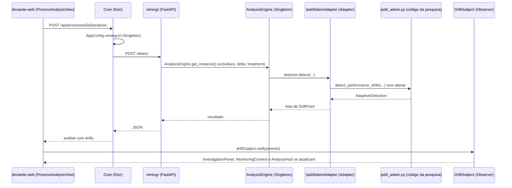

# Defesa Reuso 03: os três padrões de projeto

O enunciado (item 01) pede 3 padrões focados em reuso. Seguimos a **Opção 02**: três padrões, dois exemplos codificados de cada, um padrão de cada família do GoF. As classes estão no banco **Classes** do Notion (coluna Padrão).

| Família | Padrão | Exemplo 1 | Exemplo 2 |
|---|---|---|---|
| Criacional | Singleton | `AppConfig` (Core, Kotlin) | `AnalysisEngine` (análise de drift, Python) |
| Estrutural | Adapter | `IpddAdwinAdapter` → `DriftDetector` | `Pm4pyGraphAdapter` → `GraphMiner` |
| Comportamental | Observer | `DriftSubject` → `InvestigationPanel`, `MonitoringContext` | `DriftSubject` → `AnalysisHud` |

Strategy foi descartado porque dependia de RUL e probabilidade de falha, fora do escopo da v1 (ADR 06).

**Como ler.** Os trechos com 📍 e link são o código atual, fixado no commit (`deviante-api@1b5106c`, `deviante-web@203e38d`). Em 13/10 nenhuma das classes dos padrões existe ainda; por isso cada padrão mostra primeiro **onde está hoje** o código que ele vai organizar e depois o bloco **A DESENVOLVER**, com o arquivo exato e o código proposto. Depois do desenvolvimento, troque cada bloco pelo link real.

## 0. Onde os padrões rodam

| Padrão | Serviço | Onde roda | Arquivo (novo) |
|---|---|---|---|
| Singleton `AppConfig` | Core API | Fly.io, app `deviante-api` | `deviante-api/src/main/kotlin/AppConfig.kt` |
| Singleton `AnalysisEngine` | mining (depois Azure Function) | Fly.io, app `deviante-mining` | `deviante-api/mining/app/analysis_engine.py` |
| Adapter `IpddAdwinAdapter` | mining (depois Azure Function) | Fly.io, app `deviante-mining` | `deviante-api/mining/app/drift_detector.py` |
| Adapter `Pm4pyGraphAdapter` | mining (MS1) | Fly.io, app `deviante-mining` | `deviante-api/mining/app/graph_miner.py` |
| Observer `DriftSubject` | front | Vercel, `deviante.alander.io` | `deviante-web/src/lib/driftSubject.js` |

Os CRUDs (Processo, Atividade, Equipamento, Agenda) passam só pelo Core, então o **Singleton `AppConfig`** aparece dentro de qualquer CRUD. **Adapter** e **Observer** vivem no fluxo de análise de drift; eles entram num trecho separado, depois dos CRUDs, rodando uma análise em `https://deviante.alander.io/processes/{id}?view=analysis` num processo que já tem log.

Esse trecho não depende da Azure Function: hoje a análise roda no serviço `mining/` (FastAPI, app `deviante-mining`), chamado pelo Core. O adaptador é o mesmo código nos dois lugares; quando a Function existir, ele só muda de casa.



## 1. Singleton

**Por que serve ao reuso:** um único ponto de acesso a um recurso que precisa ser igual em toda a aplicação ou que é caro de criar. Quem precisa dele reaproveita a mesma instância.

### 1.1 `AppConfig` (Core, Kotlin)

**Hoje** cada módulo lê a configuração por conta própria, em três lugares:

📍 `deviante-api/src/main/kotlin/Database.kt` · linhas 9–12 · [abrir no GitHub](https://github.com/aland3r/deviante-api/blob/1b5106c/src/main/kotlin/Database.kt#L9-L12)

```kotlin
fun Application.configureDatabase() {
    val jdbcUrl = environment.config.property("database.jdbcUrl").getString()
    val user = environment.config.property("database.user").getString()
    val password = environment.config.property("database.password").getString()
```

📍 `deviante-api/src/main/kotlin/SupabaseAuth.kt` · linhas 74–78 · [abrir no GitHub](https://github.com/aland3r/deviante-api/blob/1b5106c/src/main/kotlin/SupabaseAuth.kt#L74-L78)

```kotlin
fun Application.configureSupabaseAuthClient(): SupabaseAuthClient {
    val url = environment.config.propertyOrNull("supabase.url")?.getString().orEmpty()
    val anonKey = environment.config.propertyOrNull("supabase.anonKey")?.getString().orEmpty()
    return SupabaseAuthClient(url, anonKey)
}
```

📍 `deviante-api/src/main/kotlin/MiningClient.kt` · linhas 259–267 · [abrir no GitHub](https://github.com/aland3r/deviante-api/blob/1b5106c/src/main/kotlin/MiningClient.kt#L259-L267)

```kotlin
fun Application.configureMiningClient(): MiningClient {
    val baseUrl = environment.config
        .propertyOrNull("mining.url")?.getString()
        ?: System.getenv("MINING_SERVICE_URL")
        ?: "http://localhost:8000"

    log.info("[MiningClient] process-mining service at $baseUrl")
    return MiningClient(baseUrl)
}
```

**A DESENVOLVER.** 📍 `deviante-api/src/main/kotlin/AppConfig.kt` (arquivo novo):

```kotlin
package com.deviante

import io.ktor.server.config.ApplicationConfig

/**
 * Singleton: `object` do Kotlin tem uma única instância, criada na primeira
 * vez que é acessada, de forma segura entre threads.
 */
object AppConfig {
    lateinit var jdbcUrl: String; private set
    lateinit var dbUser: String; private set
    lateinit var dbPassword: String; private set
    lateinit var supabaseUrl: String; private set
    lateinit var supabaseAnonKey: String; private set
    lateinit var miningUrl: String; private set
    const val DEFAULT_DELTA = 0.002

    private var loaded = false

    /** Chamado uma vez, no início de configureDatabase(). */
    fun init(config: ApplicationConfig) {
        if (loaded) return
        jdbcUrl = config.property("database.jdbcUrl").getString()
        dbUser = config.property("database.user").getString()
        dbPassword = config.property("database.password").getString()
        supabaseUrl = config.propertyOrNull("supabase.url")?.getString().orEmpty()
        supabaseAnonKey = config.propertyOrNull("supabase.anonKey")?.getString().orEmpty()
        miningUrl = config.propertyOrNull("mining.url")?.getString() ?: "http://localhost:8000"
        loaded = true
    }
}
```

📍 `Database.kt`, linhas 10–12 viram:

```kotlin
    AppConfig.init(environment.config)
    val jdbcUrl = AppConfig.jdbcUrl
    val user = AppConfig.dbUser
    val password = AppConfig.dbPassword
```

📍 `SupabaseAuth.kt`, linhas 75–77 viram `return SupabaseAuthClient(AppConfig.supabaseUrl, AppConfig.supabaseAnonKey)`; 📍 `MiningClient.kt`, linhas 260–263 viram `val baseUrl = AppConfig.miningUrl`. `Database` sobe antes de `Routing` (ordem do `application.yaml`), então a configuração já está carregada quando as rotas criam os clientes.

**Demonstrar:** em qualquer CRUD, abrir `Database.kt` e `SupabaseAuth.kt` e mostrar que os dois leem o mesmo `AppConfig`. Fala: "a configuração é carregada uma vez e todo o Core reaproveita a mesma instância".

### 1.2 `AnalysisEngine` (análise de drift, Python)

**Hoje** o endpoint chama a função da pesquisa direto:

📍 `deviante-api/mining/app/main.py` · linhas 126–141 · [abrir no GitHub](https://github.com/aland3r/deviante-api/blob/1b5106c/mining/app/main.py#L126-L141)

```python
@app.post("/detect", response_model=DetectResponse)
def detect(request: DetectRequest) -> DetectResponse:
    """Run Luiz Picolo's IPDD/ADWIN performance-analysis flow.

    ``treatment`` selects which of the two research pipelines to reproduce:
    ``raw`` for the synthetic-corpus baseline (``adwin_dataset.py``) and
    ``treated`` for the shop-floor one (``adwin_real_dataset.py``).
    """
    try:
        result = detect_performance_drifts(
            request.values,
            delta=request.delta,
            treatment=request.treatment,
        )
    except ValueError as error:
        raise HTTPException(status_code=422, detail=str(error)) from error
```

**A DESENVOLVER.** 📍 `deviante-api/mining/app/analysis_engine.py` (arquivo novo):

```python
from __future__ import annotations

from .drift_detector import DriftDetector, DriftPoint, IpddAdwinAdapter


class AnalysisEngine:
    """Singleton: uma instância do motor por processo Python.

    Numa Azure Function "quente" o módulo continua carregado entre chamadas,
    então o detector não é recriado a cada requisição.
    """

    _instance: AnalysisEngine | None = None

    def __init__(self, detector: DriftDetector) -> None:
        if AnalysisEngine._instance is not None:
            raise RuntimeError("Use AnalysisEngine.get_instance().")
        self.detector = detector

    @classmethod
    def get_instance(cls) -> AnalysisEngine:
        if cls._instance is None:
            cls._instance = cls(IpddAdwinAdapter())
        return cls._instance

    def run(self, values: list[float], delta: float, treatment: str) -> list[DriftPoint]:
        return self.detector.detect(values, delta=delta, treatment=treatment)
```

📍 `mining/app/main.py`, linha 135: `detect_performance_drifts(...)` passa a ser chamado através de `AnalysisEngine.get_instance()` (ver o adaptador na seção 2.1).

📍 `deviante-api/mining/tests/test_analysis_engine.py` (arquivo novo):

```python
from app.analysis_engine import AnalysisEngine


def test_sempre_a_mesma_instancia():
    assert AnalysisEngine.get_instance() is AnalysisEngine.get_instance()
```

**Demonstrar:** rodar `pytest mining/tests/test_analysis_engine.py` e depois rodar a análise na tela.

## 2. Adapter

**Por que serve ao reuso:** o código da pesquisa (IPDD/ADWIN) e a biblioteca pm4py têm interfaces próprias. O adaptador traduz essas interfaces para a que o Deviante espera, sem copiar nem alterar o original ("envolver, não fazer fork"). Se o algoritmo ou a biblioteca mudarem, só o adaptador muda.

### 2.1 `IpddAdwinAdapter` → `DriftDetector`

**Hoje**, o código da pesquisa (o "adaptado") tem esta interface:

📍 `deviante-api/mining/app/ipdd_adwin.py` · linhas 39–54 · [abrir no GitHub](https://github.com/aland3r/deviante-api/blob/1b5106c/mining/app/ipdd_adwin.py#L39-L54)

```python
@dataclass(frozen=True)
class AdaptiveDrift:
    detection_index: int
    anomaly_start_index: int
    value: float
    width: float
    estimation: float


@dataclass(frozen=True)
class AdaptiveDetection:
    processed_values: list[float]
    outlier_indices: list[int]
    smoothing_window: int
    treatment: str
    drifts: list[AdaptiveDrift]
```

📍 `deviante-api/mining/app/ipdd_adwin.py` · linhas 155–168 · [abrir no GitHub](https://github.com/aland3r/deviante-api/blob/1b5106c/mining/app/ipdd_adwin.py#L155-L168)

```python
def detect_performance_drifts(
    values: list[float],
    *,
    delta: float = 0.002,
    treatment: str = TREATMENT_TREATED,
) -> AdaptiveDetection:
    if len(values) < 2:
        raise ValueError("A análise exige ao menos duas observações.")
    if any(not math.isfinite(value) for value in values):
        raise ValueError("A série contém valores numéricos inválidos.")
    if treatment not in TREATMENTS:
        raise ValueError(
            f"Tratamento desconhecido: {treatment}. Use 'raw' ou 'treated'."
        )
```

E o endpoint converte a saída na mão:

📍 `deviante-api/mining/app/main.py` · linhas 143–161 · [abrir no GitHub](https://github.com/aland3r/deviante-api/blob/1b5106c/mining/app/main.py#L143-L161)

```python
    return DetectResponse(
        method="IPDD + ADWIN",
        delta=request.delta,
        treatment=result.treatment,
        observation_count=len(request.values),
        smoothing_window=result.smoothing_window,
        processed_values=result.processed_values,
        outlier_indices=result.outlier_indices,
        drifts=[
            DriftPoint(
                index=drift.detection_index,
                anomaly_start_index=drift.anomaly_start_index,
                value=drift.value,
                width=drift.width,
                estimation=drift.estimation,
            )
            for drift in result.drifts
        ],
    )
```

**A DESENVOLVER.** 📍 `deviante-api/mining/app/drift_detector.py` (arquivo novo):

```python
from __future__ import annotations

from abc import ABC, abstractmethod
from dataclasses import dataclass

from .ipdd_adwin import TREATMENT_TREATED, detect_performance_drifts


@dataclass(frozen=True)
class DriftPoint:
    """Formato do Deviante para um ponto de drift."""
    index: int
    anomaly_start_index: int
    value: float
    width: float
    estimation: float


class DriftDetector(ABC):
    """Interface alvo: o resto do sistema só conhece isto."""

    @abstractmethod
    def detect(self, values: list[float], *, delta: float, treatment: str) -> list[DriftPoint]: ...


class IpddAdwinAdapter(DriftDetector):
    """Adapter: envolve o código da pesquisa sem alterar nenhuma linha dele."""

    def detect(self, values, *, delta=0.002, treatment=TREATMENT_TREATED):
        result = detect_performance_drifts(values, delta=delta, treatment=treatment)
        return [
            DriftPoint(d.detection_index, d.anomaly_start_index, d.value, d.width, d.estimation)
            for d in result.drifts
        ]
```

**Demonstrar:** abrir `drift_detector.py` e `ipdd_adwin.py` lado a lado e mostrar que `ipdd_adwin.py` não tem nenhuma linha do Deviante. Fala: "o resto do sistema só conhece `DriftDetector`; trocar o algoritmo é escrever outro adaptador". Rodar `pytest mining/tests/test_detector.py`.

### 2.2 `Pm4pyGraphAdapter` → `GraphMiner`

**Hoje** o pm4py só é usado para ler XES no parser, e o grafo do processo é montado no Core (`repository/ProcessGraphRepository.kt`):

📍 `deviante-api/mining/app/parser.py` · linhas 107–138 · [abrir no GitHub](https://github.com/aland3r/deviante-api/blob/1b5106c/mining/app/parser.py#L107-L138)

```python
def _parse_xes(content: bytes, filename: str) -> ParsedLog:
    # Imported lazily: pm4py pulls in a heavy dependency tree, and the CSV
    # path must stay usable even where it is unavailable.
    import pm4py
    from pm4py.objects.log.util import interval_lifecycle

    import tempfile
    import os

    # pm4py.read_xes takes a path, not a buffer.
    handle, path = tempfile.mkstemp(suffix=".xes")
    try:
        with os.fdopen(handle, "wb") as tmp:
            tmp.write(content)
        try:
            log = pm4py.read_xes(path)
        except Exception as err:  # noqa: BLE001 — surface as 422, not 500
            raise ParseError(f"Não foi possível ler o XES: {err}") from err
    finally:
        # On Windows a failed read_xes can leave its handle open, and the
        # unlink then raises PermissionError — masking the real ParseError
        # with a 500. Losing a temp file is the lesser problem.
        try:
            os.unlink(path)
        except OSError:
            pass

    log = pm4py.convert_to_event_log(log)
    # start/complete -> a single row carrying @@duration, mirroring
    # adwin_dataset.py so sojourn time means the same thing downstream.
    log = interval_lifecycle.to_interval(log)
    df = pm4py.convert_to_dataframe(log)
```

**A DESENVOLVER.** 📍 `deviante-api/mining/app/graph_miner.py` (arquivo novo):

```python
from __future__ import annotations

from abc import ABC, abstractmethod
from dataclasses import dataclass, field

import pandas as pd


@dataclass
class ProcessGraph:
    """Formato do Deviante: nós e arestas com frequência, como o front desenha."""
    nodes: list[dict] = field(default_factory=list)
    edges: list[dict] = field(default_factory=list)


class GraphMiner(ABC):
    @abstractmethod
    def mine(self, events: pd.DataFrame) -> ProcessGraph: ...


class Pm4pyGraphAdapter(GraphMiner):
    """Adapter: usa o DFG do pm4py e converte para o ProcessGraph do Deviante."""

    def mine(self, events):
        import pm4py  # import tardio, como no parser.py

        dfg, starts, ends = pm4py.discover_dfg(
            events, case_id_key="case_id", activity_key="raw_label", timestamp_key="occurred_at",
        )
        activities = sorted({a for pair in dfg for a in pair} | set(starts) | set(ends))
        return ProcessGraph(
            nodes=[{"id": a, "label": a, "start": starts.get(a, 0), "end": ends.get(a, 0)} for a in activities],
            edges=[{"source": s, "target": t, "frequency": n} for (s, t), n in dfg.items()],
        )
```

📍 `mining/app/main.py`, no endpoint `/parse` (linha 214), depois do parser: `graph = Pm4pyGraphAdapter().mine(df)` e o grafo entra na resposta. As colunas `case_id`, `raw_label` e `occurred_at` são as que o parser já normaliza (`parser.py`, linhas 148–150).

**Demonstrar:** subir um log num processo e mostrar o grafo; no código, mostrar que o endpoint chama `GraphMiner.mine`, não o pm4py direto.

## 3. Observer

**Por que serve ao reuso:** quando uma análise termina, várias partes da tela precisam reagir. Com o Observer, quem publica o evento não conhece quem escuta; um painel novo só precisa se inscrever, sem mexer no publicador.

**Hoje** o resultado chega aqui e só atualiza o estado do próprio componente:

📍 `deviante-web/src/lib/api.js` · linhas 372–380 · [abrir no GitHub](https://github.com/aland3r/deviante-web/blob/203e38d/src/lib/api.js#L372-L380)

```javascript
  runProcessAnalysis: (processId, analysisId, params = {}) => {
    const query = analysisId ? `?analysisId=${encodeURIComponent(analysisId)}` : ''
    const body = {
      treatment: params.treatment ?? 'treated',
      eventLogIds: params.eventLogIds ?? [],
      excludedActivityIds: params.excludedActivityIds ?? [],
      excludedTraceIds: params.excludedTraceIds ?? [],
    }
    if (params.delta != null && params.delta !== '') body.delta = Number(params.delta)
```

📍 `deviante-web/src/components/process-analysis/ProcessAnalysisView.jsx` · linhas 456–480 · [abrir no GitHub](https://github.com/aland3r/deviante-web/blob/203e38d/src/components/process-analysis/ProcessAnalysisView.jsx#L456-L480)

```jsx
  const runAnalysis = useCallback(async (overrides) => {
    const started = performance.now()
    setRunState('running')
    setError('')
    const effective = { ...paramsRef.current, ...(overrides ?? {}) }
    const request = {
      treatment: effective.treatment,
      delta: effective.delta,
      eventLogIds: eventLogIdsRef.current,
      excludedActivityIds: [...excludedActivitiesRef.current],
      excludedTraceIds: [...excludedTracesRef.current],
    }
    try {
      const result = await api.runProcessAnalysis(processId, analysisId, request)
      eventLogIdsRef.current = (result.eventLogs?.length ? result.eventLogs : [result.eventLog]).filter(Boolean).map((log) => log.id)
      setAnalysis(result)
      setSelectedDrift(result.drifts[0]?.index ?? null)
      setSelectedTrace(null)
      setElapsed((performance.now() - started) / 1000)
    } catch (requestError) {
      setError(requestError.message)
    } finally {
      setRunState('done')
    }
  }, [processId, analysisId])
```

**A DESENVOLVER.** 📍 `deviante-web/src/lib/driftSubject.js` (arquivo novo):

```javascript
/**
 * Observer: o sujeito guarda a lista de observadores e avisa todos quando a
 * análise termina. Quem publica não sabe quantos painéis existem.
 */
class DriftSubject {
  constructor() { this.observers = new Set() }
  subscribe(observer) { this.observers.add(observer); return () => this.unsubscribe(observer) }
  unsubscribe(observer) { this.observers.delete(observer) }
  notify(event) { this.observers.forEach((observer) => observer.update(event)) }
}

// Uma instância para o app inteiro.
export const driftSubject = new DriftSubject()
```

📍 `ProcessAnalysisView.jsx`, depois da linha 471 (`setAnalysis(result)`), publicar o evento:

```javascript
      driftSubject.notify({
        type: result.drifts.length ? 'drift-detected' : 'analysis-completed',
        processId, analysisId, drifts: result.drifts,
      })
```

Os observadores (componentes que saem de `ProcessAnalysisView.jsx`, e o contexto usado por `pages/MonitoringPage.jsx`) se inscrevem assim:

```jsx
// src/components/process-analysis/AnalysisHud.jsx (novo)
export default function AnalysisHud() {
  const [summary, setSummary] = useState({ drifts: 0, status: 'aguardando' })
  useEffect(() => driftSubject.subscribe({
    update: (event) => setSummary({ drifts: event.drifts.length, status: event.type }),
  }), [])            // o retorno do subscribe faz o unsubscribe quando o componente sai da tela
  return <div>{summary.drifts} drifts · {summary.status}</div>
}
```

- **Exemplo 1:** `InvestigationPanel` (abre no drift mais recente) e `MonitoringContext` (marca o processo como "com drift").
- **Exemplo 2:** `AnalysisHud` (contagem de drifts e status).

**Demonstrar:** rodar uma análise e mostrar os três mudando ao mesmo tempo; abrir `driftSubject.js` e mostrar a lista e o laço do `notify`; mostrar o `useEffect` de um observador. Fala: "o código que chama a API não sabe quantos painéis existem".

## 4. Perguntas prováveis

- **Por que um padrão de cada família?** Mostra reuso em três níveis: criação de objetos (Singleton), integração com código de terceiros (Adapter) e comunicação entre componentes (Observer).
- **Singleton não é um antipadrão?** Usamos só onde o recurso é de fato único (configuração, motor de análise). Nenhum guarda estado de negócio entre requisições.
- **Qual a diferença entre Adapter e Facade aqui?** O adaptador implementa uma interface que o sistema já define (`DriftDetector`, `GraphMiner`). Uma fachada só simplificaria uma API, sem encaixá-la numa interface existente.
- **Por que o Observer fica no front?** O evento que interessa ao usuário é "o resultado chegou"; quem reage são os componentes da tela.

## 5. Checagem antes de ensaiar

- [ ] `AppConfig.kt` criado e usado por `Database.kt`, `SupabaseAuth.kt` e `MiningClient.kt`.
- [ ] `analysis_engine.py`, `drift_detector.py`, `graph_miner.py` e testes no `mining/`.
- [ ] `driftSubject.js` e os três observadores no front.
- [ ] Um processo demo com log carregado e drift conhecido, para a análise sair igual no dia.
- [ ] Trocar os blocos A DESENVOLVER pelos links reais depois do commit.
