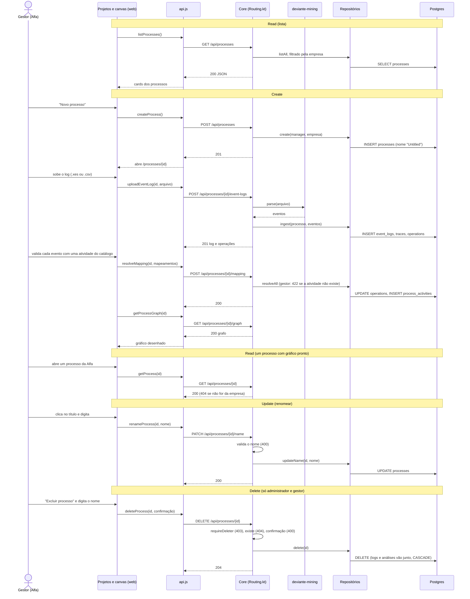
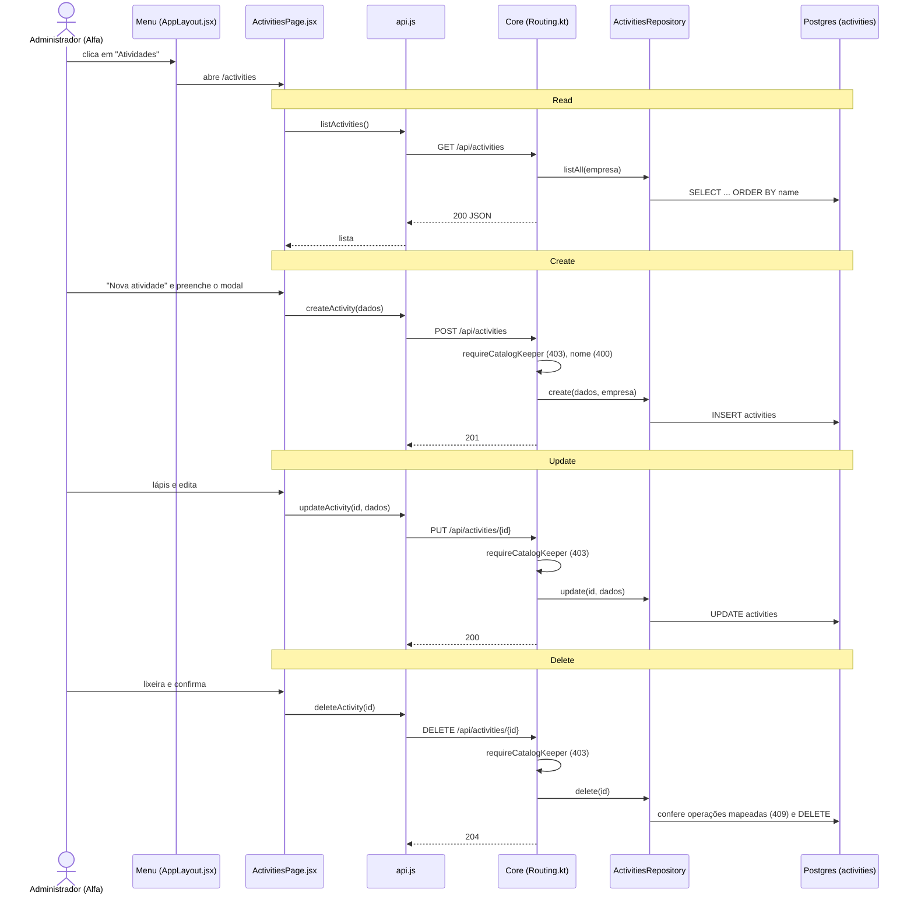

# Defesa Reuso 03: roteiro do Alander (Processo e Atividade)

Prova de autoria em 16/10. Este roteiro cobre dois CRUDs com conexão ao banco: **Processo** e **Atividade**. Os dois rodam no Core: React (Vercel) → Ktor (Fly.io) → Supabase Postgres. O upload do log, dentro do Processo, passa também pelo serviço de mineração (`deviante-mining`, Fly.io), que lê o arquivo.

**Como ler.** Cada trecho de código traz repositório, arquivo, linhas e um link fixo no commit (`deviante-api@d6ab141`, `deviante-web@b69d9b5`). Abaixo de cada trecho vem o que falar.

**Percurso.** Entrar pelo "Modo Protótipo" com a seta na **Alfa**, como **Gestor**. O painel inicial (**Projetos**) é a tela do CRUD de Processo: listar, criar um processo novo e subir um log da Alfa para gerar o gráfico, abrir um processo que já tem gráfico, renomear e excluir. O gestor não tem Operações nem Atividades no menu: ele só mapeia eventos para atividades que já existem. Depois, sair e entrar na **Alfa** como **Administrador**, ir a **Atividades** e fazer o CRUD do catálogo. Em cada tela a ordem é Read, Create, Update e Delete.

## 1. Depois do login: o menu e o token

📍 `deviante-web/src/components/layout/AppLayout.jsx` · linhas 34–40 · [abrir no GitHub](https://github.com/aland3r/deviante-web/blob/b69d9b5/src/components/layout/AppLayout.jsx#L34-L40)

```jsx
          {[
            ['/dashboard', 'Projetos'],
            ['/operations', 'Operações', 'catalog'],
            ['/activities', 'Atividades', 'catalog'],
            ['/equipment', 'Equipamentos', FEATURES.equipment],
            ['/schedules', 'Agendamentos', FEATURES.schedules],
          ].filter(([, , feature]) => !feature || (feature === 'catalog' ? canManageCatalog(user) : hasFeature(user, feature))).map(([to, label]) => (
```

📍 `deviante-web/src/lib/permissions.js` · linhas 7–11 · [abrir no GitHub](https://github.com/aland3r/deviante-web/blob/b69d9b5/src/lib/permissions.js#L7-L11)

```javascript
// Operações e o catálogo de atividades são do administrador da empresa. O gestor
// só mapeia eventos para atividades que já existem. A API também responde 403.
export const CATALOG_ROLES = new Set(['owner', 'admin'])

export const canManageCatalog = (user) => CATALOG_ROLES.has(user?.role)
```

Fala: "O menu leva às telas. Projetos é o painel de processos. Operações e Atividades são o catálogo da empresa e aparecem só para o administrador; o gestor não as vê."

📍 `deviante-api/src/main/kotlin/Routing.kt` · linhas 117–134 · [abrir no GitHub](https://github.com/aland3r/deviante-api/blob/d6ab141/src/main/kotlin/Routing.kt#L117-L134)

```kotlin
private suspend fun ApplicationCall.requireSupabaseUser(authClient: SupabaseAuthClient): SupabaseUser? {
    // Já verificado nesta requisição (ex.: pelo FeatureGate): não pergunta ao Supabase de novo.
    attributes.getOrNull(SupabaseUserKey)?.let { return it }
    val header = request.headers[HttpHeaders.Authorization]
    val token = header?.removePrefix("Bearer ")?.trim()
    if (token.isNullOrBlank()) {
        respond(HttpStatusCode.Unauthorized, ErrorResponse("Você precisa estar autenticado."))
        return null
    }

    val user = authClient.verify(token)
    if (user == null) {
        respond(HttpStatusCode.Unauthorized, ErrorResponse("Sessão inválida ou expirada."))
        return null
    }
    attributes.put(SupabaseUserKey, user)
    return user
}
```

Fala: "Toda rota começa aqui: o front manda o token do Supabase no cabeçalho, o Core confere com o Supabase Auth e responde 401 se não houver token válido. Depois acha o Manager e a empresa em que ele entrou, que filtram e carimbam os registros."

## 2. CRUD de Processo (tela Projetos)



### 2.1 A tabela

📍 `deviante-api/src/main/kotlin/db/ProcessesTable.kt` · linhas 6–20 · [abrir no GitHub](https://github.com/aland3r/deviante-api/blob/d6ab141/src/main/kotlin/db/ProcessesTable.kt#L6-L20)

```kotlin
object ProcessesTable : Table(name = "processes") {
    override val tableName = "deviante.processes"

    val id = uuid("id")
    val managerId = uuid("manager_id").references(ManagersTable.id)
    val businessId = uuid("business_id").references(BusinessesTable.id)
    val name = varchar("name", 100)
    val companyName = varchar("company_name", 255)
    val description = text("description")
    val sector = varchar("sector", 100)
    val createdAt = timestampWithTimeZone("created_at")
    val updatedAt = timestampWithTimeZone("updated_at")

    override val primaryKey = PrimaryKey(id)
}
```

Fala: "Um processo pertence a uma empresa (`business_id`) e guarda quem o criou (`manager_id`). Apagar um processo apaga em cascata os logs, as análises e os vínculos com atividades."

### 2.2 Read: a lista no painel

📍 `deviante-web/src/pages/DashboardPage.jsx` · linhas 323–345 · [abrir no GitHub](https://github.com/aland3r/deviante-web/blob/b69d9b5/src/pages/DashboardPage.jsx#L323-L345)

```jsx
  useEffect(() => {
    let cancelled = false
    Promise.all([
      api.listProcesses(),
      api.listAnalyses().catch(() => []),
      api.listMonitorings().catch(() => []),
    ])
      .then(([processRows, analysisRows, monitoringRows]) => {
        if (cancelled) return
        setProcesses(processRows)
        setAnalyses(analysisRows)
        setMonitorings(monitoringRows)
      })
      .catch((err) => {
        if (!cancelled) {
          setError(err instanceof ApiError ? err.message : 'Não foi possível carregar o painel.')
        }
      })
      .finally(() => {
        if (!cancelled) setLoading(false)
      })
    return () => { cancelled = true }
  }, [])
```

📍 `deviante-web/src/lib/api.js` · linhas 329–329 · [abrir no GitHub](https://github.com/aland3r/deviante-web/blob/b69d9b5/src/lib/api.js#L329-L329)

```javascript
  listProcesses: () => shouldUseRemoteProcesses() ? request('/processes') : mockApi.listProcesses(),
```

📍 `deviante-api/src/main/kotlin/Routing.kt` · linhas 310–323 · [abrir no GitHub](https://github.com/aland3r/deviante-api/blob/d6ab141/src/main/kotlin/Routing.kt#L310-L323)

```kotlin
                get {
                    val supabaseUser = call.requireSupabaseUser(authClient) ?: return@get
                    val manager = managerRepository.findOrCreateForSupabaseUser(
                        supabaseUser.id,
                        supabaseUser.email,
                        supabaseUser.fullNameHint,
                    )
                    val scope = call.companyScope(manager)
                    val labels = businessRepository.namesById()
                    val processes = processRepository.listAll()
                        .filter { scope.sees(it.businessId) }
                        .map { it.toResponse(company = labels[it.businessId]) }
                    call.respond(processes)
                }
```

📍 `deviante-api/src/main/kotlin/repository/ProcessRepository.kt` · linhas 19–24 · [abrir no GitHub](https://github.com/aland3r/deviante-api/blob/d6ab141/src/main/kotlin/repository/ProcessRepository.kt#L19-L24)

```kotlin
    fun listAll(): List<ProcessRecord> = transaction {
        ProcessesTable
            .selectAll()
            .orderBy(ProcessesTable.updatedAt, SortOrder.DESC)
            .map { it.toProcessRecord() }
    }
```

Fala: "Ao abrir o painel, a tela busca os processos. O Core devolve só os da empresa em que entrei; o administrador vê todos, com o nome da empresa em cada card."

### 2.3 Create: "Novo processo" e upload do log

📍 `deviante-web/src/pages/DashboardPage.jsx` · linhas 347–357 · [abrir no GitHub](https://github.com/aland3r/deviante-web/blob/b69d9b5/src/pages/DashboardPage.jsx#L347-L357)

```jsx
  async function handleCreateProcess() {
    setCreating(true)
    setError('')
    try {
      const process = await api.createProcess()
      navigate(`/processes/${process.id}`)
    } catch (err) {
      setError(err instanceof ApiError ? err.message : 'Não foi possível criar o processo.')
      setCreating(false)
    }
  }
```

📍 `deviante-web/src/lib/api.js` · linhas 330–330 · [abrir no GitHub](https://github.com/aland3r/deviante-web/blob/b69d9b5/src/lib/api.js#L330-L330)

```javascript
  createProcess: () => shouldUseRemoteProcesses() ? request('/processes', { method: 'POST' }) : mockApi.createProcess(),
```

📍 `deviante-api/src/main/kotlin/Routing.kt` · linhas 325–334 · [abrir no GitHub](https://github.com/aland3r/deviante-api/blob/d6ab141/src/main/kotlin/Routing.kt#L325-L334)

```kotlin
                post {
                    val supabaseUser = call.requireSupabaseUser(authClient) ?: return@post
                    val manager = managerRepository.findOrCreateForSupabaseUser(
                        supabaseUser.id,
                        supabaseUser.email,
                        supabaseUser.fullNameHint,
                    )
                    val process = processRepository.create(manager.id, call.companyScope(manager).businessId)
                    call.respond(HttpStatusCode.Created, process.toResponse())
                }
```

📍 `deviante-api/src/main/kotlin/repository/ProcessRepository.kt` · linhas 36–63 · [abrir no GitHub](https://github.com/aland3r/deviante-api/blob/d6ab141/src/main/kotlin/repository/ProcessRepository.kt#L36-L63)

```kotlin
    fun create(managerId: UUID, businessId: UUID): ProcessRecord = transaction {
        val now = OffsetDateTime.now()
        val id = UUID.randomUUID()

        ProcessesTable.insert {
            it[ProcessesTable.id] = id
            it[ProcessesTable.managerId] = managerId
            it[ProcessesTable.businessId] = businessId
            it[ProcessesTable.name] = DEFAULT_PROCESS_NAME
            it[ProcessesTable.companyName] = ""
            it[ProcessesTable.description] = ""
            it[ProcessesTable.sector] = ""
            it[ProcessesTable.createdAt] = now
            it[ProcessesTable.updatedAt] = now
        }

        ProcessRecord(
            id = id,
            managerId = managerId,
            businessId = businessId,
            name = DEFAULT_PROCESS_NAME,
            companyName = "",
            description = "",
            sector = "",
            createdAt = now,
            updatedAt = now,
        )
    }
```

Fala: "O botão cria o processo na hora, com nome 'Untitled' (como no Figma), e a tela abre o canvas dele."

Com o processo criado, subo o log de eventos:

📍 `deviante-web/src/components/process-graph/EventLogUploadModal.jsx` · linhas 93–112 · [abrir no GitHub](https://github.com/aland3r/deviante-web/blob/b69d9b5/src/components/process-graph/EventLogUploadModal.jsx#L93-L112)

```jsx
  async function handleUpload() {
    if (!file || uploading || eventLog) return

    setUploading(true)
    setUploadError('')
    setFormatError(false)

    try {
      const result = await api.uploadEventLog(processId, file)
      setEventLog(result.eventLog)
      setRows(result.operations.map((operation) => ({
        operationId: operation.id,
        rawLabel: operation.rawLabel,
        occurrenceCount: operation.occurrenceCount,
        caseCount: operation.caseCount,
        meanDurationSeconds: operation.meanDurationSeconds,
        activityName: operation.suggestedActivityName,
        activityDescription: '',
        rowState: accepts(operation.suggestedActivityName) ? 'suggested' : 'pending',
      })))
```

📍 `deviante-web/src/lib/api.js` · linhas 362–362 · [abrir no GitHub](https://github.com/aland3r/deviante-web/blob/b69d9b5/src/lib/api.js#L362-L362)

```javascript
  uploadEventLog: (processId, file) => upload(`/processes/${processId}/event-logs`, file),
```

📍 `deviante-api/src/main/kotlin/Routing.kt` · linhas 1501–1542 · [abrir no GitHub](https://github.com/aland3r/deviante-api/blob/d6ab141/src/main/kotlin/Routing.kt#L1501-L1542)

```kotlin
                post {
                    val processId = call.parameters["processId"]?.let(::runCatchingUuid)
                    if (processId == null) {
                        call.respond(HttpStatusCode.BadRequest, ErrorResponse("ID de processo inválido."))
                        return@post
                    }
                    if (call.requireProcess(authClient, managerRepository, processRepository, processId) == null) {
                        return@post
                    }

                    val upload = call.receiveUploadedFile()
                    if (upload == null) {
                        call.respond(HttpStatusCode.BadRequest, ErrorResponse("Nenhum arquivo enviado."))
                        return@post
                    }
                    val (fileName, bytes) = upload

                    val extension = fileName.substringAfterLast('.', "").lowercase()
                    if (extension !in setOf("xes", "csv")) {
                        call.respond(
                            HttpStatusCode.UnsupportedMediaType,
                            ErrorResponse("Envie um arquivo .xes ou .csv."),
                        )
                        return@post
                    }

                    val parsed = try {
                        miningClient.parse(fileName, bytes)
                    } catch (err: MiningParseException) {
                        // Keep the failed attempt on the process: a log the
                        // Manager could not parse is history worth showing.
                        ingestionRepository.recordFailure(
                            processId, fileName, extension, err.message ?: "Falha ao interpretar o arquivo.",
                        )
                        call.respond(HttpStatusCode.UnprocessableEntity, ErrorResponse(err.message ?: "Arquivo inválido."))
                        return@post
                    } catch (err: MiningUnavailableException) {
                        call.respond(HttpStatusCode.ServiceUnavailable, ErrorResponse(err.message ?: "Serviço indisponível."))
                        return@post
                    }

                    val ingested = ingestionRepository.ingest(processId, fileName, parsed)
```

Fala: "O arquivo vai para o Core, que aceita só `.xes` ou `.csv` (415 para outros). O serviço de mineração lê o arquivo; se não conseguir, a tentativa fica registrada e a resposta é 422. Depois o Core grava o log, os traços e as operações no banco."

No mapeamento, o gestor só escolhe atividades que já estão no catálogo da Alfa:

📍 `deviante-web/src/components/process-graph/EventLogUploadModal.jsx` · linhas 50–55 · [abrir no GitHub](https://github.com/aland3r/deviante-web/blob/b69d9b5/src/components/process-graph/EventLogUploadModal.jsx#L50-L55)

```jsx
  // Nome aceito: qualquer um para o administrador, só do catálogo para o gestor.
  function accepts(name) {
    const key = name?.trim().toLocaleLowerCase('pt-BR')
    if (!key) return false
    return mayCreate || activityCatalog.some((activity) => activity.name.toLocaleLowerCase('pt-BR') === key)
  }
```

📍 `deviante-api/src/main/kotlin/Routing.kt` · linhas 1616–1623 · [abrir no GitHub](https://github.com/aland3r/deviante-api/blob/d6ab141/src/main/kotlin/Routing.kt#L1616-L1623)

```kotlin
                    // O gestor só mapeia para atividades que já existem no catálogo;
                    // criar atividade nova é do administrador.
                    val result = try {
                        mappingRepository.resolveAll(processId, resolutions, process.businessId, manager.keepsCatalog())
                    } catch (e: MappingRepository.UnknownActivitiesException) {
                        call.respond(HttpStatusCode.UnprocessableEntity, ErrorResponse(e.message ?: "Atividade fora do catálogo."))
                        return@post
                    }
```

📍 `deviante-api/src/main/kotlin/repository/MappingRepository.kt` · linhas 62–64 · [abrir no GitHub](https://github.com/aland3r/deviante-api/blob/d6ab141/src/main/kotlin/repository/MappingRepository.kt#L62-L64)

```kotlin
        val unknown = resolutions.map { it.activityName.trim() }.distinctBy { it.lowercase() }
            .filter { findActivityByName(it, businessId) == null }
        if (unknown.isNotEmpty() && !allowCreate) throw UnknownActivitiesException(unknown)
```

Fala: "Cada evento do log aparece com a atividade sugerida. Para o gestor, só vale um nome que já existe no catálogo da empresa; um nome novo fica pendente, e o Core recusa com 422 se chegar assim. Confirmado o mapeamento, a tela pede o gráfico:"

📍 `deviante-web/src/components/process-graph/ProcessGraphTab.jsx` · linhas 609–616 · [abrir no GitHub](https://github.com/aland3r/deviante-web/blob/b69d9b5/src/components/process-graph/ProcessGraphTab.jsx#L609-L616)

```jsx
    Promise.all([
      api.getProcessGraph(processId, selectedEventLogIdList),
      api.getProcessTraces(processId, selectedEventLogIdList).catch(() => ({ variants: [] })),
    ])
      .then(([graphData, traceData]) => {
        if (cancelled) return
        setGraph(graphData)
        setVariants(traceData.variants ?? [])
```

📍 `deviante-web/src/lib/api.js` · linhas 367–370 · [abrir no GitHub](https://github.com/aland3r/deviante-web/blob/b69d9b5/src/lib/api.js#L367-L370)

```javascript
  getProcessGraph: (processId, eventLogIds = []) => {
    const query = new URLSearchParams(eventLogIds.map((id) => ['eventLogId', id])).toString()
    return request(`/processes/${processId}/graph${query ? `?${query}` : ''}`)
  },
```

📍 `deviante-api/src/main/kotlin/Routing.kt` · linhas 1032–1061 · [abrir no GitHub](https://github.com/aland3r/deviante-api/blob/d6ab141/src/main/kotlin/Routing.kt#L1032-L1061)

```kotlin
            route("/processes/{processId}/graph") {
                get {
                    val processId = call.parameters["processId"]?.let(::runCatchingUuid)
                    if (processId == null) {
                        call.respond(HttpStatusCode.BadRequest, ErrorResponse("ID de processo inválido."))
                        return@get
                    }
                    if (call.requireProcess(authClient, managerRepository, processRepository, processId) == null) {
                        return@get
                    }

                    val eventLogIds = call.request.queryParameters.getAll("eventLogId").orEmpty()
                        .mapNotNull(::runCatchingUuid)
                        .toSet()
                    if (eventLogIds.size != call.request.queryParameters.getAll("eventLogId").orEmpty().size) {
                        call.respond(HttpStatusCode.BadRequest, ErrorResponse("ID de log de eventos inválido."))
                        return@get
                    }
                    if (eventLogIds.isNotEmpty()) {
                        val available = eventLogsRepository.findByProcessId(processId)
                            .filter { it.parseStatus == "parsed" }
                            .map { it.id }
                            .toSet()
                        if (!available.containsAll(eventLogIds)) {
                            call.respond(HttpStatusCode.BadRequest, ErrorResponse("Selecione apenas logs parseados deste processo."))
                            return@get
                        }
                    }
                    call.respond(graphRepository.graph(processId, eventLogIds))
                }
```

### 2.4 Read: abrir um processo que já tem gráfico

📍 `deviante-web/src/pages/ProcessCanvasPage.jsx` · linhas 65–75 · [abrir no GitHub](https://github.com/aland3r/deviante-web/blob/b69d9b5/src/pages/ProcessCanvasPage.jsx#L65-L75)

```jsx
  useEffect(() => {
    let cancelled = false
    setLoading(true)
    api.getProcess(processId)
      .then((data) => { if (!cancelled) { setProcess(data); setTitleDraft(data.name ?? '') } })
      .catch((err) => {
        if (!cancelled) setLoadError(err instanceof ApiError ? err.message : 'Não foi possível carregar este processo.')
      })
      .finally(() => { if (!cancelled) setLoading(false) })
    return () => { cancelled = true }
  }, [processId])
```

📍 `deviante-web/src/lib/api.js` · linhas 331–331 · [abrir no GitHub](https://github.com/aland3r/deviante-web/blob/b69d9b5/src/lib/api.js#L331-L331)

```javascript
  getProcess: (id) => shouldUseRemoteProcesses() ? request(`/processes/${id}`) : mockApi.getProcess(id),
```

📍 `deviante-api/src/main/kotlin/Routing.kt` · linhas 336–355 · [abrir no GitHub](https://github.com/aland3r/deviante-api/blob/d6ab141/src/main/kotlin/Routing.kt#L336-L355)

```kotlin
                get("/{id}") {
                    val supabaseUser = call.requireSupabaseUser(authClient) ?: return@get
                    val id = call.parameters["id"]?.let(::runCatchingUuid)
                    if (id == null) {
                        call.respond(HttpStatusCode.BadRequest, ErrorResponse("ID de processo inválido."))
                        return@get
                    }
                    val manager = managerRepository.findOrCreateForSupabaseUser(
                        supabaseUser.id,
                        supabaseUser.email,
                        supabaseUser.fullNameHint,
                    )
                    val process = processRepository.findById(id)
                        ?.takeIf { call.companyScope(manager).sees(it.businessId) }
                    if (process == null) {
                        call.respond(HttpStatusCode.NotFound, ErrorResponse("Processo não encontrado."))
                        return@get
                    }
                    call.respond(process.toResponse())
                }
```

📍 `deviante-api/src/main/kotlin/repository/ProcessRepository.kt` · linhas 26–34 · [abrir no GitHub](https://github.com/aland3r/deviante-api/blob/d6ab141/src/main/kotlin/repository/ProcessRepository.kt#L26-L34)

```kotlin
    fun findById(id: UUID): ProcessRecord? = transaction {
        ProcessesTable
            .selectAll()
            .where { ProcessesTable.id eq id }
            .limit(1)
            .firstOrNull()
            ?.toProcessRecord()
    }

```

Fala: "O id vem da URL. Se não for UUID, 400; se não existir ou for de outra empresa, 404."

### 2.5 Update: clicar no título

📍 `deviante-web/src/pages/ProcessCanvasPage.jsx` · linhas 179–194 · [abrir no GitHub](https://github.com/aland3r/deviante-web/blob/b69d9b5/src/pages/ProcessCanvasPage.jsx#L179-L194)

```jsx
          {editingTitle ? (
            <input ref={titleInputRef} value={titleDraft} onChange={(e) => setTitleDraft(e.target.value)}
              onBlur={commitTitle} maxLength={100}
              onKeyDown={(e) => {
                if (e.key === 'Enter') commitTitle()
                if (e.key === 'Escape') { setTitleDraft(process.name ?? ''); setEditingTitle(false) }
              }}
              className="text-[13px] font-semibold bg-transparent border-0 outline-none text-foreground"
              style={{ borderBottom: '1px solid var(--accent-strong)', paddingBottom: '1px', minWidth: '180px', letterSpacing: '-0.01em' }} />
          ) : (
            <button onClick={() => { setTitleError(''); setEditingTitle(true) }} title="Renomear processo"
              className="text-[13px] font-semibold text-left text-foreground hover:text-white hover:bg-white/[0.06] rounded px-1.5 -mx-1.5 py-0.5 transition-colors truncate"
              style={{ letterSpacing: '-0.01em' }}>
              {process.name || 'Processo sem nome'}
            </button>
          )}
```

📍 `deviante-web/src/pages/ProcessCanvasPage.jsx` · linhas 95–109 · [abrir no GitHub](https://github.com/aland3r/deviante-web/blob/b69d9b5/src/pages/ProcessCanvasPage.jsx#L95-L109)

```jsx
  async function commitTitle() {
    setEditingTitle(false)
    const name = titleDraft.trim()
    if (!name || name === process.name) { setTitleDraft(process.name ?? ''); return }

    try {
      const updated = await api.renameProcess(processId, name)
      setProcess(updated)
      setTitleDraft(updated.name ?? '')
      setTitleError('')
    } catch (err) {
      setTitleDraft(process.name ?? '')
      setTitleError(err instanceof ApiError ? err.message : 'Não foi possível renomear o processo.')
    }
  }
```

📍 `deviante-web/src/lib/api.js` · linhas 335–337 · [abrir no GitHub](https://github.com/aland3r/deviante-web/blob/b69d9b5/src/lib/api.js#L335-L337)

```javascript
  renameProcess: (id, name) => shouldUseRemoteProcesses()
    ? request(`/processes/${id}/name`, { method: 'PATCH', body: JSON.stringify({ name }) })
    : mockApi.renameProcess(id, name),
```

📍 `deviante-api/src/main/kotlin/Routing.kt` · linhas 400–430 · [abrir no GitHub](https://github.com/aland3r/deviante-api/blob/d6ab141/src/main/kotlin/Routing.kt#L400-L430)

```kotlin
                patch("/{id}/name") {
                    val id = call.parameters["id"]?.let(::runCatchingUuid)
                    if (id == null) {
                        call.respond(HttpStatusCode.BadRequest, ErrorResponse("ID de processo inválido."))
                        return@patch
                    }
                    if (call.requireProcess(authClient, managerRepository, processRepository, id) == null) {
                        return@patch
                    }

                    val name = call.receive<RenameProcessRequest>().name.trim()
                    val nameError = when {
                        name.isBlank() -> "O nome do processo não pode ficar em branco."
                        name.length > 100 -> "O nome do processo deve ter no máximo 100 caracteres."
                        else -> null
                    }
                    if (nameError != null) {
                        call.respond(
                            HttpStatusCode.BadRequest,
                            ErrorResponse("Corrija o nome do processo.", mapOf("name" to nameError)),
                        )
                        return@patch
                    }

                    val updated = processRepository.updateName(id, name)
                    if (updated == null) {
                        call.respond(HttpStatusCode.NotFound, ErrorResponse("Processo não encontrado."))
                        return@patch
                    }
                    call.respond(updated.toResponse())
                }
```

📍 `deviante-api/src/main/kotlin/Routing.kt` · linhas 77–96 · [abrir no GitHub](https://github.com/aland3r/deviante-api/blob/d6ab141/src/main/kotlin/Routing.kt#L77-L96)

```kotlin
private suspend fun ApplicationCall.requireProcess(
    authClient: SupabaseAuthClient,
    managerRepository: ManagerRepository,
    processRepository: ProcessRepository,
    processId: UUID,
): ProcessRecord? {
    val supabaseUser = requireSupabaseUser(authClient) ?: return null
    val manager = managerRepository.findOrCreateForSupabaseUser(
        supabaseUser.id,
        supabaseUser.email,
        supabaseUser.fullNameHint,
    )
    val process = processRepository.findById(processId)
        ?.takeIf { companyScope(manager).sees(it.businessId) }
    if (process == null) {
        respond(HttpStatusCode.NotFound, ErrorResponse("Processo não encontrado."))
        return null
    }
    return process
}
```

📍 `deviante-api/src/main/kotlin/repository/ProcessRepository.kt` · linhas 84–92 · [abrir no GitHub](https://github.com/aland3r/deviante-api/blob/d6ab141/src/main/kotlin/repository/ProcessRepository.kt#L84-L92)

```kotlin
    fun updateName(id: UUID, name: String): ProcessRecord? = transaction {
        val updated = ProcessesTable.update({ ProcessesTable.id eq id }) {
            it[ProcessesTable.name] = name
            it[ProcessesTable.updatedAt] = OffsetDateTime.now()
        }
        if (updated == 0) return@transaction null

        findById(id)
    }
```

Fala: "Clicar no título vira um campo; Enter salva com `PATCH /api/processes/{id}/name`. A rota usa `requireProcess` (autentica e confere se o processo é da empresa) e valida o nome: em branco ou com mais de 100 caracteres dá 400."

### 2.6 Delete: menu de ações, "Excluir processo" (só administrador e gestor)

📍 `deviante-web/src/lib/permissions.js` · linhas 1–5 · [abrir no GitHub](https://github.com/aland3r/deviante-web/blob/b69d9b5/src/lib/permissions.js#L1-L5)

```javascript
// Excluir (processo, atividade, equipamento, agenda) é só do administrador e do
// gestor. A API repete a regra (403); aqui ela só decide se o botão aparece.
export const DELETE_ROLES = new Set(['owner', 'admin', 'manager'])

export const canDelete = (user) => DELETE_ROLES.has(user?.role)
```

📍 `deviante-web/src/pages/ProcessCanvasPage.jsx` · linhas 203–203 · [abrir no GitHub](https://github.com/aland3r/deviante-web/blob/b69d9b5/src/pages/ProcessCanvasPage.jsx#L203-L203)

```jsx
        {canDelete(user) && <ProjectActionsMenu onDelete={deleteCurrentProcess} deleteLabel="Excluir processo" />}
```

📍 `deviante-web/src/pages/ProcessCanvasPage.jsx` · linhas 111–120 · [abrir no GitHub](https://github.com/aland3r/deviante-web/blob/b69d9b5/src/pages/ProcessCanvasPage.jsx#L111-L120)

```jsx
  async function deleteCurrentProcess() {
    const processName = window.prompt(`Digite exatamente o nome do processo para excluir:\n${process.name}`)
    if (processName == null) return
    try {
      await api.deleteProcess(processId, { processName, confirmationPhrase: 'quero excluir este processo' })
      navigate('/dashboard', { replace: true })
    } catch (err) {
      setTitleError(err instanceof ApiError ? err.message : 'Não foi possível excluir o processo.')
    }
  }
```

📍 `deviante-web/src/lib/api.js` · linhas 338–340 · [abrir no GitHub](https://github.com/aland3r/deviante-web/blob/b69d9b5/src/lib/api.js#L338-L340)

```javascript
  deleteProcess: (id, confirmation) => shouldUseRemoteProcesses()
    ? request(`/processes/${id}`, { method: 'DELETE', body: JSON.stringify(confirmation) })
    : mockApi.deleteProcess(id, confirmation),
```

📍 `deviante-api/src/main/kotlin/Routing.kt` · linhas 432–463 · [abrir no GitHub](https://github.com/aland3r/deviante-api/blob/d6ab141/src/main/kotlin/Routing.kt#L432-L463)

```kotlin
                delete("/{id}") {
                    val deleter = call.requireDeleter(authClient, managerRepository) ?: return@delete
                    val id = call.parameters["id"]?.let(::runCatchingUuid)
                    if (id == null) {
                        call.respond(HttpStatusCode.BadRequest, ErrorResponse("ID de processo inválido."))
                        return@delete
                    }

                    val process = processRepository.findById(id)
                        ?.takeIf { call.companyScope(deleter).sees(it.businessId) }
                    if (process == null) {
                        call.respond(HttpStatusCode.NotFound, ErrorResponse("Processo não encontrado."))
                        return@delete
                    }

                    val body = call.receive<DeleteProcessRequest>()
                    val fieldErrors = validateProcessDeletion(body, process.name)
                    if (fieldErrors.isNotEmpty()) {
                        call.respond(
                            HttpStatusCode.BadRequest,
                            ErrorResponse("Confirme a exclusão do processo.", fieldErrors),
                        )
                        return@delete
                    }

                    val deleted = processRepository.delete(id)
                    if (!deleted) {
                        call.respond(HttpStatusCode.NotFound, ErrorResponse("Processo não encontrado."))
                        return@delete
                    }
                    call.respond(HttpStatusCode.NoContent)
                }
```

📍 `deviante-api/src/main/kotlin/repository/ProcessRepository.kt` · linhas 94–96 · [abrir no GitHub](https://github.com/aland3r/deviante-api/blob/d6ab141/src/main/kotlin/repository/ProcessRepository.kt#L94-L96)

```kotlin
    fun delete(id: UUID): Boolean = transaction {
        ProcessesTable.deleteWhere { ProcessesTable.id eq id } > 0
    }
```

Fala: "O menu de exclusão só aparece para administrador e gestor. A tela pede que eu digite o nome do processo. O Core checa, nesta ordem: papel (403), existência (404) e confirmação (400). Só então apaga, e o banco remove os dependentes em cascata. Resposta 204."

### 2.7 Demonstração

1. Entrar na **Alfa** como **Gestor**. **Read:** mostrar os processos da Alfa no painel.
2. **Create:** "Novo processo". No canvas, subir o `DR_MS_ST_20` da pasta de datasets da Alfa. Os 6 eventos chegam sugeridos com as atividades do catálogo; validar cada um e confirmar. O gráfico aparece.
3. **Read:** voltar ao painel e abrir um processo da Alfa que já tem gráfico.
4. **Update:** clicar no título do processo novo e renomear (`PATCH`, 200).
5. **Delete:** excluir o processo novo, digitando o nome (204). Os 4 processos do artigo continuam lá.

## 3. CRUD de Atividade (tela Atividades, como Administrador)



### 3.1 A tabela

📍 `deviante-api/src/main/kotlin/db/ActivitiesTable.kt` · linhas 6–28 · [abrir no GitHub](https://github.com/aland3r/deviante-api/blob/d6ab141/src/main/kotlin/db/ActivitiesTable.kt#L6-L28)

```kotlin
object ActivitiesTable : Table(name = "activities") {
    override val tableName = "deviante.activities"

    val id = uuid("id")
    // cada empresa tem o próprio catálogo de atividades
    val businessId = uuid("business_id").references(BusinessesTable.id)
    val name = varchar("name", 150)
    val description = text("description")
    val createdAt = timestampWithTimeZone("created_at")
    val updatedAt = timestampWithTimeZone("updated_at")

    override val primaryKey = PrimaryKey(id)
}

object ProcessActivitiesTable : Table(name = "process_activities") {
    override val tableName = "deviante.process_activities"

    val processId = uuid("process_id").references(ProcessesTable.id)
    val activityId = uuid("activity_id").references(ActivitiesTable.id)
    val createdAt = timestampWithTimeZone("created_at")

    override val primaryKey = PrimaryKey(processId, activityId)
}
```

Fala: "Atividade é um catálogo, e cada empresa tem o seu (`business_id`). A junção `process_activities` diz quais atividades cada processo usa (N:N). Se alguma operação de log estiver mapeada para a atividade, o banco não deixa apagar."

### 3.2 Read: abrir Atividades

📍 `deviante-web/src/pages/ActivitiesPage.jsx` · linhas 15–33 · [abrir no GitHub](https://github.com/aland3r/deviante-web/blob/b69d9b5/src/pages/ActivitiesPage.jsx#L15-L33)

```jsx
export default function ActivitiesPage() {
  const [rows, setRows] = useState([])
  const [query, setQuery] = useState('')
  const [error, setError] = useState('')
  const [loading, setLoading] = useState(true)
  const [editing, setEditing] = useState(null) // null = fechado, {} = nova, linha = edição
  const { user } = useAuth()
  const allowDelete = canDelete(user)

  const load = () => api.listActivities()
    .then((data) => setRows(Array.isArray(data) ? data : data?.items ?? []))
    .catch((err) => setError(err instanceof ApiError ? err.message : 'Não foi possível carregar as atividades.'))
    .finally(() => setLoading(false))
  useEffect(() => { load() }, [])

  const visible = useMemo(() => {
    const term = query.trim().toLowerCase()
    return rows.filter((row) => !term || `${row.name} ${row.description ?? ''}`.toLowerCase().includes(term))
  }, [rows, query])
```

📍 `deviante-api/src/main/kotlin/Routing.kt` · linhas 467–477 · [abrir no GitHub](https://github.com/aland3r/deviante-api/blob/d6ab141/src/main/kotlin/Routing.kt#L467-L477)

```kotlin
                get {
                    val supabaseUser = call.requireSupabaseUser(authClient) ?: return@get
                    val manager = managerRepository.findOrCreateForSupabaseUser(
                        supabaseUser.id,
                        supabaseUser.email,
                        supabaseUser.fullNameHint,
                    )
                    // Catálogo da empresa escolhida, também para o administrador.
                    val activities = activitiesRepository.listAll(call.companyScope(manager).businessId).map { it.toResponse() }
                    call.respond(activities)
                }
```

📍 `deviante-api/src/main/kotlin/repository/ActivitiesRepository.kt` · linhas 24–31 · [abrir no GitHub](https://github.com/aland3r/deviante-api/blob/d6ab141/src/main/kotlin/repository/ActivitiesRepository.kt#L24-L31)

```kotlin
    /** Catálogo de atividades de uma empresa. */
    fun listAll(businessId: UUID): List<ActivityRecord> = transaction {
        ActivitiesTable
            .selectAll()
            .where { ActivitiesTable.businessId eq businessId }
            .orderBy(ActivitiesTable.name, SortOrder.ASC)
            .map { it.toActivityRecord() }
    }
```

Fala: "A tela chama `GET /api/activities`. O Core devolve o catálogo da empresa em que entrei, mesmo para o administrador, ordenado por nome; a busca filtra no próprio navegador."

### 3.3 Create e Update: "Nova atividade" ou lápis

📍 `deviante-web/src/pages/ActivitiesPage.jsx` · linhas 96–114 · [abrir no GitHub](https://github.com/aland3r/deviante-web/blob/b69d9b5/src/pages/ActivitiesPage.jsx#L96-L114)

```jsx
  async function submit() {
    setBusy(true); setError('')
    try {
      const saved = initial.id
        ? await api.updateActivity(initial.id, { name: name.trim(), description: description.trim() })
        : await api.createActivity({ name: name.trim(), description: description.trim() })
      const added = [...selected].filter((id) => !linked.has(id))
      const removed = [...linked].filter((id) => !selected.has(id))
      await Promise.all([
        ...added.map((processId) => api.addProcessActivity(processId, saved.id)),
        ...removed.map((processId) => api.removeProcessActivity(processId, saved.id)),
      ])
      onSaved()
    } catch (err) {
      setError(err instanceof ApiError ? err.message : 'Não foi possível salvar a atividade.')
    } finally {
      setBusy(false)
    }
  }
```

📍 `deviante-api/src/main/kotlin/Routing.kt` · linhas 479–495 · [abrir no GitHub](https://github.com/aland3r/deviante-api/blob/d6ab141/src/main/kotlin/Routing.kt#L479-L495)

```kotlin
                post {
                    val manager = call.requireCatalogKeeper(authClient, managerRepository) ?: return@post
                    val body = call.receive<CreateActivityRequest>()

                    val fieldErrors = mutableMapOf<String, String>()
                    if (body.name.isBlank()) fieldErrors["name"] = "Nome da atividade é obrigatório."
                    if (fieldErrors.isNotEmpty()) {
                        call.respond(HttpStatusCode.BadRequest, ErrorResponse("Corrija os campos destacados.", fieldErrors))
                        return@post
                    }

                    val activity = activitiesRepository.create(
                        name = body.name.trim(),
                        description = body.description.trim(),
                        businessId = call.companyScope(manager).businessId,
                    )
                    call.respond(HttpStatusCode.Created, activity.toResponse())
```

📍 `deviante-api/src/main/kotlin/Routing.kt` · linhas 231–246 · [abrir no GitHub](https://github.com/aland3r/deviante-api/blob/d6ab141/src/main/kotlin/Routing.kt#L231-L246)

```kotlin
/**
 * O catálogo de atividades e as operações são do administrador da empresa;
 * gestor, operador, técnico e mentor recebem 403.
 */
private suspend fun ApplicationCall.requireCatalogKeeper(
    authClient: SupabaseAuthClient,
    managerRepository: ManagerRepository,
): ManagerRecord? {
    val user = requireSupabaseUser(authClient) ?: return null
    val manager = managerRepository.findOrCreateForSupabaseUser(user.id, user.email, user.fullNameHint)
    if (!manager.keepsCatalog()) {
        respond(HttpStatusCode.Forbidden, ErrorResponse("Somente o administrador mantém o catálogo de atividades."))
        return null
    }
    return manager
}
```

📍 `deviante-api/src/main/kotlin/repository/ActivitiesRepository.kt` · linhas 51–72 · [abrir no GitHub](https://github.com/aland3r/deviante-api/blob/d6ab141/src/main/kotlin/repository/ActivitiesRepository.kt#L51-L72)

```kotlin
    fun create(name: String, description: String, businessId: UUID): ActivityRecord = transaction {
        val now = OffsetDateTime.now()
        val id = UUID.randomUUID()

        ActivitiesTable.insert {
            it[ActivitiesTable.id] = id
            it[ActivitiesTable.businessId] = businessId
            it[ActivitiesTable.name] = name
            it[ActivitiesTable.description] = description
            it[ActivitiesTable.createdAt] = now
            it[ActivitiesTable.updatedAt] = now
        }

        ActivityRecord(
            id = id,
            name = name,
            description = description,
            createdAt = now,
            updatedAt = now,
            businessId = businessId,
        )
    }
```

📍 `deviante-api/src/main/kotlin/Routing.kt` · linhas 519–546 · [abrir no GitHub](https://github.com/aland3r/deviante-api/blob/d6ab141/src/main/kotlin/Routing.kt#L519-L546)

```kotlin
                put("/{id}") {
                    val manager = call.requireCatalogKeeper(authClient, managerRepository) ?: return@put
                    val id = call.parameters["id"]?.let(::runCatchingUuid)
                        ?.takeIf { activitiesRepository.findById(it)?.businessId == call.companyScope(manager).businessId }
                    if (id == null) {
                        call.respond(HttpStatusCode.BadRequest, ErrorResponse("ID de atividade inválido."))
                        return@put
                    }
                    val body = call.receive<UpdateActivityRequest>()

                    val fieldErrors = mutableMapOf<String, String>()
                    if (body.name.isBlank()) fieldErrors["name"] = "Nome da atividade é obrigatório."
                    if (fieldErrors.isNotEmpty()) {
                        call.respond(HttpStatusCode.BadRequest, ErrorResponse("Corrija os campos destacados.", fieldErrors))
                        return@put
                    }

                    val updated = activitiesRepository.update(
                        id = id,
                        name = body.name.trim(),
                        description = body.description.trim(),
                    )
                    if (updated == null) {
                        call.respond(HttpStatusCode.NotFound, ErrorResponse("Atividade não encontrada."))
                        return@put
                    }
                    call.respond(updated.toResponse())
                }
```

📍 `deviante-api/src/main/kotlin/repository/ActivitiesRepository.kt` · linhas 74–84 · [abrir no GitHub](https://github.com/aland3r/deviante-api/blob/d6ab141/src/main/kotlin/repository/ActivitiesRepository.kt#L74-L84)

```kotlin
    fun update(id: UUID, name: String, description: String): ActivityRecord? = transaction {
        val now = OffsetDateTime.now()
        val updated = ActivitiesTable.update({ ActivitiesTable.id eq id }) {
            it[ActivitiesTable.name] = name
            it[ActivitiesTable.description] = description
            it[ActivitiesTable.updatedAt] = now
        }
        if (updated == 0) return@transaction null

        findById(id)
    }
```

Fala: "O mesmo modal cria (`POST`, 201) ou edita (`PUT`, 200). Antes de tudo, `requireCatalogKeeper` confere o papel: só administrador mexe no catálogo, os outros recebem 403. Nome em branco volta 400 com o erro no campo. A atividade nova nasce na empresa em que entrei."

### 3.4 Delete: lixeira

📍 `deviante-web/src/pages/ActivitiesPage.jsx` · linhas 35–43 · [abrir no GitHub](https://github.com/aland3r/deviante-web/blob/b69d9b5/src/pages/ActivitiesPage.jsx#L35-L43)

```jsx
  async function remove(activity) {
    if (!window.confirm(`Excluir a atividade "${activity.name}"? Ela sai de todos os processos em que aparece.`)) return
    try {
      await api.deleteActivity(activity.id)
      setRows((current) => current.filter((row) => row.id !== activity.id))
    } catch (err) {
      setError(err instanceof ApiError ? err.message : 'Não foi possível excluir a atividade.')
    }
  }
```

📍 `deviante-web/src/pages/ActivitiesPage.jsx` · linhas 57–57 · [abrir no GitHub](https://github.com/aland3r/deviante-web/blob/b69d9b5/src/pages/ActivitiesPage.jsx#L57-L57)

```jsx
        {allowDelete && <button type="button" onClick={() => remove(activity)} aria-label={`Excluir ${activity.name}`} className="p-1.5 rounded hover:bg-red-950/40" style={{ color: 'var(--crit-soft)' }}><Trash2 size={12} /></button>}
```

📍 `deviante-api/src/main/kotlin/Routing.kt` · linhas 548–564 · [abrir no GitHub](https://github.com/aland3r/deviante-api/blob/d6ab141/src/main/kotlin/Routing.kt#L548-L564)

```kotlin
                delete("/{id}") {
                    val manager = call.requireCatalogKeeper(authClient, managerRepository) ?: return@delete
                    val id = call.parameters["id"]?.let(::runCatchingUuid)
                        ?.takeIf { activitiesRepository.findById(it)?.businessId == call.companyScope(manager).businessId }
                    if (id == null) {
                        call.respond(HttpStatusCode.BadRequest, ErrorResponse("ID de atividade inválido."))
                        return@delete
                    }
                    when (activitiesRepository.delete(id)) {
                        ActivityDeletion.DELETED -> call.respond(HttpStatusCode.NoContent)
                        ActivityDeletion.NOT_FOUND ->
                            call.respond(HttpStatusCode.NotFound, ErrorResponse("Atividade não encontrada."))
                        ActivityDeletion.IN_USE -> call.respond(
                            HttpStatusCode.Conflict,
                            ErrorResponse("A atividade está mapeada em operações de um log e não pode ser excluída."),
                        )
                    }
```

📍 `deviante-api/src/main/kotlin/repository/ActivitiesRepository.kt` · linhas 86–95 · [abrir no GitHub](https://github.com/aland3r/deviante-api/blob/d6ab141/src/main/kotlin/repository/ActivitiesRepository.kt#L86-L95)

```kotlin
    /**
     * Exclui a atividade. Os vínculos com processos caem em cascata no banco;
     * se alguma operação de log estiver mapeada para ela, a exclusão é recusada.
     */
    fun delete(id: UUID): ActivityDeletion = transaction {
        val inUse = OperationsTable.selectAll().where { OperationsTable.activityId eq id }.limit(1).any()
        if (inUse) return@transaction ActivityDeletion.IN_USE
        val deleted = ActivitiesTable.deleteWhere { ActivitiesTable.id eq id }
        if (deleted > 0) ActivityDeletion.DELETED else ActivityDeletion.NOT_FOUND
    }
```

Fala: "A tela inteira é só do administrador, e o Core confere o papel de novo (403). Se a atividade estiver em uso por operações de log, a resposta é 409; sem uso, apaga e responde 204."

### 3.5 Demonstração

1. Sair e entrar na **Alfa** como **Administrador**. Clicar em **Atividades** no menu.
2. **Read:** mostrar a lista e a busca.
3. **Create:** "Nova atividade": "Inspeção" (`POST`, 201).
4. **Update:** lápis, trocar para "Inspeção final" (`PUT`, 200).
5. **Delete:** lixeira na "Inspeção final" (204). Na `Machine_Operating`, a lixeira responde 409: ela está mapeada nos logs.

## 4. Perguntas prováveis

- **Por que o front não acessa o banco direto?** A credencial do Postgres ficaria no navegador. O Core concentra a regra (papel, validação, confirmação) e é o único com acesso ao banco.
- **Onde fica a transação?** Cada função de repositório roda em `transaction { }` do Exposed.
- **O que acontece com os dados de um processo excluído?** O banco apaga em cascata logs, análises e vínculos, e deixa a agenda de manutenção sem processo (`SET NULL`).

## 5. Antes de ensaiar

- [ ] Ter no computador o `DR_MS_ST_20` da pasta de datasets da Alfa para o upload.
- [ ] Entrar com a seta na **Alfa** e conferir os 4 processos do artigo com gráfico pronto.
- [ ] Ensaiar com o **Gestor** (Processo, sem Atividades no menu) e o **Administrador** (Atividades).
