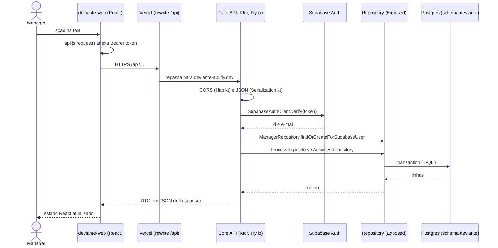

# Defesa Reuso 03: roteiro do Alander (Processo e Atividade)

Prova de autoria em 16/10. Cada integrante demonstra 2 CRUDs com conexão ao banco e explica o caminho do código. Este roteiro cobre **Processo** e **Atividade**. Os dois rodam só no Core (React → Ktor → Supabase Postgres), sem Function nem microsserviços.

**Como ler.** Cada trecho de código traz a localização exata: repositório, arquivo, linhas e um link fixo no commit (`deviante-api@1b5106c`, `deviante-web@203e38d`), que não muda mesmo que a `main` ande. Abaixo de cada trecho vem o que falar. Os blocos marcados **A DESENVOLVER** ainda não existem no código: trazem o código proposto e o lugar exato onde entra; depois do desenvolvimento, troque o bloco pelo link real.

## 0. Mapa do sistema

| Peça | Onde roda | Endereço | Código |
|---|---|---|---|
| Telas | Vercel | `https://deviante.alander.io` (`/dashboard`, `/processes/{id}`, `/activities`) | `aland3r/deviante-web` |
| Proxy da API | Vercel (rewrite) | `https://deviante.alander.io/api/*` → `https://deviante-api.fly.dev/api/*` | `deviante-web/vercel.json` |
| Core API | Fly.io, app `deviante-api`, região `iad` | `https://deviante-api.fly.dev/api` | `aland3r/deviante-api` (`src/main/kotlin`) |
| Autenticação | Supabase Auth (Google e contas demo) | `https://<projeto>.supabase.co/auth/v1/user` | chamado por `SupabaseAuth.kt` |
| Banco | Supabase Postgres, schema `deviante` | tabelas `processes`, `activities`, `process_activities`, `managers`, `users` | mapeado em `src/main/kotlin/db/*.kt` |
| Mining (não usado nos CRUDs) | Fly.io, app `deviante-mining` | só o Core chama | `deviante-api/mining/` |

📍 `deviante-web/vercel.json` · linhas 1–6 · [abrir no GitHub](https://github.com/aland3r/deviante-web/blob/203e38d/vercel.json#L1-L6)

```json
{
  "rewrites": [
    { "source": "/api/(.*)", "destination": "https://deviante-api.fly.dev/api/$1" },
    { "source": "/(.*)", "destination": "/index.html" }
  ]
}
```

O navegador sempre chama `/api/...` no próprio domínio do site; a Vercel repassa para o Fly.io. Por isso o front não precisa saber o endereço do Core.

## 1. O caminho comum (falar uma vez, no início)



### 1.1 Front: o cliente HTTP

📍 `deviante-web/src/lib/api.js` · linhas 27–27 · [abrir no GitHub](https://github.com/aland3r/deviante-web/blob/203e38d/src/lib/api.js#L27-L27)

```javascript
const API_BASE = import.meta.env.VITE_API_URL ?? '/api'
```

📍 `deviante-web/src/lib/api.js` · linhas 243–267 · [abrir no GitHub](https://github.com/aland3r/deviante-web/blob/203e38d/src/lib/api.js#L243-L267)

```javascript
async function authHeader() {
  if (!isSupabaseConfigured()) return {}
  const { data } = await getSupabase().auth.getSession()
  const token = data.session?.access_token
  return token ? { Authorization: `Bearer ${token}` } : {}
}

async function request(path, options = {}) {
  const response = await fetch(`${API_BASE}${path}`, {
    headers: {
      'Content-Type': 'application/json',
      ...(await authHeader()),
      ...(options.headers ?? {}),
    },
    ...options,
  })

  if (!response.ok) {
    const payload = await response.json().catch(() => ({}))
    throw new ApiError(payload.message ?? 'Falha na requisição.', payload.fieldErrors ?? {})
  }

  if (response.status === 204) return null
  return response.json()
}
```

Fala: "Toda chamada passa por `request()`. Ele pega o token da sessão do Supabase (`authHeader`) e manda no cabeçalho `Authorization: Bearer`. Se a resposta não for 2xx, transforma o JSON de erro num `ApiError` com a mensagem e os erros por campo; se for 204, devolve `null`."

### 1.2 Core: inicialização

📍 `deviante-api/src/main/resources/application.yaml` · linhas 1–18 · [abrir no GitHub](https://github.com/aland3r/deviante-api/blob/1b5106c/src/main/resources/application.yaml#L1-L18)

```yaml
ktor:
  deployment:
    port: 8080
  application:
    modules:
      - com.deviante.HttpKt.configureHttp
      - com.deviante.SerializationKt.configureSerialization
      - com.deviante.DatabaseKt.configureDatabase
      - com.deviante.RoutingKt.configureRouting

database:
  jdbcUrl: ${DATABASE_JDBC_URL:jdbc:postgresql://localhost:5432/postgres?sslmode=require}
  user: ${DATABASE_USER:postgres}
  password: ${DATABASE_PASSWORD:}

supabase:
  url: ${SUPABASE_URL:}
  anonKey: ${SUPABASE_ANON_KEY:}
```

Fala: "O Ktor sobe os módulos nesta ordem: HTTP (CORS), serialização JSON, banco e rotas. As credenciais vêm de variáveis de ambiente no Fly.io."

📍 `deviante-api/src/main/kotlin/Http.kt` · linhas 8–24 · [abrir no GitHub](https://github.com/aland3r/deviante-api/blob/1b5106c/src/main/kotlin/Http.kt#L8-L24)

```kotlin
fun Application.configureHttp() {
    install(CORS) {
        allowMethod(HttpMethod.Get)
        allowMethod(HttpMethod.Post)
        allowMethod(HttpMethod.Put)
        allowMethod(HttpMethod.Delete)
        allowMethod(HttpMethod.Patch)
        allowMethod(HttpMethod.Options)

        allowHeader(HttpHeaders.Authorization)
        allowHeader(HttpHeaders.ContentType)
        allowHeader(HttpHeaders.Accept)

        allowCredentials = true
        anyHost()
    }
}
```

📍 `deviante-api/src/main/kotlin/Serialization.kt` · linhas 8–12 · [abrir no GitHub](https://github.com/aland3r/deviante-api/blob/1b5106c/src/main/kotlin/Serialization.kt#L8-L12)

```kotlin
fun Application.configureSerialization() {
    install(ContentNegotiation) {
        json()
    }
}
```

📍 `deviante-api/src/main/kotlin/Database.kt` · linhas 9–27 · [abrir no GitHub](https://github.com/aland3r/deviante-api/blob/1b5106c/src/main/kotlin/Database.kt#L9-L27)

```kotlin
fun Application.configureDatabase() {
    val jdbcUrl = environment.config.property("database.jdbcUrl").getString()
    val user = environment.config.property("database.user").getString()
    val password = environment.config.property("database.password").getString()

    val hikariConfig = HikariConfig().apply {
        this.jdbcUrl = jdbcUrl
        this.username = user
        this.password = password
        driverClassName = "org.postgresql.Driver"
        maximumPoolSize = 5
    }

    val dataSource = HikariDataSource(hikariConfig)
    Database.connect(dataSource)

    // Seed demo data if needed (idempotent check inside)
    SeedDemoData.runIfNeeded()
}
```

Fala: "O Hikari mantém um pool de até 5 conexões com o Postgres. O Exposed usa esse pool em cada `transaction { }` dos repositórios."

### 1.3 Core: autenticação e Manager

📍 `deviante-api/src/main/kotlin/Routing.kt` · linhas 107–121 · [abrir no GitHub](https://github.com/aland3r/deviante-api/blob/1b5106c/src/main/kotlin/Routing.kt#L107-L121)

```kotlin
private suspend fun ApplicationCall.requireSupabaseUser(authClient: SupabaseAuthClient): SupabaseUser? {
    val header = request.headers[HttpHeaders.Authorization]
    val token = header?.removePrefix("Bearer ")?.trim()
    if (token.isNullOrBlank()) {
        respond(HttpStatusCode.Unauthorized, ErrorResponse("Você precisa estar autenticado."))
        return null
    }

    val user = authClient.verify(token)
    if (user == null) {
        respond(HttpStatusCode.Unauthorized, ErrorResponse("Sessão inválida ou expirada."))
        return null
    }
    return user
}
```

📍 `deviante-api/src/main/kotlin/SupabaseAuth.kt` · linhas 44–71 · [abrir no GitHub](https://github.com/aland3r/deviante-api/blob/1b5106c/src/main/kotlin/SupabaseAuth.kt#L44-L71)

```kotlin
    /** Verifies a Supabase access token by asking Supabase Auth who it belongs to. */
    suspend fun verify(accessToken: String): SupabaseUser? {
        if (baseUrl.isBlank() || anonKey.isBlank()) {
            logger.error("Supabase auth is not configured (SUPABASE_URL / SUPABASE_ANON_KEY missing).")
            return null
        }

        return try {
            val response = client.get("$baseUrl/auth/v1/user") {
                header(HttpHeaders.Authorization, "Bearer $accessToken")
                header("apikey", anonKey)
            }
            if (!response.status.isSuccess()) {
                logger.warn("Supabase rejected the access token: {} {}", response.status, response.bodyAsText())
                return null
            }

            val body = response.body<SupabaseUserResponse>()
            SupabaseUser(
                id = UUID.fromString(body.id),
                email = body.email ?: "",
                fullNameHint = body.user_metadata?.full_name ?: body.user_metadata?.name ?: "",
            )
        } catch (error: Exception) {
            logger.error("Failed to verify Supabase access token.", error)
            null
        }
    }
```

Fala: "O Core não valida a senha: pergunta ao Supabase Auth de quem é o token. Sem token, 401 'Você precisa estar autenticado'; token inválido, 401 'Sessão inválida ou expirada'."

📍 `deviante-api/src/main/kotlin/repository/ManagerRepository.kt` · linhas 14–24 · [abrir no GitHub](https://github.com/aland3r/deviante-api/blob/1b5106c/src/main/kotlin/repository/ManagerRepository.kt#L14-L24)

```kotlin
class ManagerRepository {
    companion object {
        private val OWNER_EMAILS = setOf("design@alander.io", "alanderavila@gmail.com")
        private val MENTOR_EMAILS = setOf("pafileiro@gmail.com", "erloures@gmail.com")

        internal fun roleForEmail(email: String): String = when {
            email.trim().lowercase() in OWNER_EMAILS -> "owner"
            email.trim().lowercase() in MENTOR_EMAILS -> "mentor"
            else -> "manager"
        }
    }
```

📍 `deviante-api/src/main/kotlin/repository/ManagerRepository.kt` · linhas 42–62 · [abrir no GitHub](https://github.com/aland3r/deviante-api/blob/1b5106c/src/main/kotlin/repository/ManagerRepository.kt#L42-L62)

```kotlin
    fun findOrCreateForSupabaseUser(supabaseUserId: UUID, email: String, fullNameHint: String): ManagerRecord =
        transaction {
            val existing = (ManagersTable innerJoin UsersTable)
                .selectAll()
                .where { ManagersTable.userId eq supabaseUserId }
                .limit(1)
                .firstOrNull()
                ?.toManagerRecord()
            if (existing != null) {
                // Re-derive the role on every login: a manager row created
                // before its e-mail was added to OWNER_EMAILS/MENTOR_EMAILS
                // would otherwise stay stuck on the role it got at signup.
                val expected = detectRole(existing.email)
                if (existing.role == expected) return@transaction existing

                ManagersTable.update({ ManagersTable.userId eq supabaseUserId }) {
                    it[ManagersTable.role] = expected
                    it[ManagersTable.updatedAt] = OffsetDateTime.now()
                }
                return@transaction existing.copy(role = expected)
            }
```

Fala: "Com o id do Supabase, o Core acha ou cria a linha em `managers`. O papel sai do e-mail: owner, mentor ou manager. Só o owner exclui processo."

📍 `deviante-api/src/main/kotlin/Routing.kt` · linhas 1514–1518 · [abrir no GitHub](https://github.com/aland3r/deviante-api/blob/1b5106c/src/main/kotlin/Routing.kt#L1514-L1518)

```kotlin
private fun runCatchingUuid(value: String): UUID? = try {
    UUID.fromString(value)
} catch (_: IllegalArgumentException) {
    null
}
```

📍 `deviante-api/src/main/kotlin/dto/ProcessDto.kt` · linhas 37–41 · [abrir no GitHub](https://github.com/aland3r/deviante-api/blob/1b5106c/src/main/kotlin/dto/ProcessDto.kt#L37-L41)

```kotlin
@Serializable
data class ErrorResponse(
    val message: String,
    val fieldErrors: Map<String, String> = emptyMap(),
)
```

Fala: "IDs inválidos viram `null` e a rota responde 400. Todo erro volta no mesmo formato: `message` e `fieldErrors`."

## 2. CRUD de Processo (objeto ORCA PROCESS)

### 2.1 Tabela

📍 `deviante-api/src/main/kotlin/db/ProcessesTable.kt` · linhas 6–19 · [abrir no GitHub](https://github.com/aland3r/deviante-api/blob/1b5106c/src/main/kotlin/db/ProcessesTable.kt#L6-L19)

```kotlin
object ProcessesTable : Table(name = "processes") {
    override val tableName = "deviante.processes"

    val id = uuid("id")
    val managerId = uuid("manager_id").references(ManagersTable.id)
    val name = varchar("name", 100)
    val companyName = varchar("company_name", 255)
    val description = text("description")
    val sector = varchar("sector", 100)
    val createdAt = timestampWithTimeZone("created_at")
    val updatedAt = timestampWithTimeZone("updated_at")

    override val primaryKey = PrimaryKey(id)
}
```

Fala: "Um processo pertence a um Manager (`manager_id`). No banco, apagar um processo apaga em cascata `process_activities`, `process_equipment`, `event_logs` e `analyses`, e deixa `process_id` nulo nas agendas de manutenção (conferido no Supabase em 13/10)."

### 2.2 Create — tela `/dashboard`, botão "Novo processo"

📍 `deviante-web/src/pages/DashboardPage.jsx` · linhas 342–352 · [abrir no GitHub](https://github.com/aland3r/deviante-web/blob/203e38d/src/pages/DashboardPage.jsx#L342-L352)

```jsx
  async function handleCreateProcess() {
    setCreating(true)
    setError('')
    try {
      const process = await api.createProcess()
      navigate(`/processes/${process.id}`)
    } catch (err) {
      setError(err instanceof ApiError ? err.message : 'Não foi possível criar o processo.')
      setCreating(false)
    }
  }
```

📍 `deviante-web/src/lib/api.js` · linhas 319–319 · [abrir no GitHub](https://github.com/aland3r/deviante-web/blob/203e38d/src/lib/api.js#L319-L319)

```javascript
  createProcess: () => shouldUseRemoteProcesses() ? request('/processes', { method: 'POST' }) : mockApi.createProcess(),
```

📍 `deviante-api/src/main/kotlin/Routing.kt` · linhas 196–205 · [abrir no GitHub](https://github.com/aland3r/deviante-api/blob/1b5106c/src/main/kotlin/Routing.kt#L196-L205)

```kotlin
                post {
                    val supabaseUser = call.requireSupabaseUser(authClient) ?: return@post
                    val manager = managerRepository.findOrCreateForSupabaseUser(
                        supabaseUser.id,
                        supabaseUser.email,
                        supabaseUser.fullNameHint,
                    )
                    val process = processRepository.create(manager.id)
                    call.respond(HttpStatusCode.Created, process.toResponse())
                }
```

📍 `deviante-api/src/main/kotlin/repository/ProcessRepository.kt` · linhas 36–61 · [abrir no GitHub](https://github.com/aland3r/deviante-api/blob/1b5106c/src/main/kotlin/repository/ProcessRepository.kt#L36-L61)

```kotlin
    fun create(managerId: UUID): ProcessRecord = transaction {
        val now = OffsetDateTime.now()
        val id = UUID.randomUUID()

        ProcessesTable.insert {
            it[ProcessesTable.id] = id
            it[ProcessesTable.managerId] = managerId
            it[ProcessesTable.name] = DEFAULT_PROCESS_NAME
            it[ProcessesTable.companyName] = ""
            it[ProcessesTable.description] = ""
            it[ProcessesTable.sector] = ""
            it[ProcessesTable.createdAt] = now
            it[ProcessesTable.updatedAt] = now
        }

        ProcessRecord(
            id = id,
            managerId = managerId,
            name = DEFAULT_PROCESS_NAME,
            companyName = "",
            description = "",
            sector = "",
            createdAt = now,
            updatedAt = now,
        )
    }
```

📍 `deviante-api/src/main/kotlin/dto/ProcessDto.kt` · linhas 55–62 · [abrir no GitHub](https://github.com/aland3r/deviante-api/blob/1b5106c/src/main/kotlin/dto/ProcessDto.kt#L55-L62)

```kotlin
fun ProcessRecord.toResponse() = ProcessResponse(
    id = id.toString(),
    name = name,
    description = description,
    sector = sector,
    createdAt = createdAt.format(DateTimeFormatter.ISO_OFFSET_DATE_TIME),
    updatedAt = updatedAt.format(DateTimeFormatter.ISO_OFFSET_DATE_TIME),
)
```

Fala: "O botão chama `createProcess`, que faz `POST /api/processes` sem corpo. O Core identifica o Manager e o repositório faz o `INSERT` com nome padrão 'Untitled' (criação instantânea, como no Figma). A resposta é 201 com o DTO, e o front navega para `/processes/{id}`."

### 2.3 Read (lista) — tela `/dashboard`

📍 `deviante-web/src/pages/DashboardPage.jsx` · linhas 318–340 · [abrir no GitHub](https://github.com/aland3r/deviante-web/blob/203e38d/src/pages/DashboardPage.jsx#L318-L340)

```jsx
  useEffect(() => {
    let cancelled = false
    Promise.all([
      api.listProcesses(),
      api.listAnalyses().catch(() => []),
      api.listMonitorings().catch(() => []),
    ])
      .then(([processRows, analysisRows, monitoringRows]) => {
        if (cancelled) return
        setProcesses(processRows)
        setAnalyses(analysisRows)
        setMonitorings(monitoringRows)
      })
      .catch((err) => {
        if (!cancelled) {
          setError(err instanceof ApiError ? err.message : 'Não foi possível carregar o painel.')
        }
      })
      .finally(() => {
        if (!cancelled) setLoading(false)
      })
    return () => { cancelled = true }
  }, [])
```

📍 `deviante-web/src/lib/api.js` · linhas 318–318 · [abrir no GitHub](https://github.com/aland3r/deviante-web/blob/203e38d/src/lib/api.js#L318-L318)

```javascript
  listProcesses: () => shouldUseRemoteProcesses() ? request('/processes') : mockApi.listProcesses(),
```

📍 `deviante-api/src/main/kotlin/Routing.kt` · linhas 185–194 · [abrir no GitHub](https://github.com/aland3r/deviante-api/blob/1b5106c/src/main/kotlin/Routing.kt#L185-L194)

```kotlin
                get {
                    val supabaseUser = call.requireSupabaseUser(authClient) ?: return@get
                    managerRepository.findOrCreateForSupabaseUser(
                        supabaseUser.id,
                        supabaseUser.email,
                        supabaseUser.fullNameHint,
                    )
                    val processes = processRepository.listAll().map { it.toResponse() }
                    call.respond(processes)
                }
```

📍 `deviante-api/src/main/kotlin/repository/ProcessRepository.kt` · linhas 19–24 · [abrir no GitHub](https://github.com/aland3r/deviante-api/blob/1b5106c/src/main/kotlin/repository/ProcessRepository.kt#L19-L24)

```kotlin
    fun listAll(): List<ProcessRecord> = transaction {
        ProcessesTable
            .selectAll()
            .orderBy(ProcessesTable.updatedAt, SortOrder.DESC)
            .map { it.toProcessRecord() }
    }
```

Fala: "Ao abrir o painel, o `useEffect` busca processos, análises e monitoramentos em paralelo. O repositório faz `SELECT` ordenado por `updated_at` decrescente, e cada linha vira `ProcessResponse`."

### 2.4 Read (um) — tela `/processes/{id}`

📍 `deviante-web/src/pages/ProcessCanvasPage.jsx` · linhas 60–70 · [abrir no GitHub](https://github.com/aland3r/deviante-web/blob/203e38d/src/pages/ProcessCanvasPage.jsx#L60-L70)

```jsx
  useEffect(() => {
    let cancelled = false
    setLoading(true)
    api.getProcess(processId)
      .then((data) => { if (!cancelled) { setProcess(data); setTitleDraft(data.name ?? '') } })
      .catch((err) => {
        if (!cancelled) setLoadError(err instanceof ApiError ? err.message : 'Não foi possível carregar este processo.')
      })
      .finally(() => { if (!cancelled) setLoading(false) })
    return () => { cancelled = true }
  }, [processId])
```

📍 `deviante-web/src/lib/api.js` · linhas 320–320 · [abrir no GitHub](https://github.com/aland3r/deviante-web/blob/203e38d/src/lib/api.js#L320-L320)

```javascript
  getProcess: (id) => shouldUseRemoteProcesses() ? request(`/processes/${id}`) : mockApi.getProcess(id),
```

📍 `deviante-api/src/main/kotlin/Routing.kt` · linhas 207–225 · [abrir no GitHub](https://github.com/aland3r/deviante-api/blob/1b5106c/src/main/kotlin/Routing.kt#L207-L225)

```kotlin
                get("/{id}") {
                    val supabaseUser = call.requireSupabaseUser(authClient) ?: return@get
                    val id = call.parameters["id"]?.let(::runCatchingUuid)
                    if (id == null) {
                        call.respond(HttpStatusCode.BadRequest, ErrorResponse("ID de processo inválido."))
                        return@get
                    }
                    managerRepository.findOrCreateForSupabaseUser(
                        supabaseUser.id,
                        supabaseUser.email,
                        supabaseUser.fullNameHint,
                    )
                    val process = processRepository.findById(id)
                    if (process == null) {
                        call.respond(HttpStatusCode.NotFound, ErrorResponse("Processo não encontrado."))
                        return@get
                    }
                    call.respond(process.toResponse())
                }
```

📍 `deviante-api/src/main/kotlin/repository/ProcessRepository.kt` · linhas 26–34 · [abrir no GitHub](https://github.com/aland3r/deviante-api/blob/1b5106c/src/main/kotlin/repository/ProcessRepository.kt#L26-L34)

```kotlin
    fun findById(id: UUID): ProcessRecord? = transaction {
        ProcessesTable
            .selectAll()
            .where { ProcessesTable.id eq id }
            .limit(1)
            .firstOrNull()
            ?.toProcessRecord()
    }

```

Fala: "O id vem da URL. Se não for UUID, 400; se não existir, 404 'Processo não encontrado'."

### 2.5 Update — tela `/processes/{id}`, clicar no título

📍 `deviante-web/src/pages/ProcessCanvasPage.jsx` · linhas 174–189 · [abrir no GitHub](https://github.com/aland3r/deviante-web/blob/203e38d/src/pages/ProcessCanvasPage.jsx#L174-L189)

```jsx
          {editingTitle ? (
            <input ref={titleInputRef} value={titleDraft} onChange={(e) => setTitleDraft(e.target.value)}
              onBlur={commitTitle} maxLength={100}
              onKeyDown={(e) => {
                if (e.key === 'Enter') commitTitle()
                if (e.key === 'Escape') { setTitleDraft(process.name ?? ''); setEditingTitle(false) }
              }}
              className="text-[13px] font-semibold bg-transparent border-0 outline-none text-foreground"
              style={{ borderBottom: '1px solid var(--accent-strong)', paddingBottom: '1px', minWidth: '180px', letterSpacing: '-0.01em' }} />
          ) : (
            <button onClick={() => { setTitleError(''); setEditingTitle(true) }} title="Renomear processo"
              className="text-[13px] font-semibold text-left text-foreground hover:text-white hover:bg-white/[0.06] rounded px-1.5 -mx-1.5 py-0.5 transition-colors truncate"
              style={{ letterSpacing: '-0.01em' }}>
              {process.name || 'Processo sem nome'}
            </button>
          )}
```

📍 `deviante-web/src/pages/ProcessCanvasPage.jsx` · linhas 90–104 · [abrir no GitHub](https://github.com/aland3r/deviante-web/blob/203e38d/src/pages/ProcessCanvasPage.jsx#L90-L104)

```jsx
  async function commitTitle() {
    setEditingTitle(false)
    const name = titleDraft.trim()
    if (!name || name === process.name) { setTitleDraft(process.name ?? ''); return }

    try {
      const updated = await api.renameProcess(processId, name)
      setProcess(updated)
      setTitleDraft(updated.name ?? '')
      setTitleError('')
    } catch (err) {
      setTitleDraft(process.name ?? '')
      setTitleError(err instanceof ApiError ? err.message : 'Não foi possível renomear o processo.')
    }
  }
```

📍 `deviante-web/src/lib/api.js` · linhas 324–326 · [abrir no GitHub](https://github.com/aland3r/deviante-web/blob/203e38d/src/lib/api.js#L324-L326)

```javascript
  renameProcess: (id, name) => shouldUseRemoteProcesses()
    ? request(`/processes/${id}/name`, { method: 'PATCH', body: JSON.stringify({ name }) })
    : mockApi.renameProcess(id, name),
```

📍 `deviante-api/src/main/kotlin/Routing.kt` · linhas 265–295 · [abrir no GitHub](https://github.com/aland3r/deviante-api/blob/1b5106c/src/main/kotlin/Routing.kt#L265-L295)

```kotlin
                patch("/{id}/name") {
                    val id = call.parameters["id"]?.let(::runCatchingUuid)
                    if (id == null) {
                        call.respond(HttpStatusCode.BadRequest, ErrorResponse("ID de processo inválido."))
                        return@patch
                    }
                    if (call.requireProcess(authClient, managerRepository, processRepository, id) == null) {
                        return@patch
                    }

                    val name = call.receive<RenameProcessRequest>().name.trim()
                    val nameError = when {
                        name.isBlank() -> "O nome do processo não pode ficar em branco."
                        name.length > 100 -> "O nome do processo deve ter no máximo 100 caracteres."
                        else -> null
                    }
                    if (nameError != null) {
                        call.respond(
                            HttpStatusCode.BadRequest,
                            ErrorResponse("Corrija o nome do processo.", mapOf("name" to nameError)),
                        )
                        return@patch
                    }

                    val updated = processRepository.updateName(id, name)
                    if (updated == null) {
                        call.respond(HttpStatusCode.NotFound, ErrorResponse("Processo não encontrado."))
                        return@patch
                    }
                    call.respond(updated.toResponse())
                }
```

📍 `deviante-api/src/main/kotlin/Routing.kt` · linhas 70–88 · [abrir no GitHub](https://github.com/aland3r/deviante-api/blob/1b5106c/src/main/kotlin/Routing.kt#L70-L88)

```kotlin
private suspend fun ApplicationCall.requireProcess(
    authClient: SupabaseAuthClient,
    managerRepository: ManagerRepository,
    processRepository: ProcessRepository,
    processId: UUID,
): ProcessRecord? {
    val supabaseUser = requireSupabaseUser(authClient) ?: return null
    managerRepository.findOrCreateForSupabaseUser(
        supabaseUser.id,
        supabaseUser.email,
        supabaseUser.fullNameHint,
    )
    val process = processRepository.findById(processId)
    if (process == null) {
        respond(HttpStatusCode.NotFound, ErrorResponse("Processo não encontrado."))
        return null
    }
    return process
}
```

📍 `deviante-api/src/main/kotlin/repository/ProcessRepository.kt` · linhas 82–90 · [abrir no GitHub](https://github.com/aland3r/deviante-api/blob/1b5106c/src/main/kotlin/repository/ProcessRepository.kt#L82-L90)

```kotlin
    fun updateName(id: UUID, name: String): ProcessRecord? = transaction {
        val updated = ProcessesTable.update({ ProcessesTable.id eq id }) {
            it[ProcessesTable.name] = name
            it[ProcessesTable.updatedAt] = OffsetDateTime.now()
        }
        if (updated == 0) return@transaction null

        findById(id)
    }
```

Fala: "Clicar no título vira um campo; Enter ou sair do campo chama `commitTitle`, que faz `PATCH /api/processes/{id}/name`. A rota usa `requireProcess` (autentica, acha o Manager, confere se o processo existe) e valida o nome: em branco ou com mais de 100 caracteres dá 400. O repositório faz `UPDATE` e devolve o processo atualizado."

Existe também `PUT /api/processes/{id}` para nome, descrição e setor:

📍 `deviante-api/src/main/kotlin/Routing.kt` · linhas 227–263 · [abrir no GitHub](https://github.com/aland3r/deviante-api/blob/1b5106c/src/main/kotlin/Routing.kt#L227-L263)

```kotlin
                put("/{id}") {
                    val supabaseUser = call.requireSupabaseUser(authClient) ?: return@put
                    val id = call.parameters["id"]?.let(::runCatchingUuid)
                    if (id == null) {
                        call.respond(HttpStatusCode.BadRequest, ErrorResponse("ID de processo inválido."))
                        return@put
                    }
                    val body = call.receive<UpdateProcessRequest>()

                    val fieldErrors = mutableMapOf<String, String>()
                    if (body.name.isBlank()) {
                        fieldErrors["name"] = "O nome do processo não pode ficar em branco."
                    } else if (body.name.trim().length > 100) {
                        fieldErrors["name"] = "O nome do processo deve ter no máximo 100 caracteres."
                    }
                    if (fieldErrors.isNotEmpty()) {
                        call.respond(HttpStatusCode.BadRequest, ErrorResponse("Corrija os campos destacados.", fieldErrors))
                        return@put
                    }

                    managerRepository.findOrCreateForSupabaseUser(
                        supabaseUser.id,
                        supabaseUser.email,
                        supabaseUser.fullNameHint,
                    )
                    val updated = processRepository.update(
                        id = id,
                        name = body.name.trim(),
                        description = body.description.trim(),
                        sector = body.sector.trim(),
                    )
                    if (updated == null) {
                        call.respond(HttpStatusCode.NotFound, ErrorResponse("Processo não encontrado."))
                        return@put
                    }
                    call.respond(updated.toResponse())
                }
```

Hoje a tela que o chamava (`src/components/process-graph/ProcessDetailsTab.jsx`) não está montada em nenhuma página. Para a defesa, o PATCH basta; se quiser mostrar descrição e setor, montar essa aba no `ProcessCanvasPage.jsx`.

### 2.6 Delete — tela `/processes/{id}`, menu de ações, "Excluir processo"

📍 `deviante-web/src/pages/ProcessCanvasPage.jsx` · linhas 192–192 · [abrir no GitHub](https://github.com/aland3r/deviante-web/blob/203e38d/src/pages/ProcessCanvasPage.jsx#L192-L192)

```jsx
        <ProjectActionsMenu onDelete={deleteCurrentProcess} deleteLabel="Excluir processo" />
```

📍 `deviante-web/src/pages/ProcessCanvasPage.jsx` · linhas 106–115 · [abrir no GitHub](https://github.com/aland3r/deviante-web/blob/203e38d/src/pages/ProcessCanvasPage.jsx#L106-L115)

```jsx
  async function deleteCurrentProcess() {
    const processName = window.prompt(`Digite exatamente o nome do processo para excluir:\n${process.name}`)
    if (processName == null) return
    try {
      await api.deleteProcess(processId, { processName, confirmationPhrase: 'quero excluir este processo' })
      navigate('/dashboard', { replace: true })
    } catch (err) {
      setTitleError(err instanceof ApiError ? err.message : 'Não foi possível excluir o processo.')
    }
  }
```

📍 `deviante-web/src/lib/api.js` · linhas 327–329 · [abrir no GitHub](https://github.com/aland3r/deviante-web/blob/203e38d/src/lib/api.js#L327-L329)

```javascript
  deleteProcess: (id, confirmation) => shouldUseRemoteProcesses()
    ? request(`/processes/${id}`, { method: 'DELETE', body: JSON.stringify(confirmation) })
    : mockApi.deleteProcess(id, confirmation),
```

📍 `deviante-api/src/main/kotlin/Routing.kt` · linhas 297–339 · [abrir no GitHub](https://github.com/aland3r/deviante-api/blob/1b5106c/src/main/kotlin/Routing.kt#L297-L339)

```kotlin
                delete("/{id}") {
                    val supabaseUser = call.requireSupabaseUser(authClient) ?: return@delete
                    val id = call.parameters["id"]?.let(::runCatchingUuid)
                    if (id == null) {
                        call.respond(HttpStatusCode.BadRequest, ErrorResponse("ID de processo inválido."))
                        return@delete
                    }
                    val manager = managerRepository.findOrCreateForSupabaseUser(
                        supabaseUser.id,
                        supabaseUser.email,
                        supabaseUser.fullNameHint,
                    )
                    if (!manager.isOwner()) {
                        call.respond(
                            HttpStatusCode.Forbidden,
                            ErrorResponse("Somente o proprietário pode excluir processos."),
                        )
                        return@delete
                    }

                    val process = processRepository.findById(id)
                    if (process == null) {
                        call.respond(HttpStatusCode.NotFound, ErrorResponse("Processo não encontrado."))
                        return@delete
                    }

                    val body = call.receive<DeleteProcessRequest>()
                    val fieldErrors = validateProcessDeletion(body, process.name)
                    if (fieldErrors.isNotEmpty()) {
                        call.respond(
                            HttpStatusCode.BadRequest,
                            ErrorResponse("Confirme a exclusão do processo.", fieldErrors),
                        )
                        return@delete
                    }

                    val deleted = processRepository.delete(id)
                    if (!deleted) {
                        call.respond(HttpStatusCode.NotFound, ErrorResponse("Processo não encontrado."))
                        return@delete
                    }
                    call.respond(HttpStatusCode.NoContent)
                }
```

📍 `deviante-api/src/main/kotlin/dto/ProcessDto.kt` · linhas 29–53 · [abrir no GitHub](https://github.com/aland3r/deviante-api/blob/1b5106c/src/main/kotlin/dto/ProcessDto.kt#L29-L53)

```kotlin
const val PROCESS_DELETE_CONFIRMATION_PHRASE = "quero excluir este processo"

@Serializable
data class DeleteProcessRequest(
    val processName: String,
    val confirmationPhrase: String,
)

@Serializable
data class ErrorResponse(
    val message: String,
    val fieldErrors: Map<String, String> = emptyMap(),
)

fun validateProcessDeletion(
    request: DeleteProcessRequest,
    expectedProcessName: String,
): Map<String, String> = buildMap {
    if (request.processName != expectedProcessName) {
        put("processName", "Digite exatamente o nome do processo.")
    }
    if (request.confirmationPhrase != PROCESS_DELETE_CONFIRMATION_PHRASE) {
        put("confirmationPhrase", "Digite exatamente a frase de confirmação.")
    }
}
```

📍 `deviante-api/src/main/kotlin/model/ManagerRecord.kt` · linhas 15–15 · [abrir no GitHub](https://github.com/aland3r/deviante-api/blob/1b5106c/src/main/kotlin/model/ManagerRecord.kt#L15-L15)

```kotlin
    fun isOwner(): Boolean = role == "owner"
```

📍 `deviante-api/src/main/kotlin/repository/ProcessRepository.kt` · linhas 92–94 · [abrir no GitHub](https://github.com/aland3r/deviante-api/blob/1b5106c/src/main/kotlin/repository/ProcessRepository.kt#L92-L94)

```kotlin
    fun delete(id: UUID): Boolean = transaction {
        ProcessesTable.deleteWhere { ProcessesTable.id eq id } > 0
    }
```

Fala: "O front pede que o usuário digite o nome e manda nome e frase de confirmação no corpo do `DELETE`. O Core checa, nesta ordem: token, papel owner (403 'Somente o proprietário pode excluir processos'), existência (404) e confirmação (400). Só então apaga; o banco remove os dependentes em cascata. Resposta 204."

Atenção: as quatro contas demo têm papel `manager`. Para o delete dar certo, entre com a sua conta Google (owner); use uma conta demo para mostrar o 403.

## 3. CRUD de Atividade (objeto ORCA ACTIVITY)

### 3.1 Tabelas

📍 `deviante-api/src/main/kotlin/db/ActivitiesTable.kt` · linhas 6–26 · [abrir no GitHub](https://github.com/aland3r/deviante-api/blob/1b5106c/src/main/kotlin/db/ActivitiesTable.kt#L6-L26)

```kotlin
object ActivitiesTable : Table(name = "activities") {
    override val tableName = "deviante.activities"

    val id = uuid("id")
    val name = varchar("name", 150)
    val description = text("description")
    val createdAt = timestampWithTimeZone("created_at")
    val updatedAt = timestampWithTimeZone("updated_at")

    override val primaryKey = PrimaryKey(id)
}

object ProcessActivitiesTable : Table(name = "process_activities") {
    override val tableName = "deviante.process_activities"

    val processId = uuid("process_id").references(ProcessesTable.id)
    val activityId = uuid("activity_id").references(ActivitiesTable.id)
    val createdAt = timestampWithTimeZone("created_at")

    override val primaryKey = PrimaryKey(processId, activityId)
}
```

Fala: "Atividade é um catálogo. A tabela de junção `process_activities` diz quais atividades cada processo usa (N:N). No banco, apagar uma atividade apaga em cascata os vínculos em `process_activities`, mas `operations.activity_id` é `NO ACTION`: se alguma operação de log estiver mapeada para a atividade, o Postgres recusa o delete (conferido em 13/10)."

### 3.2 O que já existe

📍 `deviante-web/src/lib/api.js` · linhas 331–346 · [abrir no GitHub](https://github.com/aland3r/deviante-web/blob/203e38d/src/lib/api.js#L331-L346)

```javascript
  listActivities: () => request('/activities'),
  createActivity: (data) => request('/activities', {
    method: 'POST',
    body: JSON.stringify({ name: data.name, description: data.description ?? '' }),
  }),
  updateActivity: (id, data) => request(`/activities/${id}`, {
    method: 'PUT',
    body: JSON.stringify({ name: data.name, description: data.description ?? '' }),
  }),
  listProcessActivities: (processId) => request(`/processes/${processId}/activities`),
  addProcessActivity: (processId, activityId) => request(`/processes/${processId}/activities/${activityId}`, {
    method: 'PUT',
  }),
  removeProcessActivity: (processId, activityId) => request(`/processes/${processId}/activities/${activityId}`, {
    method: 'DELETE',
  }),
```

Create:

📍 `deviante-api/src/main/kotlin/Routing.kt` · linhas 354–375 · [abrir no GitHub](https://github.com/aland3r/deviante-api/blob/1b5106c/src/main/kotlin/Routing.kt#L354-L375)

```kotlin
                post {
                    val supabaseUser = call.requireSupabaseUser(authClient) ?: return@post
                    managerRepository.findOrCreateForSupabaseUser(
                        supabaseUser.id,
                        supabaseUser.email,
                        supabaseUser.fullNameHint,
                    )
                    val body = call.receive<CreateActivityRequest>()

                    val fieldErrors = mutableMapOf<String, String>()
                    if (body.name.isBlank()) fieldErrors["name"] = "Nome da atividade é obrigatório."
                    if (fieldErrors.isNotEmpty()) {
                        call.respond(HttpStatusCode.BadRequest, ErrorResponse("Corrija os campos destacados.", fieldErrors))
                        return@post
                    }

                    val activity = activitiesRepository.create(
                        name = body.name.trim(),
                        description = body.description.trim(),
                    )
                    call.respond(HttpStatusCode.Created, activity.toResponse())
                }
```

📍 `deviante-api/src/main/kotlin/repository/ActivitiesRepository.kt` · linhas 46–65 · [abrir no GitHub](https://github.com/aland3r/deviante-api/blob/1b5106c/src/main/kotlin/repository/ActivitiesRepository.kt#L46-L65)

```kotlin
    fun create(name: String, description: String): ActivityRecord = transaction {
        val now = OffsetDateTime.now()
        val id = UUID.randomUUID()

        ActivitiesTable.insert {
            it[ActivitiesTable.id] = id
            it[ActivitiesTable.name] = name
            it[ActivitiesTable.description] = description
            it[ActivitiesTable.createdAt] = now
            it[ActivitiesTable.updatedAt] = now
        }

        ActivityRecord(
            id = id,
            name = name,
            description = description,
            createdAt = now,
            updatedAt = now,
        )
    }
```

Read:

📍 `deviante-api/src/main/kotlin/Routing.kt` · linhas 343–352 · [abrir no GitHub](https://github.com/aland3r/deviante-api/blob/1b5106c/src/main/kotlin/Routing.kt#L343-L352)

```kotlin
                get {
                    val supabaseUser = call.requireSupabaseUser(authClient) ?: return@get
                    managerRepository.findOrCreateForSupabaseUser(
                        supabaseUser.id,
                        supabaseUser.email,
                        supabaseUser.fullNameHint,
                    )
                    val activities = activitiesRepository.listAll().map { it.toResponse() }
                    call.respond(activities)
                }
```

📍 `deviante-api/src/main/kotlin/repository/ActivitiesRepository.kt` · linhas 21–35 · [abrir no GitHub](https://github.com/aland3r/deviante-api/blob/1b5106c/src/main/kotlin/repository/ActivitiesRepository.kt#L21-L35)

```kotlin
    fun listAll(): List<ActivityRecord> = transaction {
        ActivitiesTable
            .selectAll()
            .orderBy(ActivitiesTable.name, SortOrder.ASC)
            .map { it.toActivityRecord() }
    }

    fun listForProcess(processId: UUID): List<ActivityRecord> = transaction {
        ProcessActivitiesTable
            .join(ActivitiesTable, JoinType.INNER, ProcessActivitiesTable.activityId, ActivitiesTable.id)
            .selectAll()
            .where { ProcessActivitiesTable.processId eq processId }
            .orderBy(ActivitiesTable.name, SortOrder.ASC)
            .map { it.toActivityRecord() }
    }
```

Update:

📍 `deviante-api/src/main/kotlin/Routing.kt` · linhas 397–428 · [abrir no GitHub](https://github.com/aland3r/deviante-api/blob/1b5106c/src/main/kotlin/Routing.kt#L397-L428)

```kotlin
                put("/{id}") {
                    val supabaseUser = call.requireSupabaseUser(authClient) ?: return@put
                    managerRepository.findOrCreateForSupabaseUser(
                        supabaseUser.id,
                        supabaseUser.email,
                        supabaseUser.fullNameHint,
                    )
                    val id = call.parameters["id"]?.let(::runCatchingUuid)
                    if (id == null) {
                        call.respond(HttpStatusCode.BadRequest, ErrorResponse("ID de atividade inválido."))
                        return@put
                    }
                    val body = call.receive<UpdateActivityRequest>()

                    val fieldErrors = mutableMapOf<String, String>()
                    if (body.name.isBlank()) fieldErrors["name"] = "Nome da atividade é obrigatório."
                    if (fieldErrors.isNotEmpty()) {
                        call.respond(HttpStatusCode.BadRequest, ErrorResponse("Corrija os campos destacados.", fieldErrors))
                        return@put
                    }

                    val updated = activitiesRepository.update(
                        id = id,
                        name = body.name.trim(),
                        description = body.description.trim(),
                    )
                    if (updated == null) {
                        call.respond(HttpStatusCode.NotFound, ErrorResponse("Atividade não encontrada."))
                        return@put
                    }
                    call.respond(updated.toResponse())
                }
```

📍 `deviante-api/src/main/kotlin/repository/ActivitiesRepository.kt` · linhas 67–77 · [abrir no GitHub](https://github.com/aland3r/deviante-api/blob/1b5106c/src/main/kotlin/repository/ActivitiesRepository.kt#L67-L77)

```kotlin
    fun update(id: UUID, name: String, description: String): ActivityRecord? = transaction {
        val now = OffsetDateTime.now()
        val updated = ActivitiesTable.update({ ActivitiesTable.id eq id }) {
            it[ActivitiesTable.name] = name
            it[ActivitiesTable.description] = description
            it[ActivitiesTable.updatedAt] = now
        }
        if (updated == 0) return@transaction null

        findById(id)
    }
```

Vincular e desvincular do processo:

📍 `deviante-api/src/main/kotlin/Routing.kt` · linhas 801–843 · [abrir no GitHub](https://github.com/aland3r/deviante-api/blob/1b5106c/src/main/kotlin/Routing.kt#L801-L843)

```kotlin
                put("/{activityId}") {
                    val processId = call.parameters["processId"]?.let(::runCatchingUuid)
                    val activityId = call.parameters["activityId"]?.let(::runCatchingUuid)
                    if (processId == null) {
                        call.respond(HttpStatusCode.BadRequest, ErrorResponse("ID de processo inválido."))
                        return@put
                    }
                    if (activityId == null) {
                        call.respond(HttpStatusCode.BadRequest, ErrorResponse("ID de atividade inválido."))
                        return@put
                    }
                    if (call.requireProcess(authClient, managerRepository, processRepository, processId) == null) {
                        return@put
                    }

                    val activity = activitiesRepository.findById(activityId)
                    if (activity == null) {
                        call.respond(HttpStatusCode.NotFound, ErrorResponse("Atividade não encontrada."))
                        return@put
                    }

                    activitiesRepository.linkToProcess(processId, activityId)
                    call.respond(activity.toResponse())
                }

                delete("/{activityId}") {
                    val processId = call.parameters["processId"]?.let(::runCatchingUuid)
                    val activityId = call.parameters["activityId"]?.let(::runCatchingUuid)
                    if (processId == null) {
                        call.respond(HttpStatusCode.BadRequest, ErrorResponse("ID de processo inválido."))
                        return@delete
                    }
                    if (activityId == null) {
                        call.respond(HttpStatusCode.BadRequest, ErrorResponse("ID de atividade inválido."))
                        return@delete
                    }
                    if (call.requireProcess(authClient, managerRepository, processRepository, processId) == null) {
                        return@delete
                    }

                    activitiesRepository.unlinkFromProcess(processId, activityId)
                    call.respond(HttpStatusCode.NoContent)
                }
```

📍 `deviante-api/src/main/kotlin/repository/ActivitiesRepository.kt` · linhas 79–93 · [abrir no GitHub](https://github.com/aland3r/deviante-api/blob/1b5106c/src/main/kotlin/repository/ActivitiesRepository.kt#L79-L93)

```kotlin
    fun linkToProcess(processId: UUID, activityId: UUID): Boolean = transaction {
        val now = OffsetDateTime.now()
        ProcessActivitiesTable.insertIgnore {
            it[ProcessActivitiesTable.processId] = processId
            it[ProcessActivitiesTable.activityId] = activityId
            it[ProcessActivitiesTable.createdAt] = now
        }.insertedCount > 0
    }

    fun unlinkFromProcess(processId: UUID, activityId: UUID): Boolean = transaction {
        ProcessActivitiesTable.deleteWhere {
            (ProcessActivitiesTable.processId eq processId) and
                (ProcessActivitiesTable.activityId eq activityId)
        } > 0
    }
```

Fala: "`insertIgnore` vira `INSERT ... ON CONFLICT DO NOTHING`: como a chave primária é o par (processo, atividade), vincular duas vezes não duplica."

📍 `deviante-api/src/main/kotlin/dto/ActivityDto.kt` · linhas 7–34 · [abrir no GitHub](https://github.com/aland3r/deviante-api/blob/1b5106c/src/main/kotlin/dto/ActivityDto.kt#L7-L34)

```kotlin
@Serializable
data class ActivityResponse(
    val id: String,
    val name: String,
    val description: String,
    val createdAt: String,
    val updatedAt: String,
)

@Serializable
data class CreateActivityRequest(
    val name: String,
    val description: String = "",
)

@Serializable
data class UpdateActivityRequest(
    val name: String,
    val description: String,
)

fun ActivityRecord.toResponse() = ActivityResponse(
    id = id.toString(),
    name = name,
    description = description,
    createdAt = createdAt.format(DateTimeFormatter.ISO_OFFSET_DATE_TIME),
    updatedAt = updatedAt.format(DateTimeFormatter.ISO_OFFSET_DATE_TIME),
)
```

### 3.3 A DESENVOLVER: DELETE na API

📍 `deviante-api/src/main/kotlin/repository/ActivitiesRepository.kt`, nova função depois de `unlinkFromProcess` (linha 93), com `import com.deviante.db.OperationsTable` no topo:

```kotlin
enum class ActivityDeleteResult { DELETED, NOT_FOUND, IN_USE }

fun delete(id: UUID): ActivityDeleteResult = transaction {
    if (findById(id) == null) return@transaction ActivityDeleteResult.NOT_FOUND
    // operations.activity_id é NO ACTION: atividade mapeada não pode sumir.
    val inUse = OperationsTable.selectAll().where { OperationsTable.activityId eq id }.limit(1).any()
    if (inUse) return@transaction ActivityDeleteResult.IN_USE
    // process_activities sai em cascata pelo banco.
    ActivitiesTable.deleteWhere { ActivitiesTable.id eq id }
    ActivityDeleteResult.DELETED
}
```

📍 `deviante-api/src/main/kotlin/Routing.kt`, nova rota dentro de `route("/activities")`, depois do `put("/{id}")` (linha 428):

```kotlin
delete("/{id}") {
    val supabaseUser = call.requireSupabaseUser(authClient) ?: return@delete
    managerRepository.findOrCreateForSupabaseUser(supabaseUser.id, supabaseUser.email, supabaseUser.fullNameHint)
    val id = call.parameters["id"]?.let(::runCatchingUuid)
    if (id == null) {
        call.respond(HttpStatusCode.BadRequest, ErrorResponse("ID de atividade inválido."))
        return@delete
    }
    when (activitiesRepository.delete(id)) {
        ActivityDeleteResult.DELETED -> call.respond(HttpStatusCode.NoContent)
        ActivityDeleteResult.NOT_FOUND -> call.respond(HttpStatusCode.NotFound, ErrorResponse("Atividade não encontrada."))
        ActivityDeleteResult.IN_USE -> call.respond(HttpStatusCode.Conflict, ErrorResponse("Atividade em uso por operações de log."))
    }
}
```

📍 `deviante-web/src/lib/api.js`, depois de `updateActivity` (linha 339):

```javascript
  deleteActivity: (id) => request(`/activities/${id}`, { method: 'DELETE' }),
```

### 3.4 A DESENVOLVER: tela `/activities`

📍 `deviante-web/src/App.jsx`: import junto dos outros (linha 17) e rota dentro de `AppLayout`, depois de `/schedules` (linha 81):

```jsx
import ActivitiesPage from './pages/ActivitiesPage'
// ...
<Route path="/activities" element={<ActivitiesPage />} />
```

📍 `deviante-web/src/components/layout/AppLayout.jsx`, item no menu depois de Agendamentos (linha 32):

```jsx
['/activities', 'Atividades'],
```

📍 `deviante-web/src/pages/ActivitiesPage.jsx` (arquivo novo):

```jsx
import { useEffect, useState } from 'react'
import { ListChecks } from 'lucide-react'
import { api, ApiError } from '../lib/api'
import { State, Surface } from './OperationsPage'

const message = (err, fallback) => (err instanceof ApiError ? err.message : fallback)

export default function ActivitiesPage() {
  const [activities, setActivities] = useState([])
  const [processes, setProcesses] = useState([])
  const [processId, setProcessId] = useState('')
  const [linkedIds, setLinkedIds] = useState(new Set())
  const [form, setForm] = useState({ id: null, name: '', description: '' })
  const [error, setError] = useState('')
  const [loading, setLoading] = useState(true)

  // Read: catálogo e processos
  const load = () => Promise.all([api.listActivities(), api.listProcesses()])
    .then(([acts, procs]) => { setActivities(acts); setProcesses(procs) })
    .catch((err) => setError(message(err, 'Não foi possível carregar as atividades.')))
    .finally(() => setLoading(false))
  useEffect(() => { load() }, [])

  // Read do vínculo N:N do processo escolhido
  useEffect(() => {
    if (!processId) { setLinkedIds(new Set()); return }
    api.listProcessActivities(processId).then((rows) => setLinkedIds(new Set(rows.map((a) => a.id))))
  }, [processId])

  // Create e Update no mesmo formulário
  async function save(event) {
    event.preventDefault()
    setError('')
    try {
      if (form.id) await api.updateActivity(form.id, form)
      else await api.createActivity(form)
      setForm({ id: null, name: '', description: '' })
      load()
    } catch (err) { setError(message(err, 'Não foi possível salvar a atividade.')) }
  }

  // Delete
  async function remove(activity) {
    if (!window.confirm(`Excluir a atividade "${activity.name}"?`)) return
    try { await api.deleteActivity(activity.id); load() } catch (err) { setError(message(err, 'Não foi possível excluir.')) }
  }

  // Vincular ou desvincular do processo
  async function toggleLink(activity) {
    const linked = linkedIds.has(activity.id)
    if (linked) await api.removeProcessActivity(processId, activity.id)
    else await api.addProcessActivity(processId, activity.id)
    const next = new Set(linkedIds)
    linked ? next.delete(activity.id) : next.add(activity.id)
    setLinkedIds(next)
  }

  return (
    <Surface title="Atividades" subtitle="Catálogo de atividades e vínculo com processos." icon={ListChecks}>
      <form onSubmit={save} className="flex flex-wrap gap-2 mb-4">
        <input required value={form.name} onChange={(e) => setForm({ ...form, name: e.target.value })} placeholder="Nome da atividade" className="px-3 py-2 rounded-lg border border-border text-xs" />
        <input value={form.description} onChange={(e) => setForm({ ...form, description: e.target.value })} placeholder="Descrição" className="px-3 py-2 rounded-lg border border-border text-xs flex-1" />
        <button className="px-3 py-2 rounded-lg text-xs font-semibold text-white" style={{ background: 'var(--ok-strong)' }}>{form.id ? 'Salvar' : 'Criar'}</button>
      </form>
      <select value={processId} onChange={(e) => setProcessId(e.target.value)} className="px-3 py-2 rounded-lg border border-border text-xs mb-3">
        <option value="">Escolha um processo para vincular atividades</option>
        {processes.map((p) => <option key={p.id} value={p.id}>{p.name}</option>)}
      </select>
      {error && <State error>{error}</State>}
      {loading ? <State>Carregando…</State> : (
        <ul className="space-y-2">
          {activities.map((a) => (
            <li key={a.id} className="flex items-center gap-3 rounded-lg border border-border p-3 text-xs">
              {processId && <input type="checkbox" checked={linkedIds.has(a.id)} onChange={() => toggleLink(a)} aria-label="Vincular ao processo" />}
              <span className="flex-1"><strong>{a.name}</strong> {a.description && `· ${a.description}`}</span>
              <button type="button" onClick={() => setForm({ id: a.id, name: a.name, description: a.description })}>Editar</button>
              <button type="button" onClick={() => remove(a)}>Excluir</button>
            </li>
          ))}
          {!activities.length && <State>Nenhuma atividade cadastrada.</State>}
        </ul>
      )}
    </Surface>
  )
}
```

### 3.5 Roteiro de fala

1. Abrir `https://deviante.alander.io/activities`. Criar "Usinagem" e "Inspeção" (Create: `POST /api/activities`).
2. Escolher o processo criado na parte 2 e marcar as duas (Vincular: `PUT /api/processes/{p}/activities/{a}`). Marcar de novo não duplica (`insertIgnore`).
3. Editar "Inspeção" para "Inspeção final" (Update: `PUT /api/activities/{id}`). O vínculo continua, porque guarda só o id.
4. Desmarcar uma (Desvincular: `DELETE /api/processes/{p}/activities/{a}`).
5. Excluir uma atividade sem uso (Delete: 204). Explicar o 409 quando há operações mapeadas.
6. Fechar: "no meu par de CRUDs são três tabelas: `processes`, `activities` e a junção `process_activities`".

## 4. Perguntas prováveis

- **Por que o front não acessa o banco direto?** A credencial do Postgres ficaria no navegador. O Core concentra a regra de negócio (papel, validação, confirmação) e é o único com acesso ao banco.
- **Onde fica a transação?** Cada função de repositório roda dentro de `transaction { }` do Exposed, com conexão do pool aberto em `Database.kt`.
- **Como o Core sabe quem é o usuário?** Pelo token do Supabase: `verify` pergunta ao Supabase Auth e `findOrCreateForSupabaseUser` liga a resposta a uma linha de `managers`.
- **O que acontece com os dados ligados a um processo excluído?** O banco apaga em cascata vínculos, logs e análises e deixa a agenda sem processo (`SET NULL`).
- **E se o Supabase não estiver configurado?** `api.js` cai num mock em `localStorage`:

📍 `deviante-web/src/lib/api.js` · linhas 527–529 · [abrir no GitHub](https://github.com/aland3r/deviante-web/blob/203e38d/src/lib/api.js#L527-L529)

```javascript
function shouldUseRemoteProcesses() {
  return isSupabaseConfigured() || isRemoteApiEnabled()
}
```

## 5. Checagem antes de ensaiar

- [ ] DELETE de atividade (API e `api.js`) publicado.
- [ ] `ActivitiesPage.jsx`, rota e item de menu publicados.
- [ ] Trocar os blocos A DESENVOLVER pelos links reais depois do commit.
- [ ] Testar com a conta owner (delete) e com uma conta demo (403).
