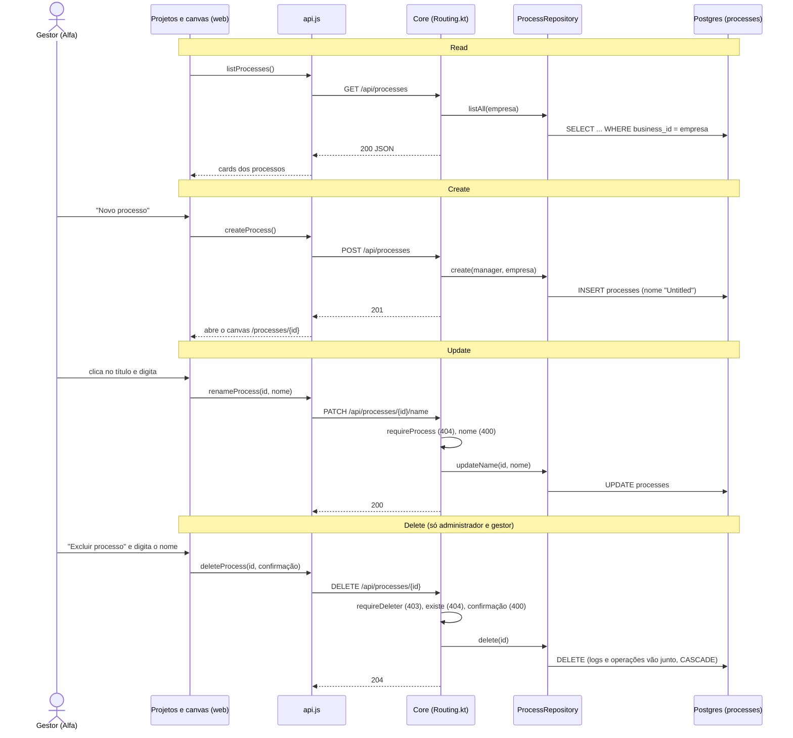
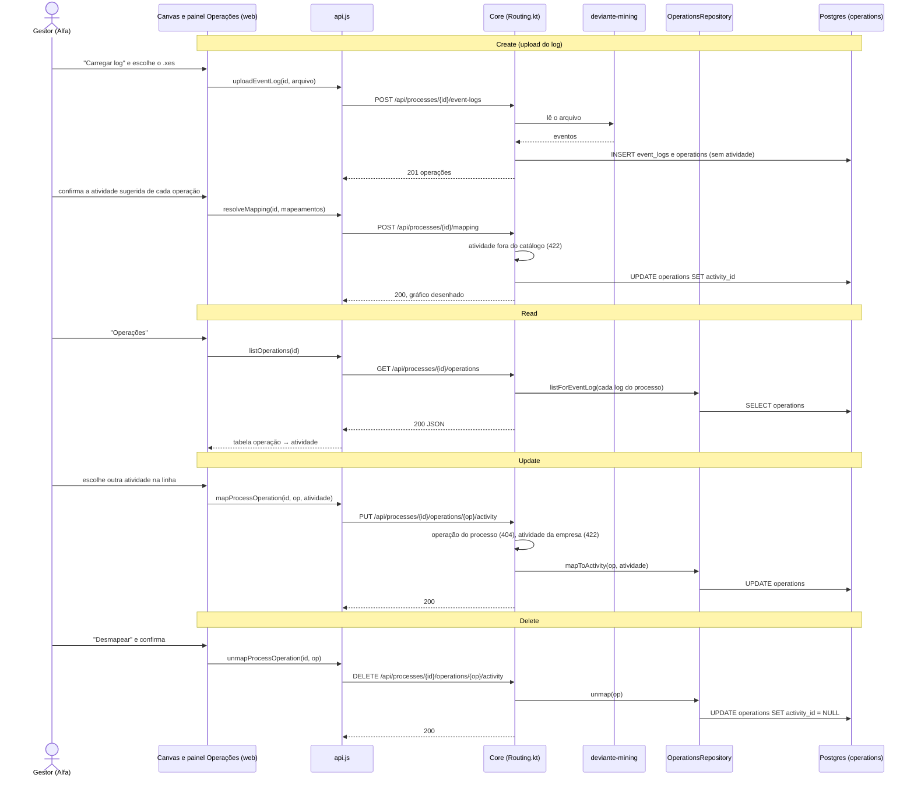

# Defesa Reuso 03: roteiro do Alander (Processo e Operações)

Prova de autoria em 16/10. Este roteiro cobre dois CRUDs com conexão ao banco: **Processo** e **Operações do log**. Os dois rodam no Core: React (Vercel) → Ktor (Fly.io) → Supabase Postgres.

**Como ler.** Cada trecho de código traz repositório, arquivo, linhas e um link fixo no commit (`deviante-api@2e5dd67`, `deviante-web@5da97a2`). Abaixo de cada trecho vem o que falar.

**Percurso.** Já logado na **Alfa** como **Gestor**, no painel inicial (**Projetos**). O painel lista os processos (Read). Crio um processo novo (Create) e subo um log nele; o log gera as operações, que mapeio para as atividades do catálogo da Alfa. Abro o painel **Operações** do processo e faço o CRUD delas. Por fim renomeio (Update) e excluo (Delete) o processo novo.

## 1. CRUD de Processo (painel Projetos e canvas)



### 1.1 A tabela

📍 `deviante-api/src/main/kotlin/db/ProcessesTable.kt` · linhas 6–20 · [abrir no GitHub](https://github.com/aland3r/deviante-api/blob/2e5dd67/src/main/kotlin/db/ProcessesTable.kt#L6-L20)

```kotlin
object ProcessesTable : Table(name = "processes") {
    override val tableName = "deviante.processes"

    val id = uuid("id")
    val managerId = uuid("manager_id").references(ManagersTable.id)
    val businessId = uuid("business_id").references(BusinessesTable.id)
    val name = varchar("name", 100)
    val companyName = varchar("company_name", 255)
    val description = text("description")
    val sector = varchar("sector", 100)
    val createdAt = timestampWithTimeZone("created_at")
    val updatedAt = timestampWithTimeZone("updated_at")

    override val primaryKey = PrimaryKey(id)
}
```

Fala: "Um processo pertence a uma empresa (`business_id`) e guarda quem o criou (`manager_id`). Apagar um processo apaga em cascata os logs, as operações e as análises."

### 1.2 Read: a lista no painel

📍 `deviante-web/src/pages/DashboardPage.jsx` · linhas 323–345 · [abrir no GitHub](https://github.com/aland3r/deviante-web/blob/5da97a2/src/pages/DashboardPage.jsx#L323-L345)

```jsx
  useEffect(() => {
    let cancelled = false
    Promise.all([
      api.listProcesses(),
      api.listAnalyses().catch(() => []),
      api.listMonitorings().catch(() => []),
    ])
      .then(([processRows, analysisRows, monitoringRows]) => {
        if (cancelled) return
        setProcesses(processRows)
        setAnalyses(analysisRows)
        setMonitorings(monitoringRows)
      })
      .catch((err) => {
        if (!cancelled) {
          setError(err instanceof ApiError ? err.message : 'Não foi possível carregar o painel.')
        }
      })
      .finally(() => {
        if (!cancelled) setLoading(false)
      })
    return () => { cancelled = true }
  }, [])
```

📍 `deviante-web/src/lib/api.js` · linhas 329–329 · [abrir no GitHub](https://github.com/aland3r/deviante-web/blob/5da97a2/src/lib/api.js#L329-L329)

```javascript
  listProcesses: () => shouldUseRemoteProcesses() ? request('/processes') : mockApi.listProcesses(),
```

📍 `deviante-api/src/main/kotlin/Routing.kt` · linhas 310–323 · [abrir no GitHub](https://github.com/aland3r/deviante-api/blob/2e5dd67/src/main/kotlin/Routing.kt#L310-L323)

```kotlin
                get {
                    val supabaseUser = call.requireSupabaseUser(authClient) ?: return@get
                    val manager = managerRepository.findOrCreateForSupabaseUser(
                        supabaseUser.id,
                        supabaseUser.email,
                        supabaseUser.fullNameHint,
                    )
                    val scope = call.companyScope(manager)
                    val labels = businessRepository.namesById()
                    val processes = processRepository.listAll()
                        .filter { scope.sees(it.businessId) }
                        .map { it.toResponse(company = labels[it.businessId]) }
                    call.respond(processes)
                }
```

📍 `deviante-api/src/main/kotlin/repository/ProcessRepository.kt` · linhas 19–24 · [abrir no GitHub](https://github.com/aland3r/deviante-api/blob/2e5dd67/src/main/kotlin/repository/ProcessRepository.kt#L19-L24)

```kotlin
    fun listAll(): List<ProcessRecord> = transaction {
        ProcessesTable
            .selectAll()
            .orderBy(ProcessesTable.updatedAt, SortOrder.DESC)
            .map { it.toProcessRecord() }
    }
```

Fala: "Ao abrir o painel, a tela busca os processos. O Core devolve só os da empresa em que entrei."

### 1.3 Create: "Novo processo"

📍 `deviante-web/src/pages/DashboardPage.jsx` · linhas 347–357 · [abrir no GitHub](https://github.com/aland3r/deviante-web/blob/5da97a2/src/pages/DashboardPage.jsx#L347-L357)

```jsx
  async function handleCreateProcess() {
    setCreating(true)
    setError('')
    try {
      const process = await api.createProcess()
      navigate(`/processes/${process.id}`)
    } catch (err) {
      setError(err instanceof ApiError ? err.message : 'Não foi possível criar o processo.')
      setCreating(false)
    }
  }
```

📍 `deviante-web/src/lib/api.js` · linhas 330–330 · [abrir no GitHub](https://github.com/aland3r/deviante-web/blob/5da97a2/src/lib/api.js#L330-L330)

```javascript
  createProcess: () => shouldUseRemoteProcesses() ? request('/processes', { method: 'POST' }) : mockApi.createProcess(),
```

📍 `deviante-api/src/main/kotlin/Routing.kt` · linhas 325–334 · [abrir no GitHub](https://github.com/aland3r/deviante-api/blob/2e5dd67/src/main/kotlin/Routing.kt#L325-L334)

```kotlin
                post {
                    val supabaseUser = call.requireSupabaseUser(authClient) ?: return@post
                    val manager = managerRepository.findOrCreateForSupabaseUser(
                        supabaseUser.id,
                        supabaseUser.email,
                        supabaseUser.fullNameHint,
                    )
                    val process = processRepository.create(manager.id, call.companyScope(manager).businessId)
                    call.respond(HttpStatusCode.Created, process.toResponse())
                }
```

📍 `deviante-api/src/main/kotlin/repository/ProcessRepository.kt` · linhas 36–63 · [abrir no GitHub](https://github.com/aland3r/deviante-api/blob/2e5dd67/src/main/kotlin/repository/ProcessRepository.kt#L36-L63)

```kotlin
    fun create(managerId: UUID, businessId: UUID): ProcessRecord = transaction {
        val now = OffsetDateTime.now()
        val id = UUID.randomUUID()

        ProcessesTable.insert {
            it[ProcessesTable.id] = id
            it[ProcessesTable.managerId] = managerId
            it[ProcessesTable.businessId] = businessId
            it[ProcessesTable.name] = DEFAULT_PROCESS_NAME
            it[ProcessesTable.companyName] = ""
            it[ProcessesTable.description] = ""
            it[ProcessesTable.sector] = ""
            it[ProcessesTable.createdAt] = now
            it[ProcessesTable.updatedAt] = now
        }

        ProcessRecord(
            id = id,
            managerId = managerId,
            businessId = businessId,
            name = DEFAULT_PROCESS_NAME,
            companyName = "",
            description = "",
            sector = "",
            createdAt = now,
            updatedAt = now,
        )
    }
```

Fala: "O botão cria o processo na hora, com nome 'Untitled', e a tela abre o canvas dele."

### 1.4 Update: clicar no título

📍 `deviante-web/src/pages/ProcessCanvasPage.jsx` · linhas 182–197 · [abrir no GitHub](https://github.com/aland3r/deviante-web/blob/5da97a2/src/pages/ProcessCanvasPage.jsx#L182-L197)

```jsx
          {editingTitle ? (
            <input ref={titleInputRef} value={titleDraft} onChange={(e) => setTitleDraft(e.target.value)}
              onBlur={commitTitle} maxLength={100}
              onKeyDown={(e) => {
                if (e.key === 'Enter') commitTitle()
                if (e.key === 'Escape') { setTitleDraft(process.name ?? ''); setEditingTitle(false) }
              }}
              className="text-[13px] font-semibold bg-transparent border-0 outline-none text-foreground"
              style={{ borderBottom: '1px solid var(--accent-strong)', paddingBottom: '1px', minWidth: '180px', letterSpacing: '-0.01em' }} />
          ) : (
            <button onClick={() => { setTitleError(''); setEditingTitle(true) }} title="Renomear processo"
              className="text-[13px] font-semibold text-left text-foreground hover:text-white hover:bg-white/[0.06] rounded px-1.5 -mx-1.5 py-0.5 transition-colors truncate"
              style={{ letterSpacing: '-0.01em' }}>
              {process.name || 'Processo sem nome'}
            </button>
          )}
```

📍 `deviante-web/src/pages/ProcessCanvasPage.jsx` · linhas 98–112 · [abrir no GitHub](https://github.com/aland3r/deviante-web/blob/5da97a2/src/pages/ProcessCanvasPage.jsx#L98-L112)

```jsx
  async function commitTitle() {
    setEditingTitle(false)
    const name = titleDraft.trim()
    if (!name || name === process.name) { setTitleDraft(process.name ?? ''); return }

    try {
      const updated = await api.renameProcess(processId, name)
      setProcess(updated)
      setTitleDraft(updated.name ?? '')
      setTitleError('')
    } catch (err) {
      setTitleDraft(process.name ?? '')
      setTitleError(err instanceof ApiError ? err.message : 'Não foi possível renomear o processo.')
    }
  }
```

📍 `deviante-web/src/lib/api.js` · linhas 335–337 · [abrir no GitHub](https://github.com/aland3r/deviante-web/blob/5da97a2/src/lib/api.js#L335-L337)

```javascript
  renameProcess: (id, name) => shouldUseRemoteProcesses()
    ? request(`/processes/${id}/name`, { method: 'PATCH', body: JSON.stringify({ name }) })
    : mockApi.renameProcess(id, name),
```

📍 `deviante-api/src/main/kotlin/Routing.kt` · linhas 400–430 · [abrir no GitHub](https://github.com/aland3r/deviante-api/blob/2e5dd67/src/main/kotlin/Routing.kt#L400-L430)

```kotlin
                patch("/{id}/name") {
                    val id = call.parameters["id"]?.let(::runCatchingUuid)
                    if (id == null) {
                        call.respond(HttpStatusCode.BadRequest, ErrorResponse("ID de processo inválido."))
                        return@patch
                    }
                    if (call.requireProcess(authClient, managerRepository, processRepository, id) == null) {
                        return@patch
                    }

                    val name = call.receive<RenameProcessRequest>().name.trim()
                    val nameError = when {
                        name.isBlank() -> "O nome do processo não pode ficar em branco."
                        name.length > 100 -> "O nome do processo deve ter no máximo 100 caracteres."
                        else -> null
                    }
                    if (nameError != null) {
                        call.respond(
                            HttpStatusCode.BadRequest,
                            ErrorResponse("Corrija o nome do processo.", mapOf("name" to nameError)),
                        )
                        return@patch
                    }

                    val updated = processRepository.updateName(id, name)
                    if (updated == null) {
                        call.respond(HttpStatusCode.NotFound, ErrorResponse("Processo não encontrado."))
                        return@patch
                    }
                    call.respond(updated.toResponse())
                }
```

📍 `deviante-api/src/main/kotlin/Routing.kt` · linhas 77–96 · [abrir no GitHub](https://github.com/aland3r/deviante-api/blob/2e5dd67/src/main/kotlin/Routing.kt#L77-L96)

```kotlin
private suspend fun ApplicationCall.requireProcess(
    authClient: SupabaseAuthClient,
    managerRepository: ManagerRepository,
    processRepository: ProcessRepository,
    processId: UUID,
): ProcessRecord? {
    val supabaseUser = requireSupabaseUser(authClient) ?: return null
    val manager = managerRepository.findOrCreateForSupabaseUser(
        supabaseUser.id,
        supabaseUser.email,
        supabaseUser.fullNameHint,
    )
    val process = processRepository.findById(processId)
        ?.takeIf { companyScope(manager).sees(it.businessId) }
    if (process == null) {
        respond(HttpStatusCode.NotFound, ErrorResponse("Processo não encontrado."))
        return null
    }
    return process
}
```

📍 `deviante-api/src/main/kotlin/repository/ProcessRepository.kt` · linhas 84–92 · [abrir no GitHub](https://github.com/aland3r/deviante-api/blob/2e5dd67/src/main/kotlin/repository/ProcessRepository.kt#L84-L92)

```kotlin
    fun updateName(id: UUID, name: String): ProcessRecord? = transaction {
        val updated = ProcessesTable.update({ ProcessesTable.id eq id }) {
            it[ProcessesTable.name] = name
            it[ProcessesTable.updatedAt] = OffsetDateTime.now()
        }
        if (updated == 0) return@transaction null

        findById(id)
    }
```

Fala: "Clicar no título vira um campo; Enter salva com `PATCH`. A rota usa `requireProcess`, que confere se o processo é da minha empresa (404 se não for), e valida o nome: em branco ou com mais de 100 caracteres dá 400."

### 1.5 Delete: "Excluir processo" (só administrador e gestor)

📍 `deviante-web/src/lib/permissions.js` · linhas 1–5 · [abrir no GitHub](https://github.com/aland3r/deviante-web/blob/5da97a2/src/lib/permissions.js#L1-L5)

```javascript
// Excluir (processo, atividade, equipamento, agenda) é só do administrador e do
// gestor. A API repete a regra (403); aqui ela só decide se o botão aparece.
export const DELETE_ROLES = new Set(['owner', 'admin', 'manager'])

export const canDelete = (user) => DELETE_ROLES.has(user?.role)
```

📍 `deviante-web/src/pages/ProcessCanvasPage.jsx` · linhas 206–206 · [abrir no GitHub](https://github.com/aland3r/deviante-web/blob/5da97a2/src/pages/ProcessCanvasPage.jsx#L206-L206)

```jsx
        {canDelete(user) && <ProjectActionsMenu onDelete={deleteCurrentProcess} deleteLabel="Excluir processo" />}
```

📍 `deviante-web/src/pages/ProcessCanvasPage.jsx` · linhas 114–123 · [abrir no GitHub](https://github.com/aland3r/deviante-web/blob/5da97a2/src/pages/ProcessCanvasPage.jsx#L114-L123)

```jsx
  async function deleteCurrentProcess() {
    const processName = window.prompt(`Digite exatamente o nome do processo para excluir:\n${process.name}`)
    if (processName == null) return
    try {
      await api.deleteProcess(processId, { processName, confirmationPhrase: 'quero excluir este processo' })
      navigate('/dashboard', { replace: true })
    } catch (err) {
      setTitleError(err instanceof ApiError ? err.message : 'Não foi possível excluir o processo.')
    }
  }
```

📍 `deviante-web/src/lib/api.js` · linhas 338–340 · [abrir no GitHub](https://github.com/aland3r/deviante-web/blob/5da97a2/src/lib/api.js#L338-L340)

```javascript
  deleteProcess: (id, confirmation) => shouldUseRemoteProcesses()
    ? request(`/processes/${id}`, { method: 'DELETE', body: JSON.stringify(confirmation) })
    : mockApi.deleteProcess(id, confirmation),
```

📍 `deviante-api/src/main/kotlin/Routing.kt` · linhas 432–463 · [abrir no GitHub](https://github.com/aland3r/deviante-api/blob/2e5dd67/src/main/kotlin/Routing.kt#L432-L463)

```kotlin
                delete("/{id}") {
                    val deleter = call.requireDeleter(authClient, managerRepository) ?: return@delete
                    val id = call.parameters["id"]?.let(::runCatchingUuid)
                    if (id == null) {
                        call.respond(HttpStatusCode.BadRequest, ErrorResponse("ID de processo inválido."))
                        return@delete
                    }

                    val process = processRepository.findById(id)
                        ?.takeIf { call.companyScope(deleter).sees(it.businessId) }
                    if (process == null) {
                        call.respond(HttpStatusCode.NotFound, ErrorResponse("Processo não encontrado."))
                        return@delete
                    }

                    val body = call.receive<DeleteProcessRequest>()
                    val fieldErrors = validateProcessDeletion(body, process.name)
                    if (fieldErrors.isNotEmpty()) {
                        call.respond(
                            HttpStatusCode.BadRequest,
                            ErrorResponse("Confirme a exclusão do processo.", fieldErrors),
                        )
                        return@delete
                    }

                    val deleted = processRepository.delete(id)
                    if (!deleted) {
                        call.respond(HttpStatusCode.NotFound, ErrorResponse("Processo não encontrado."))
                        return@delete
                    }
                    call.respond(HttpStatusCode.NoContent)
                }
```

📍 `deviante-api/src/main/kotlin/repository/ProcessRepository.kt` · linhas 94–96 · [abrir no GitHub](https://github.com/aland3r/deviante-api/blob/2e5dd67/src/main/kotlin/repository/ProcessRepository.kt#L94-L96)

```kotlin
    fun delete(id: UUID): Boolean = transaction {
        ProcessesTable.deleteWhere { ProcessesTable.id eq id } > 0
    }
```

Fala: "O menu de exclusão só aparece para administrador e gestor. A tela pede que eu digite o nome do processo. O Core checa papel (403), existência (404) e confirmação (400), e só então apaga. Resposta 204."

## 2. CRUD de Operações do log (painel Operações do processo)

Uma operação é um evento como o log o escreveu (por exemplo `Machine_Operating`), com quantas vezes ocorreu. Cada operação aponta para uma atividade do catálogo da empresa, e são as atividades que viram os nós do gráfico. O gestor mapeia só para atividades que já existem; criar atividade é do administrador.



### 2.1 A tabela

📍 `deviante-api/src/main/kotlin/db/OperationsTable.kt` · linhas 6–19 · [abrir no GitHub](https://github.com/aland3r/deviante-api/blob/2e5dd67/src/main/kotlin/db/OperationsTable.kt#L6-L19)

```kotlin
object OperationsTable : Table(name = "operations") {
    override val tableName = "deviante.operations"

    val id = uuid("id")
    val eventLogId = uuid("event_log_id").references(EventLogsTable.id)
    val rawLabel = varchar("raw_label", 255)
    val occurrenceCount = integer("occurrence_count")
    val activityId = uuid("activity_id").references(ActivitiesTable.id).nullable()
    val mappingStatus = varchar("mapping_status", 20) // unmapped, auto_mapped, mapped
    val createdAt = timestampWithTimeZone("created_at")
    val updatedAt = timestampWithTimeZone("updated_at")

    override val primaryKey = PrimaryKey(id)
}
```

Fala: "Cada operação pertence a um log, e o log a um processo. `activity_id` é a ligação com o catálogo; nula, a operação está sem mapeamento."

### 2.2 Create: carregar o log

📍 `deviante-web/src/components/process-graph/EventLogUploadModal.jsx` · linhas 93–118 · [abrir no GitHub](https://github.com/aland3r/deviante-web/blob/5da97a2/src/components/process-graph/EventLogUploadModal.jsx#L93-L118)

```jsx
  async function handleUpload() {
    if (!file || uploading || eventLog) return

    setUploading(true)
    setUploadError('')
    setFormatError(false)

    try {
      const result = await api.uploadEventLog(processId, file)
      setEventLog(result.eventLog)
      setRows(result.operations.map((operation) => ({
        operationId: operation.id,
        rawLabel: operation.rawLabel,
        occurrenceCount: operation.occurrenceCount,
        caseCount: operation.caseCount,
        meanDurationSeconds: operation.meanDurationSeconds,
        activityName: operation.suggestedActivityName,
        activityDescription: '',
        rowState: accepts(operation.suggestedActivityName) ? 'suggested' : 'pending',
      })))
    } catch (err) {
      setUploadError(err instanceof ApiError ? err.message : 'Não foi possível enviar o arquivo.')
    } finally {
      setUploading(false)
    }
  }
```

📍 `deviante-web/src/lib/api.js` · linhas 362–362 · [abrir no GitHub](https://github.com/aland3r/deviante-web/blob/5da97a2/src/lib/api.js#L362-L362)

```javascript
  uploadEventLog: (processId, file) => upload(`/processes/${processId}/event-logs`, file),
```

📍 `deviante-api/src/main/kotlin/Routing.kt` · linhas 1560–1566 · [abrir no GitHub](https://github.com/aland3r/deviante-api/blob/2e5dd67/src/main/kotlin/Routing.kt#L1560-L1566)

```kotlin
                    val extension = fileName.substringAfterLast('.', "").lowercase()
                    if (extension !in setOf("xes", "csv")) {
                        call.respond(
                            HttpStatusCode.UnsupportedMediaType,
                            ErrorResponse("Envie um arquivo .xes ou .csv."),
                        )
                        return@post
```

📍 `deviante-api/src/main/kotlin/Routing.kt` · linhas 1584–1584 · [abrir no GitHub](https://github.com/aland3r/deviante-api/blob/2e5dd67/src/main/kotlin/Routing.kt#L1584-L1584)

```kotlin
                    val ingested = ingestionRepository.ingest(processId, fileName, parsed)
```

📍 `deviante-api/src/main/kotlin/repository/EventLogIngestionRepository.kt` · linhas 54–68 · [abrir no GitHub](https://github.com/aland3r/deviante-api/blob/2e5dd67/src/main/kotlin/repository/EventLogIngestionRepository.kt#L54-L68)

```kotlin
        for (event in parsed.events) {
            val operationId = UUID.randomUUID()
            operationIdsByLabel[event.rawLabel] = operationId

            OperationsTable.insert {
                it[OperationsTable.id] = operationId
                it[OperationsTable.eventLogId] = eventLogId
                it[OperationsTable.rawLabel] = event.rawLabel.take(255)
                it[OperationsTable.occurrenceCount] = event.occurrenceCount
                it[OperationsTable.activityId] = null
                it[OperationsTable.mappingStatus] = "unmapped"
                it[OperationsTable.createdAt] = now
                it[OperationsTable.updatedAt] = now
            }
        }
```

Fala: "O Core aceita só `.xes` ou `.csv` (415 para outros). Quem lê o arquivo é o serviço de mineração, um microsserviço à parte; não entro nele aqui. Com os eventos lidos, o Core grava uma operação por evento, ainda sem atividade."

📍 `deviante-web/src/components/process-graph/EventLogUploadModal.jsx` · linhas 50–55 · [abrir no GitHub](https://github.com/aland3r/deviante-web/blob/5da97a2/src/components/process-graph/EventLogUploadModal.jsx#L50-L55)

```jsx
  // Nome aceito: qualquer um para o administrador, só do catálogo para o gestor.
  function accepts(name) {
    const key = name?.trim().toLocaleLowerCase('pt-BR')
    if (!key) return false
    return mayCreate || activityCatalog.some((activity) => activity.name.toLocaleLowerCase('pt-BR') === key)
  }
```

📍 `deviante-api/src/main/kotlin/Routing.kt` · linhas 1658–1665 · [abrir no GitHub](https://github.com/aland3r/deviante-api/blob/2e5dd67/src/main/kotlin/Routing.kt#L1658-L1665)

```kotlin
                    // O gestor só mapeia para atividades que já existem no catálogo;
                    // criar atividade nova é do administrador.
                    val result = try {
                        mappingRepository.resolveAll(processId, resolutions, process.businessId, manager.keepsCatalog())
                    } catch (e: MappingRepository.UnknownActivitiesException) {
                        call.respond(HttpStatusCode.UnprocessableEntity, ErrorResponse(e.message ?: "Atividade fora do catálogo."))
                        return@post
                    }
```

Fala: "Cada operação chega com a atividade sugerida. Para o gestor, só vale um nome que já existe no catálogo da Alfa; um nome novo o Core recusa com 422. Confirmado, as operações ficam mapeadas e o gráfico aparece."

### 2.3 Read: botão "Operações"

📍 `deviante-web/src/pages/ProcessCanvasPage.jsx` · linhas 212–215 · [abrir no GitHub](https://github.com/aland3r/deviante-web/blob/5da97a2/src/pages/ProcessCanvasPage.jsx#L212-L215)

```jsx
        <button type="button" title="Operações do log" onClick={() => { operationsChanged.current = false; setOperationsOpen(true) }}
          className="flex items-center gap-1.5 px-2.5 py-1.5 rounded text-xs font-medium border border-border text-muted-foreground hover:text-foreground transition-colors shrink-0">
          <ListTree size={12} /><span className="hidden sm:inline">Operações</span>
        </button>
```

📍 `deviante-web/src/components/process-graph/ProcessOperationsModal.jsx` · linhas 20–31 · [abrir no GitHub](https://github.com/aland3r/deviante-web/blob/5da97a2/src/components/process-graph/ProcessOperationsModal.jsx#L20-L31)

```jsx
  useEffect(() => {
    let cancelled = false
    Promise.all([api.listOperations(processId), api.listActivities()])
      .then(([ops, acts]) => {
        if (cancelled) return
        setOperations([...ops].sort((a, b) => a.rawLabel.localeCompare(b.rawLabel)))
        setActivities([...acts].sort((a, b) => a.name.localeCompare(b.name)))
      })
      .catch((err) => { if (!cancelled) setError(err instanceof ApiError ? err.message : 'Não foi possível carregar as operações.') })
      .finally(() => { if (!cancelled) setLoading(false) })
    return () => { cancelled = true }
  }, [processId])
```

📍 `deviante-web/src/lib/api.js` · linhas 364–364 · [abrir no GitHub](https://github.com/aland3r/deviante-web/blob/5da97a2/src/lib/api.js#L364-L364)

```javascript
  listOperations: (processId) => request(processId ? `/processes/${processId}/operations` : '/operations'),
```

📍 `deviante-api/src/main/kotlin/Routing.kt` · linhas 1007–1025 · [abrir no GitHub](https://github.com/aland3r/deviante-api/blob/2e5dd67/src/main/kotlin/Routing.kt#L1007-L1025)

```kotlin
            route("/processes/{processId}/operations") {
                get {
                    val supabaseUser = call.requireSupabaseUser(authClient) ?: return@get
                    val processId = call.parameters["processId"]?.let(::runCatchingUuid)
                    if (processId == null) {
                        call.respond(HttpStatusCode.BadRequest, ErrorResponse("ID de processo inválido."))
                        return@get
                    }
                    val process = call.requireProcess(authClient, managerRepository, processRepository, processId)
                        ?: return@get

                    val activityNames = activitiesRepository.listAll(process.businessId).associate { it.id to it.name }
                    val operations = eventLogsRepository.findByProcessId(processId)
                        .flatMap { operationsRepository.listForEventLog(it.id) }
                        .map { it.toResponse(activityNames[it.activityId]) }

                    call.respond(operations)
                }
            }
```

📍 `deviante-api/src/main/kotlin/repository/OperationsRepository.kt` · linhas 78–84 · [abrir no GitHub](https://github.com/aland3r/deviante-api/blob/2e5dd67/src/main/kotlin/repository/OperationsRepository.kt#L78-L84)

```kotlin
    fun listForEventLog(eventLogId: UUID): List<OperationRecord> = transaction {
        OperationsTable
            .selectAll()
            .where { OperationsTable.eventLogId eq eventLogId }
            .orderBy(OperationsTable.occurrenceCount, SortOrder.DESC)
            .map { it.toOperationRecord() }
    }
```

Fala: "O painel pede as operações do processo e o catálogo da empresa. O Core usa `requireProcess` (404 se o processo for de outra empresa) e junta as operações de todos os logs do processo com o nome da atividade."

### 2.4 Update: trocar a atividade na linha

📍 `deviante-web/src/components/process-graph/ProcessOperationsModal.jsx` · linhas 87–94 · [abrir no GitHub](https://github.com/aland3r/deviante-web/blob/5da97a2/src/components/process-graph/ProcessOperationsModal.jsx#L87-L94)

```jsx
                    <td className="py-2 pr-2">
                      <Select value={op.activityId ?? ''} disabled={busyId === op.id}
                        onChange={(e) => e.target.value && mapTo(op, e.target.value)}
                        aria-label={`Atividade de ${op.rawLabel}`}>
                        <option value="">Não mapeada</option>
                        {activities.map((a) => <option key={a.id} value={a.id}>{a.name}</option>)}
                      </Select>
                    </td>
```

📍 `deviante-web/src/components/process-graph/ProcessOperationsModal.jsx` · linhas 33–48 · [abrir no GitHub](https://github.com/aland3r/deviante-web/blob/5da97a2/src/components/process-graph/ProcessOperationsModal.jsx#L33-L48)

```jsx
  async function change(operation, run) {
    setBusyId(operation.id)
    setError('')
    try {
      const updated = await run()
      setOperations((current) => current.map((op) => (op.id === updated.id ? { ...op, ...updated } : op)))
      onChanged?.()
    } catch (err) {
      setError(err instanceof ApiError ? err.message : 'Não foi possível salvar a operação.')
    } finally {
      setBusyId(null)
    }
  }

  const mapTo = (operation, activityId) =>
    change(operation, () => api.mapProcessOperation(processId, operation.id, activityId))
```

📍 `deviante-web/src/lib/api.js` · linhas 367–370 · [abrir no GitHub](https://github.com/aland3r/deviante-web/blob/5da97a2/src/lib/api.js#L367-L370)

```javascript
  mapProcessOperation: (processId, operationId, activityId) => request(`/processes/${processId}/operations/${operationId}/activity`, {
    method: 'PUT',
    body: JSON.stringify({ activityId }),
  }),
```

📍 `deviante-api/src/main/kotlin/Routing.kt` · linhas 1033–1061 · [abrir no GitHub](https://github.com/aland3r/deviante-api/blob/2e5dd67/src/main/kotlin/Routing.kt#L1033-L1061)

```kotlin
            route("/processes/{processId}/operations/{id}") {
                suspend fun ApplicationCall.processOperation(): Pair<ProcessRecord, UUID>? {
                    val processId = parameters["processId"]?.let(::runCatchingUuid)
                    val id = parameters["id"]?.let(::runCatchingUuid)
                    if (processId == null || id == null) {
                        respond(HttpStatusCode.BadRequest, ErrorResponse("ID inválido."))
                        return null
                    }
                    val process = requireProcess(authClient, managerRepository, processRepository, processId) ?: return null
                    val logIds = eventLogsRepository.findByProcessId(processId).map { it.id }.toSet()
                    if (operationsRepository.findById(id)?.eventLogId !in logIds) {
                        respond(HttpStatusCode.NotFound, ErrorResponse("Operação não encontrada."))
                        return null
                    }
                    return process to id
                }

                put("/activity") {
                    val (process, id) = call.processOperation() ?: return@put
                    val body = call.receive<MapOperationRequest>()
                    val activity = runCatchingUuid(body.activityId)?.let(activitiesRepository::findById)
                        ?.takeIf { it.businessId == process.businessId }
                    if (activity == null) {
                        call.respond(HttpStatusCode.UnprocessableEntity, ErrorResponse("Atividade fora do catálogo da empresa."))
                        return@put
                    }
                    val updated = operationsRepository.mapToActivity(id, activity.id)!!
                    call.respond(updated.toResponse(activity.name))
                }
```

📍 `deviante-api/src/main/kotlin/repository/OperationsRepository.kt` · linhas 124–134 · [abrir no GitHub](https://github.com/aland3r/deviante-api/blob/2e5dd67/src/main/kotlin/repository/OperationsRepository.kt#L124-L134)

```kotlin
    fun mapToActivity(id: UUID, activityId: UUID): OperationRecord? = transaction {
        val now = OffsetDateTime.now()
        val updated = OperationsTable.update({ OperationsTable.id eq id }) {
            it[OperationsTable.activityId] = activityId
            it[OperationsTable.mappingStatus] = "mapped"
            it[OperationsTable.updatedAt] = now
        }
        if (updated == 0) return@transaction null

        findById(id)
    }
```

Fala: "A lista só oferece as atividades do catálogo da Alfa. No Core, `processOperation` confere que o processo é da minha empresa e que a operação é de um log desse processo (404). A atividade tem que ser da mesma empresa do processo; se não for, 422. Ao fechar o painel, o gráfico é redesenhado."

### 2.5 Delete: "Desmapear"

📍 `deviante-web/src/components/process-graph/ProcessOperationsModal.jsx` · linhas 50–53 · [abrir no GitHub](https://github.com/aland3r/deviante-web/blob/5da97a2/src/components/process-graph/ProcessOperationsModal.jsx#L50-L53)

```jsx
  const unmap = (operation) => {
    if (!window.confirm(`Desfazer o mapeamento de "${operation.rawLabel}"?`)) return
    change(operation, () => api.unmapProcessOperation(processId, operation.id))
  }
```

📍 `deviante-web/src/lib/api.js` · linhas 371–373 · [abrir no GitHub](https://github.com/aland3r/deviante-web/blob/5da97a2/src/lib/api.js#L371-L373)

```javascript
  unmapProcessOperation: (processId, operationId) => request(`/processes/${processId}/operations/${operationId}/activity`, {
    method: 'DELETE',
  }),
```

📍 `deviante-api/src/main/kotlin/Routing.kt` · linhas 1063–1066 · [abrir no GitHub](https://github.com/aland3r/deviante-api/blob/2e5dd67/src/main/kotlin/Routing.kt#L1063-L1066)

```kotlin
                delete("/activity") {
                    val (_, id) = call.processOperation() ?: return@delete
                    call.respond(operationsRepository.unmap(id)!!.toResponse())
                }
```

📍 `deviante-api/src/main/kotlin/repository/OperationsRepository.kt` · linhas 136–146 · [abrir no GitHub](https://github.com/aland3r/deviante-api/blob/2e5dd67/src/main/kotlin/repository/OperationsRepository.kt#L136-L146)

```kotlin
    fun unmap(id: UUID): OperationRecord? = transaction {
        val now = OffsetDateTime.now()
        val updated = OperationsTable.update({ OperationsTable.id eq id }) {
            it[OperationsTable.activityId] = null
            it[OperationsTable.mappingStatus] = "unmapped"
            it[OperationsTable.updatedAt] = now
        }
        if (updated == 0) return@transaction null

        findById(id)
    }
```

Fala: "Desmapear tira a ligação da operação com a atividade: `activity_id` volta a nulo e o status volta a 'unmapped'. A operação continua no log; ela só some de vez quando o processo é excluído."

## 3. Demonstração

1. **Processo, Read:** no painel, mostrar os processos da Alfa.
2. **Processo, Create:** "Novo processo". O canvas abre.
3. **Operações, Create:** "Carregar log" com o `Datasets/Alfa/DR_MS_ST_20.xes` (pasta `Datasets` do deviante-docs). As 6 operações chegam com a atividade sugerida; validar cada uma e confirmar. O gráfico aparece.
4. **Operações, Read:** botão **Operações** no topo do canvas. Mostrar a tabela operação → atividade.
5. **Operações, Update:** trocar a atividade de uma linha (`PUT`, 200). No DevTools, mostrar a chamada.
6. **Operações, Delete:** "Desmapear" na mesma linha e confirmar (`DELETE`, 200). Fechar o painel.
7. **Processo, Update:** clicar no título "Untitled" e renomear (`PATCH`, 200).
8. **Processo, Delete:** "Excluir processo", digitando o nome (204). O processo e as operações dele somem; os 4 processos do artigo continuam lá.

## 4. Perguntas prováveis

- **Por que o gestor não cria atividade?** O catálogo de atividades é da empresa e fica com o administrador. O gestor só liga as operações do log ao que já existe.
- **Por que o front não acessa o banco direto?** A credencial do Postgres ficaria no navegador. O Core concentra a regra (papel, empresa, validação) e é o único com acesso ao banco.
- **Onde fica a transação?** Cada função de repositório roda em `transaction { }` do Exposed.

## 5. Antes de ensaiar

- [ ] Ter no computador o `Datasets/Alfa/DR_MS_ST_20.xes` (vem do deviante-docs pelo `atualizar-repos.ps1`).
- [ ] Entrar na **Alfa** como **Gestor** e conferir os 4 processos do artigo no painel.
