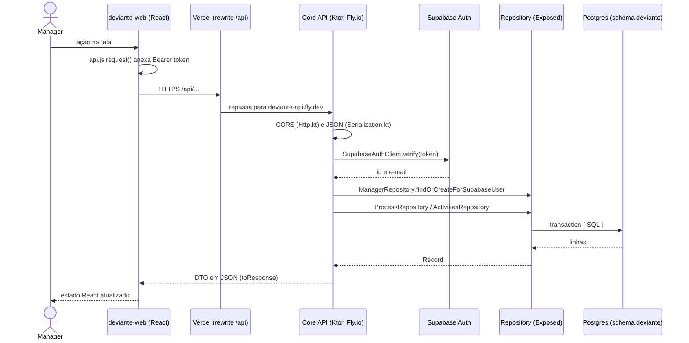

# Defesa Reuso 03: roteiro do Alander (Processo e Atividade)

Prova de autoria em 16/10. Cada integrante demonstra 2 CRUDs com conexão ao banco e explica o caminho do código. Este roteiro cobre **Processo** e **Atividade**. Os dois rodam só no Core (React → Ktor → Supabase Postgres), sem Function nem microsserviços.

**Como ler.** Cada trecho de código traz a localização exata: repositório, arquivo, linhas e um link fixo no commit (`deviante-api@7eee985`, `deviante-web@fa44226`), que não muda mesmo que a `main` ande. Abaixo de cada trecho vem o que falar. Todo trecho é código que está rodando no sistema.

## 0. Mapa do sistema

| Peça | Onde roda | Endereço | Código |
|---|---|---|---|
| Telas | Vercel | `https://deviante.alander.io` (`/dashboard`, `/processes/{id}`, `/activities`) | `aland3r/deviante-web` |
| Proxy da API | Vercel (rewrite) | `https://deviante.alander.io/api/*` → `https://deviante-api.fly.dev/api/*` | `deviante-web/vercel.json` |
| Core API | Fly.io, app `deviante-api`, região `iad` | `https://deviante-api.fly.dev/api` | `aland3r/deviante-api` (`src/main/kotlin`) |
| Autenticação | Supabase Auth (Google e contas demo) | `https://<projeto>.supabase.co/auth/v1/user` | chamado por `SupabaseAuth.kt` |
| Banco | Supabase Postgres, schema `deviante` | tabelas `processes`, `activities`, `process_activities`, `managers`, `users` | mapeado em `src/main/kotlin/db/*.kt` |
| Mining (não usado nos CRUDs) | Fly.io, app `deviante-mining` | só o Core chama | `deviante-api/mining/` |

📍 `deviante-web/vercel.json` · linhas 1–6 · [abrir no GitHub](https://github.com/aland3r/deviante-web/blob/fa44226/vercel.json#L1-L6)

```json
{
  "rewrites": [
    { "source": "/api/(.*)", "destination": "https://deviante-api.fly.dev/api/$1" },
    { "source": "/(.*)", "destination": "/index.html" }
  ]
}
```

O navegador sempre chama `/api/...` no próprio domínio do site; a Vercel repassa para o Fly.io. Por isso o front não precisa saber o endereço do Core.

## 1. O caminho comum (falar uma vez, no início)



### 1.1 Front: o cliente HTTP

📍 `deviante-web/src/lib/api.js` · linhas 27–27 · [abrir no GitHub](https://github.com/aland3r/deviante-web/blob/fa44226/src/lib/api.js#L27-L27)

```javascript
const API_BASE = import.meta.env.VITE_API_URL ?? '/api'
```

📍 `deviante-web/src/lib/api.js` · linhas 243–267 · [abrir no GitHub](https://github.com/aland3r/deviante-web/blob/fa44226/src/lib/api.js#L243-L267)

```javascript
async function authHeader() {
  if (!isSupabaseConfigured()) return {}
  const { data } = await getSupabase().auth.getSession()
  const token = data.session?.access_token
  return token ? { Authorization: `Bearer ${token}` } : {}
}

async function request(path, options = {}) {
  const response = await fetch(`${API_BASE}${path}`, {
    headers: {
      'Content-Type': 'application/json',
      ...(await authHeader()),
      ...(options.headers ?? {}),
    },
    ...options,
  })

  if (!response.ok) {
    const payload = await response.json().catch(() => ({}))
    throw new ApiError(payload.message ?? 'Falha na requisição.', payload.fieldErrors ?? {})
  }

  if (response.status === 204) return null
  return response.json()
}
```

Fala: "Toda chamada passa por `request()`. Ele pega o token da sessão do Supabase (`authHeader`) e manda no cabeçalho `Authorization: Bearer`. Se a resposta não for 2xx, transforma o JSON de erro num `ApiError` com a mensagem e os erros por campo; se for 204, devolve `null`."

### 1.2 Core: inicialização

📍 `deviante-api/src/main/resources/application.yaml` · linhas 1–18 · [abrir no GitHub](https://github.com/aland3r/deviante-api/blob/7eee985/src/main/resources/application.yaml#L1-L18)

```yaml
ktor:
  deployment:
    port: 8080
  application:
    modules:
      - com.deviante.HttpKt.configureHttp
      - com.deviante.SerializationKt.configureSerialization
      - com.deviante.DatabaseKt.configureDatabase
      - com.deviante.RoutingKt.configureRouting

database:
  jdbcUrl: ${DATABASE_JDBC_URL:jdbc:postgresql://localhost:5432/postgres?sslmode=require}
  user: ${DATABASE_USER:postgres}
  password: ${DATABASE_PASSWORD:}

supabase:
  url: ${SUPABASE_URL:}
  anonKey: ${SUPABASE_ANON_KEY:}
```

Fala: "O Ktor sobe os módulos nesta ordem: HTTP (CORS), serialização JSON, banco e rotas. As credenciais vêm de variáveis de ambiente no Fly.io."

📍 `deviante-api/src/main/kotlin/Http.kt` · linhas 8–24 · [abrir no GitHub](https://github.com/aland3r/deviante-api/blob/7eee985/src/main/kotlin/Http.kt#L8-L24)

```kotlin
fun Application.configureHttp() {
    install(CORS) {
        allowMethod(HttpMethod.Get)
        allowMethod(HttpMethod.Post)
        allowMethod(HttpMethod.Put)
        allowMethod(HttpMethod.Delete)
        allowMethod(HttpMethod.Patch)
        allowMethod(HttpMethod.Options)

        allowHeader(HttpHeaders.Authorization)
        allowHeader(HttpHeaders.ContentType)
        allowHeader(HttpHeaders.Accept)

        allowCredentials = true
        anyHost()
    }
}
```

📍 `deviante-api/src/main/kotlin/Serialization.kt` · linhas 8–12 · [abrir no GitHub](https://github.com/aland3r/deviante-api/blob/7eee985/src/main/kotlin/Serialization.kt#L8-L12)

```kotlin
fun Application.configureSerialization() {
    install(ContentNegotiation) {
        json()
    }
}
```

📍 `deviante-api/src/main/kotlin/Database.kt` · linhas 9–28 · [abrir no GitHub](https://github.com/aland3r/deviante-api/blob/7eee985/src/main/kotlin/Database.kt#L9-L28)

```kotlin
fun Application.configureDatabase() {
    AppConfig.init(environment.config)
    val jdbcUrl = AppConfig.jdbcUrl
    val user = AppConfig.dbUser
    val password = AppConfig.dbPassword

    val hikariConfig = HikariConfig().apply {
        this.jdbcUrl = jdbcUrl
        this.username = user
        this.password = password
        driverClassName = "org.postgresql.Driver"
        maximumPoolSize = 5
    }

    val dataSource = HikariDataSource(hikariConfig)
    Database.connect(dataSource)

    // Seed demo data if needed (idempotent check inside)
    SeedDemoData.runIfNeeded()
}
```

Fala: "A configuração vem do `AppConfig`, carregado uma vez (é um dos Singletons da defesa de padrões). O Hikari mantém um pool de até 5 conexões com o Postgres. O Exposed usa esse pool em cada `transaction { }` dos repositórios."

### 1.3 Core: autenticação e Manager

📍 `deviante-api/src/main/kotlin/Routing.kt` · linhas 114–131 · [abrir no GitHub](https://github.com/aland3r/deviante-api/blob/7eee985/src/main/kotlin/Routing.kt#L114-L131)

```kotlin
private suspend fun ApplicationCall.requireSupabaseUser(authClient: SupabaseAuthClient): SupabaseUser? {
    // Já verificado nesta requisição (ex.: pelo FeatureGate): não pergunta ao Supabase de novo.
    attributes.getOrNull(SupabaseUserKey)?.let { return it }
    val header = request.headers[HttpHeaders.Authorization]
    val token = header?.removePrefix("Bearer ")?.trim()
    if (token.isNullOrBlank()) {
        respond(HttpStatusCode.Unauthorized, ErrorResponse("Você precisa estar autenticado."))
        return null
    }

    val user = authClient.verify(token)
    if (user == null) {
        respond(HttpStatusCode.Unauthorized, ErrorResponse("Sessão inválida ou expirada."))
        return null
    }
    attributes.put(SupabaseUserKey, user)
    return user
}
```

📍 `deviante-api/src/main/kotlin/SupabaseAuth.kt` · linhas 44–71 · [abrir no GitHub](https://github.com/aland3r/deviante-api/blob/7eee985/src/main/kotlin/SupabaseAuth.kt#L44-L71)

```kotlin
    /** Verifies a Supabase access token by asking Supabase Auth who it belongs to. */
    suspend fun verify(accessToken: String): SupabaseUser? {
        if (baseUrl.isBlank() || anonKey.isBlank()) {
            logger.error("Supabase auth is not configured (SUPABASE_URL / SUPABASE_ANON_KEY missing).")
            return null
        }

        return try {
            val response = client.get("$baseUrl/auth/v1/user") {
                header(HttpHeaders.Authorization, "Bearer $accessToken")
                header("apikey", anonKey)
            }
            if (!response.status.isSuccess()) {
                logger.warn("Supabase rejected the access token: {} {}", response.status, response.bodyAsText())
                return null
            }

            val body = response.body<SupabaseUserResponse>()
            SupabaseUser(
                id = UUID.fromString(body.id),
                email = body.email ?: "",
                fullNameHint = body.user_metadata?.full_name ?: body.user_metadata?.name ?: "",
            )
        } catch (error: Exception) {
            logger.error("Failed to verify Supabase access token.", error)
            null
        }
    }
```

Fala: "O Core não valida a senha: pergunta ao Supabase Auth de quem é o token. Sem token, 401 'Você precisa estar autenticado'; token inválido, 401 'Sessão inválida ou expirada'."

📍 `deviante-api/src/main/kotlin/repository/ManagerRepository.kt` · linhas 14–37 · [abrir no GitHub](https://github.com/aland3r/deviante-api/blob/7eee985/src/main/kotlin/repository/ManagerRepository.kt#L14-L37)

```kotlin
class ManagerRepository {
    companion object {
        private val OWNER_EMAILS = setOf("design@alander.io", "alanderavila@gmail.com")
        private val MENTOR_EMAILS = setOf("pafileiro@gmail.com", "erloures@gmail.com")

        // Contas de demonstração do login (RF-01/RF-02): um papel por conta.
        private val DEMO_ROLES = mapOf(
            "demo-administrador@deviante.alander.io" to "admin",
            "demo-gestor@deviante.alander.io" to "manager",
            "demo-operador@deviante.alander.io" to "operator",
            "demo-tecnico@deviante.alander.io" to "technician",
        )

        internal fun roleForEmail(email: String): String {
            val normalized = email.trim().lowercase()
            return when {
                normalized in OWNER_EMAILS -> "owner"
                normalized in MENTOR_EMAILS -> "mentor"
                else -> DEMO_ROLES[normalized] ?: "manager"
            }
        }
    }

    private fun detectRole(email: String): String = roleForEmail(email)
```

📍 `deviante-api/src/main/kotlin/repository/ManagerRepository.kt` · linhas 53–73 · [abrir no GitHub](https://github.com/aland3r/deviante-api/blob/7eee985/src/main/kotlin/repository/ManagerRepository.kt#L53-L73)

```kotlin
    fun findOrCreateForSupabaseUser(supabaseUserId: UUID, email: String, fullNameHint: String): ManagerRecord =
        transaction {
            val existing = (ManagersTable innerJoin UsersTable)
                .selectAll()
                .where { ManagersTable.userId eq supabaseUserId }
                .limit(1)
                .firstOrNull()
                ?.toManagerRecord()
            if (existing != null) {
                // Re-derive the role on every login: a manager row created
                // before its e-mail was added to OWNER_EMAILS/MENTOR_EMAILS
                // would otherwise stay stuck on the role it got at signup.
                val expected = detectRole(existing.email)
                if (existing.role == expected) return@transaction existing

                ManagersTable.update({ ManagersTable.userId eq supabaseUserId }) {
                    it[ManagersTable.role] = expected
                    it[ManagersTable.updatedAt] = OffsetDateTime.now()
                }
                return@transaction existing.copy(role = expected)
            }
```

Fala: "Com o id do Supabase, o Core acha ou cria a linha em `managers`. O papel sai do e-mail: cada conta demo tem o seu (administrador, gestor, operador, técnico), e a re-derivação a cada login corrige linhas antigas."

📍 `deviante-api/src/main/kotlin/model/ManagerRecord.kt` · linhas 14–23 · [abrir no GitHub](https://github.com/aland3r/deviante-api/blob/7eee985/src/main/kotlin/model/ManagerRecord.kt#L14-L23)

```kotlin
) {
    fun isOwner(): Boolean = role == "owner"

    /** Excluir registros é permitido só ao administrador (owner ou admin) e ao gestor. */
    fun canDelete(): Boolean = role in DELETE_ROLES

    companion object {
        val DELETE_ROLES = setOf("owner", "admin", "manager")
    }
}
```

📍 `deviante-api/src/main/kotlin/Routing.kt` · linhas 168–183 · [abrir no GitHub](https://github.com/aland3r/deviante-api/blob/7eee985/src/main/kotlin/Routing.kt#L168-L183)

```kotlin
/**
 * Exclusões (processo, atividade, equipamento, agenda) são permitidas só ao
 * administrador e ao gestor; operador, técnico e mentor recebem 403.
 */
private suspend fun ApplicationCall.requireDeleter(
    authClient: SupabaseAuthClient,
    managerRepository: ManagerRepository,
): ManagerRecord? {
    val user = requireSupabaseUser(authClient) ?: return null
    val manager = managerRepository.findOrCreateForSupabaseUser(user.id, user.email, user.fullNameHint)
    if (!manager.canDelete()) {
        respond(HttpStatusCode.Forbidden, ErrorResponse("Somente o administrador ou o gestor pode excluir."))
        return null
    }
    return manager
}
```

Fala: "Excluir é permitido só ao administrador e ao gestor. Toda rota de exclusão começa por `requireDeleter`: sem token, 401; papel sem permissão, 403 'Somente o administrador ou o gestor pode excluir'."

📍 `deviante-api/src/main/kotlin/Routing.kt` · linhas 1604–1608 · [abrir no GitHub](https://github.com/aland3r/deviante-api/blob/7eee985/src/main/kotlin/Routing.kt#L1604-L1608)

```kotlin
private fun runCatchingUuid(value: String): UUID? = try {
    UUID.fromString(value)
} catch (_: IllegalArgumentException) {
    null
}
```

📍 `deviante-api/src/main/kotlin/dto/ProcessDto.kt` · linhas 37–41 · [abrir no GitHub](https://github.com/aland3r/deviante-api/blob/7eee985/src/main/kotlin/dto/ProcessDto.kt#L37-L41)

```kotlin
@Serializable
data class ErrorResponse(
    val message: String,
    val fieldErrors: Map<String, String> = emptyMap(),
)
```

Fala: "IDs inválidos viram `null` e a rota responde 400. Todo erro volta no mesmo formato: `message` e `fieldErrors`."

## 2. CRUD de Processo (objeto ORCA PROCESS)

### 2.1 Tabela

📍 `deviante-api/src/main/kotlin/db/ProcessesTable.kt` · linhas 6–19 · [abrir no GitHub](https://github.com/aland3r/deviante-api/blob/7eee985/src/main/kotlin/db/ProcessesTable.kt#L6-L19)

```kotlin
object ProcessesTable : Table(name = "processes") {
    override val tableName = "deviante.processes"

    val id = uuid("id")
    val managerId = uuid("manager_id").references(ManagersTable.id)
    val name = varchar("name", 100)
    val companyName = varchar("company_name", 255)
    val description = text("description")
    val sector = varchar("sector", 100)
    val createdAt = timestampWithTimeZone("created_at")
    val updatedAt = timestampWithTimeZone("updated_at")

    override val primaryKey = PrimaryKey(id)
}
```

Fala: "Um processo pertence a um Manager (`manager_id`). No banco, apagar um processo apaga em cascata `process_activities`, `process_equipment`, `event_logs` e `analyses`, e deixa `process_id` nulo nas agendas de manutenção (conferido no Supabase em 13/10)."

### 2.2 Create — tela `/dashboard`, botão "Novo processo"

📍 `deviante-web/src/pages/DashboardPage.jsx` · linhas 342–352 · [abrir no GitHub](https://github.com/aland3r/deviante-web/blob/fa44226/src/pages/DashboardPage.jsx#L342-L352)

```jsx
  async function handleCreateProcess() {
    setCreating(true)
    setError('')
    try {
      const process = await api.createProcess()
      navigate(`/processes/${process.id}`)
    } catch (err) {
      setError(err instanceof ApiError ? err.message : 'Não foi possível criar o processo.')
      setCreating(false)
    }
  }
```

📍 `deviante-web/src/lib/api.js` · linhas 329–329 · [abrir no GitHub](https://github.com/aland3r/deviante-web/blob/fa44226/src/lib/api.js#L329-L329)

```javascript
  createProcess: () => shouldUseRemoteProcesses() ? request('/processes', { method: 'POST' }) : mockApi.createProcess(),
```

📍 `deviante-api/src/main/kotlin/Routing.kt` · linhas 258–267 · [abrir no GitHub](https://github.com/aland3r/deviante-api/blob/7eee985/src/main/kotlin/Routing.kt#L258-L267)

```kotlin
                post {
                    val supabaseUser = call.requireSupabaseUser(authClient) ?: return@post
                    val manager = managerRepository.findOrCreateForSupabaseUser(
                        supabaseUser.id,
                        supabaseUser.email,
                        supabaseUser.fullNameHint,
                    )
                    val process = processRepository.create(manager.id)
                    call.respond(HttpStatusCode.Created, process.toResponse())
                }
```

📍 `deviante-api/src/main/kotlin/repository/ProcessRepository.kt` · linhas 36–61 · [abrir no GitHub](https://github.com/aland3r/deviante-api/blob/7eee985/src/main/kotlin/repository/ProcessRepository.kt#L36-L61)

```kotlin
    fun create(managerId: UUID): ProcessRecord = transaction {
        val now = OffsetDateTime.now()
        val id = UUID.randomUUID()

        ProcessesTable.insert {
            it[ProcessesTable.id] = id
            it[ProcessesTable.managerId] = managerId
            it[ProcessesTable.name] = DEFAULT_PROCESS_NAME
            it[ProcessesTable.companyName] = ""
            it[ProcessesTable.description] = ""
            it[ProcessesTable.sector] = ""
            it[ProcessesTable.createdAt] = now
            it[ProcessesTable.updatedAt] = now
        }

        ProcessRecord(
            id = id,
            managerId = managerId,
            name = DEFAULT_PROCESS_NAME,
            companyName = "",
            description = "",
            sector = "",
            createdAt = now,
            updatedAt = now,
        )
    }
```

📍 `deviante-api/src/main/kotlin/dto/ProcessDto.kt` · linhas 55–62 · [abrir no GitHub](https://github.com/aland3r/deviante-api/blob/7eee985/src/main/kotlin/dto/ProcessDto.kt#L55-L62)

```kotlin
fun ProcessRecord.toResponse() = ProcessResponse(
    id = id.toString(),
    name = name,
    description = description,
    sector = sector,
    createdAt = createdAt.format(DateTimeFormatter.ISO_OFFSET_DATE_TIME),
    updatedAt = updatedAt.format(DateTimeFormatter.ISO_OFFSET_DATE_TIME),
)
```

Fala: "O botão chama `createProcess`, que faz `POST /api/processes` sem corpo. O Core identifica o Manager e o repositório faz o `INSERT` com nome padrão 'Untitled' (criação instantânea, como no Figma). A resposta é 201 com o DTO, e o front navega para `/processes/{id}`."

### 2.3 Read (lista) — tela `/dashboard`

📍 `deviante-web/src/pages/DashboardPage.jsx` · linhas 318–340 · [abrir no GitHub](https://github.com/aland3r/deviante-web/blob/fa44226/src/pages/DashboardPage.jsx#L318-L340)

```jsx
  useEffect(() => {
    let cancelled = false
    Promise.all([
      api.listProcesses(),
      api.listAnalyses().catch(() => []),
      api.listMonitorings().catch(() => []),
    ])
      .then(([processRows, analysisRows, monitoringRows]) => {
        if (cancelled) return
        setProcesses(processRows)
        setAnalyses(analysisRows)
        setMonitorings(monitoringRows)
      })
      .catch((err) => {
        if (!cancelled) {
          setError(err instanceof ApiError ? err.message : 'Não foi possível carregar o painel.')
        }
      })
      .finally(() => {
        if (!cancelled) setLoading(false)
      })
    return () => { cancelled = true }
  }, [])
```

📍 `deviante-web/src/lib/api.js` · linhas 328–328 · [abrir no GitHub](https://github.com/aland3r/deviante-web/blob/fa44226/src/lib/api.js#L328-L328)

```javascript
  listProcesses: () => shouldUseRemoteProcesses() ? request('/processes') : mockApi.listProcesses(),
```

📍 `deviante-api/src/main/kotlin/Routing.kt` · linhas 247–256 · [abrir no GitHub](https://github.com/aland3r/deviante-api/blob/7eee985/src/main/kotlin/Routing.kt#L247-L256)

```kotlin
                get {
                    val supabaseUser = call.requireSupabaseUser(authClient) ?: return@get
                    managerRepository.findOrCreateForSupabaseUser(
                        supabaseUser.id,
                        supabaseUser.email,
                        supabaseUser.fullNameHint,
                    )
                    val processes = processRepository.listAll().map { it.toResponse() }
                    call.respond(processes)
                }
```

📍 `deviante-api/src/main/kotlin/repository/ProcessRepository.kt` · linhas 19–24 · [abrir no GitHub](https://github.com/aland3r/deviante-api/blob/7eee985/src/main/kotlin/repository/ProcessRepository.kt#L19-L24)

```kotlin
    fun listAll(): List<ProcessRecord> = transaction {
        ProcessesTable
            .selectAll()
            .orderBy(ProcessesTable.updatedAt, SortOrder.DESC)
            .map { it.toProcessRecord() }
    }
```

Fala: "Ao abrir o painel, o `useEffect` busca processos, análises e monitoramentos em paralelo. O repositório faz `SELECT` ordenado por `updated_at` decrescente, e cada linha vira `ProcessResponse`."

### 2.4 Read (um) — tela `/processes/{id}`

📍 `deviante-web/src/pages/ProcessCanvasPage.jsx` · linhas 65–75 · [abrir no GitHub](https://github.com/aland3r/deviante-web/blob/fa44226/src/pages/ProcessCanvasPage.jsx#L65-L75)

```jsx
  useEffect(() => {
    let cancelled = false
    setLoading(true)
    api.getProcess(processId)
      .then((data) => { if (!cancelled) { setProcess(data); setTitleDraft(data.name ?? '') } })
      .catch((err) => {
        if (!cancelled) setLoadError(err instanceof ApiError ? err.message : 'Não foi possível carregar este processo.')
      })
      .finally(() => { if (!cancelled) setLoading(false) })
    return () => { cancelled = true }
  }, [processId])
```

📍 `deviante-web/src/lib/api.js` · linhas 330–330 · [abrir no GitHub](https://github.com/aland3r/deviante-web/blob/fa44226/src/lib/api.js#L330-L330)

```javascript
  getProcess: (id) => shouldUseRemoteProcesses() ? request(`/processes/${id}`) : mockApi.getProcess(id),
```

📍 `deviante-api/src/main/kotlin/Routing.kt` · linhas 269–287 · [abrir no GitHub](https://github.com/aland3r/deviante-api/blob/7eee985/src/main/kotlin/Routing.kt#L269-L287)

```kotlin
                get("/{id}") {
                    val supabaseUser = call.requireSupabaseUser(authClient) ?: return@get
                    val id = call.parameters["id"]?.let(::runCatchingUuid)
                    if (id == null) {
                        call.respond(HttpStatusCode.BadRequest, ErrorResponse("ID de processo inválido."))
                        return@get
                    }
                    managerRepository.findOrCreateForSupabaseUser(
                        supabaseUser.id,
                        supabaseUser.email,
                        supabaseUser.fullNameHint,
                    )
                    val process = processRepository.findById(id)
                    if (process == null) {
                        call.respond(HttpStatusCode.NotFound, ErrorResponse("Processo não encontrado."))
                        return@get
                    }
                    call.respond(process.toResponse())
                }
```

📍 `deviante-api/src/main/kotlin/repository/ProcessRepository.kt` · linhas 26–34 · [abrir no GitHub](https://github.com/aland3r/deviante-api/blob/7eee985/src/main/kotlin/repository/ProcessRepository.kt#L26-L34)

```kotlin
    fun findById(id: UUID): ProcessRecord? = transaction {
        ProcessesTable
            .selectAll()
            .where { ProcessesTable.id eq id }
            .limit(1)
            .firstOrNull()
            ?.toProcessRecord()
    }

```

Fala: "O id vem da URL. Se não for UUID, 400; se não existir, 404 'Processo não encontrado'."

### 2.5 Update — tela `/processes/{id}`, clicar no título

📍 `deviante-web/src/pages/ProcessCanvasPage.jsx` · linhas 179–194 · [abrir no GitHub](https://github.com/aland3r/deviante-web/blob/fa44226/src/pages/ProcessCanvasPage.jsx#L179-L194)

```jsx
          {editingTitle ? (
            <input ref={titleInputRef} value={titleDraft} onChange={(e) => setTitleDraft(e.target.value)}
              onBlur={commitTitle} maxLength={100}
              onKeyDown={(e) => {
                if (e.key === 'Enter') commitTitle()
                if (e.key === 'Escape') { setTitleDraft(process.name ?? ''); setEditingTitle(false) }
              }}
              className="text-[13px] font-semibold bg-transparent border-0 outline-none text-foreground"
              style={{ borderBottom: '1px solid var(--accent-strong)', paddingBottom: '1px', minWidth: '180px', letterSpacing: '-0.01em' }} />
          ) : (
            <button onClick={() => { setTitleError(''); setEditingTitle(true) }} title="Renomear processo"
              className="text-[13px] font-semibold text-left text-foreground hover:text-white hover:bg-white/[0.06] rounded px-1.5 -mx-1.5 py-0.5 transition-colors truncate"
              style={{ letterSpacing: '-0.01em' }}>
              {process.name || 'Processo sem nome'}
            </button>
          )}
```

📍 `deviante-web/src/pages/ProcessCanvasPage.jsx` · linhas 95–109 · [abrir no GitHub](https://github.com/aland3r/deviante-web/blob/fa44226/src/pages/ProcessCanvasPage.jsx#L95-L109)

```jsx
  async function commitTitle() {
    setEditingTitle(false)
    const name = titleDraft.trim()
    if (!name || name === process.name) { setTitleDraft(process.name ?? ''); return }

    try {
      const updated = await api.renameProcess(processId, name)
      setProcess(updated)
      setTitleDraft(updated.name ?? '')
      setTitleError('')
    } catch (err) {
      setTitleDraft(process.name ?? '')
      setTitleError(err instanceof ApiError ? err.message : 'Não foi possível renomear o processo.')
    }
  }
```

📍 `deviante-web/src/lib/api.js` · linhas 334–336 · [abrir no GitHub](https://github.com/aland3r/deviante-web/blob/fa44226/src/lib/api.js#L334-L336)

```javascript
  renameProcess: (id, name) => shouldUseRemoteProcesses()
    ? request(`/processes/${id}/name`, { method: 'PATCH', body: JSON.stringify({ name }) })
    : mockApi.renameProcess(id, name),
```

📍 `deviante-api/src/main/kotlin/Routing.kt` · linhas 327–357 · [abrir no GitHub](https://github.com/aland3r/deviante-api/blob/7eee985/src/main/kotlin/Routing.kt#L327-L357)

```kotlin
                patch("/{id}/name") {
                    val id = call.parameters["id"]?.let(::runCatchingUuid)
                    if (id == null) {
                        call.respond(HttpStatusCode.BadRequest, ErrorResponse("ID de processo inválido."))
                        return@patch
                    }
                    if (call.requireProcess(authClient, managerRepository, processRepository, id) == null) {
                        return@patch
                    }

                    val name = call.receive<RenameProcessRequest>().name.trim()
                    val nameError = when {
                        name.isBlank() -> "O nome do processo não pode ficar em branco."
                        name.length > 100 -> "O nome do processo deve ter no máximo 100 caracteres."
                        else -> null
                    }
                    if (nameError != null) {
                        call.respond(
                            HttpStatusCode.BadRequest,
                            ErrorResponse("Corrija o nome do processo.", mapOf("name" to nameError)),
                        )
                        return@patch
                    }

                    val updated = processRepository.updateName(id, name)
                    if (updated == null) {
                        call.respond(HttpStatusCode.NotFound, ErrorResponse("Processo não encontrado."))
                        return@patch
                    }
                    call.respond(updated.toResponse())
                }
```

📍 `deviante-api/src/main/kotlin/Routing.kt` · linhas 75–93 · [abrir no GitHub](https://github.com/aland3r/deviante-api/blob/7eee985/src/main/kotlin/Routing.kt#L75-L93)

```kotlin
private suspend fun ApplicationCall.requireProcess(
    authClient: SupabaseAuthClient,
    managerRepository: ManagerRepository,
    processRepository: ProcessRepository,
    processId: UUID,
): ProcessRecord? {
    val supabaseUser = requireSupabaseUser(authClient) ?: return null
    managerRepository.findOrCreateForSupabaseUser(
        supabaseUser.id,
        supabaseUser.email,
        supabaseUser.fullNameHint,
    )
    val process = processRepository.findById(processId)
    if (process == null) {
        respond(HttpStatusCode.NotFound, ErrorResponse("Processo não encontrado."))
        return null
    }
    return process
}
```

📍 `deviante-api/src/main/kotlin/repository/ProcessRepository.kt` · linhas 82–90 · [abrir no GitHub](https://github.com/aland3r/deviante-api/blob/7eee985/src/main/kotlin/repository/ProcessRepository.kt#L82-L90)

```kotlin
    fun updateName(id: UUID, name: String): ProcessRecord? = transaction {
        val updated = ProcessesTable.update({ ProcessesTable.id eq id }) {
            it[ProcessesTable.name] = name
            it[ProcessesTable.updatedAt] = OffsetDateTime.now()
        }
        if (updated == 0) return@transaction null

        findById(id)
    }
```

Fala: "Clicar no título vira um campo; Enter ou sair do campo chama `commitTitle`, que faz `PATCH /api/processes/{id}/name`. A rota usa `requireProcess` (autentica, acha o Manager, confere se o processo existe) e valida o nome: em branco ou com mais de 100 caracteres dá 400. O repositório faz `UPDATE` e devolve o processo atualizado."

### 2.6 Delete — tela `/processes/{id}`, menu de ações, "Excluir processo"

📍 `deviante-web/src/lib/permissions.js` · linhas 1–5 · [abrir no GitHub](https://github.com/aland3r/deviante-web/blob/fa44226/src/lib/permissions.js#L1-L5)

```javascript
// Excluir (processo, atividade, equipamento, agenda) é só do administrador e do
// gestor. A API repete a regra (403); aqui ela só decide se o botão aparece.
export const DELETE_ROLES = new Set(['owner', 'admin', 'manager'])

export const canDelete = (user) => DELETE_ROLES.has(user?.role)
```

📍 `deviante-web/src/pages/ProcessCanvasPage.jsx` · linhas 38–38 · [abrir no GitHub](https://github.com/aland3r/deviante-web/blob/fa44226/src/pages/ProcessCanvasPage.jsx#L38-L38)

```jsx
  const { user } = useAuth()
```

📍 `deviante-web/src/pages/ProcessCanvasPage.jsx` · linhas 203–203 · [abrir no GitHub](https://github.com/aland3r/deviante-web/blob/fa44226/src/pages/ProcessCanvasPage.jsx#L203-L203)

```jsx
        {canDelete(user) && <ProjectActionsMenu onDelete={deleteCurrentProcess} deleteLabel="Excluir processo" />}
```

📍 `deviante-web/src/pages/ProcessCanvasPage.jsx` · linhas 111–120 · [abrir no GitHub](https://github.com/aland3r/deviante-web/blob/fa44226/src/pages/ProcessCanvasPage.jsx#L111-L120)

```jsx
  async function deleteCurrentProcess() {
    const processName = window.prompt(`Digite exatamente o nome do processo para excluir:\n${process.name}`)
    if (processName == null) return
    try {
      await api.deleteProcess(processId, { processName, confirmationPhrase: 'quero excluir este processo' })
      navigate('/dashboard', { replace: true })
    } catch (err) {
      setTitleError(err instanceof ApiError ? err.message : 'Não foi possível excluir o processo.')
    }
  }
```

📍 `deviante-web/src/lib/api.js` · linhas 337–339 · [abrir no GitHub](https://github.com/aland3r/deviante-web/blob/fa44226/src/lib/api.js#L337-L339)

```javascript
  deleteProcess: (id, confirmation) => shouldUseRemoteProcesses()
    ? request(`/processes/${id}`, { method: 'DELETE', body: JSON.stringify(confirmation) })
    : mockApi.deleteProcess(id, confirmation),
```

📍 `deviante-api/src/main/kotlin/Routing.kt` · linhas 359–389 · [abrir no GitHub](https://github.com/aland3r/deviante-api/blob/7eee985/src/main/kotlin/Routing.kt#L359-L389)

```kotlin
                delete("/{id}") {
                    call.requireDeleter(authClient, managerRepository) ?: return@delete
                    val id = call.parameters["id"]?.let(::runCatchingUuid)
                    if (id == null) {
                        call.respond(HttpStatusCode.BadRequest, ErrorResponse("ID de processo inválido."))
                        return@delete
                    }

                    val process = processRepository.findById(id)
                    if (process == null) {
                        call.respond(HttpStatusCode.NotFound, ErrorResponse("Processo não encontrado."))
                        return@delete
                    }

                    val body = call.receive<DeleteProcessRequest>()
                    val fieldErrors = validateProcessDeletion(body, process.name)
                    if (fieldErrors.isNotEmpty()) {
                        call.respond(
                            HttpStatusCode.BadRequest,
                            ErrorResponse("Confirme a exclusão do processo.", fieldErrors),
                        )
                        return@delete
                    }

                    val deleted = processRepository.delete(id)
                    if (!deleted) {
                        call.respond(HttpStatusCode.NotFound, ErrorResponse("Processo não encontrado."))
                        return@delete
                    }
                    call.respond(HttpStatusCode.NoContent)
                }
```

📍 `deviante-api/src/main/kotlin/dto/ProcessDto.kt` · linhas 29–53 · [abrir no GitHub](https://github.com/aland3r/deviante-api/blob/7eee985/src/main/kotlin/dto/ProcessDto.kt#L29-L53)

```kotlin
const val PROCESS_DELETE_CONFIRMATION_PHRASE = "quero excluir este processo"

@Serializable
data class DeleteProcessRequest(
    val processName: String,
    val confirmationPhrase: String,
)

@Serializable
data class ErrorResponse(
    val message: String,
    val fieldErrors: Map<String, String> = emptyMap(),
)

fun validateProcessDeletion(
    request: DeleteProcessRequest,
    expectedProcessName: String,
): Map<String, String> = buildMap {
    if (request.processName != expectedProcessName) {
        put("processName", "Digite exatamente o nome do processo.")
    }
    if (request.confirmationPhrase != PROCESS_DELETE_CONFIRMATION_PHRASE) {
        put("confirmationPhrase", "Digite exatamente a frase de confirmação.")
    }
}
```

📍 `deviante-api/src/main/kotlin/repository/ProcessRepository.kt` · linhas 92–94 · [abrir no GitHub](https://github.com/aland3r/deviante-api/blob/7eee985/src/main/kotlin/repository/ProcessRepository.kt#L92-L94)

```kotlin
    fun delete(id: UUID): Boolean = transaction {
        ProcessesTable.deleteWhere { ProcessesTable.id eq id } > 0
    }
```

Fala: "O front pede que o usuário digite o nome e manda nome e frase de confirmação no corpo do `DELETE`. O menu de exclusão só aparece para administrador e gestor (`canDelete`). O Core repete a regra e checa, nesta ordem: papel (`requireDeleter`, 403), existência (404) e confirmação (400). Só então apaga; o banco remove os dependentes em cascata. Resposta 204."

Para demonstrar: excluir com a conta demo do gestor ou do administrador; entrar com a do operador e mostrar que o menu "Excluir processo" não aparece.

## 3. CRUD de Atividade (objeto ORCA ACTIVITY)

### 3.1 Tabelas

📍 `deviante-api/src/main/kotlin/db/ActivitiesTable.kt` · linhas 6–26 · [abrir no GitHub](https://github.com/aland3r/deviante-api/blob/7eee985/src/main/kotlin/db/ActivitiesTable.kt#L6-L26)

```kotlin
object ActivitiesTable : Table(name = "activities") {
    override val tableName = "deviante.activities"

    val id = uuid("id")
    val name = varchar("name", 150)
    val description = text("description")
    val createdAt = timestampWithTimeZone("created_at")
    val updatedAt = timestampWithTimeZone("updated_at")

    override val primaryKey = PrimaryKey(id)
}

object ProcessActivitiesTable : Table(name = "process_activities") {
    override val tableName = "deviante.process_activities"

    val processId = uuid("process_id").references(ProcessesTable.id)
    val activityId = uuid("activity_id").references(ActivitiesTable.id)
    val createdAt = timestampWithTimeZone("created_at")

    override val primaryKey = PrimaryKey(processId, activityId)
}
```

Fala: "Atividade é um catálogo. A tabela de junção `process_activities` diz quais atividades cada processo usa (N:N). No banco, apagar uma atividade apaga em cascata os vínculos em `process_activities`, mas `operations.activity_id` é `NO ACTION`: se alguma operação de log estiver mapeada para a atividade, o Postgres recusa o delete (conferido em 13/10)."

### 3.2 Tela `/activities` (menu "Atividades")

📍 `deviante-web/src/App.jsx` · linhas 88–88 · [abrir no GitHub](https://github.com/aland3r/deviante-web/blob/fa44226/src/App.jsx#L88-L88)

```jsx
              <Route path="/activities" element={<ActivitiesPage />} />
```

📍 `deviante-web/src/components/layout/AppLayout.jsx` · linhas 31–38 · [abrir no GitHub](https://github.com/aland3r/deviante-web/blob/fa44226/src/components/layout/AppLayout.jsx#L31-L38)

```jsx
        <nav className="hidden md:flex items-center justify-center gap-2" aria-label="Navegação principal">
          {[
            ['/dashboard', 'Projetos'],
            ['/operations', 'Operações'],
            ['/activities', 'Atividades'],
            ['/equipment', 'Equipamentos', FEATURES.equipment],
            ['/schedules', 'Agendamentos', FEATURES.schedules],
          ].filter(([, , feature]) => !feature || hasFeature(user, feature)).map(([to, label]) => (
```

📍 `deviante-web/src/lib/api.js` · linhas 341–357 · [abrir no GitHub](https://github.com/aland3r/deviante-web/blob/fa44226/src/lib/api.js#L341-L357)

```javascript
  listActivities: () => request('/activities'),
  createActivity: (data) => request('/activities', {
    method: 'POST',
    body: JSON.stringify({ name: data.name, description: data.description ?? '' }),
  }),
  updateActivity: (id, data) => request(`/activities/${id}`, {
    method: 'PUT',
    body: JSON.stringify({ name: data.name, description: data.description ?? '' }),
  }),
  deleteActivity: (id) => request(`/activities/${id}`, { method: 'DELETE' }),
  listProcessActivities: (processId) => request(`/processes/${processId}/activities`),
  addProcessActivity: (processId, activityId) => request(`/processes/${processId}/activities/${activityId}`, {
    method: 'PUT',
  }),
  removeProcessActivity: (processId, activityId) => request(`/processes/${processId}/activities/${activityId}`, {
    method: 'DELETE',
  }),
```

Fala: "A tela de Atividades é a porta de entrada do CRUD. Todas as chamadas passam pelo mesmo `request()` da seção 1."

### 3.3 Read — abrir `/activities`

📍 `deviante-web/src/pages/ActivitiesPage.jsx` · linhas 15–33 · [abrir no GitHub](https://github.com/aland3r/deviante-web/blob/fa44226/src/pages/ActivitiesPage.jsx#L15-L33)

```jsx
export default function ActivitiesPage() {
  const [rows, setRows] = useState([])
  const [query, setQuery] = useState('')
  const [error, setError] = useState('')
  const [loading, setLoading] = useState(true)
  const [editing, setEditing] = useState(null) // null = fechado, {} = nova, linha = edição
  const { user } = useAuth()
  const allowDelete = canDelete(user)

  const load = () => api.listActivities()
    .then((data) => setRows(Array.isArray(data) ? data : data?.items ?? []))
    .catch((err) => setError(err instanceof ApiError ? err.message : 'Não foi possível carregar as atividades.'))
    .finally(() => setLoading(false))
  useEffect(() => { load() }, [])

  const visible = useMemo(() => {
    const term = query.trim().toLowerCase()
    return rows.filter((row) => !term || `${row.name} ${row.description ?? ''}`.toLowerCase().includes(term))
  }, [rows, query])
```

📍 `deviante-api/src/main/kotlin/Routing.kt` · linhas 393–402 · [abrir no GitHub](https://github.com/aland3r/deviante-api/blob/7eee985/src/main/kotlin/Routing.kt#L393-L402)

```kotlin
                get {
                    val supabaseUser = call.requireSupabaseUser(authClient) ?: return@get
                    managerRepository.findOrCreateForSupabaseUser(
                        supabaseUser.id,
                        supabaseUser.email,
                        supabaseUser.fullNameHint,
                    )
                    val activities = activitiesRepository.listAll().map { it.toResponse() }
                    call.respond(activities)
                }
```

📍 `deviante-api/src/main/kotlin/repository/ActivitiesRepository.kt` · linhas 24–38 · [abrir no GitHub](https://github.com/aland3r/deviante-api/blob/7eee985/src/main/kotlin/repository/ActivitiesRepository.kt#L24-L38)

```kotlin
    fun listAll(): List<ActivityRecord> = transaction {
        ActivitiesTable
            .selectAll()
            .orderBy(ActivitiesTable.name, SortOrder.ASC)
            .map { it.toActivityRecord() }
    }

    fun listForProcess(processId: UUID): List<ActivityRecord> = transaction {
        ProcessActivitiesTable
            .join(ActivitiesTable, JoinType.INNER, ProcessActivitiesTable.activityId, ActivitiesTable.id)
            .selectAll()
            .where { ProcessActivitiesTable.processId eq processId }
            .orderBy(ActivitiesTable.name, SortOrder.ASC)
            .map { it.toActivityRecord() }
    }
```

Fala: "O `useEffect` chama `listActivities` (`GET /api/activities`). O repositório faz `SELECT` ordenado por nome; a busca filtra no próprio navegador (`useMemo`)."

### 3.4 Create e Update — botão "Nova atividade" ou lápis

📍 `deviante-web/src/pages/ActivitiesPage.jsx` · linhas 96–114 · [abrir no GitHub](https://github.com/aland3r/deviante-web/blob/fa44226/src/pages/ActivitiesPage.jsx#L96-L114)

```jsx
  async function submit() {
    setBusy(true); setError('')
    try {
      const saved = initial.id
        ? await api.updateActivity(initial.id, { name: name.trim(), description: description.trim() })
        : await api.createActivity({ name: name.trim(), description: description.trim() })
      const added = [...selected].filter((id) => !linked.has(id))
      const removed = [...linked].filter((id) => !selected.has(id))
      await Promise.all([
        ...added.map((processId) => api.addProcessActivity(processId, saved.id)),
        ...removed.map((processId) => api.removeProcessActivity(processId, saved.id)),
      ])
      onSaved()
    } catch (err) {
      setError(err instanceof ApiError ? err.message : 'Não foi possível salvar a atividade.')
    } finally {
      setBusy(false)
    }
  }
```

📍 `deviante-api/src/main/kotlin/Routing.kt` · linhas 404–425 · [abrir no GitHub](https://github.com/aland3r/deviante-api/blob/7eee985/src/main/kotlin/Routing.kt#L404-L425)

```kotlin
                post {
                    val supabaseUser = call.requireSupabaseUser(authClient) ?: return@post
                    managerRepository.findOrCreateForSupabaseUser(
                        supabaseUser.id,
                        supabaseUser.email,
                        supabaseUser.fullNameHint,
                    )
                    val body = call.receive<CreateActivityRequest>()

                    val fieldErrors = mutableMapOf<String, String>()
                    if (body.name.isBlank()) fieldErrors["name"] = "Nome da atividade é obrigatório."
                    if (fieldErrors.isNotEmpty()) {
                        call.respond(HttpStatusCode.BadRequest, ErrorResponse("Corrija os campos destacados.", fieldErrors))
                        return@post
                    }

                    val activity = activitiesRepository.create(
                        name = body.name.trim(),
                        description = body.description.trim(),
                    )
                    call.respond(HttpStatusCode.Created, activity.toResponse())
                }
```

📍 `deviante-api/src/main/kotlin/repository/ActivitiesRepository.kt` · linhas 49–68 · [abrir no GitHub](https://github.com/aland3r/deviante-api/blob/7eee985/src/main/kotlin/repository/ActivitiesRepository.kt#L49-L68)

```kotlin
    fun create(name: String, description: String): ActivityRecord = transaction {
        val now = OffsetDateTime.now()
        val id = UUID.randomUUID()

        ActivitiesTable.insert {
            it[ActivitiesTable.id] = id
            it[ActivitiesTable.name] = name
            it[ActivitiesTable.description] = description
            it[ActivitiesTable.createdAt] = now
            it[ActivitiesTable.updatedAt] = now
        }

        ActivityRecord(
            id = id,
            name = name,
            description = description,
            createdAt = now,
            updatedAt = now,
        )
    }
```

📍 `deviante-api/src/main/kotlin/Routing.kt` · linhas 447–478 · [abrir no GitHub](https://github.com/aland3r/deviante-api/blob/7eee985/src/main/kotlin/Routing.kt#L447-L478)

```kotlin
                put("/{id}") {
                    val supabaseUser = call.requireSupabaseUser(authClient) ?: return@put
                    managerRepository.findOrCreateForSupabaseUser(
                        supabaseUser.id,
                        supabaseUser.email,
                        supabaseUser.fullNameHint,
                    )
                    val id = call.parameters["id"]?.let(::runCatchingUuid)
                    if (id == null) {
                        call.respond(HttpStatusCode.BadRequest, ErrorResponse("ID de atividade inválido."))
                        return@put
                    }
                    val body = call.receive<UpdateActivityRequest>()

                    val fieldErrors = mutableMapOf<String, String>()
                    if (body.name.isBlank()) fieldErrors["name"] = "Nome da atividade é obrigatório."
                    if (fieldErrors.isNotEmpty()) {
                        call.respond(HttpStatusCode.BadRequest, ErrorResponse("Corrija os campos destacados.", fieldErrors))
                        return@put
                    }

                    val updated = activitiesRepository.update(
                        id = id,
                        name = body.name.trim(),
                        description = body.description.trim(),
                    )
                    if (updated == null) {
                        call.respond(HttpStatusCode.NotFound, ErrorResponse("Atividade não encontrada."))
                        return@put
                    }
                    call.respond(updated.toResponse())
                }
```

📍 `deviante-api/src/main/kotlin/repository/ActivitiesRepository.kt` · linhas 70–80 · [abrir no GitHub](https://github.com/aland3r/deviante-api/blob/7eee985/src/main/kotlin/repository/ActivitiesRepository.kt#L70-L80)

```kotlin
    fun update(id: UUID, name: String, description: String): ActivityRecord? = transaction {
        val now = OffsetDateTime.now()
        val updated = ActivitiesTable.update({ ActivitiesTable.id eq id }) {
            it[ActivitiesTable.name] = name
            it[ActivitiesTable.description] = description
            it[ActivitiesTable.updatedAt] = now
        }
        if (updated == 0) return@transaction null

        findById(id)
    }
```

📍 `deviante-api/src/main/kotlin/dto/ActivityDto.kt` · linhas 7–34 · [abrir no GitHub](https://github.com/aland3r/deviante-api/blob/7eee985/src/main/kotlin/dto/ActivityDto.kt#L7-L34)

```kotlin
@Serializable
data class ActivityResponse(
    val id: String,
    val name: String,
    val description: String,
    val createdAt: String,
    val updatedAt: String,
)

@Serializable
data class CreateActivityRequest(
    val name: String,
    val description: String = "",
)

@Serializable
data class UpdateActivityRequest(
    val name: String,
    val description: String,
)

fun ActivityRecord.toResponse() = ActivityResponse(
    id = id.toString(),
    name = name,
    description = description,
    createdAt = createdAt.format(DateTimeFormatter.ISO_OFFSET_DATE_TIME),
    updatedAt = updatedAt.format(DateTimeFormatter.ISO_OFFSET_DATE_TIME),
)
```

Fala: "O mesmo modal cria (`POST /api/activities`, 201) ou edita (`PUT /api/activities/{id}`). Nome em branco volta 400 com o erro no campo. Depois de salvar, o modal compara os processos marcados com os vínculos atuais e chama só o que mudou."

### 3.5 Vincular ao processo — caixas "Processos que usam esta atividade"

📍 `deviante-web/src/pages/ActivitiesPage.jsx` · linhas 73–88 · [abrir no GitHub](https://github.com/aland3r/deviante-web/blob/fa44226/src/pages/ActivitiesPage.jsx#L73-L88)

```jsx
  useEffect(() => {
    let alive = true
    api.listProcesses().then(async (data) => {
      const list = Array.isArray(data) ? data : data?.items ?? []
      const current = new Set()
      if (initial.id) {
        await Promise.all(list.map(async (process) => {
          const activities = await api.listProcessActivities(process.id).catch(() => [])
          if (activities.some((activity) => activity.id === initial.id)) current.add(process.id)
        }))
      }
      if (!alive) return
      setProcesses(list); setLinked(current); setSelected(new Set(current))
    }).catch(() => {})
    return () => { alive = false }
  }, [initial.id])
```

📍 `deviante-api/src/main/kotlin/Routing.kt` · linhas 891–933 · [abrir no GitHub](https://github.com/aland3r/deviante-api/blob/7eee985/src/main/kotlin/Routing.kt#L891-L933)

```kotlin
                put("/{activityId}") {
                    val processId = call.parameters["processId"]?.let(::runCatchingUuid)
                    val activityId = call.parameters["activityId"]?.let(::runCatchingUuid)
                    if (processId == null) {
                        call.respond(HttpStatusCode.BadRequest, ErrorResponse("ID de processo inválido."))
                        return@put
                    }
                    if (activityId == null) {
                        call.respond(HttpStatusCode.BadRequest, ErrorResponse("ID de atividade inválido."))
                        return@put
                    }
                    if (call.requireProcess(authClient, managerRepository, processRepository, processId) == null) {
                        return@put
                    }

                    val activity = activitiesRepository.findById(activityId)
                    if (activity == null) {
                        call.respond(HttpStatusCode.NotFound, ErrorResponse("Atividade não encontrada."))
                        return@put
                    }

                    activitiesRepository.linkToProcess(processId, activityId)
                    call.respond(activity.toResponse())
                }

                delete("/{activityId}") {
                    val processId = call.parameters["processId"]?.let(::runCatchingUuid)
                    val activityId = call.parameters["activityId"]?.let(::runCatchingUuid)
                    if (processId == null) {
                        call.respond(HttpStatusCode.BadRequest, ErrorResponse("ID de processo inválido."))
                        return@delete
                    }
                    if (activityId == null) {
                        call.respond(HttpStatusCode.BadRequest, ErrorResponse("ID de atividade inválido."))
                        return@delete
                    }
                    if (call.requireProcess(authClient, managerRepository, processRepository, processId) == null) {
                        return@delete
                    }

                    activitiesRepository.unlinkFromProcess(processId, activityId)
                    call.respond(HttpStatusCode.NoContent)
                }
```

📍 `deviante-api/src/main/kotlin/repository/ActivitiesRepository.kt` · linhas 93–107 · [abrir no GitHub](https://github.com/aland3r/deviante-api/blob/7eee985/src/main/kotlin/repository/ActivitiesRepository.kt#L93-L107)

```kotlin
    fun linkToProcess(processId: UUID, activityId: UUID): Boolean = transaction {
        val now = OffsetDateTime.now()
        ProcessActivitiesTable.insertIgnore {
            it[ProcessActivitiesTable.processId] = processId
            it[ProcessActivitiesTable.activityId] = activityId
            it[ProcessActivitiesTable.createdAt] = now
        }.insertedCount > 0
    }

    fun unlinkFromProcess(processId: UUID, activityId: UUID): Boolean = transaction {
        ProcessActivitiesTable.deleteWhere {
            (ProcessActivitiesTable.processId eq processId) and
                (ProcessActivitiesTable.activityId eq activityId)
        } > 0
    }
```

Fala: "`insertIgnore` vira `INSERT ... ON CONFLICT DO NOTHING`: como a chave primária é o par (processo, atividade), vincular duas vezes não duplica."

### 3.6 Delete — lixeira (só administrador e gestor)

📍 `deviante-web/src/pages/ActivitiesPage.jsx` · linhas 35–43 · [abrir no GitHub](https://github.com/aland3r/deviante-web/blob/fa44226/src/pages/ActivitiesPage.jsx#L35-L43)

```jsx
  async function remove(activity) {
    if (!window.confirm(`Excluir a atividade "${activity.name}"? Ela sai de todos os processos em que aparece.`)) return
    try {
      await api.deleteActivity(activity.id)
      setRows((current) => current.filter((row) => row.id !== activity.id))
    } catch (err) {
      setError(err instanceof ApiError ? err.message : 'Não foi possível excluir a atividade.')
    }
  }
```

📍 `deviante-web/src/pages/ActivitiesPage.jsx` · linhas 57–57 · [abrir no GitHub](https://github.com/aland3r/deviante-web/blob/fa44226/src/pages/ActivitiesPage.jsx#L57-L57)

```jsx
        {allowDelete && <button type="button" onClick={() => remove(activity)} aria-label={`Excluir ${activity.name}`} className="p-1.5 rounded hover:bg-red-950/40" style={{ color: 'var(--crit-soft)' }}><Trash2 size={12} /></button>}
```

📍 `deviante-api/src/main/kotlin/Routing.kt` · linhas 480–496 · [abrir no GitHub](https://github.com/aland3r/deviante-api/blob/7eee985/src/main/kotlin/Routing.kt#L480-L496)

```kotlin
                delete("/{id}") {
                    call.requireDeleter(authClient, managerRepository) ?: return@delete
                    val id = call.parameters["id"]?.let(::runCatchingUuid)
                    if (id == null) {
                        call.respond(HttpStatusCode.BadRequest, ErrorResponse("ID de atividade inválido."))
                        return@delete
                    }
                    when (activitiesRepository.delete(id)) {
                        ActivityDeletion.DELETED -> call.respond(HttpStatusCode.NoContent)
                        ActivityDeletion.NOT_FOUND ->
                            call.respond(HttpStatusCode.NotFound, ErrorResponse("Atividade não encontrada."))
                        ActivityDeletion.IN_USE -> call.respond(
                            HttpStatusCode.Conflict,
                            ErrorResponse("A atividade está mapeada em operações de um log e não pode ser excluída."),
                        )
                    }
                }
```

📍 `deviante-api/src/main/kotlin/repository/ActivitiesRepository.kt` · linhas 21–21 · [abrir no GitHub](https://github.com/aland3r/deviante-api/blob/7eee985/src/main/kotlin/repository/ActivitiesRepository.kt#L21-L21)

```kotlin
enum class ActivityDeletion { DELETED, NOT_FOUND, IN_USE }
```

📍 `deviante-api/src/main/kotlin/repository/ActivitiesRepository.kt` · linhas 82–91 · [abrir no GitHub](https://github.com/aland3r/deviante-api/blob/7eee985/src/main/kotlin/repository/ActivitiesRepository.kt#L82-L91)

```kotlin
    /**
     * Exclui a atividade. Os vínculos com processos caem em cascata no banco;
     * se alguma operação de log estiver mapeada para ela, a exclusão é recusada.
     */
    fun delete(id: UUID): ActivityDeletion = transaction {
        val inUse = OperationsTable.selectAll().where { OperationsTable.activityId eq id }.limit(1).any()
        if (inUse) return@transaction ActivityDeletion.IN_USE
        val deleted = ActivitiesTable.deleteWhere { ActivitiesTable.id eq id }
        if (deleted > 0) ActivityDeletion.DELETED else ActivityDeletion.NOT_FOUND
    }
```

Fala: "A lixeira só aparece para quem pode excluir. O Core confere o papel (`requireDeleter`) e o repositório verifica se alguma operação de log está mapeada para a atividade: se estiver, responde 409, porque `operations.activity_id` não tem cascata. Sem uso, apaga; os vínculos em `process_activities` caem em cascata pelo banco. Resposta 204."

### 3.7 Roteiro de fala

1. Abrir `https://deviante.alander.io/activities`. Criar "Usinagem" e "Inspeção", marcando o processo criado na parte 2 (Create + vínculo).
2. Reabrir "Inspeção", trocar para "Inspeção final" (Update). O vínculo continua, porque guarda só o id.
3. Desmarcar o processo de uma delas (desvincular: `DELETE /api/processes/{p}/activities/{a}`).
4. Excluir uma atividade sem uso (Delete: 204). Explicar o 409 quando há operações mapeadas.
5. Entrar como operador e mostrar que a lixeira não aparece.
6. Fechar: "no meu par de CRUDs são três tabelas: `processes`, `activities` e a junção `process_activities`".

## 4. Perguntas prováveis

- **Por que o front não acessa o banco direto?** A credencial do Postgres ficaria no navegador. O Core concentra a regra de negócio (papel, validação, confirmação) e é o único com acesso ao banco.
- **Onde fica a transação?** Cada função de repositório roda dentro de `transaction { }` do Exposed, com conexão do pool aberto em `Database.kt`.
- **Como o Core sabe quem é o usuário?** Pelo token do Supabase: `verify` pergunta ao Supabase Auth e `findOrCreateForSupabaseUser` liga a resposta a uma linha de `managers`.
- **O que acontece com os dados ligados a um processo excluído?** O banco apaga em cascata vínculos, logs e análises e deixa a agenda sem processo (`SET NULL`).
- **E se o Supabase não estiver configurado?** `api.js` cai num mock em `localStorage`:

📍 `deviante-web/src/lib/api.js` · linhas 541–543 · [abrir no GitHub](https://github.com/aland3r/deviante-web/blob/fa44226/src/lib/api.js#L541-L543)

```javascript
function shouldUseRemoteProcesses() {
  return isSupabaseConfigured() || isRemoteApiEnabled()
}
```

## 5. Checagem antes de ensaiar

- [ ] Deploy da API no Fly.io concluído (sem ele, excluir atividade e os papéis por conta não funcionam no site).
- [ ] Ensaiar com a conta demo do gestor (exclui) e a do operador (sem botão de excluir).
