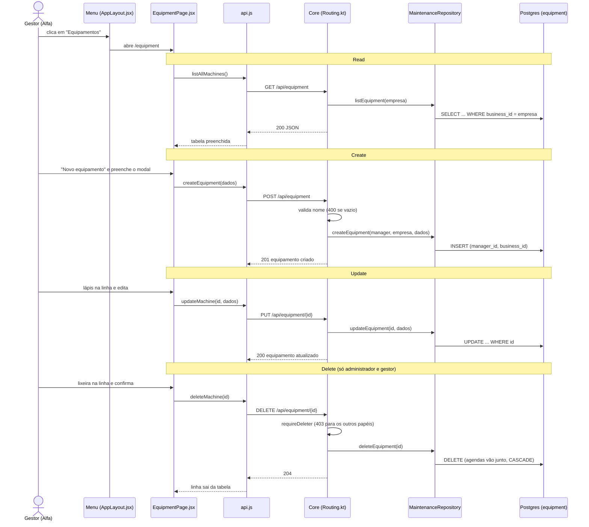
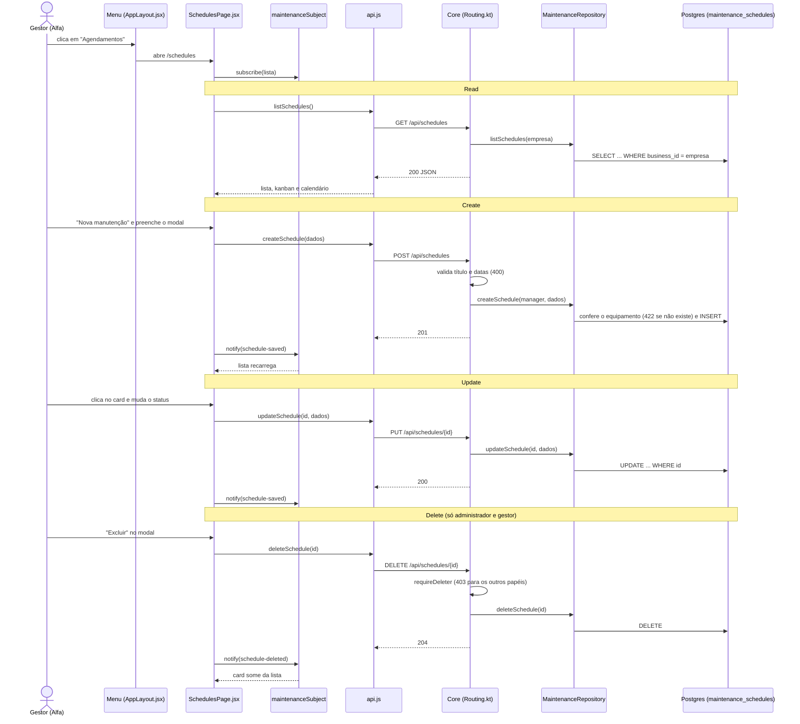

# Defesa Reuso 03: roteiro da Emanuelle (Equipamento e Agenda de manutenção)

Prova de autoria em 16/10. Este roteiro cobre dois CRUDs com conexão ao banco: **Equipamento** (máquina) e **Agenda de manutenção**. Os dois rodam só no Core: React (Vercel) → Ktor (Fly.io) → Supabase Postgres.

**Como ler.** Cada trecho de código traz repositório, arquivo, linhas e um link fixo no commit (`deviante-api@cea030d`, `deviante-web@32eb2d0`). Abaixo de cada trecho vem o que falar.

**Percurso.** Entrar pelo "Modo Protótipo" com a seta na **Alfa**, como **Gestor** (a Alfa tem o plano Manutenção; Beta e Delta não têm estas telas). Do painel inicial, ir pelo menu a **Equipamentos** e fazer o CRUD ali. Depois, pelo menu, ir a **Agendamentos** e fazer o CRUD ali. Em cada tela a ordem é Read, Create, Update e Delete.

## 1. Depois do login: o menu e o token

📍 `deviante-web/src/components/layout/AppLayout.jsx` · linhas 33–39 · [abrir no GitHub](https://github.com/aland3r/deviante-web/blob/32eb2d0/src/components/layout/AppLayout.jsx#L33-L39)

```jsx
          {[
            ['/dashboard', 'Projetos'],
            ['/operations', 'Operações'],
            ['/activities', 'Atividades'],
            ['/equipment', 'Equipamentos', FEATURES.equipment],
            ['/schedules', 'Agendamentos', FEATURES.schedules],
          ].filter(([, , feature]) => !feature || hasFeature(user, feature)).map(([to, label]) => (
```

Fala: "Equipamentos e Agendamentos só aparecem no menu para empresas cujo plano inclui o módulo de manutenção."

📍 `deviante-api/src/main/kotlin/Routing.kt` · linhas 117–134 · [abrir no GitHub](https://github.com/aland3r/deviante-api/blob/cea030d/src/main/kotlin/Routing.kt#L117-L134)

```kotlin
private suspend fun ApplicationCall.requireSupabaseUser(authClient: SupabaseAuthClient): SupabaseUser? {
    // Já verificado nesta requisição (ex.: pelo FeatureGate): não pergunta ao Supabase de novo.
    attributes.getOrNull(SupabaseUserKey)?.let { return it }
    val header = request.headers[HttpHeaders.Authorization]
    val token = header?.removePrefix("Bearer ")?.trim()
    if (token.isNullOrBlank()) {
        respond(HttpStatusCode.Unauthorized, ErrorResponse("Você precisa estar autenticado."))
        return null
    }

    val user = authClient.verify(token)
    if (user == null) {
        respond(HttpStatusCode.Unauthorized, ErrorResponse("Sessão inválida ou expirada."))
        return null
    }
    attributes.put(SupabaseUserKey, user)
    return user
}
```

Fala: "Toda rota começa aqui: o front manda o token do Supabase no cabeçalho, o Core confere com o Supabase Auth e responde 401 se não houver token válido. Depois acha o Manager e a empresa em que ele entrou, que filtram e carimbam os registros."

## 2. CRUD de Equipamento (tela Equipamentos)



### 2.1 A tabela

📍 `deviante-api/src/main/kotlin/db/MaintenanceTables.kt` · linhas 7–26 · [abrir no GitHub](https://github.com/aland3r/deviante-api/blob/cea030d/src/main/kotlin/db/MaintenanceTables.kt#L7-L26)

```kotlin
object EquipmentTable : Table(name = "equipment") {
    override val tableName = "deviante.equipment"
    val id = uuid("id")
    val managerId = uuid("manager_id").references(ManagersTable.id).nullable()
    val businessId = uuid("business_id").references(BusinessesTable.id)
    val name = varchar("name", 150)
    val tag = varchar("tag", 100).nullable()
    val kind = varchar("kind", 100).nullable()
    val location = varchar("location", 200).nullable()
    val description = text("description")
    val manufacturer = varchar("manufacturer", 150).nullable()
    val model = varchar("model", 150).nullable()
    val serialNumber = varchar("serial_number", 150).nullable()
    val status = varchar("status", 30)
    val assetUrl = text("asset_url").nullable()
    val assetFormat = varchar("asset_format", 20).nullable()
    val createdAt = timestampWithTimeZone("created_at")
    val updatedAt = timestampWithTimeZone("updated_at")
    override val primaryKey = PrimaryKey(id)
}
```

Fala: "Cada máquina pertence a uma empresa (`business_id`, obrigatório) e guarda quem a cadastrou (`manager_id`). Só o nome é obrigatório."

### 2.2 Read: a lista ao abrir a tela

📍 `deviante-web/src/pages/EquipmentPage.jsx` · linhas 29–30 · [abrir no GitHub](https://github.com/aland3r/deviante-web/blob/32eb2d0/src/pages/EquipmentPage.jsx#L29-L30)

```jsx
  const load = () => api.listAllMachines().then((data) => setRows(Array.isArray(data) ? data : data?.items ?? [])).catch((err) => setError(err instanceof ApiError ? err.message : 'Não foi possível carregar os equipamentos.')).finally(() => setLoading(false))
  useEffect(() => { load() }, []) // eslint-disable-line react-hooks/exhaustive-deps
```

📍 `deviante-web/src/lib/api.js` · linhas 499–499 · [abrir no GitHub](https://github.com/aland3r/deviante-web/blob/32eb2d0/src/lib/api.js#L499-L499)

```javascript
  listAllMachines: () => request('/equipment'),
```

📍 `deviante-api/src/main/kotlin/Routing.kt` · linhas 575–579 · [abrir no GitHub](https://github.com/aland3r/deviante-api/blob/cea030d/src/main/kotlin/Routing.kt#L575-L579)

```kotlin
                get {
                    val user = call.requireSupabaseUser(authClient) ?: return@get
                    val manager = managerRepository.findOrCreateForSupabaseUser(user.id, user.email, user.fullNameHint)
                    call.respond(maintenanceRepository.listEquipment(call.companyScope(manager).visibleBusinesses))
                }
```

📍 `deviante-api/src/main/kotlin/repository/MaintenanceRepository.kt` · linhas 48–55 · [abrir no GitHub](https://github.com/aland3r/deviante-api/blob/cea030d/src/main/kotlin/repository/MaintenanceRepository.kt#L48-L55)

```kotlin
    /** Equipamentos das empresas visíveis (null = todas, para o administrador). */
    fun listEquipment(businessIds: Set<UUID>?): List<EquipmentResponse> = transaction {
        val query = EquipmentTable.selectAll()
        if (businessIds != null) query.where { EquipmentTable.businessId inList businessIds }
        val rows = query
            .orderBy(EquipmentTable.updatedAt, SortOrder.DESC)
            .toList()
        if (rows.isEmpty()) return@transaction emptyList()
```

Fala: "A tela pede a lista ao abrir. O Core filtra pela empresa (`business_id`), então a Alfa só vê as máquinas dela; o administrador vê todas."

### 2.3 Create: botão "Novo equipamento"

📍 `deviante-web/src/pages/EquipmentPage.jsx` · linhas 110–123 · [abrir no GitHub](https://github.com/aland3r/deviante-web/blob/32eb2d0/src/pages/EquipmentPage.jsx#L110-L123)

```jsx
function CreateEquipmentModal({ initial = null, onClose, onCreate }) {
  const [values, setValues] = useState({ name: initial?.name ?? '', kind: initial?.kind ?? 'generico', tag: initial?.tag ?? '', location: initial?.location ?? '', manufacturer: initial?.manufacturer ?? '', model: initial?.model ?? '' })
  const [busy, setBusy] = useState(false)
  const set = (key) => (event) => setValues((current) => ({ ...current, [key]: event.target.value }))
  const submit = async () => { setBusy(true); try { await onCreate(values) } finally { setBusy(false) } }
  return <FormModal title={initial ? 'Editar equipamento' : 'Cadastrar equipamento'} subtitle={initial ? 'Altere os dados de identificação do ativo.' : 'Crie o ativo antes de associá-lo a processos.'}
    onClose={onClose} onSubmit={submit} busy={busy} canSubmit={Boolean(values.name.trim())} submitLabel={initial ? 'Salvar' : 'Cadastrar'}>
    <Field label="Nome *" wide><TextInput value={values.name} onChange={set('name')} placeholder="Ex.: Torno CNC Prod1" /></Field>
    <Field label="Tipo"><Select value={values.kind} onChange={set('kind')}><option value="torno">Torno CNC</option><option value="fresadora">Fresadora</option><option value="compressor">Compressor</option><option value="esteira">Esteira</option><option value="generico">Genérico</option></Select></Field>
    <Field label="TAG"><TextInput value={values.tag} onChange={set('tag')} placeholder="Ex.: TRN-01" /></Field>
    <Field label="Fabricante"><TextInput value={values.manufacturer} onChange={set('manufacturer')} placeholder="Ex.: Romi" /></Field>
    <Field label="Modelo"><TextInput value={values.model} onChange={set('model')} placeholder="Ex.: GL 240" /></Field>
    <Field label="Localização" wide><TextInput value={values.location} onChange={set('location')} placeholder="Ex.: Célula 01" /></Field>
  </FormModal>
```

📍 `deviante-web/src/pages/EquipmentPage.jsx` · linhas 55–55 · [abrir no GitHub](https://github.com/aland3r/deviante-web/blob/32eb2d0/src/pages/EquipmentPage.jsx#L55-L55)

```jsx
    {creating && <CreateEquipmentModal onClose={() => setCreating(false)} onCreate={async (data) => { await api.createEquipment(toEquipmentRequest(data)); setCreating(false); load() }} />}
```

📍 `deviante-web/src/lib/api.js` · linhas 500–500 · [abrir no GitHub](https://github.com/aland3r/deviante-web/blob/32eb2d0/src/lib/api.js#L500-L500)

```javascript
  createEquipment: (data) => request('/equipment', { method: 'POST', body: JSON.stringify(data) }),
```

📍 `deviante-api/src/main/kotlin/Routing.kt` · linhas 580–586 · [abrir no GitHub](https://github.com/aland3r/deviante-api/blob/cea030d/src/main/kotlin/Routing.kt#L580-L586)

```kotlin
                post {
                    val user = call.requireSupabaseUser(authClient) ?: return@post
                    val manager = managerRepository.findOrCreateForSupabaseUser(user.id, user.email, user.fullNameHint)
                    val body = call.receive<EquipmentRequest>()
                    if (body.name.isBlank()) { call.respond(HttpStatusCode.BadRequest, ErrorResponse("Nome do equipamento é obrigatório.")); return@post }
                    call.respond(HttpStatusCode.Created, maintenanceRepository.createEquipment(manager.id, call.companyScope(manager).businessId, body))
                }
```

📍 `deviante-api/src/main/kotlin/repository/MaintenanceRepository.kt` · linhas 102–109 · [abrir no GitHub](https://github.com/aland3r/deviante-api/blob/cea030d/src/main/kotlin/repository/MaintenanceRepository.kt#L102-L109)

```kotlin
    fun createEquipment(managerId: UUID, businessId: UUID, body: EquipmentRequest): EquipmentResponse = transaction {
        val id = UUID.randomUUID(); val now = OffsetDateTime.now()
        EquipmentTable.insert {
            it[EquipmentTable.id] = id; it[EquipmentTable.managerId] = managerId; it[EquipmentTable.businessId] = businessId
            assignEquipment(it, body); it[EquipmentTable.createdAt] = now; it[EquipmentTable.updatedAt] = now
        }
        findEquipment(id)!!
    }
```

Fala: "O modal só habilita 'Cadastrar' com nome. A rota valida de novo (400) e o repositório gera o UUID, grava quem cadastrou e a empresa, e devolve a máquina criada (201)."

### 2.4 Update: lápis na linha

📍 `deviante-web/src/pages/EquipmentPage.jsx` · linhas 81–81 · [abrir no GitHub](https://github.com/aland3r/deviante-web/blob/32eb2d0/src/pages/EquipmentPage.jsx#L81-L81)

```jsx
              <button type="button" onClick={() => setEditing(machine)} aria-label={`Editar ${machine.name}`} className="p-1.5 rounded hover:bg-secondary text-muted-foreground hover:text-foreground"><Pencil size={12} /></button>
```

📍 `deviante-web/src/pages/EquipmentPage.jsx` · linhas 56–56 · [abrir no GitHub](https://github.com/aland3r/deviante-web/blob/32eb2d0/src/pages/EquipmentPage.jsx#L56-L56)

```jsx
    {editing && <CreateEquipmentModal initial={editing} onClose={() => setEditing(null)} onCreate={async (data) => { await api.updateMachine(editing.id, toEquipmentRequest({ ...editing, ...data })); setEditing(null); load() }} />}
```

📍 `deviante-web/src/lib/api.js` · linhas 481–483 · [abrir no GitHub](https://github.com/aland3r/deviante-web/blob/32eb2d0/src/lib/api.js#L481-L483)

```javascript
  updateMachine: (machineId, patch) => request(`/equipment/${machineId}`, {
    method: 'PUT', body: JSON.stringify(patch),
  }),
```

📍 `deviante-api/src/main/kotlin/Routing.kt` · linhas 593–600 · [abrir no GitHub](https://github.com/aland3r/deviante-api/blob/cea030d/src/main/kotlin/Routing.kt#L593-L600)

```kotlin
                put("/{id}") {
                    call.requireSupabaseUser(authClient) ?: return@put
                    val id = call.parameters["id"]?.let(::runCatchingUuid)
                    val body = call.receive<EquipmentRequest>()
                    if (id == null || body.name.isBlank()) { call.respond(HttpStatusCode.BadRequest, ErrorResponse("Equipamento ou nome inválido.")); return@put }
                    val item = maintenanceRepository.updateEquipment(id, body)
                    if (item == null) call.respond(HttpStatusCode.NotFound, ErrorResponse("Equipamento não encontrado.")) else call.respond(item)
                }
```

📍 `deviante-api/src/main/kotlin/repository/MaintenanceRepository.kt` · linhas 111–114 · [abrir no GitHub](https://github.com/aland3r/deviante-api/blob/cea030d/src/main/kotlin/repository/MaintenanceRepository.kt#L111-L114)

```kotlin
    fun updateEquipment(id: UUID, body: EquipmentRequest): EquipmentResponse? = transaction {
        if (EquipmentTable.update({ EquipmentTable.id eq id }) { assignEquipment(it, body); it[EquipmentTable.updatedAt] = OffsetDateTime.now() } == 0) null
        else findEquipment(id)
    }
```

Fala: "O mesmo modal abre preenchido. O `PUT` grava os campos e devolve a máquina atualizada; 404 se ela não existir."

### 2.5 Delete: lixeira na linha (só administrador e gestor)

📍 `deviante-web/src/lib/permissions.js` · linhas 1–5 · [abrir no GitHub](https://github.com/aland3r/deviante-web/blob/32eb2d0/src/lib/permissions.js#L1-L5)

```javascript
// Excluir (processo, atividade, equipamento, agenda) é só do administrador e do
// gestor. A API repete a regra (403); aqui ela só decide se o botão aparece.
export const DELETE_ROLES = new Set(['owner', 'admin', 'manager'])

export const canDelete = (user) => DELETE_ROLES.has(user?.role)
```

📍 `deviante-web/src/pages/EquipmentPage.jsx` · linhas 82–82 · [abrir no GitHub](https://github.com/aland3r/deviante-web/blob/32eb2d0/src/pages/EquipmentPage.jsx#L82-L82)

```jsx
              {allowDelete && <button type="button" onClick={() => removeEquipment(machine)} aria-label={`Excluir ${machine.name}`} className="p-1.5 rounded hover:bg-red-950/40" style={{ color: 'var(--crit-soft)' }}><Trash2 size={12} /></button>}
```

📍 `deviante-web/src/pages/EquipmentPage.jsx` · linhas 47–51 · [abrir no GitHub](https://github.com/aland3r/deviante-web/blob/32eb2d0/src/pages/EquipmentPage.jsx#L47-L51)

```jsx
  async function removeEquipment(machine) {
    if (!window.confirm(`Excluir o equipamento "${machine.name}"? Parâmetros, leituras, análises e agendamentos dele também serão apagados.`)) return
    try { await api.deleteMachine(machine.id); setRows((current) => current.filter((row) => row.id !== machine.id)) }
    catch (err) { setError(err instanceof ApiError ? err.message : 'Não foi possível excluir o equipamento.') }
  }
```

📍 `deviante-web/src/lib/api.js` · linhas 484–484 · [abrir no GitHub](https://github.com/aland3r/deviante-web/blob/32eb2d0/src/lib/api.js#L484-L484)

```javascript
  deleteMachine: (machineId) => request(`/equipment/${machineId}`, { method: 'DELETE' }),
```

📍 `deviante-api/src/main/kotlin/Routing.kt` · linhas 601–606 · [abrir no GitHub](https://github.com/aland3r/deviante-api/blob/cea030d/src/main/kotlin/Routing.kt#L601-L606)

```kotlin
                delete("/{id}") {
                    call.requireDeleter(authClient, managerRepository) ?: return@delete
                    val id = call.parameters["id"]?.let(::runCatchingUuid)
                    if (id == null || !maintenanceRepository.deleteEquipment(id)) call.respond(HttpStatusCode.NotFound, ErrorResponse("Equipamento não encontrado."))
                    else call.respond(HttpStatusCode.NoContent)
                }
```

📍 `deviante-api/src/main/kotlin/repository/MaintenanceRepository.kt` · linhas 116–116 · [abrir no GitHub](https://github.com/aland3r/deviante-api/blob/cea030d/src/main/kotlin/repository/MaintenanceRepository.kt#L116-L116)

```kotlin
    fun deleteEquipment(id: UUID): Boolean = transaction { EquipmentTable.deleteWhere { EquipmentTable.id eq id } > 0 }
```

Fala: "A lixeira só aparece para administrador e gestor. O Core repete a regra (`requireDeleter`, 403). Apagar a máquina apaga as agendas dela no banco (cascata). Resposta 204, e a linha sai da tabela."

### 2.6 Demonstração

1. No painel inicial, clicar em **Equipamentos** no menu.
2. **Read:** mostrar a lista da Alfa.
3. **Create:** cadastrar "Torno CNC Prod1", tipo torno, TAG TRN-01. No DevTools, `POST /api/equipment` e 201.
4. **Update:** lápis, mudar a localização, salvar (`PUT`, 200).
5. **Delete:** lixeira num equipamento sem agenda (204). Sair, entrar como **Operador** da Alfa e mostrar que a lixeira não aparece.

## 3. CRUD de Agenda de manutenção (tela Agendamentos)



### 3.1 A tabela

📍 `deviante-api/src/main/kotlin/db/MaintenanceTables.kt` · linhas 29–46 · [abrir no GitHub](https://github.com/aland3r/deviante-api/blob/cea030d/src/main/kotlin/db/MaintenanceTables.kt#L29-L46)

```kotlin
object MaintenanceSchedulesTable : Table(name = "maintenance_schedules") {
    override val tableName = "deviante.maintenance_schedules"
    val id = uuid("id")
    val equipmentId = uuid("equipment_id").references(EquipmentTable.id)
    val processId = uuid("process_id").references(ProcessesTable.id).nullable()
    val recommendationId = uuid("recommendation_id").references(MaintenanceRecommendationsTable.id).nullable()
    val managerId = uuid("manager_id").references(ManagersTable.id)
    // preenchida no banco a partir do equipamento (trigger maintenance_schedules_business_id)
    val businessId = uuid("business_id").references(BusinessesTable.id).nullable()
    val title = varchar("title", 200)
    val notes = text("notes")
    val scheduledStart = timestampWithTimeZone("scheduled_start")
    val scheduledEnd = timestampWithTimeZone("scheduled_end").nullable()
    val status = varchar("status", 30)
    val createdAt = timestampWithTimeZone("created_at")
    val updatedAt = timestampWithTimeZone("updated_at")
    override val primaryKey = PrimaryKey(id)
}
```

Fala: "Cada agenda pertence a uma máquina (`equipment_id`, obrigatório): é a FK entre os meus dois CRUDs. Pode apontar para um processo, que é o CRUD do Alander. Se a máquina for apagada, a agenda vai junto (cascata)."

### 3.2 Read: lista, kanban e calendário

📍 `deviante-web/src/pages/SchedulesPage.jsx` · linhas 22–25 · [abrir no GitHub](https://github.com/aland3r/deviante-web/blob/32eb2d0/src/pages/SchedulesPage.jsx#L22-L25)

```jsx
  const load = () => api.listSchedules({ equipmentId }).then((data) => setRows(Array.isArray(data) ? data : data?.items ?? [])).catch((err) => setError(err instanceof ApiError ? err.message : 'Não foi possível carregar os agendamentos.')).finally(() => setLoading(false))
  useEffect(() => { load() }, [equipmentId]) // eslint-disable-line react-hooks/exhaustive-deps
  // A própria lista também é observadora: recarrega quando a agenda muda.
  useEffect(() => maintenanceSubject.subscribe({ update: load }), [equipmentId]) // eslint-disable-line react-hooks/exhaustive-deps
```

📍 `deviante-web/src/lib/api.js` · linhas 501–512 · [abrir no GitHub](https://github.com/aland3r/deviante-web/blob/32eb2d0/src/lib/api.js#L501-L512)

```javascript
  listSchedules: (params = {}) => {
    const query = new URLSearchParams(Object.entries(params).filter(([, value]) => value != null && value !== '')).toString()
    return request(`/schedules${query ? `?${query}` : ''}`).then((payload) => {
      const rows = Array.isArray(payload) ? payload : payload?.items ?? []
      const normalized = rows.map((row) => ({
        ...row,
        scheduledStart: row.scheduledStart ?? row.plannedFor ?? null,
        scheduledEnd: row.scheduledEnd ?? null,
      }))
      return Array.isArray(payload) ? normalized : { ...payload, items: normalized }
    })
  },
```

📍 `deviante-api/src/main/kotlin/Routing.kt` · linhas 901–906 · [abrir no GitHub](https://github.com/aland3r/deviante-api/blob/cea030d/src/main/kotlin/Routing.kt#L901-L906)

```kotlin
                get {
                    val u=call.requireSupabaseUser(authClient)?:return@get
                    val m = managerRepository.findOrCreateForSupabaseUser(u.id,u.email,u.fullNameHint)
                    val equipmentId = call.request.queryParameters["equipmentId"]?.let(::runCatchingUuid)
                    call.respond(maintenanceRepository.listSchedules(equipmentId, call.companyScope(m).visibleBusinesses))
                }
```

📍 `deviante-api/src/main/kotlin/repository/MaintenanceRepository.kt` · linhas 349–355 · [abrir no GitHub](https://github.com/aland3r/deviante-api/blob/cea030d/src/main/kotlin/repository/MaintenanceRepository.kt#L349-L355)

```kotlin
    /** Agenda, opcionalmente de um equipamento e só das empresas visíveis. */
    fun listSchedules(equipmentId: UUID? = null, businessIds: Set<UUID>? = null): List<MaintenanceScheduleResponse> = transaction {
        val query = MaintenanceSchedulesTable.selectAll()
        if (equipmentId != null) query.andWhere { MaintenanceSchedulesTable.equipmentId eq equipmentId }
        if (businessIds != null) query.andWhere { MaintenanceSchedulesTable.businessId inList businessIds }
        query.orderBy(MaintenanceSchedulesTable.scheduledStart).map(::schedule)
    }
```

Fala: "As três visões usam a mesma lista; só muda o agrupamento na tela. A própria lista se inscreve no `maintenanceSubject` para recarregar quando a agenda mudar (Observer)."

### 3.3 Create e Update: "Nova manutenção" ou clique no card

📍 `deviante-web/src/pages/SchedulesPage.jsx` · linhas 27–31 · [abrir no GitHub](https://github.com/aland3r/deviante-web/blob/32eb2d0/src/pages/SchedulesPage.jsx#L27-L31)

```jsx
  async function save(data) {
    const saved = editing?.id ? await api.updateSchedule(editing.id, data) : await api.createSchedule(data)
    setEditing(null)
    maintenanceSubject.notify({ type: 'schedule-saved', scheduleId: saved?.id ?? editing?.id })
  }
```

📍 `deviante-web/src/lib/api.js` · linhas 513–514 · [abrir no GitHub](https://github.com/aland3r/deviante-web/blob/32eb2d0/src/lib/api.js#L513-L514)

```javascript
  createSchedule: (data) => request('/schedules', { method: 'POST', body: JSON.stringify(data) }),
  updateSchedule: (id, patch) => request(`/schedules/${id}`, { method: 'PUT', body: JSON.stringify(patch) }),
```

📍 `deviante-api/src/main/kotlin/Routing.kt` · linhas 907–912 · [abrir no GitHub](https://github.com/aland3r/deviante-api/blob/cea030d/src/main/kotlin/Routing.kt#L907-L912)

```kotlin
                post {
                    val u=call.requireSupabaseUser(authClient)?:return@post; val m=managerRepository.findOrCreateForSupabaseUser(u.id,u.email,u.fullNameHint); val body=call.receive<MaintenanceScheduleRequest>()
                    val start=runCatching{OffsetDateTime.parse(body.scheduledStart)}.getOrNull(); val end=body.scheduledEnd?.let{runCatching{OffsetDateTime.parse(it)}.getOrNull()}
                    if(body.title.isBlank()||start==null||(body.scheduledEnd!=null&&end==null)||(end!=null&&end<start)) { call.respond(HttpStatusCode.BadRequest,ErrorResponse("Agenda de manutenção inválida.")); return@post }
                    val item=runCatching{maintenanceRepository.createSchedule(m.id,body)}.getOrNull(); if(item==null) call.respond(HttpStatusCode.UnprocessableEntity,ErrorResponse("Referências da agenda inválidas.")) else call.respond(HttpStatusCode.Created,item)
                }
```

📍 `deviante-api/src/main/kotlin/repository/MaintenanceRepository.kt` · linhas 361–373 · [abrir no GitHub](https://github.com/aland3r/deviante-api/blob/cea030d/src/main/kotlin/repository/MaintenanceRepository.kt#L361-L373)

```kotlin
    fun createSchedule(managerId: UUID, body: MaintenanceScheduleRequest): MaintenanceScheduleResponse? = transaction {
        val equipmentId = UUID.fromString(body.equipmentId)
        if (findEquipment(equipmentId) == null) return@transaction null
        val id = UUID.randomUUID(); val now = OffsetDateTime.now()
        MaintenanceSchedulesTable.insert {
            it[MaintenanceSchedulesTable.id] = id; it[MaintenanceSchedulesTable.equipmentId] = equipmentId
            it[MaintenanceSchedulesTable.processId] = body.processId?.let(UUID::fromString); it[MaintenanceSchedulesTable.recommendationId] = body.recommendationId?.let(UUID::fromString)
            it[MaintenanceSchedulesTable.managerId] = managerId; it[MaintenanceSchedulesTable.title] = body.title.trim(); it[MaintenanceSchedulesTable.notes] = body.notes.trim()
            it[MaintenanceSchedulesTable.scheduledStart] = OffsetDateTime.parse(body.scheduledStart); it[MaintenanceSchedulesTable.scheduledEnd] = body.scheduledEnd?.let(OffsetDateTime::parse)
            it[MaintenanceSchedulesTable.status] = body.status; it[MaintenanceSchedulesTable.createdAt] = now; it[MaintenanceSchedulesTable.updatedAt] = now
        }
        findSchedule(id)
    }
```

📍 `deviante-api/src/main/kotlin/Routing.kt` · linhas 913–925 · [abrir no GitHub](https://github.com/aland3r/deviante-api/blob/cea030d/src/main/kotlin/Routing.kt#L913-L925)

```kotlin
                put("/{id}") {
                    call.requireSupabaseUser(authClient) ?: return@put
                    val id = call.parameters["id"]?.let(::runCatchingUuid)
                    val body = call.receive<MaintenanceScheduleRequest>()
                    val start = runCatching { OffsetDateTime.parse(body.scheduledStart) }.getOrNull()
                    val end = body.scheduledEnd?.let { runCatching { OffsetDateTime.parse(it) }.getOrNull() }
                    if (id == null || body.title.isBlank() || start == null || (body.scheduledEnd != null && end == null) || (end != null && end < start)) {
                        call.respond(HttpStatusCode.BadRequest, ErrorResponse("Agenda de manutenção inválida."))
                        return@put
                    }
                    val item = runCatching { maintenanceRepository.updateSchedule(id, body) }.getOrNull()
                    if (item == null) call.respond(HttpStatusCode.NotFound, ErrorResponse("Agenda não encontrada.")) else call.respond(item)
                }
```

📍 `deviante-api/src/main/kotlin/repository/MaintenanceRepository.kt` · linhas 375–383 · [abrir no GitHub](https://github.com/aland3r/deviante-api/blob/cea030d/src/main/kotlin/repository/MaintenanceRepository.kt#L375-L383)

```kotlin
    fun updateSchedule(id: UUID, body: MaintenanceScheduleRequest): MaintenanceScheduleResponse? = transaction {
        val changed = MaintenanceSchedulesTable.update({ MaintenanceSchedulesTable.id eq id }) {
            it[MaintenanceSchedulesTable.equipmentId] = UUID.fromString(body.equipmentId); it[MaintenanceSchedulesTable.processId] = body.processId?.let(UUID::fromString)
            it[MaintenanceSchedulesTable.recommendationId] = body.recommendationId?.let(UUID::fromString); it[MaintenanceSchedulesTable.title] = body.title.trim(); it[MaintenanceSchedulesTable.notes] = body.notes.trim()
            it[MaintenanceSchedulesTable.scheduledStart] = OffsetDateTime.parse(body.scheduledStart); it[MaintenanceSchedulesTable.scheduledEnd] = body.scheduledEnd?.let(OffsetDateTime::parse)
            it[MaintenanceSchedulesTable.status] = body.status; it[MaintenanceSchedulesTable.updatedAt] = OffsetDateTime.now()
        }
        if (changed == 0) null else findSchedule(id)
    }
```

Fala: "O mesmo modal cria (`POST`) ou edita (`PUT`). O Core valida título e datas (400) e, na criação, confere se a máquina existe (422). Depois de salvar, a tela avisa o `maintenanceSubject`, e a lista e o contador do menu se atualizam."

### 3.4 Delete: "Excluir" no modal (só administrador e gestor)

📍 `deviante-web/src/pages/SchedulesPage.jsx` · linhas 32–37 · [abrir no GitHub](https://github.com/aland3r/deviante-web/blob/32eb2d0/src/pages/SchedulesPage.jsx#L32-L37)

```jsx
  async function remove() {
    if (!window.confirm(`Excluir a manutenção "${editing.title}"?`)) return
    await api.deleteSchedule(editing.id)
    setEditing(null)
    maintenanceSubject.notify({ type: 'schedule-deleted', scheduleId: editing.id })
  }
```

📍 `deviante-web/src/pages/SchedulesPage.jsx` · linhas 53–53 · [abrir no GitHub](https://github.com/aland3r/deviante-web/blob/32eb2d0/src/pages/SchedulesPage.jsx#L53-L53)

```jsx
    {editing && <ScheduleModal initial={editing} onClose={() => setEditing(null)} onSave={save} onDelete={editing.id && canDelete(user) ? remove : null} />}</Surface>
```

📍 `deviante-web/src/lib/api.js` · linhas 515–515 · [abrir no GitHub](https://github.com/aland3r/deviante-web/blob/32eb2d0/src/lib/api.js#L515-L515)

```javascript
  deleteSchedule: (id) => request(`/schedules/${id}`, { method: 'DELETE' }),
```

📍 `deviante-api/src/main/kotlin/Routing.kt` · linhas 926–926 · [abrir no GitHub](https://github.com/aland3r/deviante-api/blob/cea030d/src/main/kotlin/Routing.kt#L926-L926)

```kotlin
                delete("/{id}") { call.requireDeleter(authClient, managerRepository)?:return@delete; val id=call.parameters["id"]?.let(::runCatchingUuid); if(id==null||!maintenanceRepository.deleteSchedule(id)) call.respond(HttpStatusCode.NotFound,ErrorResponse("Agenda não encontrada.")) else call.respond(HttpStatusCode.NoContent) }
```

📍 `deviante-api/src/main/kotlin/repository/MaintenanceRepository.kt` · linhas 385–385 · [abrir no GitHub](https://github.com/aland3r/deviante-api/blob/cea030d/src/main/kotlin/repository/MaintenanceRepository.kt#L385-L385)

```kotlin
    fun deleteSchedule(id: UUID): Boolean = transaction { MaintenanceSchedulesTable.deleteWhere { MaintenanceSchedulesTable.id eq id } > 0 }
```

Fala: "O botão só vai para o modal quando a agenda já existe e o papel pode excluir. O Core confere de novo (403) e responde 204."

### 3.5 Demonstração

1. Como **Gestor** da Alfa, clicar em **Agendamentos** no menu.
2. **Read:** mostrar lista, kanban e calendário.
3. **Create:** "Nova manutenção": "Troca de rolamento", Torno CNC Prod1, início amanhã (`POST`, 201).
4. **Update:** abrir o card, mudar para "Em andamento", salvar (`PUT`, 200). O card muda de coluna no kanban.
5. **Delete:** excluir a manutenção (204). Como **Operador**, o botão "Excluir" não aparece.

## 4. Perguntas prováveis

- **O que acontece ao excluir uma máquina que tem agenda?** O banco apaga a agenda junto (`ON DELETE CASCADE` em `maintenance_schedules.equipment_id`).
- **Onde fica a transação?** Cada função do repositório roda em `transaction { }` do Exposed.
- **Por que esconder o botão e ainda checar no Core?** Quem chama a API direto não passa pela tela; por isso a regra também está no Core (403).

## 5. Antes de ensaiar

- [ ] Entrar com a seta na **Alfa** (ou na Gama), que têm Equipamentos e Agendamentos.
- [ ] Ensaiar com o **Gestor** (exclui) e o **Operador** (sem botão de excluir).
