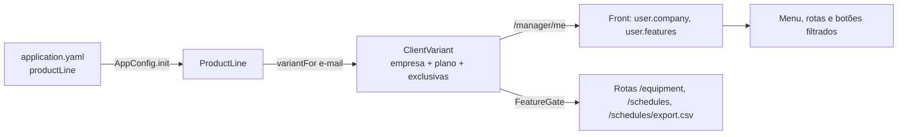

# Defesa Reuso 03: exemplo de variabilidade (item 02, 2,0 pts)

O enunciado pede "um exemplo de como planejaram a variabilidade". Na entrega anterior (Parte III) a ideia era: nem todo cliente recebe as mesmas opções, alguns recursos são para todos e algumas funções são feitas para um cliente específico. É isso que está implementado, de ponta a ponta (API e tela), com testes.

**Como ler.** Os trechos com 📍 e link são o código atual, fixado no commit (`deviante-api@7eee985`, `deviante-web@fa44226`).

## 0. O modelo de variabilidade

O Deviante é um produto só, entregue em variantes. Cada empresa cliente recebe uma combinação de três tipos de funcionalidade:

| Tipo | Funcionalidades | Quem recebe |
|---|---|---|
| Comum | Processos, Atividades, Análise de drift | Todo cliente |
| Opcional (por plano) | Equipamentos e Agendamentos (módulo de manutenção) | Plano Manutenção |
| Exclusiva (por cliente) | Exportar a agenda em CSV | Só os clientes que contrataram |

As contas demo representam quatro empresas, cada uma com o nome de uma letra grega, e o nome da empresa aparece ao lado do nome do usuário no menu do topo:

| Conta demo | Empresa | Plano | Exclusivas | O que muda na tela |
|---|---|---|---|---|
| Administrador | Deviante | Manutenção | CSV | Tudo, com "Exportar CSV" |
| Gestor | Metalúrgica Alfa | Manutenção | CSV | Tudo, com "Exportar CSV" |
| Operador | Metalúrgica Beta | Essencial | nenhuma | Sem "Equipamentos" e "Agendamentos" no menu |
| Técnico | Metalúrgica Gama | Manutenção | nenhuma | Agendamentos sem "Exportar CSV" |

A variante é escolhida por **configuração**, não por código: incluir um cliente ou trocar o plano dele é editar o `application.yaml`, sem recompilar. Essa é a técnica de LPS de variabilidade por configuração, com pontos de variação resolvidos em tempo de execução.



## 1. O modelo no Core

Funcionalidades, planos e a variante de cada cliente:

📍 `deviante-api/src/main/kotlin/variability/ProductLine.kt` · linhas 16–55 · [abrir no GitHub](https://github.com/aland3r/deviante-api/blob/7eee985/src/main/kotlin/variability/ProductLine.kt#L16-L55)

```kotlin
enum class Feature(val key: String) {
    PROCESSES("processes"),
    ACTIVITIES("activities"),
    DRIFT_ANALYSIS("drift-analysis"),
    EQUIPMENT("equipment"),
    SCHEDULES("schedules"),
    SCHEDULE_EXPORT("schedule-export");

    companion object {
        fun fromKey(key: String): Feature =
            entries.firstOrNull { it.key == key } ?: error("Funcionalidade desconhecida: $key")
    }
}

/** Funcionalidades comuns: entram em todo produto, qualquer que seja o plano. */
val COMMON_FEATURES = setOf(Feature.PROCESSES, Feature.ACTIVITIES, Feature.DRIFT_ANALYSIS)

/** Planos: conjuntos de funcionalidades. Todo plano contém as comuns. */
enum class Plan(val key: String, val label: String, optional: Set<Feature>) {
    ESSENCIAL("essencial", "Essencial", emptySet()),
    MANUTENCAO("manutencao", "Manutenção", setOf(Feature.EQUIPMENT, Feature.SCHEDULES));

    val features: Set<Feature> = COMMON_FEATURES + optional

    companion object {
        fun fromKey(key: String): Plan =
            entries.firstOrNull { it.key == key } ?: error("Plano desconhecido: $key")
    }
}

/** A variante do produto que um cliente recebe: o plano mais as funções exclusivas dele. */
data class ClientVariant(
    val client: String,
    val plan: Plan,
    val exclusive: Set<Feature> = emptySet(),
) {
    val features: Set<Feature> = plan.features + exclusive

    fun has(feature: Feature): Boolean = feature in features
}
```

Fala: "Toda funcionalidade é um ponto de variação. Todo plano contém as comuns; o plano Manutenção soma o módulo opcional; e a variante do cliente soma ao plano as funções exclusivas dele."

A variante de cada conta sai do `application.yaml`:

📍 `deviante-api/src/main/resources/application.yaml` · linhas 28–51 · [abrir no GitHub](https://github.com/aland3r/deviante-api/blob/7eee985/src/main/resources/application.yaml#L28-L51)

```yaml
productLine:
  defaultClient: "Deviante"
  defaultPlan: manutencao
  clients:
    - name: "Deviante"
      plan: manutencao
      exclusive: [schedule-export]
      accounts:
        - demo-administrador@deviante.alander.io
    - name: "Metalúrgica Alfa"
      plan: manutencao
      exclusive: [schedule-export]
      accounts:
        - demo-gestor@deviante.alander.io
    - name: "Metalúrgica Beta"
      plan: essencial
      exclusive: []
      accounts:
        - demo-operador@deviante.alander.io
    - name: "Metalúrgica Gama"
      plan: manutencao
      exclusive: []
      accounts:
        - demo-tecnico@deviante.alander.io
```

📍 `deviante-api/src/main/kotlin/variability/ProductLine.kt` · linhas 57–83 · [abrir no GitHub](https://github.com/aland3r/deviante-api/blob/7eee985/src/main/kotlin/variability/ProductLine.kt#L57-L83)

```kotlin
class ProductLine(
    private val default: ClientVariant,
    private val byAccount: Map<String, ClientVariant>,
) {
    fun variantFor(email: String): ClientVariant = byAccount[email.trim().lowercase()] ?: default

    companion object {
        /** Lê a seção `productLine` do application.yaml. */
        fun fromConfig(config: ApplicationConfig): ProductLine {
            val section = config.config("productLine")
            val default = ClientVariant(
                client = section.propertyOrNull("defaultClient")?.getString() ?: "Cliente padrão",
                plan = Plan.fromKey(section.property("defaultPlan").getString()),
            )
            val byAccount = section.configList("clients").flatMap { client ->
                val variant = ClientVariant(
                    client = client.property("name").getString(),
                    plan = Plan.fromKey(client.property("plan").getString()),
                    exclusive = (client.propertyOrNull("exclusive")?.getList() ?: emptyList())
                        .map(Feature::fromKey).toSet(),
                )
                client.property("accounts").getList().map { it.trim().lowercase() to variant }
            }.toMap()
            return ProductLine(default, byAccount)
        }
    }
}
```

E é carregada uma vez, pelo Singleton `AppConfig` (o mesmo do item 01):

📍 `deviante-api/src/main/kotlin/AppConfig.kt` · linhas 38–40 · [abrir no GitHub](https://github.com/aland3r/deviante-api/blob/7eee985/src/main/kotlin/AppConfig.kt#L38-L40)

```kotlin
        // Sem a seção productLine (ex.: testes), todo cliente recebe o plano completo.
        productLine = runCatching { ProductLine.fromConfig(config) }
            .getOrElse { ProductLine(ClientVariant("Cliente padrão", Plan.MANUTENCAO), emptyMap()) }
```

## 2. O ponto de variação na API

Um plugin do Ktor instalado na rota deixa passar só quem tem a funcionalidade na variante; os outros recebem 403. Assim a regra não depende da tela:

📍 `deviante-api/src/main/kotlin/Routing.kt` · linhas 139–166 · [abrir no GitHub](https://github.com/aland3r/deviante-api/blob/7eee985/src/main/kotlin/Routing.kt#L139-L166)

```kotlin
/**
 * Ponto de variação na API: instalado numa rota, só deixa passar o cliente
 * cuja variante do produto inclui a funcionalidade; os outros recebem 403.
 */
val FeatureGate = createRouteScopedPlugin("FeatureGate", ::FeatureGateConfig) {
    val feature = pluginConfig.feature
    val authClient = pluginConfig.authClient
    val managerRepository = pluginConfig.managerRepository
    onCall { call ->
        val user = call.requireSupabaseUser(authClient) ?: return@onCall
        val manager = managerRepository.findOrCreateForSupabaseUser(user.id, user.email, user.fullNameHint)
        val variant = AppConfig.productLine.variantFor(manager.email)
        if (!variant.has(feature)) {
            call.respond(
                HttpStatusCode.Forbidden,
                ErrorResponse("Este recurso não faz parte do plano ${variant.plan.label} de ${variant.client}."),
            )
        }
    }
}

private fun Route.requireFeature(feature: Feature, authClient: SupabaseAuthClient, managerRepository: ManagerRepository) {
    install(FeatureGate) {
        this.feature = feature
        this.authClient = authClient
        this.managerRepository = managerRepository
    }
}
```

Onde ele é instalado: o módulo opcional inteiro e, dentro dele, a função exclusiva.

📍 `deviante-api/src/main/kotlin/Routing.kt` · linhas 516–517 · [abrir no GitHub](https://github.com/aland3r/deviante-api/blob/7eee985/src/main/kotlin/Routing.kt#L516-L517)

```kotlin
            route("/equipment") {
                requireFeature(Feature.EQUIPMENT, authClient, managerRepository)
```

📍 `deviante-api/src/main/kotlin/Routing.kt` · linhas 832–841 · [abrir no GitHub](https://github.com/aland3r/deviante-api/blob/7eee985/src/main/kotlin/Routing.kt#L832-L841)

```kotlin
            route("/schedules") {
                requireFeature(Feature.SCHEDULES, authClient, managerRepository)
                // Função exclusiva de um cliente: só existe na variante que a contratou.
                route("/export.csv") {
                    requireFeature(Feature.SCHEDULE_EXPORT, authClient, managerRepository)
                    get {
                        val rows = maintenanceRepository.listSchedules(null)
                        call.respondText(schedulesToCsv(rows), ContentType.Text.CSV.withCharset(Charsets.UTF_8))
                    }
                }
```

O front descobre a variante em `/manager/me`, que agora devolve empresa, plano e funcionalidades:

📍 `deviante-api/src/main/kotlin/dto/ManagerDto.kt` · linhas 24–32 · [abrir no GitHub](https://github.com/aland3r/deviante-api/blob/7eee985/src/main/kotlin/dto/ManagerDto.kt#L24-L32)

```kotlin
fun ManagerRecord.toResponse(variant: ClientVariant? = null) = ManagerResponse(
    id = userId.toString(),
    email = email,
    fullName = fullName,
    role = role,
    client = variant?.client,
    plan = variant?.plan?.key,
    features = variant?.features?.map { it.key }?.sorted() ?: emptyList(),
)
```

## 3. O ponto de variação na tela

📍 `deviante-web/src/lib/features.js` · linhas 1–10 · [abrir no GitHub](https://github.com/aland3r/deviante-web/blob/fa44226/src/lib/features.js#L1-L10)

```javascript
// Variabilidade da linha de produto (Reuso 03): o que cada cliente contratou
// vem da API (/manager/me → features). A tela só mostra o que está na variante;
// a API repete a regra (403). Sem a lista (API antiga ou mock), mostra tudo.
export const FEATURES = {
  equipment: 'equipment',
  schedules: 'schedules',
  scheduleExport: 'schedule-export',
}

export const hasFeature = (user, feature) => !user?.features?.length || user.features.includes(feature)
```

O perfil carregado guarda empresa, plano e funcionalidades:

📍 `deviante-web/src/lib/auth.js` · linhas 100–108 · [abrir no GitHub](https://github.com/aland3r/deviante-web/blob/fa44226/src/lib/auth.js#L100-L108)

```javascript
async function loadManagerProfile() {
  try {
    const manager = await apiFetch('/manager/me')
    return {
      fullName: manager.fullName,
      role: manager.role,
      company: manager.client,
      plan: manager.plan,
      features: manager.features,
```

O nome da empresa ao lado do nome do usuário (menu do topo, à direita):

📍 `deviante-web/src/components/layout/UserMenu.jsx` · linhas 46–49 · [abrir no GitHub](https://github.com/aland3r/deviante-web/blob/fa44226/src/components/layout/UserMenu.jsx#L46-L49)

```jsx
        <span className="truncate">{name}</span>
        {user?.company && (
          <span className="truncate font-normal" style={{ color: 'var(--muted-foreground)' }}>· {user.company}</span>
        )}
```

O menu esconde o que o cliente não contratou:

📍 `deviante-web/src/components/layout/AppLayout.jsx` · linhas 32–38 · [abrir no GitHub](https://github.com/aland3r/deviante-web/blob/fa44226/src/components/layout/AppLayout.jsx#L32-L38)

```jsx
          {[
            ['/dashboard', 'Projetos'],
            ['/operations', 'Operações'],
            ['/activities', 'Atividades'],
            ['/equipment', 'Equipamentos', FEATURES.equipment],
            ['/schedules', 'Agendamentos', FEATURES.schedules],
          ].filter(([, , feature]) => !feature || hasFeature(user, feature)).map(([to, label]) => (
```

E as rotas do módulo opcional redirecionam quem não o tem, mesmo digitando o endereço:

📍 `deviante-web/src/components/auth/FeatureRoute.jsx` · linhas 1–9 · [abrir no GitHub](https://github.com/aland3r/deviante-web/blob/fa44226/src/components/auth/FeatureRoute.jsx#L1-L9)

```jsx
import { Navigate, Outlet } from 'react-router-dom'
import { useAuth } from '../../context/AuthContext'
import { hasFeature } from '../../lib/features'

/** Rota de um módulo opcional: quem não contratou volta para o painel. */
export default function FeatureRoute({ feature }) {
  const { user } = useAuth()
  return hasFeature(user, feature) ? <Outlet /> : <Navigate to="/dashboard" replace />
}
```

📍 `deviante-web/src/App.jsx` · linhas 84–91 · [abrir no GitHub](https://github.com/aland3r/deviante-web/blob/fa44226/src/App.jsx#L84-L91)

```jsx
              <Route element={<FeatureRoute feature={FEATURES.equipment} />}>
                <Route path="/equipment" element={<EquipmentPage />} />
                <Route path="/equipment/:machineId" element={<MachineDetailPage />} />
              </Route>
              <Route path="/activities" element={<ActivitiesPage />} />
              <Route element={<FeatureRoute feature={FEATURES.schedules} />}>
                <Route path="/schedules" element={<SchedulesPage />} />
              </Route>
```

A função exclusiva, o botão "Exportar CSV" em `/schedules`:

📍 `deviante-web/src/pages/SchedulesPage.jsx` · linhas 51–51 · [abrir no GitHub](https://github.com/aland3r/deviante-web/blob/fa44226/src/pages/SchedulesPage.jsx#L51-L51)

```jsx
  const actions = <div className="flex items-center gap-2">{hasFeature(user, FEATURES.scheduleExport) && <button onClick={exportCsv} className="flex items-center gap-1.5 px-3 py-2 rounded-lg border border-border text-xs text-foreground" style={{ background: 'var(--surface-raised)' }}><Download size={12} />Exportar CSV</button>}<button onClick={() => setEditing({ equipmentId })} className="flex items-center gap-1.5 px-3.5 py-2 rounded-lg text-xs font-semibold text-white" style={{ background: 'var(--ok-strong)' }}><Plus size={12} />Nova manutenção</button><div className="flex rounded-lg border border-border overflow-hidden">{VIEWS.map(({ id, label, icon: Icon }) => <button key={id} onClick={() => setView(id)} className="flex items-center gap-1.5 px-3 py-2 text-[11px]" style={{ border: 0, background: view === id ? 'var(--surface-inset)' : 'var(--surface-raised)', color: view === id ? 'var(--text-strong)' : 'var(--muted-foreground)' }}><Icon size={11} />{label}</button>)}</div></div>
```

## 4. Testes

📍 `deviante-api/src/test/kotlin/ProductLineTest.kt` · linhas 25–43 · [abrir no GitHub](https://github.com/aland3r/deviante-api/blob/7eee985/src/test/kotlin/ProductLineTest.kt#L25-L43)

```kotlin
    @Test
    fun `each client receives its own variant`() {
        val alfa = productLine.variantFor("demo-gestor@deviante.alander.io")
        val beta = productLine.variantFor("demo-operador@deviante.alander.io")
        val gama = productLine.variantFor("DEMO-TECNICO@deviante.alander.io ")

        assertEquals("Metalúrgica Alfa", alfa.client)
        assertEquals(Plan.MANUTENCAO, alfa.plan)
        assertTrue(alfa.has(Feature.SCHEDULE_EXPORT))

        assertEquals("Metalúrgica Beta", beta.client)
        assertEquals(Plan.ESSENCIAL, beta.plan)
        assertFalse(beta.has(Feature.EQUIPMENT))
        assertFalse(beta.has(Feature.SCHEDULES))

        assertEquals("Metalúrgica Gama", gama.client)
        assertTrue(gama.has(Feature.SCHEDULES))
        assertFalse(gama.has(Feature.SCHEDULE_EXPORT))
    }
```

Rodar: `./gradlew test --tests ProductLineTest` dentro de `deviante-api`.

## 5. Demonstração (dois minutos)

1. Entrar em `https://deviante.alander.io` como **Gestor**. Mostrar "· Metalúrgica Alfa" ao lado do nome, no topo. Abrir **Agendamentos** e mostrar o botão **Exportar CSV**; clicar e abrir o arquivo.
2. Sair e entrar como **Técnico** (Metalúrgica Gama). Agendamentos está lá, mas sem **Exportar CSV**: mesmo plano, sem a função exclusiva.
3. Sair e entrar como **Operador** (Metalúrgica Beta, plano Essencial). O menu não tem **Equipamentos** nem **Agendamentos**. Digitar `/schedules` na barra de endereço: volta para o painel.
4. Abrir o `application.yaml` e mostrar que trocar `plan: essencial` por `plan: manutencao` na Beta é tudo o que muda a variante.

Fala de fechamento: "é um software só; o que muda de um cliente para outro é a configuração. Os recursos comuns são para todos, o módulo de manutenção depende do plano e o CSV foi feito para clientes específicos, que foi o que planejamos na entrega anterior."

## 6. Perguntas prováveis

- **Por que não um banco com os planos?** Para a v1 o número de clientes é pequeno e a configuração já separa variante de código. Levar a tabela para o banco muda só o `ProductLine.fromConfig`; o resto do sistema continua perguntando `variant.has(feature)`.
- **Esconder na tela não basta?** Não: quem digita a URL ou chama a API direto ainda acessaria. Por isso a mesma regra está no `FeatureGate` (403) e na tela.
- **Isso é diferente da permissão de excluir?** É. Excluir depende do **papel** do usuário (administrador e gestor). A variabilidade depende do **cliente** (o que a empresa contratou). As duas convivem.

## 7. Checagem antes de ensaiar

- [ ] Deploy da API no Fly.io concluído. Sem ele, o site ainda roda a API antiga: o nome da empresa aparece (o front tem o nome de cada conta demo), mas nenhum módulo some, porque a API antiga não informa as funcionalidades.
- [ ] Uma manutenção cadastrada, para o CSV não sair vazio.
