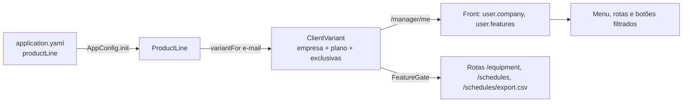

# Defesa Reuso 03: exemplo de variabilidade (item 02, 2,0 pts)

O enunciado pede "um exemplo de como planejaram a variabilidade". Na entrega anterior (Parte III) a ideia era: nem todo cliente recebe as mesmas opções, alguns recursos são para todos e algumas funções são feitas para um cliente específico. É isso que está implementado, de ponta a ponta (API e tela), com testes.

**Como ler.** Os trechos com 📍 e link são o código atual, fixado no commit (`deviante-api@bdd868c`, `deviante-web@d1cba0d`).

## 0. O modelo de variabilidade

O Deviante é um produto só, entregue em variantes. Cada empresa cliente recebe uma combinação de três tipos de funcionalidade:

| Tipo | Funcionalidades | Quem recebe |
|---|---|---|
| Comum | Processos, Atividades, Análise de drift | Todo cliente |
| Opcional (por plano) | Equipamentos e Agendamentos (módulo de manutenção) | Plano Manutenção |
| Exclusiva (por cliente) | Exportar a agenda em CSV | Só os clientes que contrataram |

O login demo tem quatro empresas clientes, cada uma com o nome de uma letra grega. A Deviante não entra nessa lista: é a empresa de quem entra pelo Google.

| Empresa | Plano | Exclusivas | O que muda na tela |
|---|---|---|---|
| Alfa | Manutenção | CSV | Tudo, com "Exportar CSV" |
| Beta | Essencial | nenhuma | Sem "Equipamentos" e "Agendamentos" no menu |
| Gama | Manutenção | nenhuma | Agendamentos sem "Exportar CSV" |
| Delta | Essencial | nenhuma | Sem "Equipamentos" e "Agendamentos" no menu |

No login, o "Modo Protótipo" tem setas que trocam a empresa; os quatro papéis (administrador, gestor, operador, técnico) entram em qualquer uma. O nome da empresa aparece ao lado do nome do usuário, no topo. Cada empresa tem as próprias instâncias de processo, análise, máquina, monitoramento e agenda; o administrador vê as de todas, com o nome da empresa em cada processo.

No banco, a empresa é uma tabela (`deviante.businesses`: nome, CNPJ, setor), e cada processo, análise, máquina (`equipment`), monitoramento e agenda guarda a empresa dona numa chave estrangeira (`business_id`, obrigatória). Os usuários (`managers`) também apontam para a empresa a que pertencem.

A variante é escolhida por **configuração**, não por código: incluir um cliente ou trocar o plano dele é editar o `application.yaml`, sem recompilar. Essa é a técnica de LPS de variabilidade por configuração, com pontos de variação resolvidos em tempo de execução.



## 1. O modelo no Core

Funcionalidades, planos e a variante de cada cliente:

📍 `deviante-api/src/main/kotlin/variability/ProductLine.kt` · linhas 16–55 · [abrir no GitHub](https://github.com/aland3r/deviante-api/blob/bdd868c/src/main/kotlin/variability/ProductLine.kt#L16-L55)

```kotlin
enum class Feature(val key: String) {
    PROCESSES("processes"),
    ACTIVITIES("activities"),
    DRIFT_ANALYSIS("drift-analysis"),
    EQUIPMENT("equipment"),
    SCHEDULES("schedules"),
    SCHEDULE_EXPORT("schedule-export");

    companion object {
        fun fromKey(key: String): Feature =
            entries.firstOrNull { it.key == key } ?: error("Funcionalidade desconhecida: $key")
    }
}

/** Funcionalidades comuns: entram em todo produto, qualquer que seja o plano. */
val COMMON_FEATURES = setOf(Feature.PROCESSES, Feature.ACTIVITIES, Feature.DRIFT_ANALYSIS)

/** Planos: conjuntos de funcionalidades. Todo plano contém as comuns. */
enum class Plan(val key: String, val label: String, optional: Set<Feature>) {
    ESSENCIAL("essencial", "Essencial", emptySet()),
    MANUTENCAO("manutencao", "Manutenção", setOf(Feature.EQUIPMENT, Feature.SCHEDULES));

    val features: Set<Feature> = COMMON_FEATURES + optional

    companion object {
        fun fromKey(key: String): Plan =
            entries.firstOrNull { it.key == key } ?: error("Plano desconhecido: $key")
    }
}

/** A variante do produto que um cliente recebe: o plano mais as funções exclusivas dele. */
data class ClientVariant(
    val client: String,
    val plan: Plan,
    val exclusive: Set<Feature> = emptySet(),
) {
    val features: Set<Feature> = plan.features + exclusive

    fun has(feature: Feature): Boolean = feature in features
}
```

Fala: "Toda funcionalidade é um ponto de variação. Todo plano contém as comuns; o plano Manutenção soma o módulo opcional; e a variante do cliente soma ao plano as funções exclusivas dele."

O que cada empresa contratou sai do `application.yaml`:

📍 `deviante-api/src/main/resources/application.yaml` · linhas 28–49 · [abrir no GitHub](https://github.com/aland3r/deviante-api/blob/bdd868c/src/main/resources/application.yaml#L28-L49)

```yaml
productLine:
  # Empresa de quem entra pelo Google; as demais são as do login demo.
  # A empresa de cada usuário e a dona de cada registro ficam no banco
  # (deviante.businesses e business_id); aqui fica o que cada uma contratou.
  defaultClient: "Deviante"
  defaultPlan: manutencao
  clients:
    - name: "Deviante"
      plan: manutencao
      exclusive: [schedule-export]
    - name: "Alfa"
      plan: manutencao
      exclusive: [schedule-export]
    - name: "Beta"
      plan: essencial
      exclusive: []
    - name: "Gama"
      plan: manutencao
      exclusive: []
    - name: "Delta"
      plan: essencial
      exclusive: []
```

📍 `deviante-api/src/main/kotlin/variability/ProductLine.kt` · linhas 57–90 · [abrir no GitHub](https://github.com/aland3r/deviante-api/blob/bdd868c/src/main/kotlin/variability/ProductLine.kt#L57-L90)

```kotlin
class ProductLine(
    private val default: ClientVariant,
    /** Todas as variantes configuradas (uma por cliente), na ordem do application.yaml. */
    val variants: List<ClientVariant>,
) {
    /**
     * Variante de uma empresa pelo nome. A empresa a que cada usuário pertence
     * fica no banco (business_id); aqui fica só o que cada uma contratou.
     */
    fun variantForClient(client: String): ClientVariant? =
        variants.firstOrNull { it.client.equals(client.trim(), ignoreCase = true) }

    fun variantOrDefault(client: String?): ClientVariant = client?.let(::variantForClient) ?: default

    companion object {
        /** Lê a seção `productLine` do application.yaml. */
        fun fromConfig(config: ApplicationConfig): ProductLine {
            val section = config.config("productLine")
            val variants = section.configList("clients").map { client ->
                ClientVariant(
                    client = client.property("name").getString(),
                    plan = Plan.fromKey(client.property("plan").getString()),
                    exclusive = (client.propertyOrNull("exclusive")?.getList() ?: emptyList())
                        .map(Feature::fromKey).toSet(),
                )
            }
            val defaultClient = section.propertyOrNull("defaultClient")?.getString() ?: "Cliente padrão"
            // A variante padrão usa o mesmo plano e as mesmas exclusivas do cliente de mesmo nome.
            val default = variants.firstOrNull { it.client == defaultClient }
                ?: ClientVariant(defaultClient, Plan.fromKey(section.property("defaultPlan").getString()))
            return ProductLine(default, variants)
        }
    }
}
```

E é carregada uma vez, pelo Singleton `AppConfig` (o mesmo do item 01):

📍 `deviante-api/src/main/kotlin/AppConfig.kt` · linhas 38–40 · [abrir no GitHub](https://github.com/aland3r/deviante-api/blob/bdd868c/src/main/kotlin/AppConfig.kt#L38-L40)

```kotlin
        // Sem a seção productLine (ex.: testes), todo cliente recebe o plano completo.
        productLine = runCatching { ProductLine.fromConfig(config) }
            .getOrElse { ProductLine(ClientVariant("Cliente padrão", Plan.MANUTENCAO), emptyList()) }
```

## 2. O ponto de variação na API

Um plugin do Ktor instalado na rota deixa passar só quem tem a funcionalidade na variante; os outros recebem 403. Assim a regra não depende da tela:

📍 `deviante-api/src/main/kotlin/Routing.kt` · linhas 185–212 · [abrir no GitHub](https://github.com/aland3r/deviante-api/blob/bdd868c/src/main/kotlin/Routing.kt#L185-L212)

```kotlin
/**
 * Ponto de variação na API: instalado numa rota, só deixa passar o cliente
 * cuja variante do produto inclui a funcionalidade; os outros recebem 403.
 */
val FeatureGate = createRouteScopedPlugin("FeatureGate", ::FeatureGateConfig) {
    val feature = pluginConfig.feature
    val authClient = pluginConfig.authClient
    val managerRepository = pluginConfig.managerRepository
    onCall { call ->
        val user = call.requireSupabaseUser(authClient) ?: return@onCall
        val manager = managerRepository.findOrCreateForSupabaseUser(user.id, user.email, user.fullNameHint)
        val variant = call.effectiveVariant(manager)
        if (!variant.has(feature)) {
            call.respond(
                HttpStatusCode.Forbidden,
                ErrorResponse("Este recurso não faz parte do plano ${variant.plan.label} de ${variant.client}."),
            )
        }
    }
}

private fun Route.requireFeature(feature: Feature, authClient: SupabaseAuthClient, managerRepository: ManagerRepository) {
    install(FeatureGate) {
        this.feature = feature
        this.authClient = authClient
        this.managerRepository = managerRepository
    }
}
```

Onde ele é instalado: o módulo opcional inteiro e, dentro dele, a função exclusiva.

📍 `deviante-api/src/main/kotlin/Routing.kt` · linhas 573–574 · [abrir no GitHub](https://github.com/aland3r/deviante-api/blob/bdd868c/src/main/kotlin/Routing.kt#L573-L574)

```kotlin
            route("/equipment") {
                requireFeature(Feature.EQUIPMENT, authClient, managerRepository)
```

📍 `deviante-api/src/main/kotlin/Routing.kt` · linhas 889–900 · [abrir no GitHub](https://github.com/aland3r/deviante-api/blob/bdd868c/src/main/kotlin/Routing.kt#L889-L900)

```kotlin
            route("/schedules") {
                requireFeature(Feature.SCHEDULES, authClient, managerRepository)
                // Função exclusiva de um cliente: só existe na variante que a contratou.
                route("/export.csv") {
                    requireFeature(Feature.SCHEDULE_EXPORT, authClient, managerRepository)
                    get {
                        val u = call.requireSupabaseUser(authClient) ?: return@get
                        val m = managerRepository.findOrCreateForSupabaseUser(u.id, u.email, u.fullNameHint)
                        val rows = maintenanceRepository.listSchedules(null, call.companyScope(m).visibleBusinesses)
                        call.respondText(schedulesToCsv(rows), ContentType.Text.CSV.withCharset(Charsets.UTF_8))
                    }
                }
```

O front descobre a variante em `/manager/me`, que agora devolve empresa, plano e funcionalidades:

📍 `deviante-api/src/main/kotlin/dto/ManagerDto.kt` · linhas 24–32 · [abrir no GitHub](https://github.com/aland3r/deviante-api/blob/bdd868c/src/main/kotlin/dto/ManagerDto.kt#L24-L32)

```kotlin
fun ManagerRecord.toResponse(variant: ClientVariant? = null) = ManagerResponse(
    id = userId.toString(),
    email = email,
    fullName = fullName,
    role = role,
    client = variant?.client,
    plan = variant?.plan?.key,
    features = variant?.features?.map { it.key }?.sorted() ?: emptyList(),
)
```

## 3. O ponto de variação na tela

📍 `deviante-web/src/lib/features.js` · linhas 1–10 · [abrir no GitHub](https://github.com/aland3r/deviante-web/blob/d1cba0d/src/lib/features.js#L1-L10)

```javascript
// Variabilidade da linha de produto (Reuso 03): o que cada cliente contratou
// vem da API (/manager/me → features). A tela só mostra o que está na variante;
// a API repete a regra (403). Sem a lista (API antiga ou mock), mostra tudo.
export const FEATURES = {
  equipment: 'equipment',
  schedules: 'schedules',
  scheduleExport: 'schedule-export',
}

export const hasFeature = (user, feature) => !user?.features?.length || user.features.includes(feature)
```

O perfil carregado guarda empresa, plano e funcionalidades:

📍 `deviante-web/src/lib/auth.js` · linhas 102–110 · [abrir no GitHub](https://github.com/aland3r/deviante-web/blob/d1cba0d/src/lib/auth.js#L102-L110)

```javascript
async function loadManagerProfile() {
  try {
    const manager = await apiFetch('/manager/me')
    return {
      fullName: manager.fullName,
      role: manager.role,
      company: manager.client,
      plan: manager.plan,
      features: manager.features,
```

O nome da empresa ao lado do nome do usuário (menu do topo, à direita):

📍 `deviante-web/src/components/layout/UserMenu.jsx` · linhas 47–50 · [abrir no GitHub](https://github.com/aland3r/deviante-web/blob/d1cba0d/src/components/layout/UserMenu.jsx#L47-L50)

```jsx
        <span className="truncate">{name}</span>
        {user?.company && (
          <span className="truncate font-normal" style={{ color: 'var(--muted-foreground)' }}>· {user.company}</span>
        )}
```

O menu esconde o que o cliente não contratou:

📍 `deviante-web/src/components/layout/AppLayout.jsx` · linhas 33–39 · [abrir no GitHub](https://github.com/aland3r/deviante-web/blob/d1cba0d/src/components/layout/AppLayout.jsx#L33-L39)

```jsx
          {[
            ['/dashboard', 'Projetos'],
            ['/operations', 'Operações'],
            ['/activities', 'Atividades'],
            ['/equipment', 'Equipamentos', FEATURES.equipment],
            ['/schedules', 'Agendamentos', FEATURES.schedules],
          ].filter(([, , feature]) => !feature || hasFeature(user, feature)).map(([to, label]) => (
```

E as rotas do módulo opcional redirecionam quem não o tem, mesmo digitando o endereço:

📍 `deviante-web/src/components/auth/FeatureRoute.jsx` · linhas 1–9 · [abrir no GitHub](https://github.com/aland3r/deviante-web/blob/d1cba0d/src/components/auth/FeatureRoute.jsx#L1-L9)

```jsx
import { Navigate, Outlet } from 'react-router-dom'
import { useAuth } from '../../context/AuthContext'
import { hasFeature } from '../../lib/features'

/** Rota de um módulo opcional: quem não contratou volta para o painel. */
export default function FeatureRoute({ feature }) {
  const { user } = useAuth()
  return hasFeature(user, feature) ? <Outlet /> : <Navigate to="/dashboard" replace />
}
```

📍 `deviante-web/src/App.jsx` · linhas 84–91 · [abrir no GitHub](https://github.com/aland3r/deviante-web/blob/d1cba0d/src/App.jsx#L84-L91)

```jsx
              <Route element={<FeatureRoute feature={FEATURES.equipment} />}>
                <Route path="/equipment" element={<EquipmentPage />} />
                <Route path="/equipment/:machineId" element={<MachineDetailPage />} />
              </Route>
              <Route path="/activities" element={<ActivitiesPage />} />
              <Route element={<FeatureRoute feature={FEATURES.schedules} />}>
                <Route path="/schedules" element={<SchedulesPage />} />
              </Route>
```

A função exclusiva, o botão "Exportar CSV" em `/schedules`:

📍 `deviante-web/src/pages/SchedulesPage.jsx` · linhas 51–51 · [abrir no GitHub](https://github.com/aland3r/deviante-web/blob/d1cba0d/src/pages/SchedulesPage.jsx#L51-L51)

```jsx
  const actions = <div className="flex items-center gap-2">{hasFeature(user, FEATURES.scheduleExport) && <button onClick={exportCsv} className="flex items-center gap-1.5 px-3 py-2 rounded-lg border border-border text-xs text-foreground" style={{ background: 'var(--surface-raised)' }}><Download size={12} />Exportar CSV</button>}<button onClick={() => setEditing({ equipmentId })} className="flex items-center gap-1.5 px-3.5 py-2 rounded-lg text-xs font-semibold text-white" style={{ background: 'var(--ok-strong)' }}><Plus size={12} />Nova manutenção</button><div className="flex rounded-lg border border-border overflow-hidden">{VIEWS.map(({ id, label, icon: Icon }) => <button key={id} onClick={() => setView(id)} className="flex items-center gap-1.5 px-3 py-2 text-[11px]" style={{ border: 0, background: view === id ? 'var(--surface-inset)' : 'var(--surface-raised)', color: view === id ? 'var(--text-strong)' : 'var(--muted-foreground)' }}><Icon size={11} />{label}</button>)}</div></div>
```

## 4. Empresa escolhida no login e dados por empresa

As setas do login escolhem a empresa:

📍 `deviante-web/src/components/auth/LoginCard.jsx` · linhas 34–37 · [abrir no GitHub](https://github.com/aland3r/deviante-web/blob/d1cba0d/src/components/auth/LoginCard.jsx#L34-L37)

```jsx
  // Variabilidade: as setas trocam a empresa (variante do produto) dos 4 papéis.
  const [companyIndex, setCompanyIndex] = useState(() => Math.max(0, COMPANIES.findIndex((c) => c.name === getDemoCompany())))
  const company = COMPANIES[companyIndex]
  const stepCompany = (delta) => setCompanyIndex((i) => (i + delta + COMPANIES.length) % COMPANIES.length)
```

📍 `deviante-web/src/components/auth/LoginCard.jsx` · linhas 131–140 · [abrir no GitHub](https://github.com/aland3r/deviante-web/blob/d1cba0d/src/components/auth/LoginCard.jsx#L131-L140)

```jsx
              <div style={{ margin: '0 4px 8px', display: 'flex', alignItems: 'center', gap: 6, padding: '6px', borderRadius: 10, border: '1px solid rgba(255,255,255,0.08)', background: 'rgba(255,255,255,0.03)' }}>
                <button type="button" aria-label="Empresa anterior" disabled={busy} onClick={() => stepCompany(-1)} style={arrowStyle}><ChevronLeft size={14} /></button>
                <div style={{ flex: 1, textAlign: 'center', minWidth: 0 }}>
                  <div style={{ fontSize: 12, fontWeight: 600, color: '#e2e8f0' }}>{company.name}</div>
                  <div style={{ fontSize: 10, color: '#64748b', fontFamily: "'JetBrains Mono',monospace" }}>
                    plano {company.plan}{company.exclusive.length ? ' + CSV exclusivo' : ''} · {companyIndex + 1}/{COMPANIES.length}
                  </div>
                </div>
                <button type="button" aria-label="Próxima empresa" disabled={busy} onClick={() => stepCompany(1)} style={arrowStyle}><ChevronRight size={14} /></button>
              </div>
```

A escolha vai em todas as requisições, num cabeçalho:

📍 `deviante-web/src/lib/demoCompany.js` · linhas 1–36 · [abrir no GitHub](https://github.com/aland3r/deviante-web/blob/d1cba0d/src/lib/demoCompany.js#L1-L36)

```javascript
// Variabilidade (Reuso 03): no login de demonstração, as setas escolhem a
// empresa cliente. Cada empresa é uma variante do produto, definida no
// application.yaml da API (plano + funções exclusivas). A escolha vai em todas
// as requisições no cabeçalho X-Deviante-Company; a API só aceita o cabeçalho
// de contas demo e responde com os recursos e os dados daquela empresa (cada
// registro guarda no banco a empresa dona). A Deviante não entra aqui: é a
// empresa de quem entra pelo Google.
export const COMPANIES = [
  { name: 'Alfa', plan: 'Manutenção', exclusive: ['CSV'] },
  { name: 'Beta', plan: 'Essencial', exclusive: [] },
  { name: 'Gama', plan: 'Manutenção', exclusive: [] },
  { name: 'Delta', plan: 'Essencial', exclusive: [] },
]

const KEY = 'deviante.demoCompany'

export function getDemoCompany() {
  let name = null
  try { name = window.localStorage.getItem(KEY) } catch { /* sem armazenamento */ }
  // Uma escolha antiga que saiu da lista (ex.: Deviante) não vale mais.
  return COMPANIES.some((c) => c.name === name) ? name : null
}

export function setDemoCompany(name) {
  try { window.localStorage.setItem(KEY, name) } catch { /* sem armazenamento: vale a empresa padrão da conta */ }
}

export function clearDemoCompany() {
  try { window.localStorage.removeItem(KEY) } catch { /* nada a limpar */ }
}

export function companyHeader() {
  const name = getDemoCompany()
  // Cabeçalhos HTTP só aceitam ASCII: o nome vai codificado.
  return name ? { 'X-Deviante-Company': encodeURIComponent(name) } : {}
}
```

Na API, o cabeçalho só vale para contas demo; quem entra pelo Google age pela empresa gravada no próprio cadastro. A empresa define a variante e o escopo dos dados: cada um vê só os registros cujo `business_id` é o da empresa; administrador, proprietário e mentor veem todos. Registros novos gravam o `business_id` da empresa escolhida.

📍 `deviante-api/src/main/kotlin/Routing.kt` · linhas 136–177 · [abrir no GitHub](https://github.com/aland3r/deviante-api/blob/bdd868c/src/main/kotlin/Routing.kt#L136-L177)

```kotlin
/** Cabeçalho com a empresa escolhida no login demo (setas do card). */
const val COMPANY_HEADER = "X-Deviante-Company"

internal val businessRepository = BusinessRepository()

/**
 * Empresa em nome da qual a requisição age: contas demo escolhem no login
 * (cabeçalho); as demais agem pela empresa gravada no seu cadastro.
 */
internal fun ApplicationCall.effectiveCompany(manager: ManagerRecord): String {
    val chosen = request.headers[COMPANY_HEADER]
        ?.takeIf { ManagerRepository.isDemoAccount(manager.email) }
        ?.let { runCatching { java.net.URLDecoder.decode(it, Charsets.UTF_8) }.getOrNull() }
        ?.takeIf { businessRepository.idByName(it) != null }
    return chosen
        ?: manager.businessId?.let { businessRepository.namesById()[it] }
        ?: AppConfig.productLine.variantOrDefault(null).client
}

/** Variante do produto (plano + exclusivas do application.yaml) da empresa da requisição. */
internal fun ApplicationCall.effectiveVariant(manager: ManagerRecord): ClientVariant =
    AppConfig.productLine.variantOrDefault(effectiveCompany(manager))

/**
 * Dados por empresa: cada registro guarda no banco a empresa dona
 * (business_id). O usuário enxerga só os da empresa em que entrou;
 * administrador, proprietário e mentor enxergam todos.
 */
class CompanyScope(val variant: ClientVariant, val businessId: UUID, private val seesAll: Boolean) {
    val visibleBusinesses: Set<UUID>? get() = if (seesAll) null else setOf(businessId)
    fun sees(recordBusinessId: UUID?): Boolean = seesAll || recordBusinessId == businessId
}

private val SEES_ALL_ROLES = setOf("admin", "owner", "mentor")

internal fun ApplicationCall.companyScope(manager: ManagerRecord): CompanyScope {
    val company = effectiveCompany(manager)
    val businessId = businessRepository.idByName(company)
        ?: manager.businessId
        ?: error("Empresa $company não cadastrada em deviante.businesses")
    return CompanyScope(effectiveVariant(manager), businessId, manager.role in SEES_ALL_ROLES)
}
```

A lista de processos aplica o escopo e rotula cada processo com a empresa dona:

📍 `deviante-api/src/main/kotlin/Routing.kt` · linhas 300–305 · [abrir no GitHub](https://github.com/aland3r/deviante-api/blob/bdd868c/src/main/kotlin/Routing.kt#L300-L305)

```kotlin
                    val scope = call.companyScope(manager)
                    val labels = businessRepository.namesById()
                    val processes = processRepository.listAll()
                        .filter { scope.sees(it.businessId) }
                        .map { it.toResponse(company = labels[it.businessId]) }
                    call.respond(processes)
```

**Colas na tela.** Janelas flutuantes, que podem ser fechadas, dizem em cada tela onde está a variabilidade e em que arquivo ela está (login, painel, Equipamentos, Agendamentos). O item "Mostrar colas de variabilidade", no menu do usuário, reabre todas. Arquivos: `src/components/variability/VariabilityHints.jsx` e `LoginHints.jsx`.

## 5. Testes

📍 `deviante-api/src/test/kotlin/ProductLineTest.kt` · linhas 25–44 · [abrir no GitHub](https://github.com/aland3r/deviante-api/blob/bdd868c/src/test/kotlin/ProductLineTest.kt#L25-L44)

```kotlin
    @Test
    fun `each company receives its own variant`() {
        val alfa = productLine.variantOrDefault("Alfa")
        val beta = productLine.variantOrDefault("metalúrgica beta ")
        val gama = productLine.variantOrDefault("Gama")
        val delta = productLine.variantOrDefault("Delta")

        assertEquals(Plan.MANUTENCAO, alfa.plan)
        assertTrue(alfa.has(Feature.SCHEDULE_EXPORT))

        assertEquals("Beta", beta.client)
        assertEquals(Plan.ESSENCIAL, beta.plan)
        assertFalse(beta.has(Feature.EQUIPMENT))
        assertFalse(beta.has(Feature.SCHEDULES))

        assertTrue(gama.has(Feature.SCHEDULES))
        assertFalse(gama.has(Feature.SCHEDULE_EXPORT))

        assertEquals(Plan.ESSENCIAL, delta.plan)
    }
```

Rodar: `./gradlew test --tests ProductLineTest` dentro de `deviante-api`.

## 6. Demonstração (três minutos)

1. Em `https://deviante.alander.io`, no "Modo Protótipo", usar as setas até **Alfa** e entrar como **Gestor**. Mostrar "· Alfa" ao lado do nome e os processos da Alfa. Abrir **Agendamentos** e clicar em **Exportar CSV**.
2. Sair, ir com a seta até **Gama** e entrar de novo como **Gestor**. Mesmo papel, outra empresa: outros processos, e Agendamentos sem **Exportar CSV** (mesmo plano, sem a função exclusiva).
3. Sair, ir até **Beta** (plano Essencial) e entrar como **Operador**. O menu não tem **Equipamentos** nem **Agendamentos**. Digitar `/schedules` na barra de endereço: volta para o painel.
4. Entrar como **Administrador** em qualquer empresa: o painel mostra os processos de todas, com o selo da empresa em cada um.
5. Abrir o `application.yaml` e mostrar que trocar `plan: essencial` por `plan: manutencao` na Beta é tudo o que muda a variante.

As colas abertas em cada tela servem de roteiro; feche cada uma depois de explicar.

Fala de fechamento: "é um software só; o que muda de um cliente para outro é a configuração. Os recursos comuns são para todos, o módulo de manutenção depende do plano e o CSV foi feito para clientes específicos, que foi o que planejamos na entrega anterior."

## 7. Perguntas prováveis

- **Por que a empresa está no banco e o plano no yaml?** A empresa é dado: cada registro precisa dizer de quem é (chave estrangeira). O plano é a variante do produto, e mantê-lo em configuração é a técnica de LPS escolhida. Levar os planos para o banco mudaria só o `ProductLine.fromConfig`; o resto do sistema continua perguntando `variant.has(feature)`.
- **Esconder na tela não basta?** Não: quem digita a URL ou chama a API direto ainda acessaria. Por isso a mesma regra está no `FeatureGate` (403) e na tela.
- **Como o administrador vê tudo e os outros não?** A API calcula o escopo (`CompanyScope`) a cada requisição: para quem não é administrador, só os registros cujo `business_id` é o da empresa escolhida; criar um processo grava esse `business_id`.
- **Isso é diferente da permissão de excluir?** É. Excluir depende do **papel** do usuário (administrador e gestor). A variabilidade depende do **cliente** (o que a empresa contratou). As duas convivem.

## 8. Checagem antes de ensaiar

- [ ] Uma manutenção cadastrada na Alfa, para o CSV não sair vazio.
- [ ] Colas reabertas ("Mostrar colas de variabilidade" no menu do usuário), se tiverem sido fechadas no ensaio.
