# Evidências de variabilidade e reuso

Prints do sistema em produção (`deviante.alander.io`), tirados em 16/10/2026 com as contas do "Modo Protótipo". As janelas amarelas à esquerda são as colas de variabilidade da própria interface: cada uma diz o ponto de variação daquela tela e em que arquivo ele está.

## 1. Variabilidade por empresa (plano e função exclusiva)

O produto é o mesmo; cada empresa recebe uma variante definida no `application.yaml` (plano + funções exclusivas).

| | |
|---|---|
| 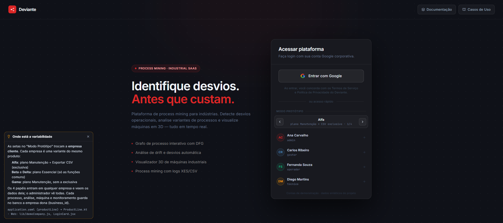 | **Escolha da empresa no login.** As setas trocam a empresa cliente (Alfa, plano Manutenção + CSV exclusivo, 1/4); os quatro papéis entram em qualquer uma. |
| 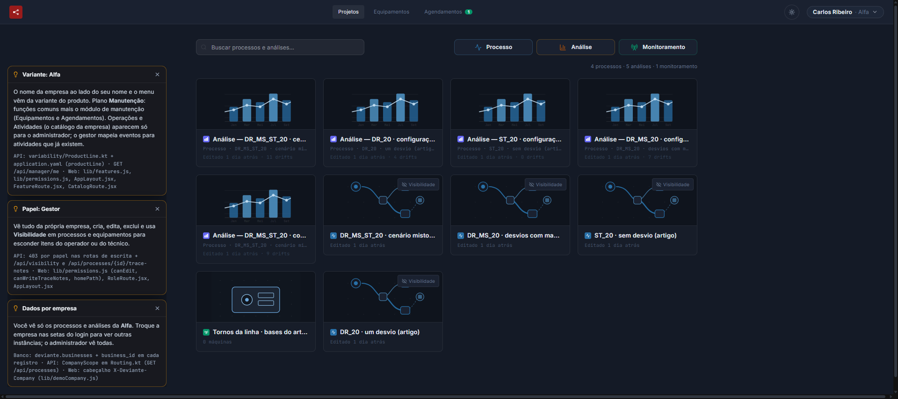 | **Alfa, plano Manutenção.** O menu tem Equipamentos e Agendamentos (módulo opcional). O painel mostra só os processos e análises da Alfa. |
| 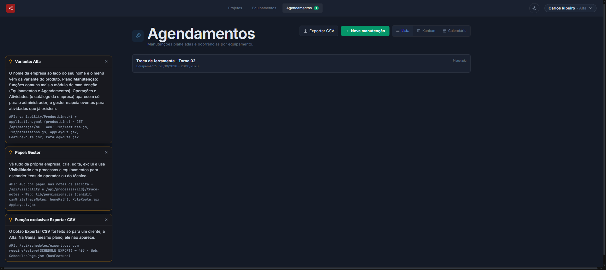 | **Função exclusiva.** Na Alfa, Agendamentos tem "Exportar CSV". |
| 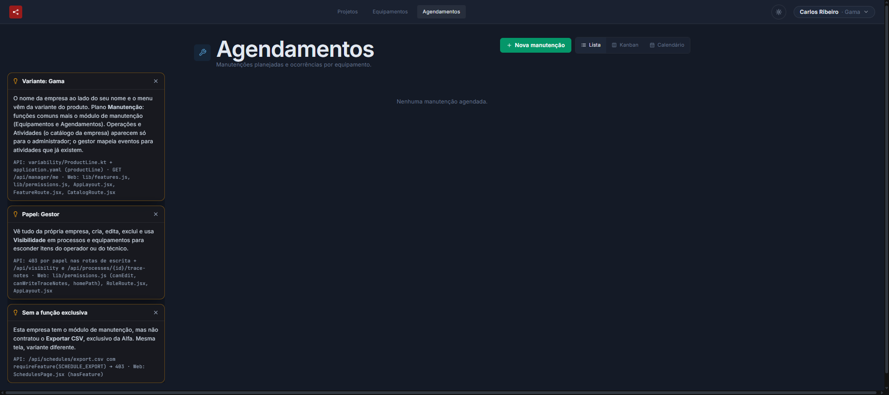 | **Mesmo plano, outra variante.** A Gama também tem o módulo de manutenção, mas não contratou o CSV: o botão não existe. |
| 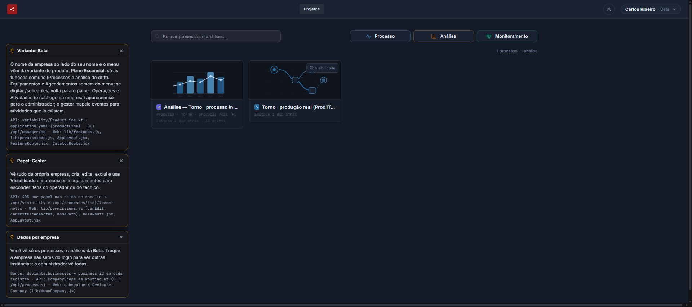 | **Plano Essencial.** Na Beta o menu só tem Projetos: sem Equipamentos e Agendamentos. Os dados também são outros (o torno real). |
| 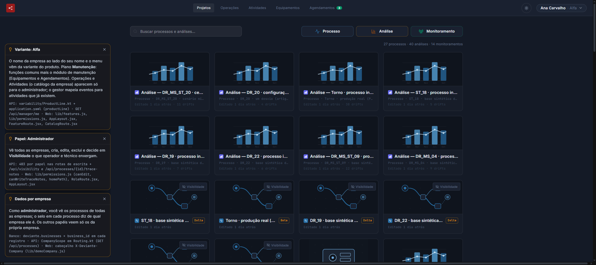 | **Administrador.** Vê os processos de todas as empresas, com o selo da empresa dona em cada card (Beta, Delta…), e ainda Operações e Atividades no menu. |

## 2. Variabilidade por papel (Alfa)

A empresa define o que o produto tem; o papel define o que cada usuário vê e faz.

| | |
|---|---|
| 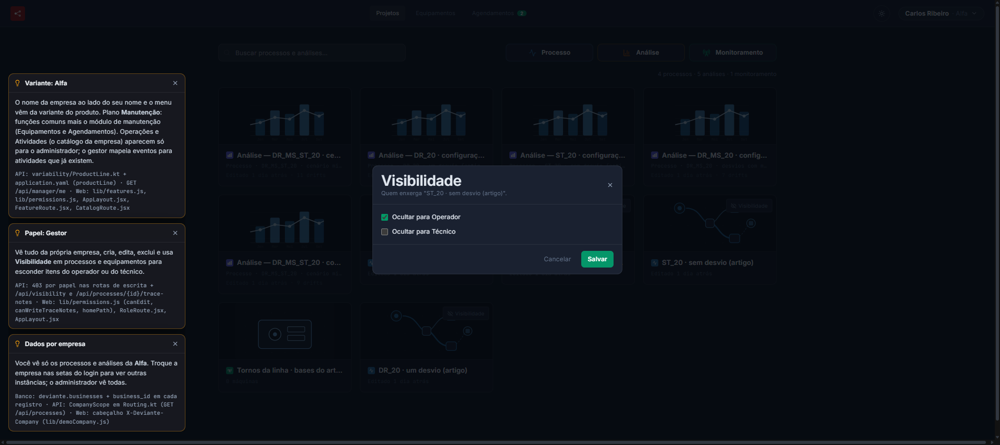 | **Gestor: visibilidade.** Em cada processo, "Visibilidade" permite ocultá-lo para o Operador ou para o Técnico. Aqui o processo "ST_20 · sem desvio (artigo)" é ocultado para o Operador. |
| 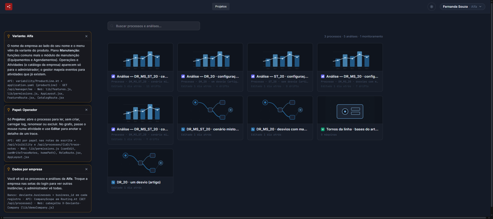 | **Operador.** Menu só com Projetos, sem "Novo processo". O processo ocultado pelo gestor (ST_20) não aparece: são 3 processos, contra 4 do gestor. |
| 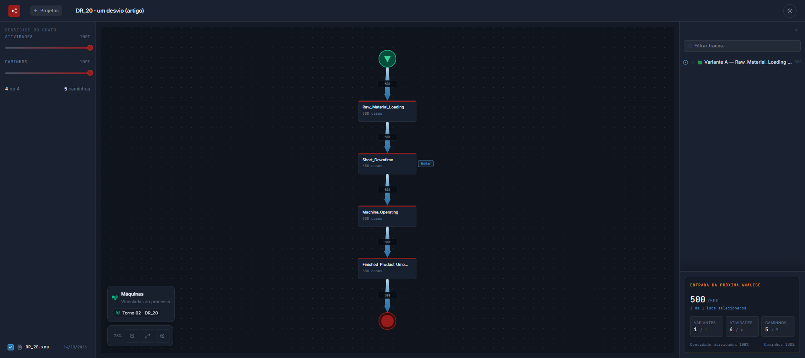 | **Operador no grafo.** Ao passar o mouse na atividade "Short_Downtime", aparece "Editar". O operador não renomeia, não carrega log e não exclui. |
| 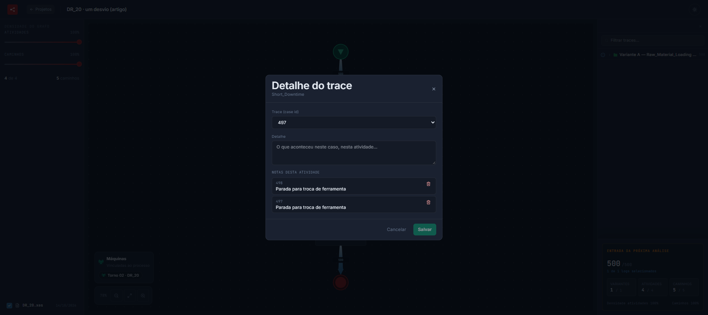 | **Detalhe do trace.** O modal escolhe o caso (trace 497) e grava o detalhe naquela atividade; a lista mostra as notas já salvas (casos 497 e 498). |
| 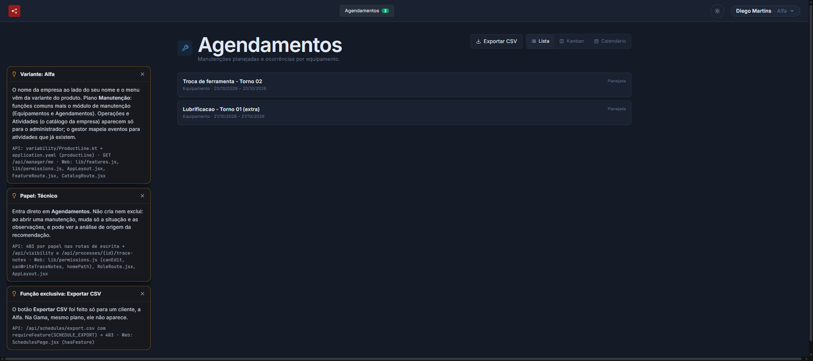 | **Técnico.** A tela inicial é Agendamentos e o menu só tem Agendamentos. Não há "Nova manutenção". |
| 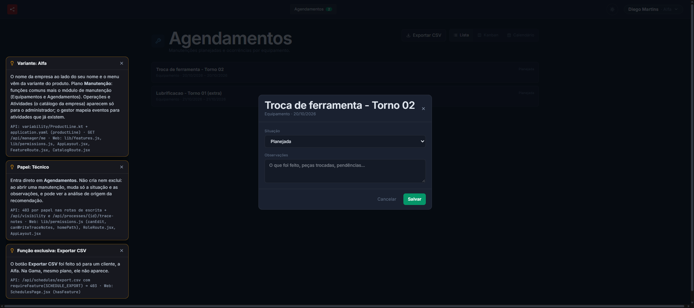 | **Técnico na manutenção.** O modal só tem Situação e Observações: sem editar título, máquina ou datas, e sem excluir. O link "Ver análise de origem" aparece quando a manutenção tem um processo de origem; esta foi criada antes do campo existir. |
|  | **Técnico registra o andamento.** Situação "Em andamento" e a observação "Ferramenta trocada; aguardando teste de operação". |

## 3. Reuso

| | |
|---|---|
| 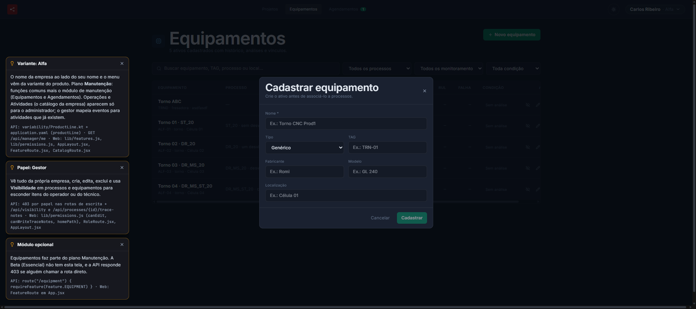 | **Componente reutilizado (`@deviante/ui`).** O modal "Cadastrar equipamento" é o `FormModal` do pacote, com os campos `Field`, `TextInput` e `Select`. |
| 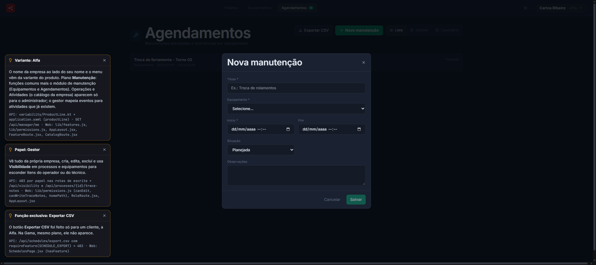 | **O mesmo componente em outro CRUD.** "Nova manutenção" usa o mesmo `FormModal`; só os campos mudam. |
| 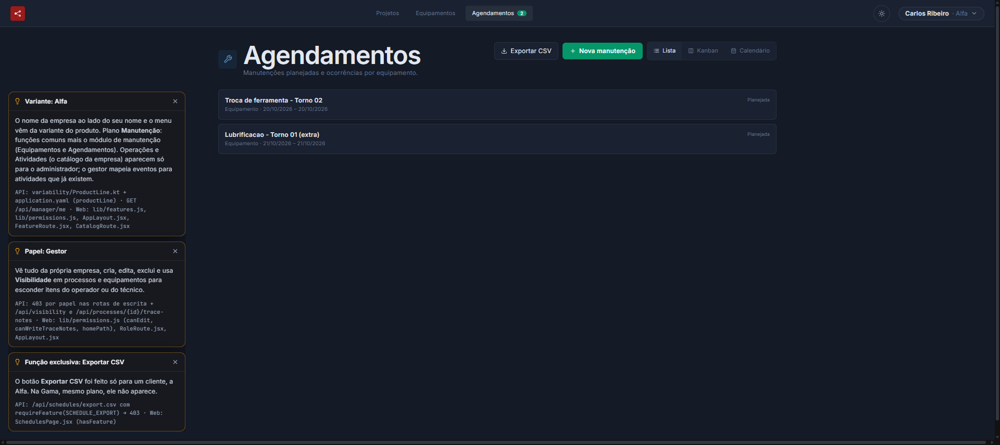 | **Observer.** Depois de salvar uma manutenção, o contador ao lado de "Agendamentos" passa de 1 (print 03) para 2 sem recarregar a página: o formulário publica no `maintenanceSubject` e o contador do menu é um dos assinantes. |
| 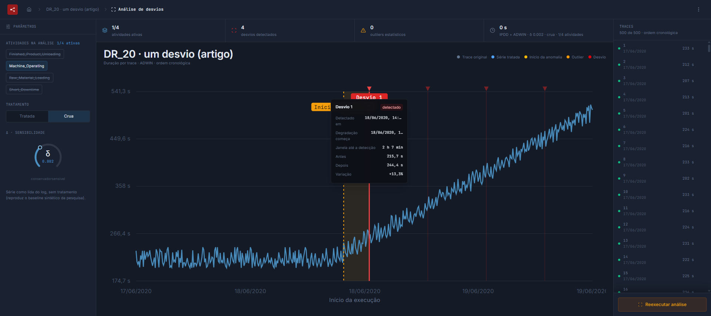 | **Adapter e Singleton na análise.** A análise do DR_20 detecta 4 desvios com IPDD + ADWIN (δ 0,002, série crua), o mesmo resultado do artigo. O código da pesquisa roda sem alteração por trás do `IpddAdwinAdapter`, chamado pelo `AnalysisEngine` (Singleton). |

## Onde está cada ponto no código

- Empresa e plano: `deviante-api/src/main/kotlin/variability/ProductLine.kt`, `application.yaml` (`productLine`), `deviante-web/src/lib/features.js`. Detalhes em [`defesa/variabilidade.md`](../defesa/variabilidade.md) §1–§4.
- Papel: `deviante-api/src/main/kotlin/model/ManagerRecord.kt`, `deviante-web/src/lib/permissions.js`. Detalhes em [`defesa/variabilidade.md`](../defesa/variabilidade.md) §5.
- Padrões: [`defesa/padroes-de-projeto.md`](../defesa/padroes-de-projeto.md). Ativos: [`ativos-reutilizaveis.md`](../ativos-reutilizaveis.md).
