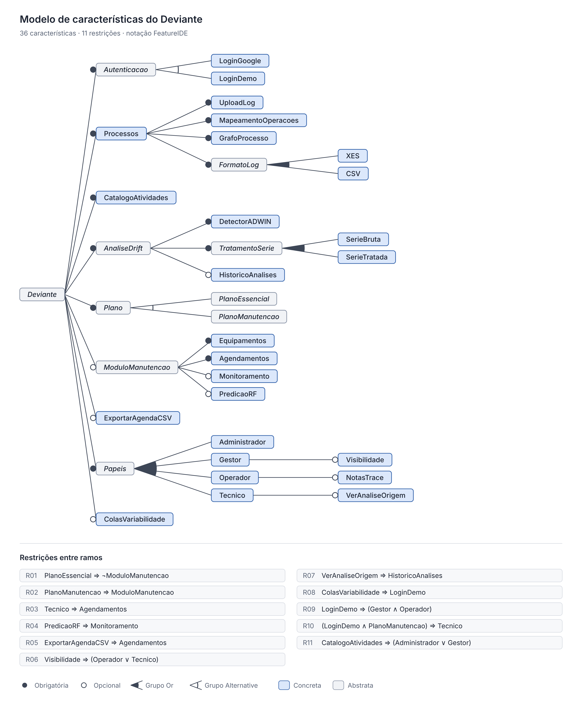

# Parte I: modelo de características (FeatureIDE)

O modelo tem 36 características e 11 restrições. Ele descreve a linha de produto que já está no código: a empresa cliente escolhe um plano e funções exclusivas (`deviante-api/src/main/kotlin/variability/ProductLine.kt` e a seção `productLine` do `application.yaml`), e cada papel vê e faz coisas diferentes (`deviante-web/src/lib/permissions.js`).

## Arquivos

| Arquivo | O que é |
|---|---|
| `model.xml` | Modelo para abrir no FeatureIDE (Eclipse) |
| `configs/*.xml` | Uma configuração por empresa: Deviante, Alfa, Beta, Gama, Delta |
| `modelo-de-caracteristicas.png` / `.svg` | Diagrama renderizado em alta resolução |
| `gerar.py` | Fonte única: gera `model.xml` e as configurações e valida o modelo por SAT |
| `renderizar.py` | Gera o diagrama a partir do mesmo modelo |

**Abrir no Eclipse:** File → New → Other… → FeatureIDE → FeatureIDE Project (composer padrão). Substitua o `model.xml` do projeto por este e copie `configs/` para a pasta `configs` do projeto. Para a imagem oficial: no editor do modelo, botão direito → Export As → PNG.

**Validação:** `python gerar.py` confere que o modelo é satisfazível, que não há características mortas nem falso-opcionais, que nenhuma restrição é redundante e que as 5 configurações são válidas. Ele conta 6.948 produtos possíveis.

## Tipos de característica e justificativas

| Tipo | Exemplos no modelo | Justificativa |
|---|---|---|
| **Abstrata** | Deviante, Autenticacao, AnaliseDrift, Plano, ModuloManutencao, Papeis, FormatoLog, TratamentoSerie, PlanoEssencial, PlanoManutencao | Organizam a árvore e não correspondem a um trecho de código próprio. Os planos são abstratos porque são só pacotes de funções: `Plan` em `ProductLine.kt` é um conjunto de `Feature`. |
| **Concreta** | Processos, UploadLog, Equipamentos, Agendamentos, ExportarAgendaCSV, Gestor, NotasTrace… | Cada uma tem código que a implementa: uma rota no Core, uma tela no front, um valor de `Feature`. |
| **Obrigatória** | Autenticacao, Processos, CatalogoAtividades, AnaliseDrift, DetectorADWIN, Plano, Papeis; Equipamentos e Agendamentos dentro do módulo | É o núcleo comum: `COMMON_FEATURES` (processos, atividades, análise de drift) entra em todo produto. Se o módulo de manutenção entra, entram máquinas e agenda juntas. |
| **Opcional** | ModuloManutencao, ExportarAgendaCSV, HistoricoAnalises, Monitoramento, PredicaoRF, Visibilidade, NotasTrace, VerAnaliseOrigem, ColasVariabilidade | Variam de cliente para cliente: o módulo depende do plano, o CSV é exclusivo da Alfa, a predição RF é experimental e só a Gama a tem. |
| **Grupo Or** (ao menos um) | Papeis; FormatoLog (XES, CSV); TratamentoSerie (bruta, tratada) | Uma variante pode ter qualquer combinação de papéis, formatos de log aceitos e tratamentos de série, mas precisa de ao menos um de cada. |
| **Grupo Alternative** (exatamente um) | Plano (Essencial, Manutenção); Autenticacao (Google, Demo) | Cada empresa contrata um único plano. A empresa Deviante entra só pelo Google; as empresas do protótipo, só pelo login demo. |

## Restrições

As 11 restrições usam os quatro operadores pedidos: Implies (⇒) em todas, And (∧) em R09 e R10, Or (∨) em R06 e R11 e Not (¬) em R01.

| # | Restrição | Justificativa |
|---|---|---|
| R01 | `PlanoEssencial ⇒ ¬ModuloManutencao` | O plano Essencial não inclui o módulo de manutenção. |
| R02 | `PlanoManutencao ⇒ ModuloManutencao` | O plano Manutenção sempre traz o módulo. |
| R03 | `Tecnico ⇒ Agendamentos` | O técnico só trabalha na agenda; sem Agendamentos ele não tem tela. |
| R04 | `PredicaoRF ⇒ Monitoramento` | A predição RF usa as leituras de sensores do monitoramento. |
| R05 | `ExportarAgendaCSV ⇒ Agendamentos` | A exportação é da agenda de manutenção. |
| R06 | `Visibilidade ⇒ (Operador ∨ Tecnico)` | Ocultar objetos só faz sentido se existe operador ou técnico. |
| R07 | `VerAnaliseOrigem ⇒ HistoricoAnalises` | O técnico abre a análise salva que originou o agendamento. |
| R08 | `ColasVariabilidade ⇒ LoginDemo` | As colas explicam a variabilidade no Modo Protótipo. |
| R09 | `LoginDemo ⇒ (Gestor ∧ Operador)` | O login demo sempre oferece os cartões de gestor e operador. |
| R10 | `(LoginDemo ∧ PlanoManutencao) ⇒ Tecnico` | No demo, empresa com manutenção oferece também o técnico. |
| R11 | `CatalogoAtividades ⇒ (Administrador ∨ Gestor)` | O catálogo precisa de quem o mantém (administrador) ou o usa no mapeamento (gestor). |

## Configurações por empresa

| Empresa | LoginGoogle | LoginDemo | XES | CSV | PlanoEssencial | PlanoManutencao | Monitoramento | PredicaoRF | ExportarAgendaCSV | Tecnico | ColasVariabilidade |
|---|---|---|---|---|---|---|---|---|---|---|---|
| Deviante | ✓ |  | ✓ | ✓ |  | ✓ | ✓ | ✓ | ✓ | ✓ |  |
| Alfa |  | ✓ | ✓ |  |  | ✓ | ✓ |  | ✓ | ✓ | ✓ |
| Beta |  | ✓ |  | ✓ | ✓ |  |  |  |  |  | ✓ |
| Gama |  | ✓ | ✓ |  |  | ✓ | ✓ | ✓ |  | ✓ | ✓ |
| Delta |  | ✓ | ✓ |  | ✓ |  |  |  |  |  | ✓ |

Todas as empresas também têm as duas séries (bruta e tratada), o histórico de análises e os papéis Administrador, Gestor e Operador com as funções opcionais deles.

R10 registra uma correção que o modelo apontou. Antes, Beta e Delta (plano Essencial) aceitavam login de técnico, mas o técnico só trabalha na agenda, que essas empresas não têm. Pela R03, essas configurações seriam inválidas. Agora o cartão de técnico só aparece nas empresas com o módulo de manutenção.
