# Arquitetura do Deviante — arc42

**Grupo:** Alander Menezes Arantes de Ávila, Emanuelle Skolut Jose.

---

## 1. Introdução e Metas

O Deviante é um sistema de suporte a decisões para a gestão de manutenção industrial capaz de detectar desvios temporais a partir de registros do chão de fábrica. Orientado por técnicas de mineração de processo e aprendizagem de máquina, o sistema identifica quando o tempo de execução de uma atividade do processo produtivo muda de comportamento, sinalizando possíveis anomalias que facilitam as decisões de gestores de manutenção no agendamento de inspeções e manutenções no momento mais adequado. O objetivo do projeto é a redução de custos para a empresa e o aumento da disponibilidade dos ativos industriais.

A presente documentação apresenta um conjunto de decisões de design que afetam a estrutura e o comportamento do sistema Deviante. Tais decisões incluem a escolha de padrões arquiteturais, a definição de componentes e suas interações, além da especificação de requisitos funcionais e não funcionais. A arquitetura proposta serve como um guia para o desenvolvimento, influenciando diretamente a qualidade do software e a eficiência do processo de engenharia.

### 1.1 Visão Geral de Requisitos

O Deviante auxilia o gestor de manutenção a tomar decisões relacionadas à validação da degradação dos ativos industriais e agendamento das manutenções antes de chegar à falha funcionar. Através dos registros oriundos das máquinas envolvidas no processo produtivo, o framework integrado através de microsserviço, o IPDD, detecta que uma máquina começou a demorar mais do que o normal para executar operações e fornece recursos ao gestor para agir antes da falha, momento em que o custo de manutenção é menor, já que leva em consideração a condição do equipamento. As tabelas abaixo resumem os requisitos:

**Requisitos funcionais**

| ID | Requisito | Atendido por |
|---|---|---|
| RF-01 | Login via conta Google (OAuth) | Microfrontend + Supabase Auth |
| RF-02 | Validar o papel do usuário na autenticação: administrador, gestor, operador ou técnico | Supabase Auth (papel no JWT) + Core API |
| RF-03 | Administrador cria, lista, atualiza e exclui todos os processos do sistema | Core API |
| RF-04 | Gestor cadastra, lista, atualiza e exclui operadores e técnicos da sua empresa | Core API |
| RF-05 | Gestor cria, lista, atualiza e exclui os processos da sua empresa | Core API |
| RF-06 | Processos da empresa visíveis para todos os seus gestores, operadores e técnicos | Core API |
| RF-07 | Operador cria, lista, atualiza e exclui atividades de processos | Core API |
| RF-08 | Gestor cadastra atividades e registros de eventos a partir de logs CSV ou XES | MS1 · Ingestão + Core API |
| RF-09 | Gerar e exibir o DFG (Directly-Follows Graph) do log carregado | MS1 · Ingestão (FastAPI + PM4Py, MongoDB Atlas) |
| RF-10 | Mapear cada operação do log em uma atividade do processo, e editar e remover esse mapeamento | Core API |
| RF-11 | Gestor cria, lista, atualiza e exclui os monitoramentos da sua empresa | Core API |
| RF-12 | Gestor cadastra, lista, atualiza e exclui máquinas, agrupa em monitoramentos e associa a processos, que as exibem no detalhe | Core API |
| RF-13 | Carregar log CSV ou XES de uma máquina e registrar seus parâmetros no monitoramento | MS1 · Ingestão + Core API |
| RF-14 | Configurar os parâmetros da análise: filtro de traces antes da 1ª execução e sensibilidade do IPDD/ADWIN para reexecutar sem novo upload | MS2 |
| RF-15 | Executar a análise de desvio (drift) sobre um processo ou máquina, com o cálculo IPDD/ADWIN numa função sem estado | MS2 · Análises (FastAPI, Azure SQL) + Azure Function (ServiceBusQueueTrigger) |
| RF-16 | Exibir o diagnóstico de saúde de uma máquina monitorada, incluindo a degradação de seus componentes | Core API |
| RF-17 | Criar ações proativas (manutenção ou inspeção) a partir de uma recomendação, e editá-las e excluí-las | Core API |
| RF-18 | Técnico registra a execução de uma ação proativa e reabilita a máquina | Core API |
| RF-19 | Encaminhar os CRUDs da interface para Core API, MS1 e MS2 sem acesso direto da interface | BFF (NestJS) |
| RF-20 | Exibir numa única tela a visão consolidada do processo, via `GET /aggregated-data` | BFF (MS1, MS2 e Azure Function) |

**Requisitos não funcionais de negócio**

| ID | Requisito | Atendido por |
|---|---|---|
| RNF-01 | Back-end em Kotlin | Core API (Ktor) |
| RNF-02 | Persistência poliglota por serviço: Core no PostgreSQL do Supabase, MS1 no MongoDB Atlas e MS2 no Azure SQL | Core API, MS1, MS2 |
| RNF-03 | Interface em React + Vite | Microfrontend |
| RNF-04 | Figma como fonte única de tokens e componentes de UI | Microfrontend |
| RNF-05 | Microsserviços Python em FastAPI, consumidos via REST | MS1, MS2 |
| RNF-06 | Microsserviços Python como Azure Functions (serverless) | Parcial: o IPDD/ADWIN é Function; MS1 e MS2 rodam no Fly.io (ADR 04) |
| RNF-07 | Ingestão multiformato: hoje CSV e XES; um novo formato entra com um parser novo no MS1, sem alterar os outros serviços | MS1 (parser por formato) |
| RNF-08 | Isolamento de dados por empresa (filtro pela empresa do usuário do JWT) e por serviço (um usuário de banco próprio por serviço; o Core com role própria, sem o usuário `postgres`) | Core API e usuários de banco de cada serviço (§8.2) |
| RNF-09 | Git e CI/CD com build, testes e deploy a cada alteração | GitHub Actions em cada repositório |
| RNF-10 | Autenticação Supabase Auth com Google; JWT com usuário e papel | Supabase Auth, API Gateway, BFF, Core API |

**Requisitos não funcionais de arquitetura (Cloud)**

| ID | Requisito | Atendido por |
|---|---|---|
| RNF-12 | SPA estruturada como microfrontend que consome só o BFF | Microfrontend |
| RNF-13 | BFF em Node.js (Express ou NestJS) | BFF (NestJS) |
| RNF-14 | Microsserviços com Database per Service | Core, MS1 e MS2, cada um com seu banco (persistência poliglota) |
| RNF-15 | Microsserviço 1 com MongoDB Atlas (Free Tier) | MS1 |
| RNF-16 | Microsserviço 2 com Azure SQL (oferta gratuita) | MS2 |
| RNF-17 | Azure Function exposta via HTTP | Function App de análise com HTTP Trigger na prévia do BFF (`ipdd-adwin`) e na previsão experimental chamada pelo MS2 (`maintenance-prediction`) |
| RNF-18 | API Gateway na AWS | API Gateway |
| RNF-19 | Arquitetura Orientada a Eventos | Azure Service Bus, uma fila por evento (`EventLogParsed`, `AnalysisRequested`, `AnalysisCompleted`, `DriftDetected`) |
| RNF-20 | Clean Architecture (Domain, Application, Infrastructure, API) | Todos os serviços (§5.2) |
| RNF-21 | Vertical Slice (uma pasta por feature) | Todos os serviços (§5.2) |
| RNF-22 | Testes unitários e de arquitetura | §8.5 |
| RNF-23 | Swagger no BFF, microsserviços e eventos | OpenAPI do NestJS e do FastAPI; AsyncAPI para os eventos `EventLogParsed`, `AnalysisRequested`, `AnalysisCompleted` e `DriftDetected` |
| RNF-24 | Imagens do BFF e dos microsserviços no Docker Hub | §7 |
| RNF-25 | Aplicação em URLs da nuvem, não localhost | §7 |

### 1.2 Metas de Qualidade

As cinco metas abaixo são as qualidades que mais pesam para os stakeholders, em ordem de prioridade, com o nome da característica da ISO/IEC 25010:2023 a que cada uma corresponde. Cada meta tem um cenário verificável; a seção 4 mostra como a arquitetura atende cada uma e a seção 10 detalha os cenários.

| Prioridade | Meta | ISO/IEC 25010 | Cenário |
|---|---|---|---|
| 1 | Correção analítica | Adequação funcional (correção) | Para os logs sintéticos `DR_*` o drift detectado cai a até 5 traces do ponto injetado (ground truth de `adwin_dataset.py`). |
| 2 | Modificabilidade | Manutenibilidade (modificabilidade) | Um novo formato de log (ex.: JSON) entra com uma nova subclasse de parser, sem alterar MS2, BFF ou Core. |
| 3 | Tolerância a falhas | Confiabilidade (tolerância a falhas) | Uma falha no MS2 ou na Function não derruba o CRUD de processos e máquinas; o BFF devolve o agregado parcial. |
| 4 | Segurança | Segurança (confidencialidade, autenticidade) | Nenhum serviço é acessível sem JWT válido emitido pelo Supabase Auth; dados de uma empresa não aparecem para outra. |
| 5 | Implantabilidade | Flexibilidade (instalabilidade) | Cada serviço é uma imagem Docker publicada no Docker Hub e implantada de forma independente. |

### 1.3 Stakeholders

Pessoas e papéis que precisam conhecer, aprovar ou usar esta arquitetura. Os quatro primeiros são os usuários do sistema; os demais avaliam, orientam ou constroem o projeto.

| Nome / Papel | Contato | Expectativa |
|---|---|---|
| Operador do maquinário | Usuário do sistema | Informar as atividades da cadeia produtiva e registrar os dados. |
| Gestor de manutenção | Usuário do sistema | Monitorar os dados, gerar análises a partir do processo registrado e acionar a manutenção a tempo. |
| Técnico de manutenção | Usuário do sistema | Saber o que fazer, registrar a manutenção realizada e reabilitar a máquina no sistema. |
| Administrador da plataforma | Usuário do sistema | Manter os processos de todas as empresas (RF-03). |
| Analista / mentor | Grupo de pesquisa IPDD (PUCPR) | Validar as análises e ajustar a sensibilidade do IPDD/ADWIN. |
| Denise M. V. Sato, autora do framework IPDD | [denise.vecino@pucpr.br](mailto:denise.vecino@pucpr.br) | Ver o método aplicado com fidelidade ao trabalho original. |
| Luiz F. Picolo, pesquisador do grupo IPDD | [luiz.picolo@pucpr.edu.br](mailto:luiz.picolo@pucpr.edu.br) | Ver o detector reaproveitado sem alteração e com resultados reproduzíveis. |
| Eduardo de Freitas Loures, orientador PIBITI | [eduardo.loures@pucpr.br](mailto:eduardo.loures@pucpr.br) | Orientar a pesquisa e validar a aplicação na manutenção industrial. |
| Manoel Valerio da Silveira Neto, professor de Arquitetura e Soluções Cloud | [manoel.valerio@pucpr.br](mailto:manoel.valerio@pucpr.br) | Avaliar estilos arquiteturais e implantação em nuvem. |
| Tiago Adelino Navarro, professor de Desenvolvimento Orientado a Reuso | [tiago.adelino@pucpr.edu.br](mailto:tiago.adelino@pucpr.edu.br) | Avaliar padrões de projeto, variabilidade e reuso. |
| Grupo de desenvolvimento: Alander Menezes Arantes de Ávila, Bernardo Creplive Vieira,  Emanuelle Skolut Jose, Murilo Regnier Stange | [menezes.alander@pucpr.edu.br](mailto:menezes.alander@pucpr.edu.br) | Uma arquitetura que caiba no prazo e no free tier. |

---

## 2. Restrições da Arquitetura

O Deviante atende a três frentes, cada uma com suas restrições e demandas.

A primeira é a Iniciação Tecnológica (PIBITI), vigente de agosto de 2025 a julho de 2026 e apresentada no SEMIC em outubro de 2026. O produto continua uma pesquisa da PUCPR que envolve graduandos, mestrandos e doutorandos. Por isso parte da estratégia já chega consolidada e validada pelo grupo de pesquisa: o PM4Py para minerar o processo e o IPDD/ADWIN para detectar os desvios de desempenho.

As outras duas são disciplinas do 6º período de Engenharia de Software da PUCPR. **Arquitetura e Soluções Cloud** define o estilo e a infraestrutura: microfrontend, BFF em Node.js, dois microsserviços com bancos próprios (MongoDB Atlas e Azure SQL), uma Azure Function, API Gateway na AWS e comunicação por eventos, com Clean Architecture, Vertical Slice, testes unitários e de arquitetura, imagens no Docker Hub, repositórios públicos e documentação arc42 com C4. **Desenvolvimento Orientado a Reuso** pede que o projeto seja modelado com padrões de projeto, deixe explícitos os pontos de variabilidade e reaproveite componentes existentes em vez de reescrevê-los.

As restrições abaixo seguem o template arc42 em três grupos: técnicas, organizacionais e convenções. Cada uma traz o motivo que a impõe.

### 2.1 Restrições técnicas

| ID | Restrição | Motivo |
|---|---|---|
| RT1 | Interface como microfrontend em React que consome só o BFF | Exigência de Cloud (RNF-12). React + Vite é decisão do grupo (RNF-03). |
| RT2 | BFF em Node.js (NestJS), com o endpoint `GET /aggregated-data` | Exigência de Cloud (RNF-13, RF-19, RF-20). |
| RT3 | Microsserviço 1 com MongoDB Atlas (Free Tier) | Exigência de Cloud (RNF-15). |
| RT4 | Microsserviço 2 com Azure SQL na oferta gratuita (serverless, 100 mil vCore-segundos e 32 GB por mês) | Exigência de Cloud (RNF-16). Ao esgotar a cota do mês, o banco pausa até o mês seguinte, o que limita consultas pesadas. |
| RT5 | Azure Function com HTTP Trigger ou Message Trigger | Exigência de Cloud (RNF-17, RF-15). |
| RT6 | API Gateway na AWS como porta de entrada | Exigência de Cloud (RNF-18). |
| RT7 | Comunicação assíncrona por eventos entre serviços | Exigência de Cloud (RNF-19). |
| RT8 | Back-end de domínio em Kotlin; microsserviços analíticos em Python com FastAPI | Decisão do grupo (RNF-01, RNF-05). PM4Py e o código IPDD/ADWIN só existem em Python. |
| RT9 | Supabase para autenticação (Google) e PostgreSQL do Core | Decisão do grupo (RNF-02, RNF-10). O domínio do Core é relacional (ADR 03 e 08). |
| RT10 | Código IPDD/ADWIN da pesquisa reaproveitado sem reescrita | Fidelidade científica: o método publicado precisa dar os mesmos resultados. |
| RT11 | Só serviços gratuitos (free tiers) | Projeto acadêmico sem orçamento. Limites de memória, conexões e cota de computação condicionam o desenho. |

### 2.2 Restrições organizacionais

| ID | Restrição | Motivo |
|---|---|---|
| RO1 | Equipe de dois alunos | Grupo do projeto integrador (PjBL) do 6º período. |
| RO2 | Prazos: documentação de Cloud em 15/10/2026; Reuso e apresentação do PIBITI em 16/10/2026; arquitetura completa de Cloud em 12/11/2026 | Calendário das disciplinas e do PIBITI. |
| RO3 | Método analítico definido pela pesquisa e validado pelo orientador | O PIBITI continua o trabalho do grupo de pesquisa IPDD da PUCPR. |
| RO4 | Um repositório público no GitHub por serviço, cada um com README (arquitetura, tecnologias, como rodar, nomes dos alunos) | Exigência de Cloud. |
| RO5 | Imagem Docker do BFF e de cada microsserviço publicada no Docker Hub | Exigência de Cloud (RNF-24). |
| RO6 | CI com build, testes e deploy a cada alteração; testes unitários e de arquitetura | RNF-09 e exigência de Cloud (RNF-22). |
| RO7 | Demonstração em URLs da nuvem, não localhost, em vídeo no YouTube com todos os integrantes falando | Exigência de Cloud (RNF-25). |

### 2.3 Convenções

| ID | Convenção | Motivo |
|---|---|---|
| C1 | Documentação de arquitetura no template arc42 (12 seções), com diagramas C4 nos níveis de contexto, contêineres e componentes | Exigência de Cloud. |
| C2 | Diagramas em Mermaid, versionados como texto | Renderizam a partir do próprio texto, sem ferramenta de desenho. |
| C3 | Clean Architecture (`domain`, `application`, `infrastructure`, `api`) com uma pasta por feature (Vertical Slice) | Exigência de Cloud (RNF-20, RNF-21). |
| C4 | APIs documentadas em Swagger/OpenAPI e eventos em AsyncAPI | Exigência de Cloud (RNF-23). |
| C5 | Figma como fonte única de tokens e componentes de interface | Decisão do grupo (RNF-04). |
| C6 | Documentação em português; código, nomes de classes e eventos em inglês | Público da documentação é a banca da PUCPR; código segue o padrão das bibliotecas. |

---

## 3. Contexto e Escopo

O Deviante é tratado aqui como uma caixa-preta. Dentro do escopo estão o registro do processo, a importação do event log, a análise de desvios e o registro das manutenções. Fora do escopo ficam o sistema de origem da fábrica (MES/ERP), que só exporta o log, e o provedor de identidade (Google). Operador, gestor e técnico acessam o sistema pelo navegador; o administrador, que mantém os processos de todas as empresas, usa as mesmas telas e não aparece separado no diagrama.

### 3.1 Contexto de negócio

**C4 — Nível 1 · System Context**

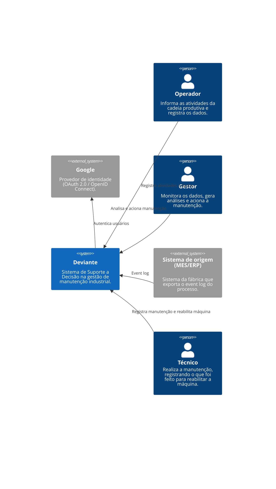

| Parceiro | Entrada | Saída |
|---|---|---|
| Operador | Atividades da cadeia produtiva, leituras | Processo registrado |
| Gestor de manutenção | Mapeamentos, parâmetros de análise, acionamento da manutenção | Grafo, drifts, recomendações |
| Técnico de manutenção | Manutenção realizada, reabilitação da máquina | Intervenções agendadas |
| Sistema de origem (MES/ERP) | — | Event log XES/CSV (exportado pelo gestor) |
| Google | — | Identidade (OAuth 2.0) |

### 3.2 Contexto técnico

Todo o tráfego externo entra por um único canal, o API Gateway da AWS, e segue para o BFF. Os canais internos entre os serviços aparecem na seção 5 (C4 nível 2) e na seção 7.

| Parceiro | Canal técnico | Entrada/saída de negócio que passa por ele |
|---|---|---|
| Operador, gestor e técnico (navegador) | HTTPS/JSON até o API Gateway e o BFF, com JWT no header `Authorization` | Atividades, mapeamentos, parâmetros de análise e manutenções entram; grafo, drifts e recomendações saem |
| Sistema de origem (MES/ERP) | Arquivo XES ou CSV enviado por upload (multipart via HTTPS) | Event log do processo |
| Google | OAuth 2.0 / OpenID Connect, intermediado pelo Supabase Auth | Identidade do usuário (JWT) |

---

## 4. Estratégia da Solução

Esta seção resume as decisões que dão forma ao Deviante: como o sistema é dividido, quais tecnologias usa, quais padrões arquiteturais e de projeto adota e como isso atende às metas de qualidade (seção 1.2) dentro das restrições da seção 2. A estrutura detalhada está na seção 5 e os conceitos transversais na seção 8.

### 4.1 Decomposição e integração

O sistema é dividido por responsabilidade, cada parte com seu banco (Database per Service). A interface é um microfrontend em React que conversa só com o BFF em NestJS, e o BFF fica atrás do API Gateway da AWS. O domínio (processos, atividades, máquinas, monitoramentos e manutenções) fica na Core API em Kotlin/Ktor sobre o Postgres do Supabase, que também cuida do login. A ingestão do log e o grafo do processo ficam no MS1 (FastAPI + PM4Py, MongoDB Atlas) e as análises de desvio no MS2 (FastAPI, Azure SQL). Cada serviço usa o banco que combina com o seu dado (persistência poliglota): relacional no Core, documentos no MS1 e Azure SQL no MS2.

**Núcleo analítico.** O IPDD/ADWIN roda numa Azure Function sem estado, disparada por uma fila do Service Bus quando o MS2 pede uma análise (HTTP só para a prévia do BFF), reaproveitando o código da pesquisa sem reescrita para preservar os resultados do método publicado.

**Integração.** Os serviços trocam eventos no Azure Service Bus, uma fila por evento (`EventLogParsed`, `AnalysisRequested`, `AnalysisCompleted`, `DriftDetected`). Assim ingestão, análise e domínio evoluem e falham separados, e o BFF consegue devolver um agregado parcial quando um deles está fora.

### 4.2 Padrões arquiteturais e de projeto

No nível da arquitetura, o Deviante combina microsserviços com Database per Service, Backend for Frontend (BFF), API Gateway e comunicação orientada a eventos (filas do Service Bus, uma por evento); dentro de cada serviço, Clean Architecture com uma pasta por feature (Vertical Slice). No nível do código, adota um padrão de cada família GoF: o **Singleton** (criacional) garante uma única instância do motor de análise na Function (`AnalysisEngine`) e da configuração (`AppConfig`); o **Adapter** (estrutural) envolve o código IPDD/ADWIN da pesquisa (`IpddAdwinAdapter` → `DriftDetector`) e o PM4Py (`Pm4pyGraphAdapter` → `GraphMiner`) atrás de interfaces próprias; e o **Observer** (comportamental) faz o `DriftSubject` notificar `InvestigationPanel`, `MonitoringContext` e `AnalysisHud` no microfrontend quando um drift é detectado. Os detalhes de cada padrão estão na seção 8.3.

### 4.3 Tecnologia e operação

Só serviços gratuitos: Vercel para a interface, Fly.io para o BFF, a Core API, o MS1 e o MS2 (ADR 04), Azure para a Function, o Service Bus e o Azure SQL. Cada serviço vira uma imagem no Docker Hub e é publicado pelo GitHub Actions.

### 4.4 Metas de qualidade e abordagens

A tabela liga cada meta de qualidade (seção 1.2) à abordagem que a atende.

| Meta de qualidade | Cenário | Abordagem de solução |
|---|---|---|
| Correção analítica | Para os logs sintéticos `DR_*`, o drift detectado cai a até 5 traces do ponto injetado. | Reaproveitar o IPDD/ADWIN original por um Adapter (`IpddAdwinAdapter`), sem reescrita, e validar contra o ground truth de `adwin_dataset.py` (seções 8.3 e 10). |
| Modificabilidade | Um novo formato de log (ex.: JSON) entra sem alterar MS2, BFF ou Core. | Um parser por formato isolado no MS1; eventos separam o MS1 de quem consome o log; Clean Architecture e Vertical Slice limitam o impacto da mudança (seções 5 e 8). |
| Tolerância a falhas | Uma falha no MS2 ou na Function não derruba o CRUD de processos e máquinas; o BFF devolve o agregado parcial. | Database per Service, Function sem estado, eventos idempotentes no Service Bus e BFF com timeout por serviço (seções 5, 6 e 8). |
| Segurança | Nenhum serviço responde sem JWT válido do Supabase Auth; dados de uma empresa não aparecem para outra. | Login Google pelo Supabase Auth, JWT validado no API Gateway e no Core, filtro por empresa em todo repositório do Core e um usuário de banco por serviço (seção 8.2). |
| Implantabilidade | Cada serviço é uma imagem Docker no Docker Hub, implantada de forma independente. | Um repositório, uma imagem e um pipeline do GitHub Actions por serviço (seção 7). |

---

## 5. Visão de Blocos de Construção

Esta seção abre a caixa-preta do contexto da seção 3 (C4 nível 1) e mostra a decomposição estática do Deviante em três níveis, na mesma lógica de zoom do C4: o nível 1 mostra os containers, o nível 2 abre o Core API em componentes e o nível 3 detalha o código em UML. Cada nível traz o diagrama, a motivação da divisão e os blocos que ele contém.

### 5.1 Containers

Caixa branca do Deviante. O Supabase Auth (login com Google) e o sistema de origem (MES/ERP) aparecem como externos.

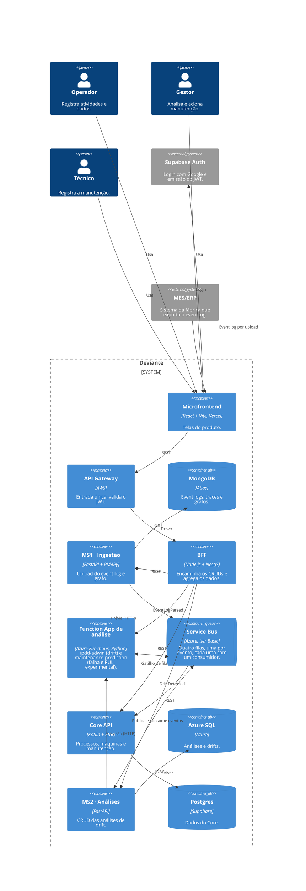

**Motivação.** Cada serviço é dono de um grupo de objetos ORCA e do seu próprio banco, para que ingestão, análise e domínio evoluam e sejam implantados separadamente (meta de modificabilidade, §1.2). Cada banco combina com o dado do serviço (persistência poliglota, ADR 08): o domínio do Core é relacional e fica no Postgres, os logs e traces do MS1 são documentos e ficam no MongoDB, e as análises do MS2 ficam no Azure SQL. O BFF concentra a agregação para que o Microfrontend faça uma única chamada por tela, e o cálculo IPDD/ADWIN fica isolado numa função sem estado, que pode ser trocada sem mexer nos serviços. A análise chega à função por uma fila do Service Bus, para que um cálculo demorado não prenda o MS2; só a prévia do BFF, que precisa de resposta imediata, usa HTTP (ADR 05). Todo o aprendizado de máquina fica num único Function App de análise, com uma function para a detecção e outra para a previsão experimental de falha, para que o código de ML evolua num lugar só, sem espalhar pelos serviços (ADR 11).

**Blocos contidos**

| Container | Responsabilidade | Tecnologia | Banco |
|---|---|---|---|
| Microfrontend | SPA do produto e do site público | React + Vite, Vercel | — |
| API Gateway | Entrada única, roteamento, JWT, rate limit | AWS API Gateway (HTTP API) | — |
| BFF | Proxy dos CRUDs; `GET /aggregated-data` junta Core, MS1, MS2 e Function num único JSON | Node.js + NestJS, Fly.io | — |
| Core API | Empresas, usuários, processos, atividades, mapeamentos, máquinas e componentes, monitoramentos, recomendações e intervenções | Kotlin + Ktor, Fly.io | Supabase Postgres |
| MS1 · Ingestão | Upload CSV/XES, parse, operações, traces e grafo (DFG) com PM4Py; CRUD de event logs (ADR 02) | Python + FastAPI + PM4Py, Fly.io | MongoDB Atlas |
| MS2 · Análises | CRUD das análises de drift; monta a série de tempos, pede o cálculo por fila e grava o resultado; numa análise de máquina, pede também a previsão experimental | Python + FastAPI, Fly.io | Azure SQL |
| Function App de análise (ML) | `ipdd-adwin`: recebe a série e devolve os pontos de drift. `maintenance-prediction` (experimental): Random Forest treinado a cada chamada com execuções rotuladas, devolve a probabilidade de falha e o RUL em traces. Sem estado | Python, plano Consumption; `ipdd-adwin` com ServiceBusQueueTrigger e HTTP Trigger (prévia), `maintenance-prediction` com HTTP Trigger | — |
| Service Bus | Transporte de eventos entre serviços, uma fila por evento | Azure Service Bus, tier Basic | — |

**Interfaces importantes.** São os contratos entre os containers. As REST passam pelo BFF; as de evento passam pelo Service Bus. O diagrama de componentes da §5.3 mostra quem fornece e quem requer cada uma.

| Interface | Fornecida por | Tipo | Usada por |
|---|---|---|---|
| `IAggregatedData` | BFF | REST, `GET /aggregated-data` | Microfrontend |
| `IDomainCrud` | Core API | REST | BFF |
| `IEventLogs` | MS1 · Ingestão | REST, upload multipart | BFF |
| `IAnalyses` | MS2 · Análises | REST | BFF |
| `IDriftCalculation` | Azure Function | HTTP, `POST /ipdd-adwin` | BFF (prévia) |
| `IMaintenancePrediction` | Azure Function | HTTP, `POST /maintenance-prediction` (experimental) | MS2 |
| `IAnalysisRequestedHandler` | Azure Function | Evento `AnalysisRequested`, fila `analysis-requested` | MS2 (publica) |
| `IAnalysisCompletedHandler` | MS2 · Análises | Evento `AnalysisCompleted`, fila `analysis-completed` | Azure Function (publica) |
| `IEventLogParsedHandler` | MS2 · Análises | Evento `EventLogParsed`, fila `eventlog-parsed` | MS1 (publica) |
| `IDriftDetectedHandler` | Core API | Evento `DriftDetected`, fila `drift-detected` | MS2 (publica) |

### 5.2 Componentes do Core API

Caixa branca do Core API.

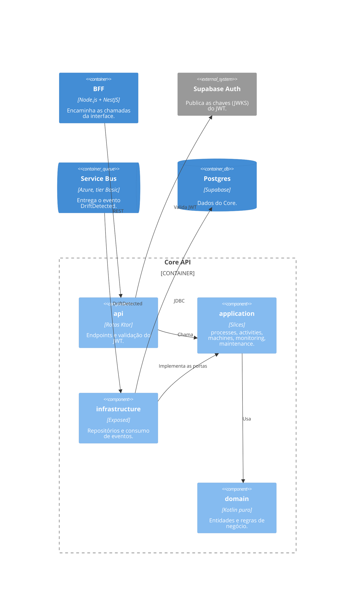

**Motivação.** O Core foi escolhido para abrir porque é dono de cinco dos seis objetos ORCA (§8.1) e concentra as regras de negócio. MS1 e MS2 seguem a mesma divisão, e o cálculo de drift, que é a parte de maior risco, já está isolado na Function (ADR 01). O Core combina Clean Architecture (RNF-20), com o `domain` sem dependências externas, e Vertical Slice (RNF-21), com uma pasta por feature dentro de `application`.

**Blocos contidos**

| Componente | Responsabilidade |
|---|---|
| `api` | Rotas Ktor, validação do JWT (JWKS) e conversão de requisição e resposta |
| `application` | Casos de uso, uma slice por feature: `processes` (CreateProcess, UpdateProcess, DeleteProcess, ListProcesses), `activities` (ManageActivityCatalog, MapOperation, UnmapOperation), `machines` (CreateMachine, UpdateMachine, DeleteMachine, ManageComponents), `monitoring` (CreateMonitoring, LinkMachine) e `maintenance` (CreateRecommendation, ScheduleIntervention, CompleteIntervention) |
| `domain` | Entidades e regras em Kotlin puro, detalhadas na §5.3 |
| `infrastructure` | Repositórios com Exposed sobre o Postgres e consumo do evento `DriftDetected`; implementa as portas definidas em `application` |

### 5.3 Código

Classes e componentes aqui; sequência na seção 6.

**Diagrama de classes**

Modelo de domínio em quatro vistas horizontais. Atributos vêm do código e do mínimo da solução. O histórico entra por upload de EventLog (temperature, vibration e noiseLevel no Event quando o log traz). Component carrega idade e degradação. Monitoring agrupa máquinas sob acompanhamento de saúde, sem IoT (ADR 09). O papel administrador é um valor de Role em User. Cardinalidades nas associações.

**Pessoas e painel**

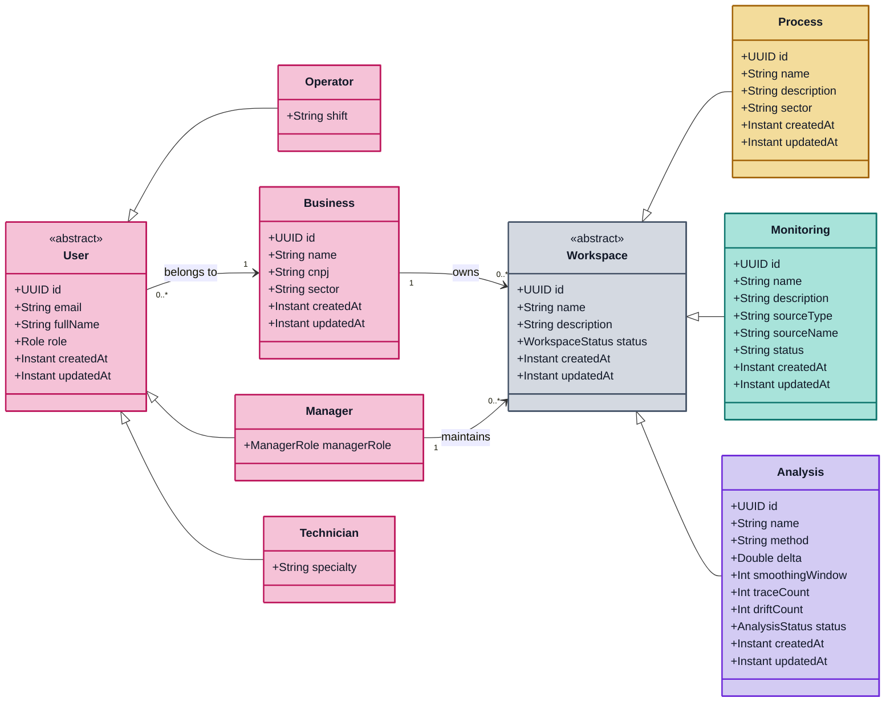

**Event log e processo**

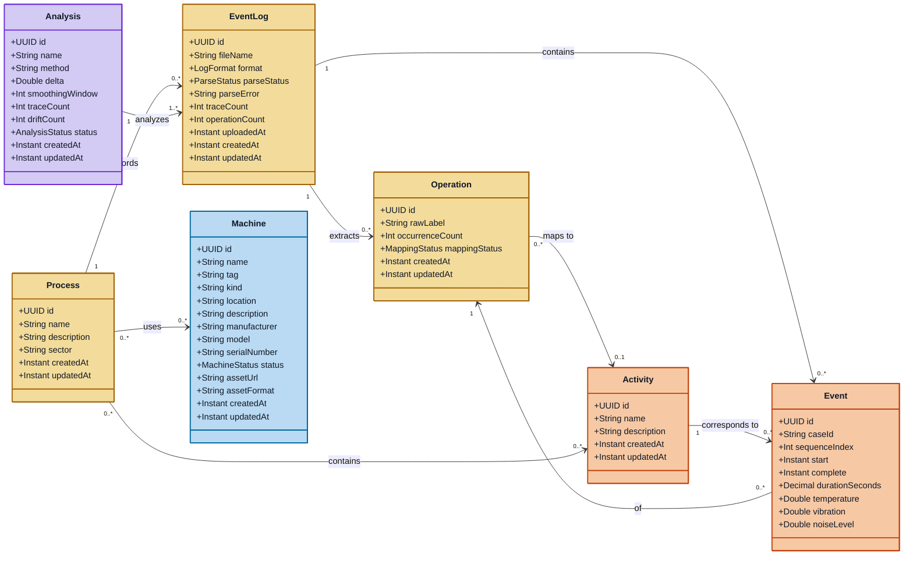

**Análise e intervenção**

Finding pode abrir uma Maintenance (0..\* para 0..1); essa aresta fica fora do desenho para não esticar a herança. Uma Analysis pode focar uma Machine (0..\* para 0..1); a máquina segue no evento até a Recommendation, que a aponta na vista Ativos e peça.

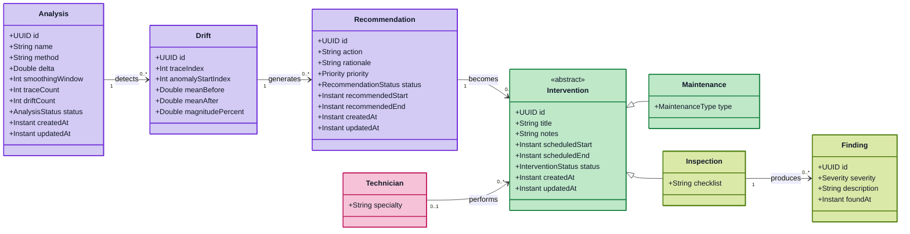

**Ativos e peça**

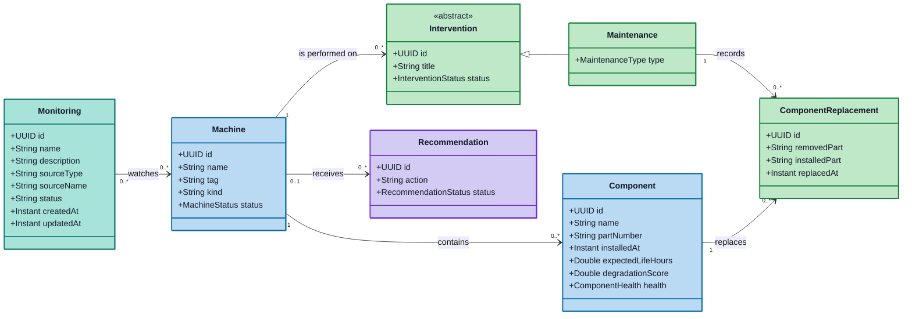

**Diagrama de componentes**

Interfaces entre os containers da seção 5.1.

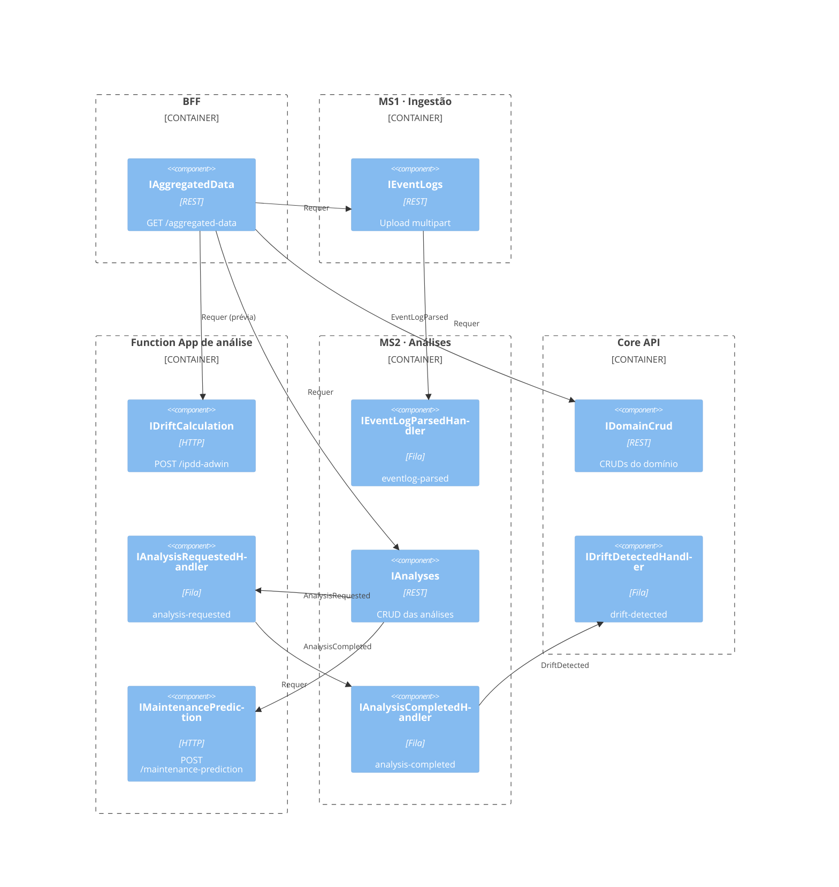

---

## 6. Visão de Runtime

Esta seção mostra como os blocos da seção 5 colaboram em tempo de execução. Foram escolhidos os cenários que carregam o objetivo do sistema (do event log até a manutenção), a interação com a interface externa de identidade e o comportamento quando algo falha. Cada cenário traz o diagrama de sequência (C4 nível 4) e a análise do que ele mostra.

### 6.1 Upload do event log e análise de drift

**C4 — Nível 4 · UML de Sequência**

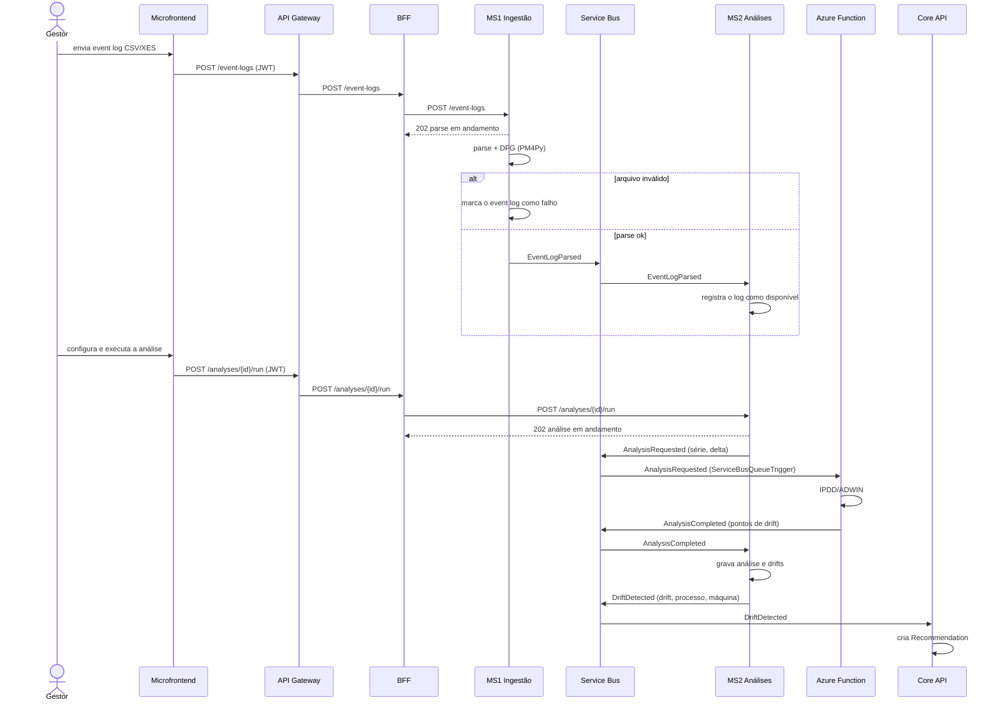

**Análise.** O gestor envia o event log exportado do MES/ERP. A ingestão responde na hora e avisa o MS2 por evento quando o log fica disponível. Depois o gestor configura a análise (filtro de traces e sensibilidade, RF-14) e a executa. O MS2 responde na hora e pede o cálculo por fila; a Function é disparada pela própria fila, calcula e devolve o resultado por outra fila. O MS2 grava os drifts e o resultado segue por evento até o Core criar a recomendação de manutenção. Cada fila tem um único consumidor. Se o arquivo for inválido, o MS1 marca o event log como falho e nenhum evento é publicado.

### 6.2 Abrir o processo (`GET /aggregated-data`)

**C4 — Nível 4 · UML de Sequência**

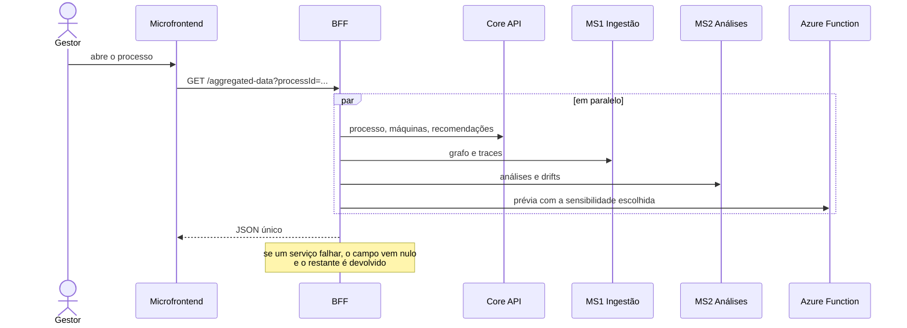

**Análise.** Ao abrir um processo, o Microfrontend faz uma única chamada. O BFF consulta os serviços em paralelo e devolve um JSON único, mesmo que um deles falhe.

### 6.3 Login com Google

**C4 — Nível 4 · UML de Sequência**

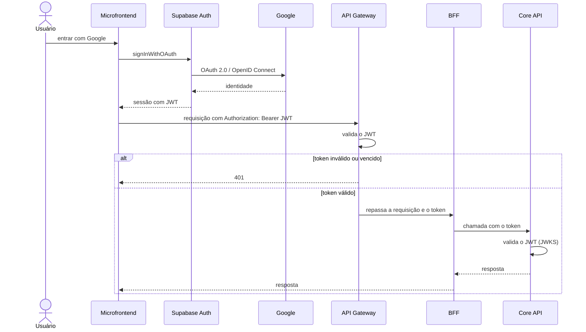

**Análise.** O login é a única interação com o provedor de identidade. Depois dele, toda chamada leva o JWT, que é validado no API Gateway e de novo no Core.

### 6.4 Da recomendação à manutenção realizada

**C4 — Nível 4 · UML de Sequência**

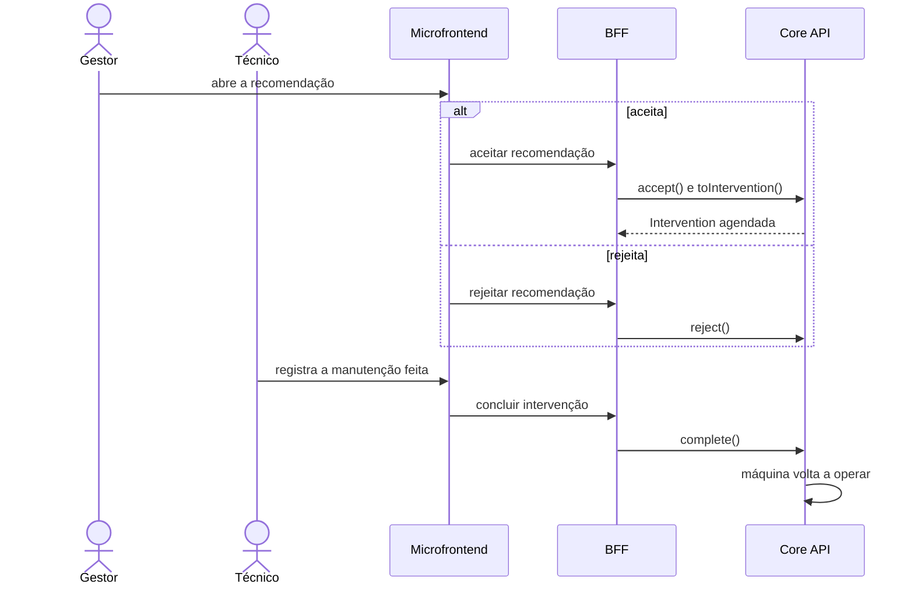

**Análise.** A recomendação criada em 6.1 só vira manutenção quando o gestor aceita. O técnico registra a execução, o que fecha o ciclo e reabilita a máquina.

---

## 7. Visão de Implantação

Esta seção mostra a infraestrutura onde o Deviante roda e onde cada bloco da seção 5 é implantado. Tudo roda em planos gratuitos ou de estudante de nuvem pública, sem servidor próprio.

### 7.1 Infraestrutura — nível 1 (produção)

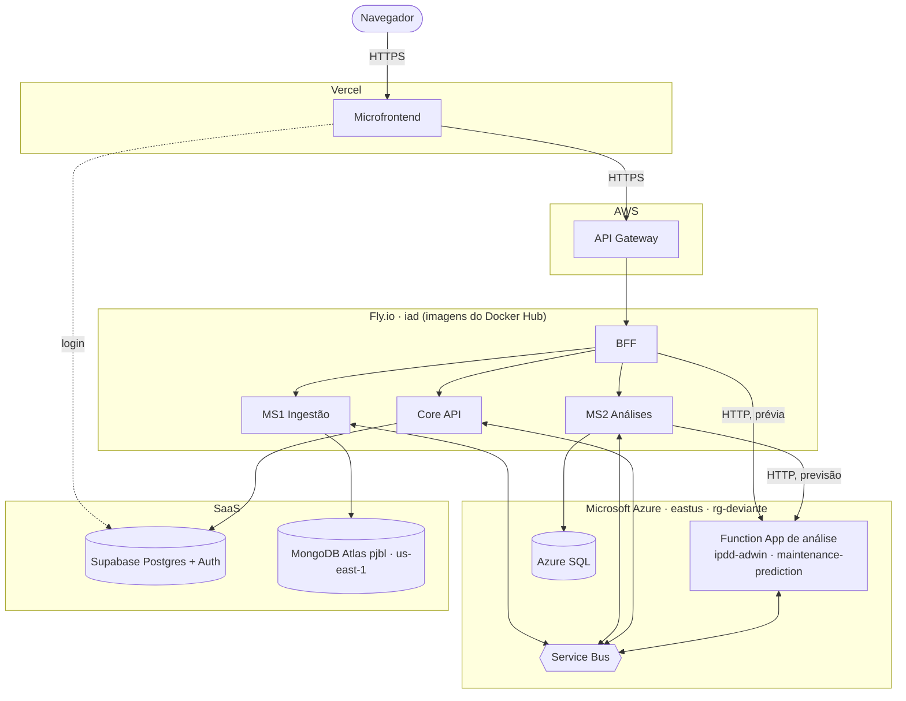

**Motivação.** As restrições de Cloud (§2) fixam o API Gateway na AWS e a Azure Function e o Azure SQL na Azure, que também hospeda o barramento de eventos. Os serviços em contêiner ficam no Fly.io, onde o deploy já funcionava no plano gratuito (ADR 04), rodando as mesmas imagens publicadas no Docker Hub. Os bancos gerenciados (Supabase, MongoDB Atlas e Azure SQL) evitam operar banco próprio, um por serviço (ADR 08). Azure, Fly.io e Atlas ficam na mesma área, a costa leste dos EUA (eastus, iad e us-east-1); a assinatura Azure for Students não libera East US 2.

**Características de qualidade.** O Fly.io e a Azure Function escalam a zero quando não há uso, o que mantém o custo em zero, mas a primeira chamada depois de um período parado demora mais (cold start). O BFF tolera essa latência com timeout por serviço e resposta parcial (§6.2, §8.4).

**Mapeamento dos blocos na infraestrutura**

| Bloco (§5) | Nó de infraestrutura | Implantação |
|---|---|---|
| Microfrontend | Vercel | Deploy a cada push na `main` |
| API Gateway | AWS API Gateway (HTTP API) | Configuração de rotas e autorizador JWT |
| BFF, Core API, MS1, MS2 | Fly.io, uma app por serviço | Imagem no Docker Hub, deploy via GitHub Actions |
| Function App de análise (`ipdd-adwin` e `maintenance-prediction`) | Um único Azure Function App em Python, plano Consumption, eastus, resource group `rg-deviante`; `ipdd-adwin` com ServiceBusQueueTrigger na fila `analysis-requested` e HTTP Trigger para a prévia; `maintenance-prediction` com HTTP Trigger | Deploy via GitHub Actions com login OIDC na managed identity, sem segredo |
| Service Bus | Azure Service Bus, tier Basic, eastus, resource group `rg-deviante` | Quatro filas, uma por evento e cada uma com um único consumidor: `eventlog-parsed` (MS2), `analysis-requested` (Function), `analysis-completed` (MS2) e `drift-detected` (Core); o tier Basic não tem tópicos |
| Bancos | Supabase Postgres, MongoDB Atlas M0 `pjbl` (us-east-1), Azure SQL Free (eastus) | Serviços gerenciados; um usuário de banco por serviço, com acesso só aos próprios dados; strings de conexão nos secrets do GitHub Actions |
| Autenticação | Supabase Auth | Login Google e emissão do JWT |

---

## 8. Conceitos Transversais

Esta seção reúne as regras e soluções que valem para vários blocos ao mesmo tempo, para não repeti-las em cada um: o modelo de domínio, a segurança, os padrões de reuso, o tratamento de erros, os testes de arquitetura e a configuração.

### 8.1 Modelo de domínio e dados

**Objetos de negócio (OOUX / ORCA).** Os seis objetos do ORCA são o vocabulário comum entre interface, código e dados. Cada objeto vira uma classe de domínio (§5.3), uma tela no Microfrontend e uma tabela ou coleção; cada CTA vira um caso de uso.

| Objeto ORCA | Classe / dado | Serviço dono | CTAs | Requisitos |
|---|---|---|---|---|
| Process | `Process` (um `Workspace`); `EventLog` no MS1 | Core API | criar, editar, excluir, ver detalhe, carregar event log | RF-03, RF-05, RF-06, RF-09, RF-12 |
| Activity | `Activity`; `Operation` e `Event` no MS1 | Core API | mapear, editar e remover mapeamento | RF-07, RF-08, RF-10 |
| Analysis | `Analysis` (um `Workspace`), `Drift` (+ cálculo na Function) | MS2 · Análises | criar, filtrar traces, executar, ajustar sensibilidade | RF-14, RF-15 |
| Monitoring | `Monitoring` (um `Workspace`) | Core API | criar, editar, excluir, agrupar máquinas | RF-11, RF-12, RF-13 |
| Machine | `Machine`, `Component` | Core API | ver diagnóstico de saúde e degradação dos componentes | RF-12, RF-16 |
| Maintenance | `Recommendation` → `Intervention` (`Maintenance` ou `Inspection`), `Finding`, `ComponentReplacement` | Core API | criar ação proativa, editar, excluir, registrar execução | RF-17, RF-18 |

Os usuários (`User`, com os papéis `Operator`, `Manager` e `Technician`) são atores, e a empresa (`Business`) é o contexto a que eles e os workspaces pertencem; nenhum dos dois é objeto ORCA. O event log, as operações, os eventos e o grafo (MS1) são dados de suporte de Process e Activity.

Cada serviço é dono dos seus dados; entre bancos só trafegam ids (`*_ref`). Cada serviço acessa só o próprio banco, com um usuário seu; nenhum serviço lê os dados do outro. As heranças da §5.3 viram tabelas assim: cada tipo de workspace tem a sua tabela (`processes` e `monitorings` no Core, `analyses` no MS2), os papéis de usuário ficam numa única tabela `users` com a coluna `role`, e manutenção e inspeção ficam em `interventions`, com a coluna `kind`.

**Diagrama de Entidades e Relacionamentos — Core (Supabase Postgres)**

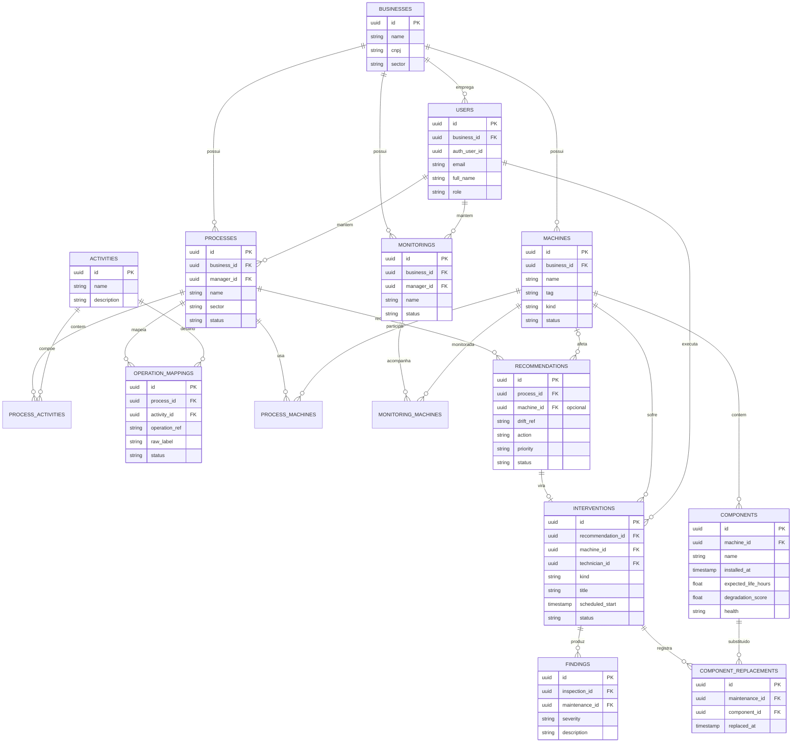

**MS2 (Azure SQL)**

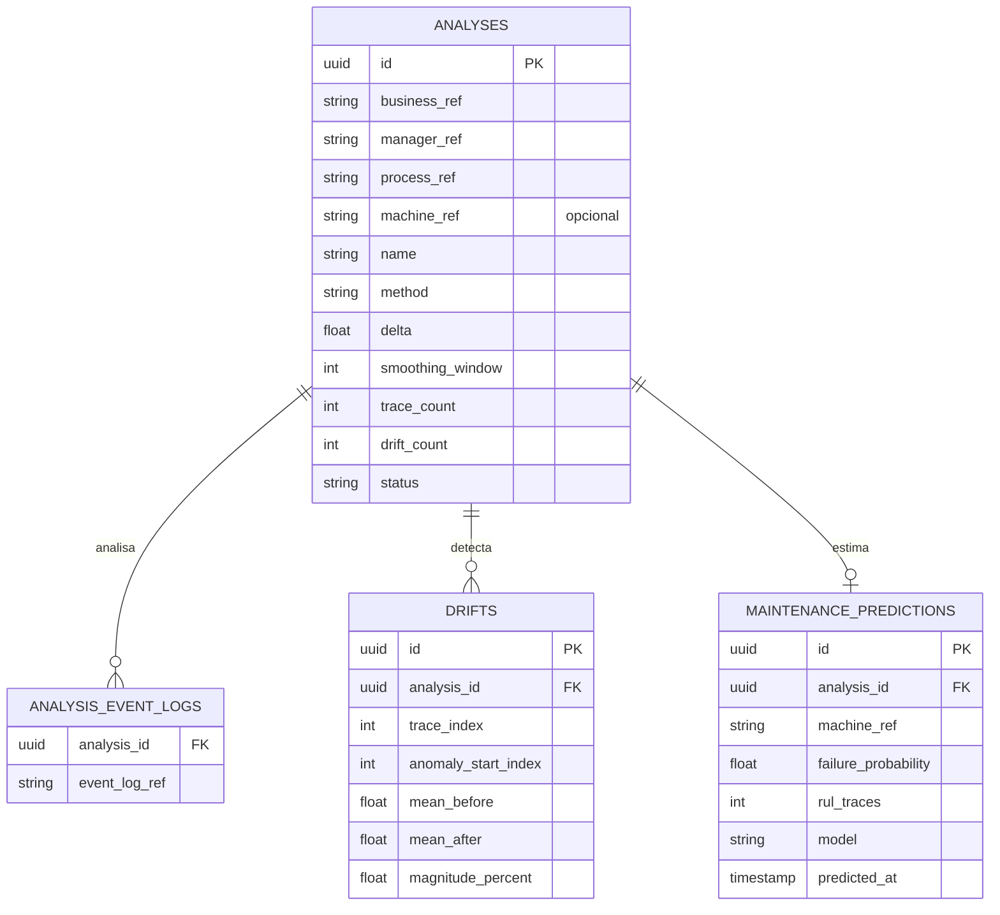

A tabela `maintenance_predictions` guarda o resultado da previsão experimental (ADR 06), só em análises de máquina.

**MS1 (MongoDB Atlas)** — coleções `event_logs` (formato e status do parse), `traces` (eventos embutidos, com temperatura, vibração e ruído quando o log traz), `operations` (rótulos brutos e status do mapeamento) e `process_graphs` (nós e arestas do DFG com frequências).

### 8.2 Segurança

O login é feito no Supabase Auth com Google. O JWT é validado no API Gateway e de novo no Core (JWKS); o BFF repassa o token. Os serviços só aceitam chamadas vindas do BFF ou do Service Bus.

**Autenticação separada dos dados (RNF-10).** O Supabase Auth emite o JWT com o identificador e o papel do usuário. O front só conhece a chave pública do Auth; as tabelas do Core são acessadas apenas pela Core API, no servidor, com credencial própria.

**Isolamento por empresa e por serviço (RNF-08).** Toda consulta da Core API filtra pela empresa (`business_id`) do usuário identificado no JWT, e um teste de arquitetura garante o filtro (§8.5). Cada serviço acessa o banco com um usuário próprio e restrito aos seus dados: o Core com uma role própria no PostgreSQL, sem usar o usuário `postgres`, o MS1 com um usuário do Atlas só na sua database e o MS2 com um usuário só no seu schema do Azure SQL. Nenhum serviço lê os dados de outro. Atlas e Azure SQL aceitam conexões só dos IPs de saída dos serviços, nunca do navegador.

**Azure sem segredo.** O deploy acessa a Azure por uma managed identity com papel Contributor só no resource group `rg-deviante`, com login OIDC do GitHub Actions, sem senha guardada.

### 8.3 Padrões de reuso

Um padrão de cada família, todos sobre o que a v1 faz de fato (upload, grafo, análise de drift, investigação). A manutenção preditiva (RUL e probabilidade de falha) é experimental na v1 e não entra nos padrões (ADR 06).

| Padrão | Família | Exemplos | Onde |
|---|---|---|---|
| Singleton | Criacional | `AnalysisEngine` (instância única do wrapper do detector, reaproveitada entre chamadas), `AppConfig` (registro único de configuração e parâmetros padrão da análise) | Function, Core |
| Adapter | Estrutural | `IpddAdwinAdapter` → `DriftDetector` (código IPDD/ADWIN da pesquisa), `Pm4pyGraphAdapter` → `GraphMiner` (PM4Py) | Function, MS1 |
| Observer | Comportamental | `DriftSubject` notifica `InvestigationPanel`, `MonitoringContext` e `AnalysisHud` quando o ADWIN detecta um drift ou a análise conclui | Microfrontend |

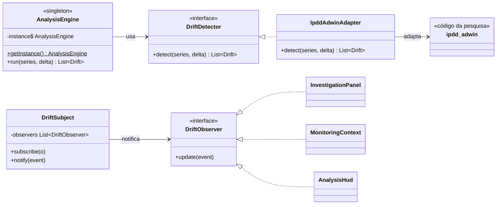

O Adapter é o padrão que preserva a pesquisa: o código da pesquisa é envolvido, não copiado nem alterado ("wrap, não fork"). O Singleton evita recarregar o detector a cada chamada, e o Observer desacopla a detecção das telas que reagem a ela.

### 8.4 Tratamento de erros e resiliência

Erros saem como JSON com um campo `error` e status HTTP adequado. O BFF usa timeout por serviço e devolve agregado parcial. Eventos são idempotentes (chave = id do event log no `EventLogParsed`, id da análise no `AnalysisRequested` e no `AnalysisCompleted` e id do drift no `DriftDetected`). Uma análise sem `AnalysisCompleted` dentro do prazo é marcada como falha pelo MS2 e pode ser executada de novo; mensagens que falham repetidamente vão para a fila de mensagens mortas do Service Bus.

### 8.5 Testes de arquitetura

| Serviço | Ferramenta | Regras |
|---|---|---|
| Core (Kotlin) | Konsist | `domain` não importa `infrastructure`, `api` nem Ktor; classes de uma slice não importam outra slice; toda consulta dos repositórios filtra por `business_id` |
| BFF (Node) | dependency-cruiser | módulos de feature não se importam entre si; nenhum driver de banco no BFF |
| MS1, MS2 (Python) | import-linter | contrato de camadas `api → application → domain`, `infrastructure → domain` |

### 8.6 Configuração e segredos

Cada serviço lê a configuração de variáveis de ambiente, e a mesma imagem roda em qualquer ambiente. Credenciais (strings de conexão, chaves do Supabase, tokens de deploy) ficam nos secrets do GitHub Actions e são injetadas no deploy; nenhuma credencial vai para os repositórios, que são públicos.

---

## 9. Decisões de Arquitetura

Esta seção registra as decisões de arquitetura importantes, caras de reverter ou arriscadas, que não estão fixadas pelas restrições da seção 2. A seção 4 resume a estratégia; aqui fica o porquê de cada escolha, a alternativa descartada e o que ela custa. Cada linha é um registro de decisão (ADR) com o seu status e a data em que foi aceita.

| ADR | Decisão | Contexto e motivo | Alternativa descartada | Consequências | Status |
|---|---|---|---|---|---|
| 01 | O cálculo IPDD/ADWIN roda numa Azure Function sem estado; o MS2 só gerencia as análises | O cálculo é puro e vem pronto da pesquisa (RT10). Isolado, ele pode ser trocado ou escalado sem mexer nos serviços, e a Function é exigida (RT5) | Rodar o detector dentro do MS2 | Uma ida e volta pela fila a mais por análise (ADR 10) e cold start na primeira chamada (§11) | Aceita, 05/10/2026 |
| 02 | O MS1 concentra tudo que lê o log bruto: upload, parse CSV/XES, operações, traces e o grafo (DFG) com PM4Py | Um novo formato de log deve mudar um único serviço (meta 2, §1.2) | Fazer o parse no Core e só o grafo em Python | Os demais serviços nunca leem o log; o `EventLogParsed` só avisa que o log está disponível, e o MS2 monta a série quando a análise é executada | Aceita, 05/10/2026 |
| 03 | A Core API evolui o `deviante-api` existente (Kotlin + Ktor) como serviço de domínio | O Core é dono de cinco dos seis objetos ORCA e já tem login, CRUDs e deploy funcionando | Começar um serviço novo em Node ou Python | Herda a organização por tipo e o modelo antigo, que precisam migrar (§11) | Aceita, 05/10/2026 |
| 04 | BFF, Core, MS1 e MS2 hospedados no Fly.io | O deploy já funcionava no plano gratuito, com as mesmas imagens do Docker Hub | Contêineres na Azure ou na AWS | Três nuvens (Fly.io, Azure, AWS) e latência entre elas; todas na costa leste dos EUA (§7) | Aceita, 05/10/2026 |
| 05 | Eventos entre serviços pelo Azure Service Bus, tier Basic, uma fila por evento (`EventLogParsed`, `AnalysisRequested`, `AnalysisCompleted`, `DriftDetected`) | A comunicação por eventos é exigida (RT7), e o Service Bus fica na mesma assinatura e região da Function e do Azure SQL | Chamadas REST encadeadas entre os serviços | Consistência eventual; os consumidores precisam ser idempotentes (§8.4); sem tópicos no tier Basic, cada evento tem um único consumidor | Aceita, 05/10/2026; filas revistas em 14/10/2026 |
| 06 | Prognóstico de manutenção (probabilidade de falha e RUL) é experimental nesta versão | A entrega se concentra na detecção de drift e no diagnóstico de saúde (RF-16). A previsão adapta experimentos ainda não publicados da pesquisa (Random Forest) e não tem modelo validado nem salvo | Tratar a previsão como resultado definitivo, no mesmo nível da detecção | A previsão roda na function `maintenance-prediction` (ADR 11), só em análises de máquina com dados suficientes, e aparece marcada como experimental; nenhuma regra de negócio depende só dela | Aceita, 06/10/2026; revista em 14/10/2026 |
| 07 | Identidade no Supabase Auth com Google; papel e isolamento entre empresas aplicados na aplicação, sem RLS no banco | Só a Core API acessa as tabelas do Core, com credencial própria, e o JWT já traz usuário e papel (RNF-08, RNF-10) | Políticas RLS por empresa no Postgres; provedor de identidade próprio | Uma consulta sem filtro exporia dados de outra empresa; um teste de arquitetura cobra o filtro (§8.5) | Aceita, 05/10/2026 |
| 08 | Persistência poliglota: cada serviço usa o banco que combina com o seu dado (Postgres no Core, MongoDB no MS1, Azure SQL no MS2) | O domínio do Core é relacional, logs e traces são documentos e o Azure SQL do MS2 é exigência da disciplina (RT3, RT4) | Consolidar Core e MS1 no MongoDB Atlas | Três provedores de dados, cada um com sua credencial; entre bancos só trafegam ids | Aceita, 05/10/2026 |
| 09 | Dados de máquina entram só por upload de event log, sem sensores em tempo real | O sistema de origem exporta o log em arquivo (§3), e o método da pesquisa foi validado sobre logs | Ingestão contínua de sensores (IoT) | O diagnóstico é tão atual quanto o último upload; um fluxo contínuo entraria como nova fonte de eventos no MS1 | Aceita, 08/10/2026 |
| 10 | A Function IPDD/ADWIN é disparada pela fila `analysis-requested` (ServiceBusQueueTrigger) e devolve o resultado pela fila `analysis-completed`; o HTTP Trigger fica só para a prévia do BFF | A arquitetura orientada a eventos da disciplina pede uma Function no plano Consumption consumindo o Service Bus por fila (RT5, RT7); um cálculo demorado não deve prender o MS2 | O MS2 chamar a Function por HTTP e esperar a resposta | A análise fica “em andamento” até o `AnalysisCompleted` chegar; dois eventos a mais para documentar e testar | Aceita, 14/10/2026 |
| 11 | Todo o aprendizado de máquina fica num único Function App de análise, em Python e com um só pacote de código, com duas functions: `ipdd-adwin` (detecção) e `maintenance-prediction` (previsão experimental) | Detecção e previsão são cálculos sem estado que vêm da mesma pesquisa e evoluem juntos; mantê-los num lugar só separa o ML dos serviços sem espalhar código | Uma Function App por modelo; a previsão dentro do MS2 ou do Core | Um deploy e um cold start compartilhados pelas duas functions; um modelo treinado e salvo entra nesse pacote com versão, sem mexer nos serviços | Aceita, 14/10/2026 |

---

## 10. Requisitos de Qualidade

Esta seção detalha as metas de qualidade da seção 1.2 em cenários mensuráveis e acrescenta as qualidades de prioridade menor que também orientam o desenho: desempenho, correção dos dados, idempotência e operabilidade.

### 10.1 Árvore de qualidade

A árvore agrupa os cenários pelas características da ISO/IEC 25010:2023. Os cenários Q1 e Q3 a Q7 detalham as metas da seção 1.2; Q2 e Q8 a Q12 cobrem as qualidades de prioridade menor.

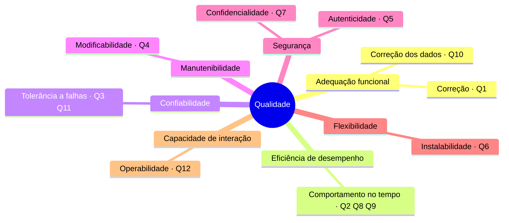

### 10.2 Cenários de qualidade

Cada cenário descreve o contexto, o estímulo que o dispara e a resposta esperada, com a métrica que diz se a qualidade foi atingida. Q4 e Q6 são cenários de mudança; os demais, de uso ou de falha.

| ID | Qualidade | Contexto | Estímulo | Resposta e métrica |
|---|---|---|---|---|
| Q1 | Correção (meta 1) | Logs sintéticos `DR_01.xes` … `DR_30.xes`, com drift injetado em ponto conhecido, e `ST_01.xes`, sem drift; sensibilidade padrão | O gestor executa a análise | Drift a até 5 traces do ponto injetado em pelo menos 90% dos logs `DR_*`; nenhum drift no `ST_01`; o mesmo resultado a cada execução com a mesma sensibilidade |
| Q2 | Desempenho | Core, MS1, MS2 e Function no ar e já aquecidos | O gestor abre um processo (`GET /aggregated-data`) | Resposta completa em até 2 s em 95% das chamadas |
| Q3 | Tolerância a falhas (meta 3) | MS2 ou Function fora do ar | O gestor abre um processo e edita uma máquina | O CRUD de processos e máquinas segue funcionando; o agregado chega sem as análises, marcadas como indisponíveis, dentro do timeout do BFF |
| Q4 | Modificabilidade (meta 2) | Sistema em produção lendo CSV e XES | Entra um novo formato de log (ex.: JSON) | Um parser novo no MS1; nenhuma linha alterada em MS2, BFF ou Core; os testes de arquitetura continuam passando |
| Q5 | Autenticidade (meta 4) | Qualquer rota pública | Chamada sem JWT ou com JWT expirado | 401 no API Gateway, sem a requisição chegar ao BFF |
| Q6 | Instalabilidade (meta 5) | Um ambiente novo de nuvem | Implantar um serviço | A mesma imagem do Docker Hub sobe só com variáveis de ambiente, sem rebuild e sem reimplantar os outros serviços |
| Q7 | Confidencialidade (meta 4) | Duas empresas com processos e máquinas cadastrados | Um gestor da empresa A pede, pelo id, um recurso da empresa B | 404, sem nenhum dado da empresa B na resposta |
| Q8 | Desempenho | Log real `Prod1Torno.csv` (13.053 eventos, 3.282 traces) | Upload pelo gestor | Parse e grafo concluídos e `EventLogParsed` publicado em menos de 30 s |
| Q9 | Desempenho | Série de cerca de 3.300 traces, Function aquecida | O gestor executa a análise | Análise marcada como concluída, com os drifts gravados, em menos de 5 s após a execução em 95% das vezes (inclui a ida e volta pelas filas) |
| Q10 | Correção dos dados | Event log carregado e com operações extraídas | Lote de mapeamento incompleto ou com operações de processos diferentes | Lote rejeitado inteiro; nenhuma atividade criada pela metade |
| Q11 | Tolerância a falhas | Service Bus entrega com garantia de pelo menos uma vez | O evento `DriftDetected` chega duas vezes ao Core | Uma única recomendação criada para o drift |
| Q12 | Operabilidade | Gestor no canvas do processo | Cria ou edita um processo, uma atividade ou uma máquina | A edição acontece no próprio canvas, sem tela de formulário separada |

---

## 11. Riscos e Dívida Técnica

Esta seção lista, por prioridade, os riscos técnicos (o que pode dar errado) e as dívidas técnicas (o que já existe e terá de ser corrigido), cada um com o impacto e a mitigação prevista. Obrigações fixas, como regiões ou planos permitidos, são restrições e ficam na seção 2.

| Prioridade | Tipo | Risco ou dívida | Impacto | Mitigação |
|---|---|---|---|---|
| 1 | Dívida | A implementação ainda é a da versão anterior: um único serviço Python (`mining/`) faz ingestão e análise sobre o Postgres, e ainda não existem BFF, API Gateway, Service Bus nem o Function App de análise | A arquitetura das seções 5 a 7 não roda até a migração, com prazo em 12/11/2026 (RO2) para uma equipe de dois alunos (RO1) | Migrar em passos que funcionam sozinhos, cada um com deploy e testes: separar MS1 e MS2 com seus bancos, extrair o IPDD/ADWIN e a previsão para o Function App, criar o BFF atrás do API Gateway e, por fim, ligar o Service Bus |
| 2 | Dívida | O banco e o código do Core ainda seguem o modelo antigo (gestor, equipamento, recomendação e agenda), não o modelo de domínio da §5.3 (empresa, workspace, componente, intervenção) | Diagramas e código divergem; parte dos requisitos (RF-04, RF-16, RF-17) não tem onde ser gravada | Migração do schema do Core junto com a reorganização em slices, um objeto ORCA por vez |
| 3 | Risco | O isolamento entre empresas é feito na aplicação, não no banco (ADR 07) | Uma consulta sem filtro expõe dados de outra empresa | Todo repositório do Core filtra pela empresa do usuário do JWT, com teste de arquitetura (§8.5) e o cenário Q7 (§10) |
| 4 | Dívida | A API ainda não aplica os papéis administrador, gestor, operador e técnico (RF-02) | Qualquer usuário autenticado alcança operações de outro papel | Ler o papel do JWT e checá-lo em cada caso de uso da camada `application` |
| 5 | Dívida | O Core conecta ao Postgres com o usuário administrativo `postgres` | Uma credencial vazada dá acesso a todo o banco | Role própria só com as tabelas do Core (§8.2), trocada no secret do deploy |
| 6 | Risco | Limites dos planos gratuitos: Atlas M0 com 512 MB e sem backup automático, cota mensal de computação do Azure SQL gratuito, cold start no Fly.io e na Function | Lentidão ou indisponibilidade durante a demonstração; perda de dados do MS1 | Séries pequenas e consultas leves no MS2, cache no BFF, aquecer os serviços antes da demonstração e exportar o MS1 com `mongodump` antes de cada entrega |
| 7 | Dívida | Código organizado por tipo, não por feature, e sem testes de arquitetura | As regras de Clean Architecture e Vertical Slice (RNF-20, RNF-21) não são verificadas | Reorganizar em slices e incluir Konsist, dependency-cruiser e import-linter no CI (§8.5) |
| 8 | Risco | Consistência eventual dos eventos (ADR 05): mensagens duplicadas, atrasadas ou fora de ordem | Recomendações duplicadas ou análises que não aparecem no agregado | Consumidores idempotentes com chave no id do event log, da análise ou do drift (§8.4) e o cenário Q11 (§10) |
| 9 | Risco | Dependência do código da pesquisa: uma mudança no código original altera os resultados | A análise deixa de reproduzir o método publicado | Código envolvido por um Adapter, sem cópia nem alteração (§8.3), versão fixada e o cenário Q1 (§10) como teste de regressão |
| 10 | Risco | Dependência de seis provedores (Vercel, Fly.io, AWS, Azure, Supabase e MongoDB Atlas) | Latência entre nuvens e migração cara se um provedor mudar o plano gratuito | Regiões na costa leste dos EUA (§7), chamadas em paralelo no BFF, cada provedor acessado só pelo serviço dono e imagens Docker portáveis |
| 11 | Risco | Análise presa “em andamento”: a Function falha ou o `AnalysisCompleted` não chega ao MS2 (ADR 10) | O gestor espera um resultado que nunca aparece e não sabe se deve executar de novo | Mensagens que falham repetidamente vão para a fila de mensagens mortas do Service Bus; o MS2 marca como falha a análise sem resposta após um prazo, e o gestor pode executá-la de novo |
| 12 | Risco | A previsão de falha e RUL é experimental: Random Forest treinado a cada chamada, sem modelo validado nem salvo (ADR 06, ADR 11) | Valores instáveis entre execuções ou lidos como resultado definitivo | Só em análises de máquina com dados suficientes, sempre marcada como experimental na interface e sem nenhuma regra de negócio dependendo só dela |

---

## 12. Glossário

Termos de domínio e técnicos usados neste documento, em ordem alfabética, para que o grupo, os professores e os parceiros usem as mesmas palavras. Os seis objetos ORCA (Activity, Analysis, Machine, Maintenance, Monitoring e Process) estão detalhados na seção 8.1 e no modelo de classes da seção 5.3.

| Termo | Definição |
|---|---|
| Activity (Atividade) | Objeto ORCA: etapa normalizada do processo, para a qual as operações do event log são mapeadas. |
| ADR | Architecture Decision Record: registro de uma decisão de arquitetura com contexto, alternativa descartada, consequências e status (seção 9). |
| ADWIN | Adaptive Windowing: algoritmo que detecta mudança na média de uma série de valores. |
| Analysis (Análise) | Objeto ORCA: execução do IPDD/ADWIN sobre um ou mais event logs, com seus parâmetros e os drifts encontrados. |
| API Gateway | Porta de entrada única das requisições externas; roteia, valida o JWT e limita a taxa. |
| AsyncAPI | Especificação para documentar eventos e filas, equivalente ao OpenAPI para APIs HTTP. |
| arc42 | Template de documentação de arquitetura em 12 seções, usado neste documento. |
| Azure Function | Função serverless da Azure, cobrada por execução e sem servidor a manter; aqui rodam, sem estado, a detecção IPDD/ADWIN e a previsão experimental, no Function App de análise. |
| BFF | Backend for Frontend: API feita sob medida para a interface, que encaminha os CRUDs e agrega os dados de vários serviços. |
| Business (Empresa) | Empresa cliente, identificada pelo CNPJ, à qual pertencem os usuários e os workspaces. |
| C4 | Modelo de diagramas de arquitetura em quatro níveis de zoom: contexto, containers, componentes e código. |
| Clean Architecture | Organização do código em camadas (domain, application, infrastructure, api) em que as dependências apontam para o domínio. |
| Cold start | Demora extra da primeira chamada a um serviço que estava parado (escalado a zero). |
| Component (Componente) | Peça de uma máquina, com idade e índice de degradação; base do diagnóstico de saúde. |
| Consistência eventual | Garantia de que os serviços ficam coerentes depois que os eventos são entregues, e não no mesmo instante. |
| Database per Service | Padrão em que cada serviço tem banco próprio, acessado só por ele. Aqui com persistência poliglota: cada banco é do tipo que combina com o dado do serviço. |
| Delta (sensibilidade) | Parâmetro de confiança do ADWIN; quanto menor, mais evidência é exigida para apontar um drift. |
| DFG | Directly-Follows Graph: grafo de quais atividades seguem quais, com a frequência de cada passagem. |
| Drift | Mudança estatisticamente relevante no comportamento de uma série, aqui o sojourn time de uma atividade. |
| Event log | Registro de eventos de um processo, em CSV ou XES: caso (trace), operação e tempos de início e fim. |
| Fila (queue) | Canal do Service Bus que guarda as mensagens de um evento até o seu único consumidor ler; se ele estiver fora, a mensagem espera. |
| Finding (Achado) | Problema encontrado numa inspeção, com severidade; pode abrir uma manutenção. |
| Function App | Unidade de deploy da Azure que agrupa várias functions com o mesmo código e a mesma configuração; aqui, o Function App de análise com `ipdd-adwin` e `maintenance-prediction` (ADR 11). |
| Ground truth | Ponto de drift conhecido, injetado nos logs sintéticos, contra o qual a detecção é medida. |
| Inspection (Inspeção) | Intervenção que só verifica a máquina e registra achados, sem corrigir. |
| Intervention (Intervenção) | Ação proativa sobre uma máquina, criada a partir de uma recomendação: manutenção ou inspeção. |
| IPDD | Interactive Process Drift Detection: framework de detecção de desvios do grupo de pesquisa IPDD da PUCPR. |
| JWT / JWKS | JSON Web Token: token assinado que identifica o usuário e o papel em cada chamada. JWKS é o conjunto de chaves públicas usado para validá-lo. |
| Machine (Máquina) | Objeto ORCA: equipamento do chão de fábrica, composto de componentes. |
| Maintenance (Manutenção) | Objeto ORCA: intervenção que corrige ou substitui componentes de uma máquina; a inspeção é a intervenção que só verifica. |
| MES/ERP | Sistemas de execução e de gestão da fábrica; são a origem do event log. |
| Microfrontend | Interface web dividida em partes implantáveis de forma independente, que consome só o BFF. |
| Monitoring (Monitoramento) | Objeto ORCA: acompanhamento da saúde de um grupo de máquinas. |
| OOUX / ORCA | Object-Oriented UX: método que modela a interface a partir dos objetos de negócio. ORCA = Objects, Relationships, CTAs, Attributes. |
| Operation (Operação) | Rótulo de atividade como vem no event log, antes de ser mapeado para uma Activity. |
| PM4Py | Biblioteca Python de mineração de processo, usada para ler o log e gerar o DFG. |
| Process (Processo) | Objeto ORCA: processo de manufatura registrado e analisado. |
| Random Forest | Modelo de aprendizado de máquina formado por várias árvores de decisão; aqui estima a probabilidade de falha e o RUL, de forma experimental. |
| Recommendation (Recomendação) | Sugestão de manutenção ou inspeção gerada a partir de um drift; quando aceita, vira uma intervenção. |
| RUL | Remaining Useful Life: vida útil restante estimada de uma máquina, aqui em traces; experimental nesta versão (ADR 06). |
| Service Bus | Barramento de mensagens da Azure que transporta os eventos entre os serviços. Aqui no tier Basic, que só tem filas. |
| ServiceBusQueueTrigger | Gatilho que executa uma Azure Function a cada mensagem que chega numa fila do Service Bus. |
| Sojourn time | Tempo que um caso passa numa atividade (fim − início). |
| Trace | Sequência de eventos de um mesmo caso. |
| Vertical Slice | Organização do código por feature, com uma pasta por caso de uso de ponta a ponta. |
| Workspace | Área de trabalho de uma empresa, que pode ser um processo, um monitoramento ou uma análise. |
