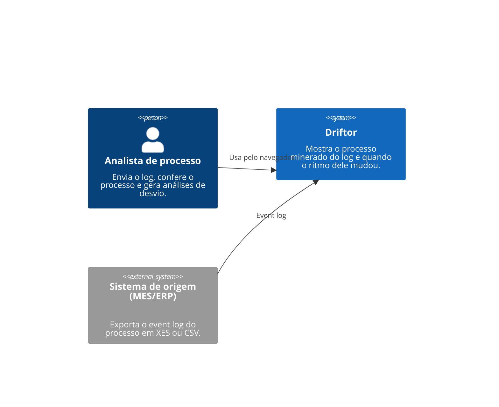
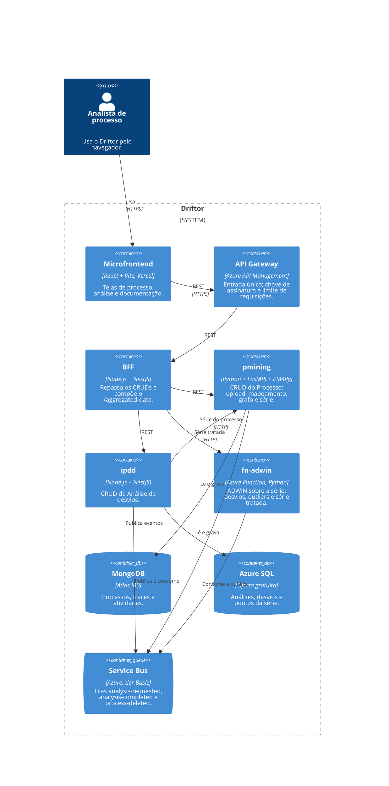
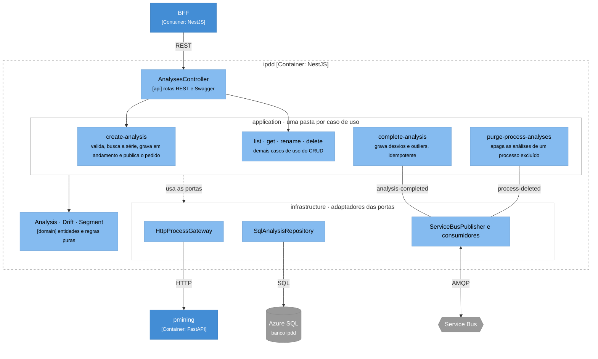
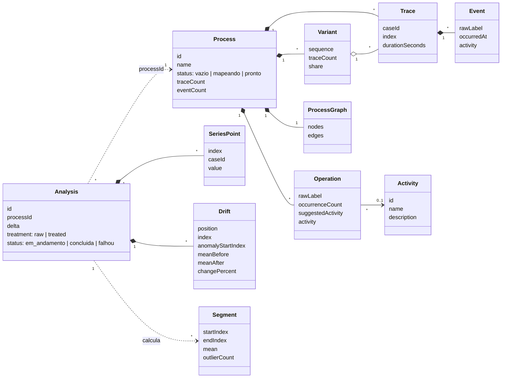
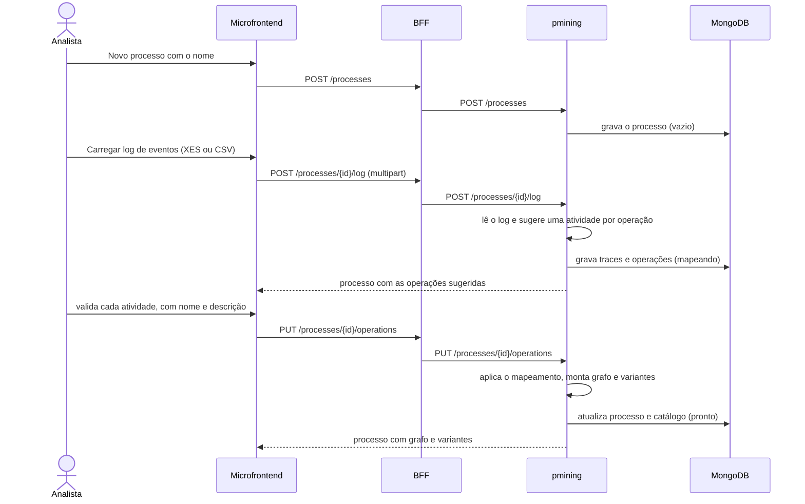
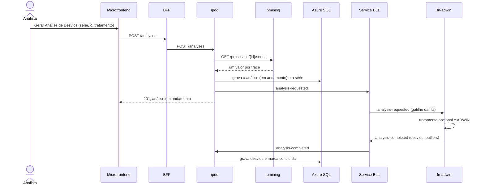
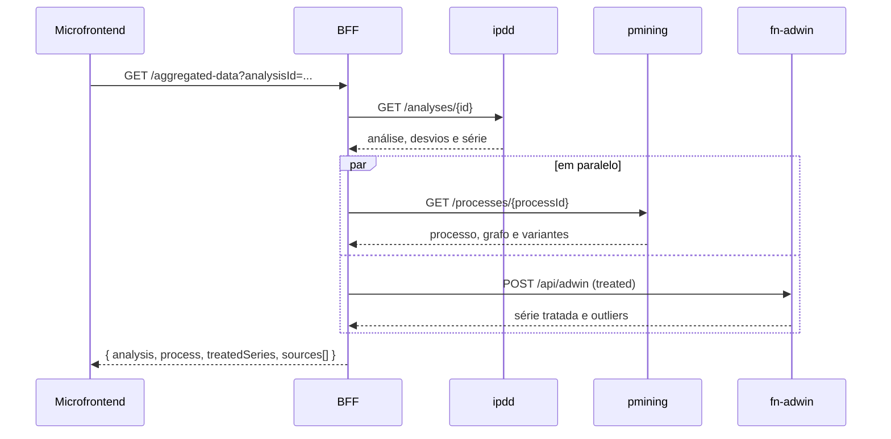
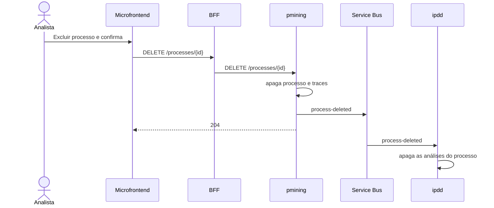
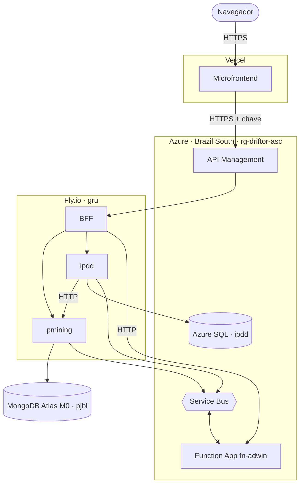
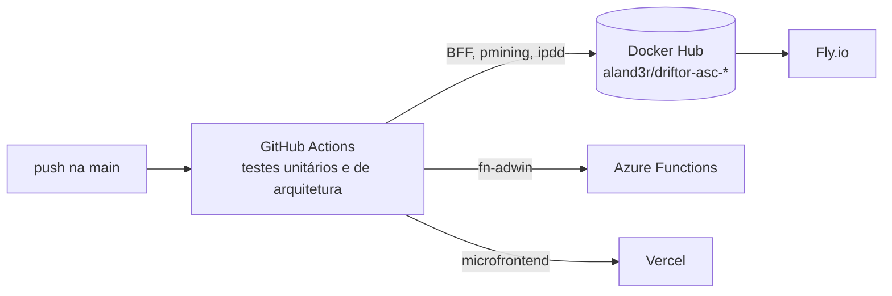

# Arquitetura do Driftor — arc42

**Grupo:** Alander Menezes Arantes de Ávila, Emanuelle Skolut Jose.

---

## 1. Introdução e Metas

O Driftor mostra quando um processo produtivo mudou de ritmo. A partir do event log exportado pelo sistema da fábrica, ele reconstrói o processo como um grafo de atividades e aplica o detector ADWIN, usado no método IPDD da pesquisa da PUCPR, sobre a duração dos traces para apontar em que ponto o tempo de execução deixou de se comportar como antes. Cada desvio aparece na linha do tempo com o caso em que foi detectado, as médias antes e depois e a variação.

Esta documentação descreve a arquitetura da versão em nuvem do Driftor: um microfrontend, um BFF, dois microsserviços com bancos próprios e uma Azure Function, ligados por filas de mensagens e expostos por um API Gateway.

### 1.1 Visão geral de requisitos

O usuário trabalha com dois objetos: o **Processo**, criado só com o nome e alimentado pelo event log que o analista carrega nele, e a **Análise de desvios**, gerada sobre um processo. Cada um tem o seu CRUD completo.

| ID | Requisito funcional | Serviço |
|---|---|---|
| RF-01 | Criar um processo pelo nome e carregar nele um event log (XES ou CSV); um novo log substitui o anterior. | pmining |
| RF-02 | Mapear as operações do log para atividades do catálogo, com sugestão automática, descrição opcional da atividade, criação de atividade nova e opção de continuar depois. | pmining |
| RF-03 | Ver o processo: grafo de atividades com controle de densidade, variantes, traces e, para cada atividade, frequência e desempenho. | pmining |
| RF-04 | Renomear e excluir um processo; a exclusão apaga também as análises dele. | pmining, ipdd |
| RF-05 | Gerar uma análise de desvios escolhendo o processo, a série (duração total do trace ou tempo numa atividade), a sensibilidade δ e o tratamento (bruto ou tratado). | ipdd, fn-adwin |
| RF-06 | Ver a análise: a série no tempo, os desvios D1…Dn, os segmentos entre eles, os outliers e a série tratada. | BFF, ipdd, fn-adwin |
| RF-07 | Renomear e excluir uma análise. | ipdd |
| RF-08 | Ver processos e análises num painel de cartões. | BFF |
| RF-09 | Ler esta documentação de arquitetura dentro do próprio aplicativo. | BFF |

### 1.2 Metas de qualidade

As quatro metas abaixo, em ordem de prioridade, são as qualidades que mais pesam na arquitetura, com a característica correspondente da ISO/IEC 25010. A seção 10 traz os cenários verificáveis.

| Prioridade | Meta | ISO/IEC 25010 | Cenário resumido |
|---|---|---|---|
| 1 | Correção analítica | Adequação funcional | Os quatro logs sintéticos da pesquisa (`ST_20`, `DR_20`, `DR_MS_20`, `DR_MS_ST_20`) dão 0, 4, 7 e 9 desvios, como no artigo. |
| 2 | Tolerância a falhas | Confiabilidade | Se a Function ou o pmining cair, a tela da análise ainda abre com o que o BFF conseguiu reunir. |
| 3 | Modificabilidade | Manutenibilidade | Um novo formato de log entra com um novo leitor no pmining, sem mudar ipdd, BFF ou Function. |
| 4 | Implantabilidade | Flexibilidade | Cada serviço é uma imagem no Docker Hub, publicada e implantada sozinha a cada push na `main`. |

### 1.3 Stakeholders

| Nome / Papel | Contato | Expectativa |
|---|---|---|
| Analista de processo (usuário) | Usuário do sistema | Enviar o log, conferir o processo e descobrir quando e quanto o ritmo mudou. |
| Denise M. V. Sato, autora do framework IPDD | [denise.vecino@pucpr.br](mailto:denise.vecino@pucpr.br) | Ver o método aplicado com resultados iguais aos publicados. |
| Manoel Valerio da Silveira Neto, professor de Arquitetura e Soluções Cloud | [manoel.valerio@pucpr.br](mailto:manoel.valerio@pucpr.br) | Avaliar os estilos arquiteturais e a implantação em nuvem. |
| Grupo de desenvolvimento: Alander Menezes Arantes de Ávila, Emanuelle Skolut Jose | [menezes.alander@pucpr.edu.br](mailto:menezes.alander@pucpr.edu.br), [emanuelle.skolut@pucpr.edu.br](mailto:emanuelle.skolut@pucpr.edu.br) | Uma arquitetura que caiba no prazo e nos planos gratuitos. |

---

## 2. Restrições da Arquitetura

As restrições vêm de duas fontes: a disciplina de Arquitetura e Soluções Cloud, que fixa o estilo e a infraestrutura, e a pesquisa IPDD, que fornece o método de detecção. Cada uma traz o motivo que a impõe.

### 2.1 Restrições técnicas

| ID | Restrição | Motivo |
|---|---|---|
| RT1 | Interface em microfrontend React que fala só com o BFF | Exigência da disciplina. |
| RT2 | BFF em Node.js com o endpoint `GET /aggregated-data`, que junta numa resposta os dados dos dois microsserviços e da Function | Exigência da disciplina. |
| RT3 | Um microsserviço com MongoDB Atlas e outro com Azure SQL, cada um com CRUD e Swagger | Exigência da disciplina. |
| RT4 | Uma Azure Function com gatilho HTTP ou de mensagem | Exigência da disciplina. |
| RT5 | Comunicação assíncrona por eventos entre os serviços | Exigência da disciplina. |
| RT6 | Um API Gateway como porta de entrada | Exigência da disciplina; o enunciado sugere AWS, a escolha está na ADR 03. |
| RT7 | Detecção pelo ADWIN como no método IPDD, com os mesmos resultados do artigo | Fidelidade ao método publicado. |
| RT8 | Só planos gratuitos ou de estudante | Projeto acadêmico sem orçamento; limites de memória, cota e cold start condicionam o desenho. |

### 2.2 Restrições organizacionais

| ID | Restrição | Motivo |
|---|---|---|
| RO1 | Equipe de dois alunos e entrega em 12/11/2026 | Calendário acadêmico; o escopo cabe em dois objetos (Processo e Análise). |
| RO2 | Um repositório público por serviço, com README, arquitetura e instruções para rodar | A avaliação é feita sobre os repositórios. |
| RO3 | Cada serviço publicado como imagem no Docker Hub, com build, testes e deploy automáticos | Critério de avaliação. |
| RO4 | Apresentação em vídeo com o sistema rodando na nuvem e a participação de todos | Forma de avaliação. |

### 2.3 Convenções

| ID | Convenção | Motivo |
|---|---|---|
| C1 | arc42 com diagramas C4 (contexto, containers e componentes) e UML para classes e sequências, escritos em Mermaid | Notações pedidas na disciplina; o diagrama muda junto com o texto. |
| C2 | Clean Architecture (`domain`, `application`, `infrastructure`, `api`) com uma pasta por caso de uso (Vertical Slice) | Pedido na disciplina; a seção 8.3 detalha. |
| C3 | APIs em OpenAPI (Swagger) e eventos em AsyncAPI | Pedido na disciplina. |
| C4 | Documentação em português; código, rotas e eventos em inglês | O público da documentação é a banca; o código segue as bibliotecas. |
| C5 | Telas desenhadas no Figma Make e portadas para o React | Decisão do grupo. |

---

## 3. Contexto e Escopo

O Driftor é tratado aqui como uma caixa-preta. Dentro do escopo estão o processo minerado do log e a análise de desvios. Fora dele fica o sistema de origem da fábrica (MES/ERP), que só exporta o event log em arquivo; o usuário baixa esse arquivo e o envia ao Driftor.

### 3.1 Contexto de negócio

**C4 nível 1 · Contexto**

| Parceiro | Entrada | Saída |
|---|---|---|
| Analista de processo | Event log, mapeamento das operações, parâmetros da análise | Grafo do processo, variantes, desvios e segmentos |
| Sistema de origem (MES/ERP) | — | Event log em XES ou CSV |

### 3.2 Contexto técnico

Todo o tráfego do navegador entra pelo API Gateway, que exige uma chave de assinatura e limita as requisições, e segue para o BFF. Os canais internos entre os serviços estão na seção 5.

| Parceiro | Canal técnico | O que passa por ele |
|---|---|---|
| Navegador do analista | HTTPS/JSON até o API Gateway, com a chave no header `Ocp-Apim-Subscription-Key` | Comandos dos CRUDs e as telas compostas pelo BFF |
| Sistema de origem | Arquivo XES ou CSV enviado por upload (multipart) | Event log do processo |

---

## 4. Estratégia da Solução

Esta seção resume as decisões que dão forma ao Driftor. A estrutura está na seção 5, os conceitos transversais na seção 8 e o porquê de cada escolha na seção 9.

### 4.1 Decomposição e integração

O sistema se divide por quem é dono de cada dado, cada parte com o seu banco (Database per Service):

- **pmining** (Python, FastAPI e PM4Py, MongoDB Atlas) é dono de tudo que lê o log: upload, leitura do XES ou CSV, mapeamento das operações, traces, variantes, grafo e a série de durações. É o CRUD do Processo.
- **ipdd** (Node.js, NestJS, Azure SQL) é dono do ciclo de vida da análise: cria, guarda o resultado, renomeia e exclui. É o CRUD da Análise.
- **fn-adwin** (Azure Function em Python) só calcula: recebe uma série numérica e devolve desvios, outliers e a série tratada. Não guarda estado.
- **BFF** (Node.js, NestJS) é a única porta do microfrontend: repassa os CRUDs e compõe o `GET /aggregated-data`.

Os serviços trocam três eventos por filas do Azure Service Bus: `analysis-requested` e `analysis-completed` levam o cálculo do ipdd para a Function e de volta, e `process-deleted` avisa o ipdd para apagar as análises de um processo excluído. Assim o cálculo pode demorar ou falhar sem prender a interface, e cada serviço é implantado sozinho.

### 4.2 Padrões arquiteturais e de projeto

Na arquitetura: microsserviços com Database per Service, Backend for Frontend, API Gateway e comunicação por eventos com uma fila por evento. Dentro de cada serviço: Clean Architecture com uma pasta por caso de uso (Vertical Slice). No código, as bibliotecas externas (PM4Py, o ADWIN da biblioteca `river`, o driver do MongoDB, o `mssql` e o Service Bus) ficam atrás de portas da aplicação e são ligadas por adaptadores na camada de infraestrutura, o que permite testar cada caso de uso com dublês em memória.

### 4.3 Tecnologia e operação

| Parte | Tecnologia | Onde roda |
|---|---|---|
| Microfrontend | React 19, Vite, React Router, Recharts, dagre | Vercel |
| API Gateway | Azure API Management (Consumption) | Azure, Brazil South |
| BFF e ipdd | Node.js 22, NestJS | Fly.io, São Paulo (`gru`) |
| pmining | Python 3.12, FastAPI, PM4Py | Fly.io, São Paulo (`gru`) |
| fn-adwin | Azure Functions Python v2 no plano Flex Consumption, `river` | Azure, Brazil South |
| Mensageria | Azure Service Bus, tier Basic | Azure, Brazil South |
| Bancos | MongoDB Atlas M0 (pmining) e Azure SQL na oferta gratuita (ipdd) | Atlas na AWS `us-east-1`; Azure SQL em Brazil South |

Cada serviço tem um repositório público e um pipeline do GitHub Actions que roda os testes, publica a imagem no Docker Hub e faz o deploy.

### 4.4 Metas de qualidade e abordagens

| Meta | Abordagem |
|---|---|
| Correção analítica | O ADWIN roda com os mesmos parâmetros da pesquisa (δ 0,002, série bruta) e um teste automatizado confere os desvios das quatro bases sintéticas (seções 8 e 10). |
| Tolerância a falhas | O BFF consulta as fontes em paralelo e devolve `null` com o motivo para a que falhar; a análise fica "em andamento" até a resposta da fila chegar (seções 6 e 8.5). |
| Modificabilidade | Só o pmining lê o log; os outros serviços recebem séries numéricas. Fatias verticais e testes de arquitetura limitam o alcance de uma mudança (seção 8.4). |
| Implantabilidade | Um repositório, uma imagem e um pipeline por serviço (seção 7). |

---

## 5. Visão de Blocos de Construção

Esta seção abre a caixa-preta da seção 3 em três níveis de zoom: os containers do sistema, os componentes de um microsserviço e as classes do domínio.

### 5.1 Containers

**C4 nível 2 · Containers**

| Container | Responsabilidade | Interface |
|---|---|---|
| Microfrontend | Landing, painel, processo, análise e documentação. Fala só com o BFF. | — |
| API Gateway | Exige a chave de assinatura, limita requisições e repassa ao BFF. | HTTPS |
| BFF | Repassa os CRUDs de processo e análise; compõe `GET /aggregated-data` (análise, processo e série tratada) e `GET /overview` (painel); serve esta documentação. | REST, Swagger em `/docs` |
| pmining | `POST /processes` (só o nome), `POST /processes/{id}/log` (upload do log), `GET`, `PATCH`, `DELETE`, `PUT /processes/{id}/operations`, traces, série e catálogo de atividades. | REST, Swagger em `/docs` |
| ipdd | `POST /analyses`, `GET`, `PATCH`, `DELETE`; consome `analysis-completed` e `process-deleted`. | REST, Swagger em `/docs`; AsyncAPI em `/events` |
| fn-adwin | Consome `analysis-requested` e responde em `analysis-completed`; `POST /api/adwin` para o BFF. | Fila e HTTP |

### 5.2 Componentes do ipdd

O ipdd é o serviço que mais conversa com os outros: recebe REST, chama o pmining, publica e consome filas e grava no Azure SQL. Os demais serviços seguem a mesma organização, com as fatias listadas na tabela abaixo do diagrama.

**C4 nível 3 · Componentes do ipdd**

Os casos de uso dependem só do domínio (`Analysis`, `Drift`, `Segment`) e das portas (`AnalysisRepository`, `ProcessGateway`, `EventPublisher`); os adaptadores de infraestrutura implementam as portas e são ligados na inicialização. Nenhuma fatia importa outra.

| Serviço | Fatias (uma pasta por caso de uso) |
|---|---|
| pmining | `create_process`, `upload_log`, `map_operations`, `get_process`, `list_processes`, `list_traces`, `get_series`, `rename_process`, `delete_process`, `activities` |
| ipdd | `create-analysis`, `complete-analysis`, `get-analysis`, `list-analyses`, `rename-analysis`, `delete-analysis`, `purge-process-analyses` |
| fn-adwin | `detect_drifts` |
| BFF | `get-aggregated-data`, `get-overview`, `get-documentation` e o repasse dos CRUDs |

### 5.3 Classes do domínio

O domínio tem onze classes. As do pmining descrevem o processo minerado; as do ipdd descrevem a análise. Entre os dois serviços só trafegam o id do processo e a série numérica.

| Classe | Serviço | Papel |
|---|---|---|
| Process | pmining | O processo nomeado, o log carregado nele e o seu estado (vazio, mapeando, pronto). |
| Trace, Event | pmining | Um caso do log e os eventos dele, na ordem. |
| Operation, Activity | pmining | O rótulo bruto do log e a atividade do catálogo, com descrição opcional, a que foi ligado. |
| Variant, ProcessGraph | pmining | Sequências distintas de atividades e o grafo de sucessão com métricas por atividade. |
| Analysis | ipdd | Parâmetros, estado e resumo de uma análise. |
| SeriesPoint | ipdd | Um valor da série por trace (duração total ou tempo numa atividade). |
| Drift | ipdd | Um desvio detectado pelo ADWIN, com as médias antes e depois. |
| Segment | ipdd | Trecho da série entre dois desvios; calculado na leitura, não gravado. |

---

## 6. Visão de Runtime

Os quatro cenários abaixo cobrem os dois CRUDs, o caminho assíncrono do cálculo e a composição do BFF. Em todos, o microfrontend chama o API Gateway, que repassa ao BFF; o gateway foi omitido dos diagramas para deixá-los legíveis.

### 6.1 Criar um processo, carregar o log e mapear as operações

O Create do Processo pede só o nome e grava o processo como "vazio". Na página do processo, o analista carrega o log: o pmining lê o arquivo, sugere uma atividade do catálogo para cada operação e passa o processo a "mapeando". O analista valida cada atividade, podendo renomeá-la e dar uma descrição; ao concluir, o pmining monta o grafo e as variantes e o processo passa a "pronto". O analista pode fechar o modal e continuar o mapeamento depois.

### 6.2 Gerar uma análise de desvios

A análise é criada na hora, com o estado "em andamento", e o cálculo segue pela fila. A tela da análise consulta o BFF a cada poucos segundos até o estado mudar.

Se a série for inválida, a Function responde `analysis-completed` com o erro e a análise fica como "falhou", com a mensagem visível na tela.

### 6.3 Abrir a análise (`GET /aggregated-data`)

O BFF busca a análise no ipdd e, em paralelo, o processo no pmining e a série tratada na Function. Cada fonte vem com o seu tempo de resposta; a que falhar vem como `null` com o motivo, e a tela mostra o que chegou.

### 6.4 Excluir um processo

A exclusão é imediata no pmining; as análises do processo somem do ipdd logo depois, quando o evento é consumido.

---

## 7. Visão de Implantação

Tudo roda em planos gratuitos ou de estudante, sem servidor próprio. Os serviços em contêiner ficam no Fly.io em São Paulo e os recursos da Azure em Brazil South, no resource group `rg-driftor-asc`.

### 7.1 Infraestrutura

**Entrega contínua.** Cada repositório tem um pipeline no GitHub Actions disparado por push na `main`.

### 7.2 Mapeamento dos blocos

| Bloco (seção 5) | Nó | Implantação |
|---|---|---|
| Microfrontend | Vercel | Deploy a cada push na `main` |
| API Gateway | Azure API Management, plano Consumption | Produto com chave de assinatura, limite de requisições e CORS; uma API apontando para o BFF |
| BFF, pmining, ipdd | Fly.io, uma app por serviço em `gru` | GitHub Actions: testes, imagem `aland3r/driftor-asc-<serviço>` no Docker Hub, deploy da imagem |
| fn-adwin | Azure Function App, Python, plano Flex Consumption | GitHub Actions: testes e publicação do pacote |
| Service Bus | Namespace `driftor-asc-bus`, tier Basic | Filas `analysis-requested`, `analysis-completed` e `process-deleted` |
| Bancos | MongoDB Atlas M0 `pjbl` (banco `pmining`); Azure SQL `driftor-asc-sql` (banco `ipdd`, serverless com pausa automática) | Serviços gerenciados; uma credencial por serviço, guardada nos secrets do repositório |

**Características de qualidade.** O Fly.io e a Function escalam a zero, o que mantém o custo em zero, mas a primeira chamada depois de um tempo parado demora mais (cold start), e o Azure SQL serverless também acorda devagar. O BFF tolera essa latência com resposta parcial, e a análise assíncrona não prende a tela.

### 7.3 Endereços

| Item | Endereço |
|---|---|
| Aplicação | https://driftor-asc-mfe.vercel.app |
| API Gateway | https://driftor-asc-apim.azure-api.net/api |
| BFF (Swagger) | https://driftor-asc-bff.fly.dev/docs |
| pmining (Swagger) | https://driftor-asc-pmining.fly.dev/docs |
| ipdd (Swagger e AsyncAPI) | https://driftor-asc-ipdd.fly.dev/docs e https://driftor-asc-ipdd.fly.dev/events |
| fn-adwin | https://driftor-asc-fn-adwin-dsa6htarh3avfag4.brazilsouth-01.azurewebsites.net/api/health |
| Repositórios | https://github.com/aland3r/driftor-asc-mfe, -bff, -pmining, -ipdd e -fn-adwin |
| Imagens | https://hub.docker.com/u/aland3r |

---

## 8. Conceitos Transversais

Regras que valem para todos os serviços.

### 8.1 Dados

Cada serviço tem o seu banco e nenhum lê o banco do outro; entre eles só trafegam o id do processo e a série numérica.

| Serviço | Banco | Coleções ou tabelas |
|---|---|---|
| pmining | MongoDB Atlas, banco `pmining` | `processes` (processo com operações, grafo e variantes), `traces` (um documento por caso, com os eventos), `activities` (catálogo) |
| ipdd | Azure SQL, banco `ipdd` | `analyses`, `drifts` e `analysis_points`, as duas últimas com `ON DELETE CASCADE` a partir de `analyses` |

Os traces ficam fora do documento do processo para que um log grande não esbarre no limite de 16 MB por documento do MongoDB.

### 8.2 Segurança

Esta versão não tem login de usuário (ADR 06): os dados são sintéticos e o objetivo é a arquitetura em nuvem. O controle de acesso fica no API Gateway, que exige a chave de assinatura em toda chamada, limita o número de requisições por chave e libera o CORS só para o domínio do microfrontend. Cada serviço tem a sua credencial de banco, e senhas, tokens e strings de conexão ficam apenas nos secrets do GitHub Actions e nas variáveis das plataformas, nunca nos repositórios públicos.

### 8.3 Clean Architecture e Vertical Slice

Todos os serviços usam as mesmas quatro camadas, com dependências apontando para dentro:

| Camada | Conteúdo | Pode depender de |
|---|---|---|
| `domain` | Entidades e regras puras (variantes, métricas do grafo, segmentos, tratamento da série) | Nada |
| `application` | Uma pasta por caso de uso, com o handler e as portas que ele usa | `domain` |
| `infrastructure` | Adaptadores: MongoDB, `mssql`, Service Bus, PM4Py, clientes HTTP | `application`, `domain` |
| `api` | Rotas REST, Swagger, gatilhos da Function e composição das dependências | Todas |

Cada caso de uso é uma fatia vertical: para mudar o upload, por exemplo, só a pasta `upload_log` e o adaptador que ela usa mudam.

### 8.4 Testes

Cada repositório roda os testes no GitHub Actions antes de publicar a imagem. Os testes unitários exercitam os casos de uso com adaptadores em memória; os testes de arquitetura falham o build quando uma regra da seção 8.3 é quebrada.

| Serviço | Ferramenta | Regras verificadas |
|---|---|---|
| BFF e ipdd | dependency-cruiser | domínio puro, aplicação sem infraestrutura nem drivers, infraestrutura sem api, fatias independentes, sem ciclos |
| pmining | import-linter | camadas, domínio sem FastAPI, PyMongo ou PM4Py, fatias independentes |
| fn-adwin | pytest | domínio e aplicação sem `azure` nem `river` fora da infraestrutura |
| Microfrontend | dependency-cruiser | componentes e features não importam telas, telas isoladas entre si, sem ciclos |

Um teste do pmining reproduz os desvios das quatro bases sintéticas (0, 4, 7 e 9), a meta 1 da seção 1.2.

### 8.5 Erros e resiliência

- Erros que o usuário pode corrigir (arquivo inválido, δ fora de 0 a 1, nome vazio) voltam como 4xx com a mensagem em português.
- O BFF chama cada serviço com timeout (10 s, e 20 s para a Function) e devolve resposta parcial no `/aggregated-data` e no `/overview`, com o estado de cada fonte em `sources`.
- Os consumidores das filas são idempotentes: `analysis-completed` só altera uma análise ainda em andamento, e `process-deleted` repetido não apaga nada a mais.
- Uma mensagem que falha repetidas vezes vai para a fila de mensagens mortas do Service Bus, sem travar as demais.

### 8.6 Eventos

Os eventos estão descritos em AsyncAPI no ipdd (`/events`). O tier Basic do Service Bus não tem tópicos, então cada evento tem uma fila e um único consumidor.

| Fila | Produtor | Consumidor | Conteúdo |
|---|---|---|---|
| `analysis-requested` | ipdd | fn-adwin | `analysisId`, valores da série, δ e tratamento |
| `analysis-completed` | fn-adwin | ipdd | Estado, desvios, outliers e janela de suavização, ou o erro |
| `process-deleted` | pmining | ipdd | `processId` e o momento da exclusão |

---

## 9. Decisões de Arquitetura

Cada linha é um registro de decisão (ADR): o que foi decidido, por quê, a alternativa descartada e o custo.

| ADR | Decisão | Motivo | Alternativa descartada | Consequências | Status |
|---|---|---|---|---|---|
| 01 | Dividir por dono do dado: pmining (Python) cuida de tudo que lê o log; ipdd (Node.js) cuida das análises; fn-adwin só calcula | PM4Py e o ADWIN da pesquisa só existem em Python; o CRUD de análises e o BFF ficam em Node.js, pedido pela disciplina para o BFF | Um microsserviço de análise que também calcula | Três linguagens de execução (Python, Node.js, Function Python) e a série atravessa a rede uma vez por análise | Aceita, 09/11/2026 |
| 02 | O cálculo do ADWIN roda numa Azure Function disparada pela fila `analysis-requested`, que responde em `analysis-completed`; o HTTP `POST /api/adwin` serve só a série tratada do BFF | Um cálculo que pode demorar não deve prender a requisição, e a disciplina pede Function com gatilho de mensagem | O ipdd chamar a Function por HTTP e esperar | A análise passa por "em andamento" e a tela consulta até concluir | Aceita, 09/11/2026 |
| 03 | API Gateway no Azure API Management (Consumption) | O grupo não tem conta AWS ativa, e o APIM fica na mesma assinatura e região dos demais recursos da Azure | Amazon API Gateway, sugerido no enunciado | Uma nuvem a menos para operar; a chave de assinatura vai no header `Ocp-Apim-Subscription-Key` | Aceita, 09/11/2026 |
| 04 | BFF, pmining e ipdd no Fly.io em São Paulo, a partir das imagens do Docker Hub | Deploy gratuito de contêiner, perto da Azure Brazil South | Azure App Service ou Container Apps | Duas nuvens e um caminho de rede entre elas; o firewall do Azure SQL precisa aceitar a saída do Fly.io | Aceita, 09/11/2026 |
| 05 | Service Bus tier Basic, uma fila por evento | Mais barato que o Standard e suficiente para três eventos com um consumidor cada | Tópicos com assinaturas (Standard) | Um novo consumidor do mesmo evento exige outra fila | Aceita, 09/11/2026 |
| 06 | Sem login de usuário nesta versão; o acesso é controlado pela chave e pelo limite do API Gateway | Dados sintéticos e foco na arquitetura em nuvem; login não muda nenhum dos requisitos da entrega | Login com provedor de identidade e token validado no gateway | Qualquer pessoa com a aplicação usa os mesmos dados; os serviços no Fly.io também respondem fora do gateway (seção 11) | Aceita, 10/11/2026 |
| 07 | Excluir um processo apaga as análises dele por evento (`process-deleted`) | O ipdd não pode ler o banco do pmining, e a exclusão não deve depender do ipdd estar no ar | O BFF apagar nos dois serviços em sequência | Consistência eventual: por alguns segundos, uma análise órfã pode aparecer | Aceita, 09/11/2026 |
| 08 | Previsão de falha por aprendizado de máquina fica fora desta versão | Exige dados de máquina e de falhas que não fazem parte do escopo; a detecção de desvio já responde à pergunta do usuário | Uma segunda function de previsão já nesta entrega | Quando entrar, será uma segunda function no mesmo Function App, consumindo a mesma série, sem mudar ipdd ou BFF | Aceita, 10/11/2026 |

---

## 10. Requisitos de Qualidade

Cenários verificáveis para as metas da seção 1.2 e para outras qualidades que a arquitetura atende.

| ID | Qualidade | Cenário | Como é verificado |
|---|---|---|---|
| Q1 | Correção analítica | Com δ 0,002 e série bruta, `ST_20`, `DR_20`, `DR_MS_20` e `DR_MS_ST_20` dão 0, 4, 7 e 9 desvios. | Teste automatizado no pmining e na fn-adwin; conferido também pela interface. |
| Q2 | Tolerância a falhas | Com a Function fora do ar, `GET /aggregated-data` responde com a análise e o processo, e `treatedSeries` vem `null` com o motivo em `sources`. | Teste unitário do BFF com a fonte falhando. |
| Q3 | Tolerância a falhas | Uma mensagem `analysis-completed` repetida não altera a análise já concluída. | Teste unitário do ipdd. |
| Q4 | Modificabilidade | Um novo formato de log entra com um novo leitor no pmining, sem mudar ipdd, BFF ou Function. | Testes de arquitetura garantem que só o pmining conhece o log. |
| Q5 | Implantabilidade | Um push na `main` de um serviço publica a imagem e faz o deploy só dele. | Pipeline do GitHub Actions de cada repositório. |
| Q6 | Desempenho | O painel abre em até 3 s com os serviços aquecidos; a primeira chamada depois de parados pode levar mais (cold start). | Tempo por fonte em `sources` do `/overview` e do `/aggregated-data`. |
| Q7 | Segurança | Uma chamada sem a chave de assinatura é recusada pelo gateway com 401, e o excesso de chamadas recebe 429. | Teste manual no API Gateway. |

---

## 11. Riscos e Dívida Técnica

| ID | Risco ou dívida | Impacto | Mitigação |
|---|---|---|---|
| R1 | Cold start do Fly.io, da Function e do Azure SQL serverless | A primeira tela depois de um tempo parado demora vários segundos | Resposta parcial no BFF; análise assíncrona; aquecer os serviços antes da apresentação |
| R2 | Cota mensal gratuita do Azure SQL | Esgotada a cota, o banco pausa até o mês seguinte e as análises ficam indisponíveis | Auto-pausa ligada; série gravada uma vez por análise; o BFF mostra o processo mesmo sem o ipdd |
| R3 | Os serviços no Fly.io respondem também fora do gateway | A chave e o limite do gateway podem ser contornados por quem souber o endereço | Dívida aceita nesta versão (ADR 06); o próximo passo é o BFF exigir um segredo que só o gateway envia |
| R4 | Limites do MongoDB Atlas M0 (512 MB) | Muitos logs grandes enchem o banco | Traces em coleção própria; excluir um processo apaga os traces |
| R5 | Consistência eventual na exclusão em cascata | Uma análise órfã pode aparecer por alguns segundos | Consumidor idempotente; o BFF trata processo ausente como fonte vazia |
| R6 | Mensagem que falha sempre na fila | Uma análise fica "em andamento" para sempre | Fila de mensagens mortas do Service Bus; a Function responde "falhou" para série inválida |

---

## 12. Glossário

| Termo | Definição |
|---|---|
| ADWIN | Adaptive Windowing: detector que mantém uma janela de valores e a corta quando as médias de duas partes diferem mais do que δ permite; cada corte é um desvio. |
| Análise de desvios | Execução do ADWIN sobre a série de um processo, com os seus parâmetros e resultado. |
| API Gateway | Porta de entrada única das chamadas do navegador; aqui, o Azure API Management. |
| Atividade | Nome padronizado de uma etapa do processo, do catálogo, a que as operações do log são ligadas. |
| BFF | Backend for Frontend: serviço que atende só o microfrontend, repassa chamadas e compõe respostas. |
| Clean Architecture | Organização em camadas em que o domínio não depende de banco, framework ou rede. |
| δ (delta) | Sensibilidade do ADWIN; quanto menor, mais evidência é preciso para apontar um desvio. O padrão é 0,002. |
| Desvio (drift) | Ponto em que o tempo de execução do processo mudou de patamar. |
| Event log | Registro dos eventos do processo exportado pelo sistema de origem, em XES ou CSV. |
| IPDD | Interactive Process Drift Detection: método da pesquisa da PUCPR que usa o ADWIN para encontrar desvios em processos. |
| Operação | Rótulo bruto de um evento no log, antes de ser ligado a uma atividade. |
| Outlier | Valor isolado muito fora da vizinhança na série; o tratamento o substitui antes do ADWIN. |
| Processo | Objeto criado pelo nome que recebe um event log e guarda o que se minera dele: traces, variantes e grafo. |
| Segmento | Trecho da série entre dois desvios consecutivos. |
| Série | Um valor por trace, na ordem: a duração total ou o tempo gasto numa atividade. |
| Service Bus | Serviço de filas de mensagens da Azure que leva os eventos entre os serviços. |
| Trace | Um caso do processo: a sequência de eventos de uma mesma execução. |
| Tratamento | Modo da série: bruto (como veio do log) ou tratado (outliers substituídos e média móvel). |
| Variante | Sequência distinta de atividades; traces com a mesma sequência pertencem à mesma variante. |
| Vertical Slice | Organização em que cada caso de uso tem a sua pasta, do handler às portas que usa. |
| XES | eXtensible Event Stream: formato padrão IEEE para event logs. |
